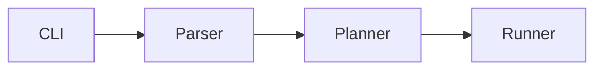

# GitHub-flavored HTML and tricks

## What GitHub keeps vs strips

Stripped: `style`, `class`, `<script>`, `<style>`, `<iframe>`, event handlers, most CSS. `id` and `name` get a `user-content-` prefix (anchor links still work).

Kept and useful:

| Element / attribute | Use |
|---|---|
| `<div align="center">`, `<p align="center">` | Center the hero |
| `<h1>`-`<h6>` with `align` | Centered headings in the hero |
| `` | Size logos, screenshots |
| `<picture>` + `<source media="(prefers-color-scheme: dark)">` | Dark/light logos |
| `<details>` + `<summary>` | Collapse long config, alt installs, FAQ |
| `<kbd>` | Keyboard keys |
| `<sub>`, `<sup>` | Captions, footnotes |
| `<br>` | Line breaks inside HTML blocks |
| `<table>`, `<td align valign width>` | Side-by-side screenshots, sponsor grids |
| `<a href="#anchor">` | Nav row, back-to-top |

Use HTML only where markdown cannot do it (centering, sizing, dark mode, collapsing). npm, PyPI, and crates.io render HTML less faithfully; check there if the README is published to a registry.

Always leave a blank line between an HTML block and following markdown.

## Dark/light logo

```html
<picture>
  <source media="(prefers-color-scheme: dark)" srcset="assets/logo-dark.svg">
  
</picture>
```

## Alerts (callouts)

```md
> [!NOTE]
> Requires Node 20+.

> [!WARNING]
> v3 removes the `--legacy` flag.
```

Types: NOTE, TIP, IMPORTANT, WARNING, CAUTION. Use one or two per README, for things a reader must not miss.

## Mermaid

````md

````

Good for architecture or data flow. It must reflect the actual code.

## Collapsible

```html
<details>
<summary>Other package managers</summary>

```bash
pnpm add pkg
yarn add pkg
```

</details>
```

Blank lines inside `<details>` are needed for markdown to render.

## Side-by-side screenshots

```html
<table>
  <tr>
    <td><br><sub>Light</sub></td>
    <td><br><sub>Dark</sub></td>
  </tr>
</table>
```

## Back to top

```html
<a id="readme-top"></a>
...
<p align="right"><a href="#readme-top">back to top</a></p>
```

Only for READMEs long enough to need it.

## Demo media

- Terminal: VHS (charmbracelet/vhs) tapes are reproducible and versionable; asciinema + agg also works.
- UI: short screen recording exported to GIF or MP4.
- Keep under ~10 seconds and ~5 MB; show the result, not setup.
- An MP4 dragged into a GitHub issue/PR comment yields a hosted URL that plays inline when pasted into the README.
- Always set `alt` text.

## Other embeds

- Star history chart (star-history.com): only once the curve looks good.
- Contributors wall (contrib.rocks): one ``; useful once there are several contributors.
- Relative links (`docs/config.md`) so forks and branches work.
