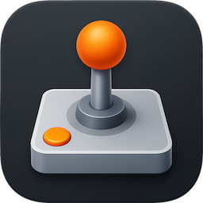

<div align="center">



<h1>OpenJoystickDriver</h1>

<h3>Play Mac games with the controller macOS does not support.</h3>

<p>
  <a href="https://github.com/xsyetopz/OpenJoystickDriver/actions/workflows/ci.yml"></a>
  <a href="https://github.com/xsyetopz/OpenJoystickDriver/releases"></a>
  <a href="https://github.com/xsyetopz/OpenJoystickDriver/releases"></a>
  <a href="https://github.com/sponsors/xsyetopz"></a>
  <a href="LICENSE"></a>
</p>

<p>
  <a href="https://github.com/xsyetopz/OpenJoystickDriver/wiki">Wiki</a> ·
  <a href="https://github.com/xsyetopz/OpenJoystickDriver/wiki/Supported-Controllers">Supported controllers</a> ·
  <a href="CHANGELOG.md">Changelog</a>
</p>

</div>


macOS reads a short list of game controllers and ignores the rest, such as the DualShock 3 above. OpenJoystickDriver (OJD) is a menu-bar app that reads those controllers over USB, Bluetooth or a 2.4 GHz dongle and gives games a virtual Xbox or generic gamepad. A controller macOS already handles is left to macOS. OJD runs in your user session with one DriverKit extension and no kernel extension, so SIP and AMFI stay on.

> [!WARNING]
> Many controllers have no hardware test yet, and some games do not read the virtual controller.
> Check [Supported controllers][wiki-supported] and [Playing games][wiki-games] before you rely on it.

## Quickstart

Requires macOS 12 or later, on Apple silicon or Intel.

1. Download the `.dmg` from the [latest release][releases], drag **OpenJoystickDriver.app** into **Applications** and open it.
2. Click the controller icon in the menu bar. If it shows **Grant Access**, allow OJD in **Input Monitoring** and **Accessibility**.
3. Connect the controller, select it under **Controllers** and click **Open Input Test...** to watch each control respond live.
4. Start a game.

An Xbox One or Series controller on USB also needs the driver extension, under **System Settings** > **General** > **Login Items & Extensions** > **Driver Extensions**. Stuck? See [Troubleshooting][wiki-troubleshooting].

## Features

- 600+ controller records across Xbox, PlayStation, Nintendo Switch, Steam, GameSir, NVIDIA SHIELD, Flydigi and generic HID gamepads.
- Three virtual profiles per controller: `SDLCompatible` (an Xbox Adaptive Controller for SDL games and Steam), `GameControllerCompatible` (an Xbox Wireless Controller for Apple's Game Controller framework) and `Generic`.
- Remapping with combinations, sequences and layers, plus keyboard, pointer and scroll output.
- A live input test for every button, stick and trigger.
- Mods that add controller records, patches, profiles and virtual devices without touching the signed app.
- `ojd`, a command-line tool with JSON output for scripts.

## Usage

Install `ojd` from **Settings** > **Install Command-Line Tool**, which links `/usr/local/bin/ojd`. Check the service, extension and permissions, then list connected controllers:

```bash
ojd status
ojd controller list
```

Start an SDL game with your virtual controllers' mappings in `SDL_GAMECONTROLLERCONFIG`:

```bash
ojd virtual launch /Applications/PCSX2.app
```

Check a mod package, then install it:

```bash
ojd mod install ~/Downloads/my-controller-mod --dry-run
ojd mod install ~/Downloads/my-controller-mod
```

The wiki covers the rest: [Getting started][wiki-start], [Using the app][wiki-app], [Remapping profiles][wiki-remap] and the [Command reference][wiki-cli].

<details>
<summary>Screenshots</summary>


</details>

## FAQ

<details>
<summary>Do I need to disable SIP or AMFI?</summary>

No. OJD needs neither, in any build.

</details>

<details>
<summary>Does it work with Steam?</summary>

Yes, with the `SDLCompatible` profile: Steam read every control and drove the rumble motors on macOS 27. With `Generic`, Steam was erratic and slow to respond. See [Playing games][wiki-games].

</details>

<details>
<summary>Why does my controller work in one app but not another?</summary>

Each app reads controllers through its own API, and some SDL apps cannot read the virtual controller. See [Game does not see the controller][wiki-not-seen].

</details>

## Contributing

Run `./Scripts/ojd setup` and `just check` before opening a pull request; see [CONTRIBUTING.md](CONTRIBUTING.md). Bugs and controller test results go through [Reporting a bug][wiki-bug]. [Sponsorship][sponsor] pays for the controllers and Macs that tests run on; if your company uses OJD, please sponsor it.

## License

[PolyForm Noncommercial 1.0.0](LICENSE) © 2026 Krystian J., from 0.6.0-alpha.2 on. Commercial use needs a separate license; see [COMMERCIAL.md](COMMERCIAL.md). Releases up to and including 0.6.0-alpha.1 are MIT. Xbox and PlayStation are trademarks of Microsoft and Sony; OJD is not affiliated with either.

[releases]: https://github.com/xsyetopz/OpenJoystickDriver/releases
[sponsor]: https://github.com/sponsors/xsyetopz
[wiki-supported]: https://github.com/xsyetopz/OpenJoystickDriver/wiki/Supported-Controllers
[wiki-games]: https://github.com/xsyetopz/OpenJoystickDriver/wiki/Playing-Games
[wiki-troubleshooting]: https://github.com/xsyetopz/OpenJoystickDriver/wiki/Troubleshooting
[wiki-not-seen]: https://github.com/xsyetopz/OpenJoystickDriver/wiki/Troubleshooting#game-does-not-see-the-controller
[wiki-start]: https://github.com/xsyetopz/OpenJoystickDriver/wiki/Getting-Started
[wiki-app]: https://github.com/xsyetopz/OpenJoystickDriver/wiki/Using-the-App
[wiki-remap]: https://github.com/xsyetopz/OpenJoystickDriver/wiki/Remapping-Profiles
[wiki-cli]: https://github.com/xsyetopz/OpenJoystickDriver/wiki/Command-Reference
[wiki-bug]: https://github.com/xsyetopz/OpenJoystickDriver/wiki/Reporting-a-Bug
