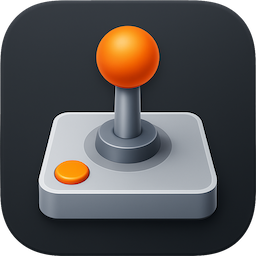
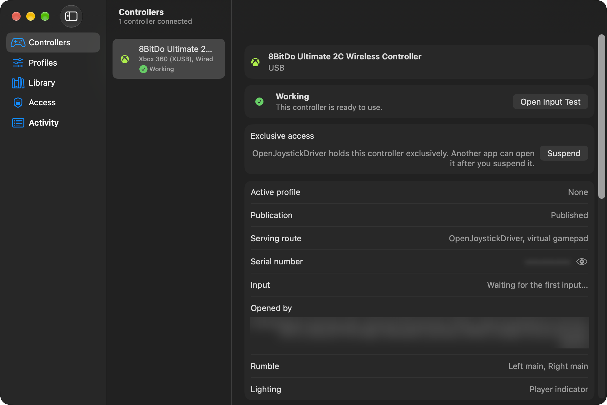
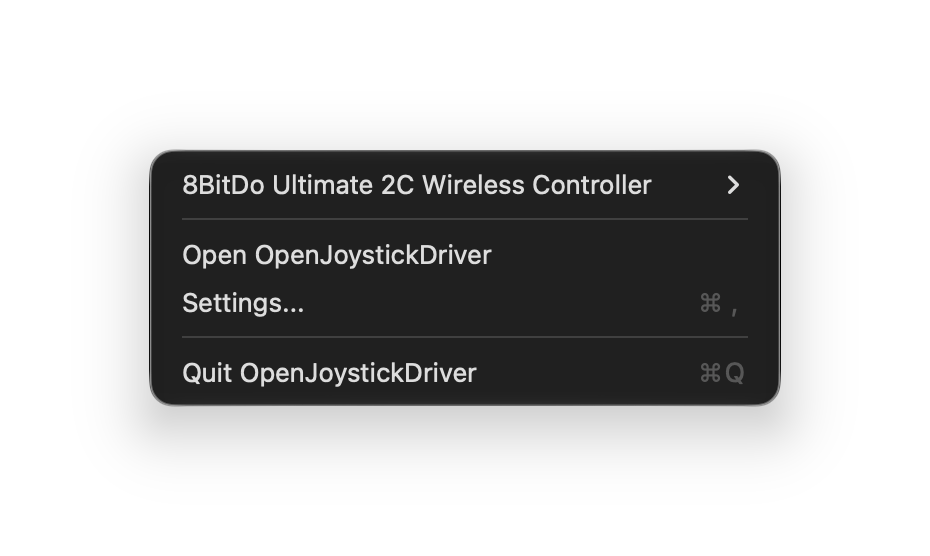
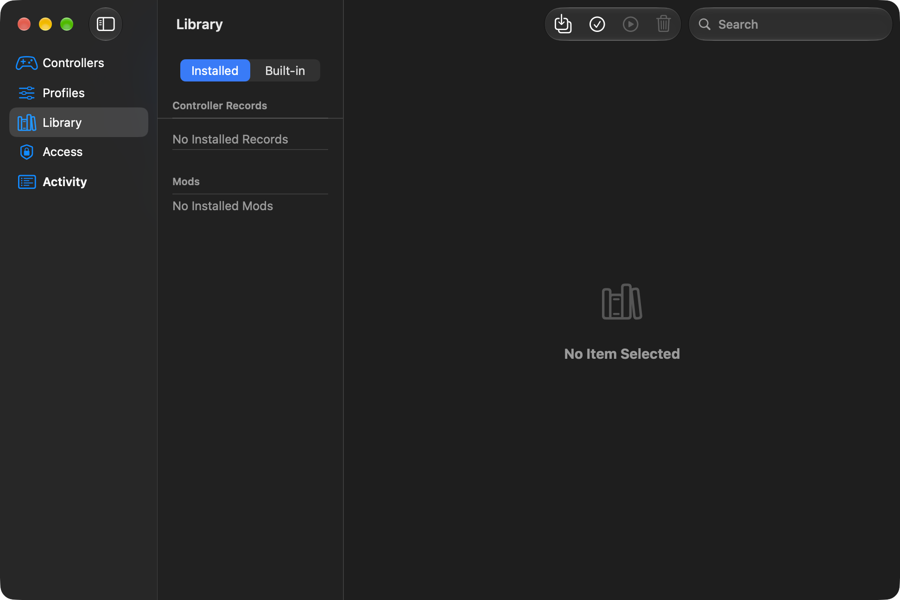
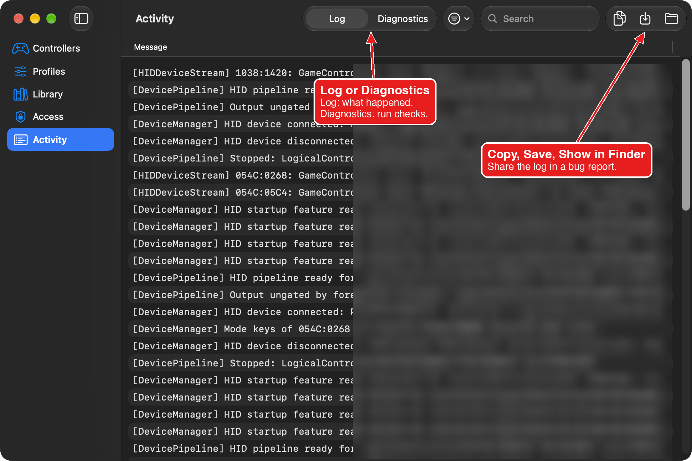
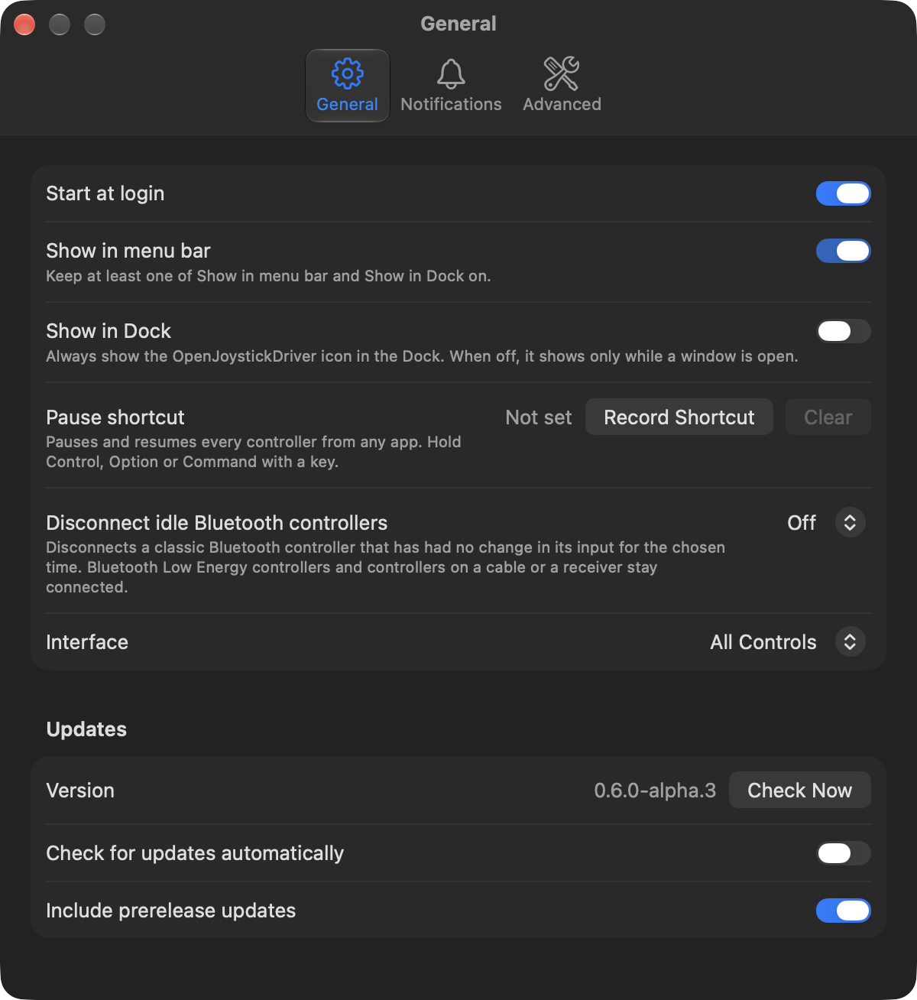

<!-- markdownlint-disable-file first-line-heading no-inline-html -- GitHub centers the banner, badges and details only through HTML. -->
<div align="center">



<h1>OpenJoystickDriver</h1>

<h3>Play Mac games with the controller macOS does not support.</h3>

<p>
  <a href="https://github.com/xsyetopz/OpenJoystickDriver/actions/workflows/ci.yml"></a>
  <a href="https://github.com/xsyetopz/OpenJoystickDriver/releases"></a>
  <a href="https://github.com/xsyetopz/OpenJoystickDriver/releases"></a>
  <a href="https://github.com/sponsors/xsyetopz"></a>
  <a href="LICENSE"></a>
</p>

<p>
  <a href="https://github.com/xsyetopz/OpenJoystickDriver/wiki">Wiki</a> ·
  <a href="https://github.com/xsyetopz/OpenJoystickDriver/wiki/Supported-Controllers">Supported controllers</a> ·
  <a href="CHANGELOG.md">Changelog</a>
</p>

</div>



macOS reads a short list of game controllers and ignores the rest, such as the DualShock 3 above. OpenJoystickDriver (OJD) is a menu-bar app that reads those controllers over USB, Bluetooth or a 2.4 GHz dongle and gives games a virtual gamepad: an Xbox controller, a DualShock 4 or a generic HID gamepad. A controller macOS already handles is left to macOS. OJD runs in your user session with one DriverKit extension and no kernel extension, so SIP and AMFI stay on.

> [!WARNING]
> Many controllers have no hardware test yet, and some games do not read the virtual controller.
> Check [Supported controllers][wiki-supported] and [Playing games][wiki-games] before you rely on it.

## Quickstart

Requires macOS 13 or later, on Apple silicon or Intel.

1. Download the `.dmg` from the [latest release][releases], drag **OpenJoystickDriver.app** into **Applications** and open it.
2. Click the controller icon in the menu bar and choose **Open OpenJoystickDriver**. On **Finish Setting Up**, click **Request...** beside **Input Monitoring** and **Accessibility** (**Device Control and Data Access** on macOS 27) and allow OJD.
3. Connect the controller, select it under **Controllers** and click **Open Input Test** to watch each control respond live.
4. Start a game.

A genuine Xbox One or Series controller on USB also needs the Xbox USB driver: approve it in **System Settings** > **General** > **Login Items & Extensions** > **Driver Extensions** (**Privacy & Security** on macOS 13 and 14). See [Connecting Controllers][wiki-xbox-driver]. Stuck? See [Troubleshooting][wiki-troubleshooting].

## Features

- 700+ controller records across Xbox, PlayStation, Nintendo Switch, Wii and the GameCube adapter, Steam, GameSir, NVIDIA SHIELD, Flydigi and generic HID gamepads.
- Four virtual gamepad kinds per controller:
  - **For Steam, SDL and Apple Game Controller games** (`SDLCompatible`), an Xbox Wireless Controller.
  - **For Apple Game Controller games that use Share** (`GameControllerCompatible`), an Xbox Wireless Controller with Share.
  - **For older Unity games** (`InControlCompatible`), a DualShock 4 that carries rumble to games that use InControl.
  - **Generic HID gamepad** (`Generic`).
- Remapping with combinations, sequences and layers, plus keyboard, pointer, scroll and system actions, and profiles that switch with the app in front.
- A live input test for every button, stick and trigger, a guided check that records which controls respond, and stick, trigger and gyro calibration for each controller.
- Mods that add controller records, patches, protocol descriptions, profiles and virtual gamepads without touching the signed app.
- `ojd`, a command-line tool with JSON output for scripts.

## Usage

Install `ojd` from **Settings** > **Advanced** > **Install Command-Line Tool**, which links `/usr/local/bin/ojd`; the button shows with the **All Controls** interface. Check the service, extension and permissions, then list connected controllers:

```bash
ojd status
ojd controller list
```

Start an SDL game with your virtual controllers' mappings in `SDL_GAMECONTROLLERCONFIG`:

```bash
ojd virtual launch /Applications/PCSX2.app
```

Check a mod package, then install it:

```bash
ojd mod install ~/Downloads/my-controller-mod --dry-run
ojd mod install ~/Downloads/my-controller-mod
```

Ask for each control in turn and see which ones respond:

```bash
ojd controller check VVVV:PPPP
```

Records, patches, profiles and mod manifests are XML property lists (`.plist`) with `apiVersion` `openjoystickdriver/v1alpha4`. OJD converts the files of an earlier alpha when its service starts; `ojd migrate --dry-run` shows what it would convert. Check one with `plutil -lint FILE.plist`, read one as JSON with `plutil -convert json -o - FILE.plist`, and write one from JSON with `plutil -convert xml1 -o FILE.plist FILE.json`.

The wiki covers the rest: [Getting started][wiki-start], [Using the app][wiki-app], [Remapping profiles][wiki-remap] and the [Command reference][wiki-cli].

<details>
<summary>Screenshots</summary>






</details>

## FAQ

<details>
<summary>Do I need to disable SIP or AMFI?</summary>

No. OJD needs neither, in any build.

</details>

<details>
<summary>Does it work with Steam?</summary>

Yes, with the `SDLCompatible` profile: Steam read every control and drove the rumble motors on macOS 27. With `Generic`, Steam was erratic and slow to respond. See [Playing games][wiki-games].

</details>

<details>
<summary>Why does my controller work in one app but not another?</summary>

Each app reads controllers through its own API, and some SDL apps cannot read the virtual controller. See [Game does not see the controller][wiki-not-seen].

</details>

## Contributing

Run `just setup` and `just verify` before opening a pull request; see [CONTRIBUTING.md](CONTRIBUTING.md). Bugs and controller test results go through [Reporting a bug][wiki-bug]. [Sponsorship][sponsor] pays for the controllers and Macs that tests run on; if your company uses OJD, sponsor it.

## License

[MPL-2.0](LICENSE).

[releases]: https://github.com/xsyetopz/OpenJoystickDriver/releases
[sponsor]: https://github.com/sponsors/xsyetopz
[wiki-supported]: https://github.com/xsyetopz/OpenJoystickDriver/wiki/Supported-Controllers
[wiki-games]: https://github.com/xsyetopz/OpenJoystickDriver/wiki/Playing-Games
[wiki-xbox-driver]: https://github.com/xsyetopz/OpenJoystickDriver/wiki/Connecting-Controllers#xbox-usb-driver
[wiki-troubleshooting]: https://github.com/xsyetopz/OpenJoystickDriver/wiki/Troubleshooting
[wiki-not-seen]: https://github.com/xsyetopz/OpenJoystickDriver/wiki/Troubleshooting#game-does-not-see-the-controller
[wiki-start]: https://github.com/xsyetopz/OpenJoystickDriver/wiki/Getting-Started
[wiki-app]: https://github.com/xsyetopz/OpenJoystickDriver/wiki/Using-the-App
[wiki-remap]: https://github.com/xsyetopz/OpenJoystickDriver/wiki/Remapping-Profiles
[wiki-cli]: https://github.com/xsyetopz/OpenJoystickDriver/wiki/Command-Reference
[wiki-bug]: https://github.com/xsyetopz/OpenJoystickDriver/wiki/Reporting-a-Bug
