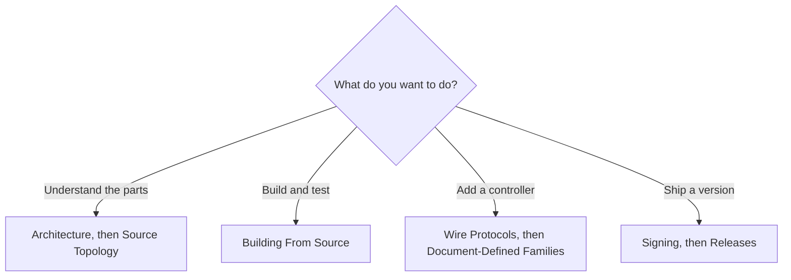

# Contributor Documentation

These pages are for contributors and maintainers. To use the app, read the [user guides](../wiki/Home.md).

## Contents

- [Development](#development)
- [SDK](#sdk)
- [Localization](#localization)
- [Hardware Evidence](#hardware-evidence)

## Development

For contributors who build, sign, or change the app. Start with [Architecture](development/architecture.md).

- [Who Owns a USB Controller: macOS or OJD](development/apple-controller-ownership.md): Who gets a plugged-in controller, macOS or OJD, and how OJD reads it.
- [Architecture](development/architecture.md): How the app, the service, and the Xbox USB driver fit together.
- [Building From Source](development/building-from-source.md): Build and test OJD with `just`.
- [CLI and Application Runtime](development/cli-and-runtime.md): How one program is both the app and the `ojd` command.
- [Compatibility Source Notes](development/compatibility-sources.md): Which outside projects OJD learns controller facts from.
- [Document-Defined Protocol Families](development/document-defined-families.md): Add a controller family with a settings file and no Swift code.
- [Environment Files](development/environment.md): The optional local settings file the scripts read.
- [Experimental Controller Status](development/experimental-controllers.md): Controllers with code but no full test on real hardware.
- [Implementation Status](development/implementation-status.md): What OJD has built so far.
- [InputConfig Preset Library: Import Measurement](development/inputconfig-presets.md): Whether an importer for InputConfig presets is worth writing.
- [Installer Format: DMG or Package](development/installer-format.md): Why OJD ships as a disk image and not an installer package.
- [Interface Audit: 0.6.0-alpha.2](development/interface-audit.md): Every window, menu, and control of one release, checked one by one.
- [Public Endpoint Design](development/public-endpoint-design.md): Why the endpoint, the private door for other programs, works the way it does.
- [Menu-Bar and Settings UI Architecture](development/menu-bar-settings-architecture.md): How the menu-bar and Settings code is split up.
- [Check and Fix a GitHub Release](development/releases.md): Publish a new version.
- [Remapping](development/remapping.md): How profiles change what each control does.
- [Advanced Remapping Controls](development/remapping-advanced-controls.md)
- [Remapping Calibration](development/remapping-calibration.md)
- [Remapping Input Samples](development/remapping-input-samples.md)
- [Remapping Motion Processing](development/remapping-motion.md)
- [Scripting Surfaces](development/scripting-surfaces.md): What Shortcuts, `ojd`, and the endpoint can each do.
- [Signing the App and XboxUSBDevice DEXT](development/signing.md): Sign the app and the Xbox USB driver.
- [Source Topology](development/source-topology.md): A map of the source folders and their layers.
- [Terminology Survey](development/terminology-survey.md): Counts of the words the app and the wiki use for each idea.
- [Create a Local Tester Build](development/tester-builds.md): Make a build for testers.
- [USB DriverKit Entitlement Candidates](development/usb-entitlement-candidates.md): Controllers OJD could ask Apple to let its driver claim.
- [Virtual Profile Selection: What GameController and SDL3 Read](development/virtual-profile-selection.md): Which virtual gamepad both Apple's framework and SDL read.
- [Wire Protocols](development/wire-protocols.md): The languages controllers speak on the cable or radio.
- [Xbox Fallback Identities](development/xbox-identities.md): How the virtual gamepad safely pretends to be an Xbox controller.
- [Import Controller Identities From Linux xpad](development/xpad-import.md): Copy controller IDs from Linux xpad and SDL with a script.

## SDK

For developers who write a client for the local endpoint.

- [SDK Endpoint](sdk/endpoint.md): Handshake, messages, errors, and grants.
- [WebRTC Bridge](sdk/webrtc-bridge.md): Carries a controller between two Macs.

## Localization

For translators and reviewers.

- [Localization Review 0.6.0](localization/review-0.6.0.md): The 20 non-English locales.

## Hardware Evidence

For testers who check a controller and for maintainers who judge compatibility claims. Read [Consumer-Binding Evidence](testing/consumer-binding.md) first, then [Test a Controller Record](testing/controller-record.md).

- [8BitDo Tester Checks](testing/8bitdo-tester-checks.md)
- [8BitDo Ultimate 2](testing/8bitdo-ultimate-2.md)
- [8BitDo Ultimate 2C Wireless](testing/8bitdo-ultimate-2c.md)
- [Browser Gamepad API Manual Evidence](testing/browser-gamepad-api.md)
- [Consumer-Binding Evidence](testing/consumer-binding.md)
- [Test a Controller Record](testing/controller-record.md)
- [Flydigi Tester Checks](testing/flydigi-tester-checks.md)
- [Flydigi Apex 4 (DInput)](testing/flydigi-apex-4.md)
- [Flydigi Vader 4 Pro (Bluetooth)](testing/flydigi-vader-4-pro.md)
- [Flydigi Vader 5 Pro 2.4 GHz Dongle](testing/flydigi-vader-5-pro.md)
- [Flydigi Vader 5S (USB)](testing/flydigi-vader-5s.md)
- [Test the GameSir G7 Pro, Cyclone 2, and G7 Pro 8K PC](testing/gamesir-family.md)
- [Gyro-to-Stick Hardware Check](testing/gyro-stick.md)
- [Probe macOS Haptics Backends](testing/haptics-backends.md)
- [Joy-Con Input Validation](testing/joy-con.md)
- [Test Logitech F310 XInput Mapping](testing/logitech-f310.md)
- [Test the Nacon Revolution X Pro](testing/nacon-revolution-x.md)
- [NITHO MLT-KRMA-K Test Record](testing/nitho-mlt-krma-k.md)
- [Test Physical Output](testing/physical-output.md)
- [Test Razer Wolverine V3 Tournament Edition](testing/razer/v3-te.md)
- [Testing the Razer Wolverine V2](testing/razer/wolverine-v2.md)
- [Test the SCUF Envision Pro](testing/scuf-envision-pro.md)
- [SIXAXIS and DUALSHOCK 3](testing/sixaxis-vs-ds3.md)
- [Third-Party PS3 Controllers](testing/ps3-third-party.md)
- [Third-Party DualSense Controllers](testing/dualsense-third-party.md)
- [Wired Switch Input-Only Pads](testing/switch-input-only.md)
- [Test Switch 2 Controllers](testing/switch-2.md)
- [Steam Controller (2026, Triton)](testing/steam-triton.md)
- [Test Steam Controller Hardware](testing/steam-controller.md)
- [Test the Steam Deck Controller](testing/steam-deck.md)
- [Test a Tester Build](testing/tester-builds.md)
- [Test WR-007 USB HID Receiver](testing/wr-007.md)
- [Test an Xbox 360 Wireless Receiver](testing/xbox-360-wireless-receiver.md)
- [Capture Xbox Adaptive Joystick Packets](testing/xbox-adaptive-joystick.md)
- [Xbox Nano Controller Test Record](testing/xbox-nano.md)
- [Xbox One Controller Model 1537 (`045E:02D1`) Detection](testing/xbox-one-02d1.md)
- [Test Microsoft Xbox One Controller (Model 1537)](testing/xbox/1537.md)
- [ZD O+ in Switch Mode](testing/zd-o-plus.md)
