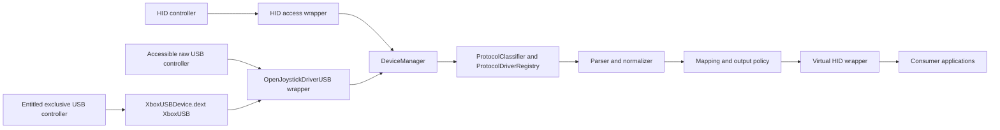
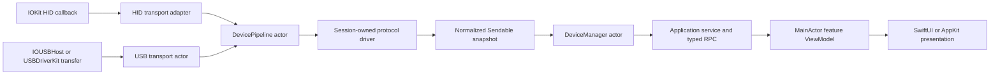
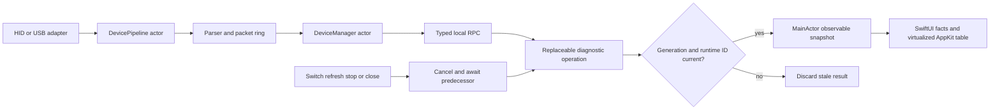
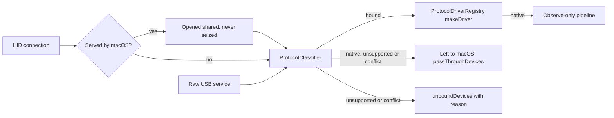
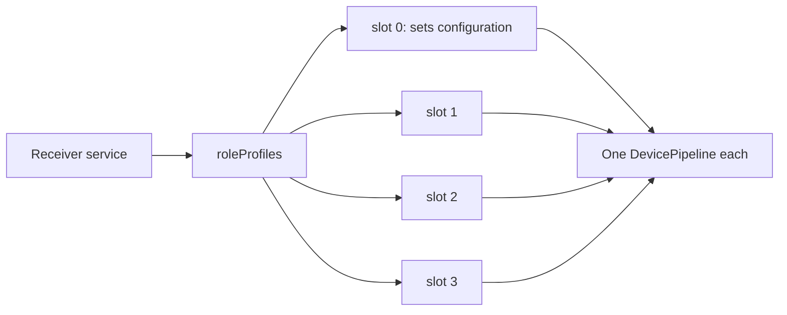

# Architecture

OpenJoystickDriver ships one application bundle, one persistent host process, and one generated DriverKit system extension, `com.openjoystickdriver.XboxUSBDevice`, with one personality, XboxUSB.

The app owns controller semantics, virtual output, authenticated local commands, and the menu and settings UI, and opens most accessible raw USB interfaces directly. XboxUSB owns only devices under OJD's Apple-issued USB transport entitlement.

## Controller Ownership and Concurrency

`DeviceManager` is the inventory actor. It alone owns physical discovery and exact-device selection, and creates, replaces, and stops one `DevicePipeline` actor per protocol role ([Composite devices and roles](#composite-devices-and-roles)). The pipeline owns its protocol driver, normalized state, transport coordination, and tasks.

- HID and USB adapters own platform handles and copy callback and transfer data.
- Decoding and controller state changes run only on the pipeline actor, never on `@MainActor`.
- `PhysicalProtocolDriver` is not `Sendable`; it moves once into its session.
- USB startup, keep-alive, and physical output are parser-produced value plans that the transport session runs. Decoding objects do no device I/O.
- Replacement and shutdown cancel and await session tasks first. A platform open without a session cannot block shutdown: its late result sees the inactive generation and closes unpublished.
- @MainActor owns only application, window, menu, panel, and observable presentation state.

### Developer Diagnostics Lifetime

Diagnostics observe service-owned sessions and open no second reader. One replaceable operation owns the controller snapshot and packet-capture request; replace, refresh, stop, and close cancel and await it first. A result publishes only for the current generation and session token.

Packet differencing, classification, and bulk formatting stay off @MainActor, which publishes bounded, derived snapshots. Raw capture is authoritative for copy and export.

## Source and Sink Boundary

Two platform-free protocols in `Streaming/` carry input. An `InputSource` has an `origin` and a `sink`, and sends each canonical `StreamFrame` with `produce(_:onDelivered:)`. An `OutputSink` has a `destination`, consumes frames or output commands, and refuses other shapes with `StreamBoundaryError.unsupported`. `onDelivered` runs when the frame reaches the destination, where delivery stamps are taken. All paths are compiled in.

| Path | Source (`origin`) | Sink (`destination`) |
| --- | --- | --- |
| Physical controller to virtual device | `DevicePipeline` (physicalController) | any `OutputDispatcher` (virtualDevice; diagnosticLog for `LoggingOutputDispatcher`) |
| Output activation | DevicePipeline, and the remapping router's route for a controller | the same OutputDispatcher, through `StreamFrame.activation` |
| Virtual feed | `VirtualFeedRegistry` session (virtualFeed, or endpointFeed for the endpoint pool) | `VirtualFeedDeviceSink` (virtualDevice) |
| Endpoint feed client to feed queue | `EndpointFeedSource` (endpointFeed) | `VirtualFeedIntakeSink` (virtualDevice), through `StreamFrame.feed` |
| Host feedback to an endpoint feed client | the feed's virtual device, through the registry | `EndpointFeedReturnSink` (endpointFeedClient), through `consume(_:for:)` |
| Endpoint `Controllers` stream | `EndpointStreamSource` (endpointStream) | `EndpointSubscribers` (endpointSubscription) |
| Physical output commands | the service's output requests | DeviceManager (physicalOutput) |
| Mapped physical output | `RemappingPhysicalOutputBridge` | DeviceManager (physicalOutput), through `MappingOutputClaim`, `MappingOutputRelease` and `ProfileColorClaim` |

The registry delivers host output commands to a feed's return sink in order, one task at a time, held until the client has its `FeedSession` line.

## Classification and Binding

`ProtocolClassifier` (`OpenJoystickDriverKit/Protocol/Classification/`) selects one protocol from observed `PhysicalDevice` facts, with no I/O. Precedence:

1. The exact catalog row for the VID/PID, whose family must match the access path (raw USB or HID).
2. An interface class/subclass/protocol signature pinned to Linux `xpad.c` (XID `58/42/00`, XUSB wired and receiver, GIP on interface 0).
3. The device-descriptor GIP triple `FF/47/D0`, only on an unconfigured device that exposes no interface facts.
4. `HIDDescriptor`, only on IOHID and only after `HIDDescriptorContract` accepts the report descriptor. A catalog row naming it must pass the same contract.

A catalog row naming `HIDReportLayout` carries a `ControllerInputLayout`, from which `ReportLayoutDriver` decodes the raw report. No signature selects that family.

A validation failure never falls to a lower level, and no device gets a generic HID parser. The result is `.bound(ProtocolBinding)`, `.unsupported(reason)`, or `.conflict(reason, candidates:)`. `ProtocolBindingReason` has exactly twelve IDs: NoProtocolMatch, AmbiguousProtocolMatch, InterfaceContractMismatch, DescriptorContractMismatch, UnsupportedProtocolVariant, UnsupportedTransportVariant, VirtualProfileUnavailable, DeviceInUse, ConfigurationUnreadable, BootloaderIdentity, NoModeMatched, NoControllerLinked.

Each ID has a sentence (`ui.controllers.<id>`) and next step (`ui.controllers.<id>.nextStep`) in every language. `idle: NoControllerLinked` gives NoControllerLinked; `idle: Bootloader` gives BootloaderIdentity. NoModeMatched covers a record with no `default` or selected mode, a probe with no route, or a probe with no usable reply.

A `ProtocolBindingID` is `family[:variant]`, such as `XboxXUSB:Receiver`. The variant is required exactly when the family declares variants. Records store one only when the transport cannot decide it.

`ProtocolDriverRegistry` builds `PhysicalProtocolDriver` values from one exhaustive switch over `PhysicalProtocolID`:

- `runtimeProfile(for:)` returns the binding's catalog record, or the family defaults for a signature binding (GIP sets configuration 1 before the claim).
- `makeDriver(for:identifier:claimed:)` is the only runtime factory. A raw-USB binding passes its claimed facts, whose interface contract must hold before a driver exists. HID bindings pass none; classification checked their descriptor contract.
- `makeUnobservedDriver` serves only profile capabilities and record rendering. Unbound devices get no driver.

A driver's `DriverSessionPlan` fixes its report liveness timeout and whether output waits for a receiver presence connect.

Native gamepads are observed and remapped:

- A device is native when `GCController.supportsHIDDevice` is true and its record states `server: System`, or states no `server` and GameController lists a controller for it (`HIDDeviceStream.nativePassThrough(supportsHIDDevice:listing:statedServer:)`). The stream matches a listed controller by `vendorName` equal to the HID `Product` string.
- A device counts as native for 1 s after it arrives. Then the stream reads `GCController.controllers()`, and OJD seizes and serves a device GameController does not list. A `server: OJD` record is seized at once. Its `systemListsGameController` follows the same listing, so the second-controller warning appears only when macOS lists a controller for it.
- A native device is opened shared, never seized, stays out of location ownership and disconnect coalescing, and is classified and bound like any HID device.
- Its pipeline carries a `MacOSOwnedOutput` allowance: the family default (`macOSOwnedOutput` in `Resources/Protocols/*.plist`) plus the record's `session.rumble` report. OJD sends no startup, feature, status, periodic, shutdown, or recovery report and reads no feature report unless the allowance says so (motion keeps nominal calibration). Write executors refuse any report the allowance does not name by kind, ID, and length.
- Only the DualShock 3 / Sixaxis description sets a default: output report 0x01 with player 1, sent after the first input report and on player-indicator requests, because macOS never sets its LED. On USB the Sixaxis sends no input until the host reads feature 0xF2, so OJD makes the driver's F2 and F5 reads at bind. The Ant Esports GP100 record adds vendor rumble report 0x02. No other record names a template.
- Its `physicalOwnership` is `SystemGamepad`, so `ServingPolicy` decides `nativePassThrough` for every intent and OJD never publishes a virtual gamepad for it.
- Remapping profiles run on its input; a profile needing exclusive input or a virtual gamepad is ineligible. While no route selects the controller, its pipeline parses reports but dispatches nothing (`ObservedInputDemand`). Element values go only to a driver whose `DriverSessionPlan.parsesHIDElementValues` is set.
- A user-requested wireless disconnect still applies. macOS keeps every other HID interface at its location: OJD never seizes it, tears down any pipeline bound there, releases its claim, and routes none of its input. Such an interface that connects after the native one, and a native device no driver binds, go under `passThroughDevices`; one rejected earlier stays under `unboundDevices`.
- Location 0 identifies no controller and is never shared.

`unboundDevices` in the service payload records backend, reason, interface summaries, and rejected candidates. Each bound controller carries its binding result: rule, matched predicates, and catalog record ID. Support reports include both. `status` prints them under `Unbound devices` and `Left to macOS`, and `status --json` carries both arrays. OJD keeps its input claim on a rejected HID connection only while a bound pipeline shares its controller or routing location; otherwise macOS keeps the device.

Under the Automatic intent, `AutomaticUserSpaceOutputDispatcher` publishes one virtual profile per eligible controller, which `VirtualHIDProfileSelector` chooses from the declared controls alone: SDLCompatible (`045E:0B0C`) when it can carry every primary control, otherwise Generic. Both carry every primary control, so Automatic selects SDLCompatible. GameControllerCompatible (`045E:0B13`) is published only on an override.

The catalog comes from Linux `xpad.c`, SDL `controller_list.h`, and SDL_GameControllerDB, pinned in `ControllerSources.lock.json`, plus authored overrides; see [xpad import](xpad-import.md). A HID pad with no record whose descriptor passes the contract is matched by SDL GUID against the database's Mac lines. The registry computes the GUID and passes the converted `HIDUsageMap` to `HIDDescriptorDriver`, keeping the classifier pure. The binding result carries an `inputMapping` fact: Record, SDLGameControllerDB, StandardHIDUsageMap, or None.

## Composite Devices and Roles

One physical device can expose several protocol roles, each with its own pipeline and logical controller. Only the Xbox 360 wireless receiver (raw USB) and Steam Controller (HID) declare more than one.

### Identity

- `ControllerModelID` (`Device/ControllerModelID.swift`): VID and PID only. Every unit of a model shares it, and records are found by it.
- `ControllerHardwareIdentity` (`Device/ControllerHardwareIdentity.swift`): VID, PID, and serial number (an empty serial is stored as nil).
- `LogicalControllerID`: a ControllerHardwareIdentity plus `locationID` and `interfaceNumber`. The interface number is part of equality, the runtime token, and `description` (`if=N`). Raw USB keys carry the claimed interface, HID keys only for a HID role, and Bluetooth keys none.

`UserSpaceVirtualDeviceConstants.stableKey` (`HID/PhysicalHIDTrackingStateMachine.swift`) hashes `VID:PID:serial:location:interface` with FNV-1a into the virtual serial and LocationID. Each role gets its own virtual identity, and the hardware serial stays hidden.

`DeviceManager.isSamePhysicalController` treats two keys from different services as one controller when they share a ControllerHardwareIdentity and a serial number or location. A raw-USB admission conflicts when its exact key already runs or the same controller runs through another service. Roles of one service never conflict.

OJD never migrates stored files in place. A file keeps working as written, or OJD skips it, reports it, and leaves the bytes unchanged. User records are named `vvvv-pppp.plist` after `vendorID` and `productID`. A record with an unsupported `apiVersion` is dropped (`ControllerRecordSetTests.aStoredFileKeepsWorkingOrIsDroppedUnchanged`).

### Raw-USB Roles

`ProtocolDriverRegistry.roleProfiles(for:resolution:)` returns the roles of one claim. An `XboxXUSB:Receiver` binding whose row pins no interface or endpoint gets one role per qualifying interface: alternate setting 0, triple FF/5D/81, one interrupt IN endpoint, and one interrupt OUT endpoint, as `xpad_probe` checks. Roles sort by interface number, capped at four. A role's index is its slot ordinal.

Every other family, a pinned receiver row, and a receiver with no qualifying interface run one role.

- Admission is atomic per service. `startUSBRoles` starts roles in order; a conflict, driver failure, or lost generation stops every started role and returns `.retry`, so the next poll admits the service whole.
- Detach removes every role of the service in one pass (`removeUSBRole`, also used by rollback).
- Only slot 0 keeps `needsSetConfiguration`. `IOUSBHostTransportProvider` also skips SET_CONFIGURATION when the current configuration equals the requested one (`USBTransportOpenOptions.setsConfiguration(current:)`), because it terminates every open interface. A slot 0 reopen leaves slots 1 to 3 running. GIP rows that set configuration 1 follow the same rule.

### HID Roles

`ProtocolDriverRegistry.hidConnectionRole(of:)` returns `.location`, `.interface(n)`, or `.notARole`. Only ValveSteamController declares roles. A connection is a role when its report descriptor has a Feature item (`steam_is_valve_interface` in `hid-steam.c`) and OJD observed its parent USB `bInterfaceNumber`; otherwise it is .notARole. Every other family is .location: one controller per routing location, keyed without an interface.

Input from a role connection routes to that connection's key only (`hidPipelineKey`). Other connections route by location to keys without an interface. Role writes, startup feature reads, and disconnects target one connection. Ownership stays per location: seizing, releasing, or reacquiring one role's interface acts on every interface there, as does claim release on rejected connections.

### Assembly Hook

A catalog row may name a `ControllerAssemblyPolicy` in `protocol.assembly` to combine roles into one logical controller. The vocabulary is empty: the schema enum is `[]` and the decoder rejects every name. `handleHIDDeviceConnected` reads `ProtocolDriverRegistry.assemblyPolicy(for:)` through an exhaustive switch, so the first policy must add its branch there. Until then one role is one logical controller.

### Receiver Presence

`XUSBDriver(slotOrdinal:)` builds one receiver slot (0 to 3; other values fail). Its startup write is the presence inquiry `08 00 0F C0 00…` (12 bytes, from `xpad.c`), which tolerates rejection. A presence notification or valid pad report connects the slot. Empty slots are unlisted and publish no output. On connect the manager assigns a player indicator. Each transport session resets presence.

## Platform Split

Deployment floor: macOS 12 and DriverKit 21. HID uses IOKit on every supported macOS, so no HID path selects by OS version.

| Capability | macOS 12+ |
| --- | --- |
| Physical HID discovery and reports | `IOHIDManager` / `IOHIDDevice` |
| Consumer virtual HID | `IOHIDUserDevice` |
| Raw/custom USB | app-side IOUSBHost or restricted USBDriverKit DEXT |

`IOHIDUserDevice` is the only virtual HID publisher. The app and service call `IOHIDUserDeviceCreateWithProperties` (available from macOS 10.15, not deprecated), which needs `com.apple.developer.hid.virtual.device`. The DEXT publishes no HID device, and the package does not link CoreHID.

Publishing is one such call with the profile's complete identity properties and no fallback set. On macOS 27 the device reports Transport as Virtual whatever the profile requests.

## Switch 2 Bluetooth LE

Switch 2 controllers over Bluetooth speak only GATT, invisible to IOHID. `Switch2BluetoothLECentral` (`OpenJoystickDriverService`) owns CoreBluetooth on one serial queue, connects to advertised Switch 2 products, and hands each ready link to `Switch2BluetoothLEHub` (`OpenJoystickDriverKit`, no CoreBluetooth import) through the `Switch2BluetoothLEWriter` protocol.

The hub gives each link a synthetic routing location from `0xB1E0_0000` upward. `BluetoothLECompositeHIDBackend` merges hub connections into the IOHID event stream and routes output by location.

`BluetoothLECompositeUSBTransportProvider` opens a hub location as a `Switch2BluetoothLECommandSession`: bulk OUT writes go to the command characteristic and bulk IN reads return reply notifications. Switch2Driver runs unchanged over both links, apart from its transport byte. The merged stream ends with the IOHID stream, so an IOHID access failure also stops the Bluetooth LE pipelines until detection restarts.

Not verified: the synthetic location range is free of IOHID locations.

## USB Transport Boundary

`OpenJoystickDriverKit` owns the `USBTransportProvider` and `USBTransportSession` ports plus all parsing and policy, and never imports SwifterKit. `OpenJoystickDriverUSB` is the app-side facade with one route-tagged API. Its direct backend opens accessible vendor-specific interfaces with IOUSBHost. Its USBDriverKit backend talks to the restricted DEXT.

Routes follow ownership evidence:

| Case | Route |
| --- | --- |
| Service exposed by the DEXT | Stays on the DEXT |
| Model under the production USB transport entitlement | Never falls back to direct app-side access |
| Other raw USB controller | IOUSBHost, when macOS lets the app own its interface |
| Failed open | Reported, not retried through another route |

### Descriptor Facts

- `OpenJoystickDriverKit/Device/PhysicalInterfaceSignature.swift` holds `PhysicalDevice`, `PhysicalInterfaceSignature` (one per alternate setting), and optional `PhysicalEndpointSignature`.
- Absent passive fields stay `nil`; a missing configuration descriptor is `interfaces == nil`.
- Direct IOUSBHost has no `DeviceAccessBackend` value. An observed DEXT route maps to USBExtension.
- `IOUSBHostPassiveUSBRegistrySource` reads `bcdDevice` ([Apple's key][1]) into `PhysicalDevice.deviceRelease` when it is an unsigned 16-bit value. Not verified: availability on any physical device.
- Enumeration admits catalog rows that declare raw USB access. `TransportFacade` also admits an uncatalogued IOUSBHost device with a known Xbox signature (`ProtocolDriverRegistry.carriesProtocolSignature`). `resolveTransport` returns the catalog endpoint profile and an optional PhysicalDevice.
- USBDriverKit keeps the configured profile plus a limited snapshot from its cached `DriverService`: `service.id`, VID/PID, product and serial properties, and the physical location when present. It marks host transport `.usb`, backend USBExtension, route `.usbExtension`; all other facts stay nil. `USBTransportDevice.locationID` stays a routing value and may use low service-ID bits.
- `USBDiscovery` accepts a snapshot only when its `serviceAddress` matches the enumerated route and service, rechecked after the await. Detach removes a pipeline only if the current record has the same raw USB snapshot, so a HID takeover with the same identifier survives.
- Observation needs a unique registry root with the exact `IORegistryEntryGetRegistryEntryID` service ID and matching VID/PID/location, with no location-only fallback. Not verified: live registry correspondence on hardware.

### Enumeration and Admission

- `USBEnumerationTracker` emits typed attach, detach, and access-failure deltas over exact service snapshots. A provider failure keeps acknowledged services and synthesizes no detach. Changed facts under one service identity give the old detach, then the new attach. `.retry` stays eligible on the 500 ms cadence.
- Admission checks the lifecycle generation and cancellation before event processing and after each await. `stop()` does not await a noncooperative provider. A stale candidate inserts no state.
- Open: per-interface access-failure recovery, suspend and resume, hardware validation.

### Interface Contract Check

The IORegistry publishes no endpoint descriptors, and an unconfigured device no interfaces. When passive facts cannot resolve an interface with endpoints, `USBTransportProvider.resolveUSBConfiguration` reads the descriptor of configuration 1 through `IOUSBHostTransportProvider.cachedConfigurationDescriptor`, with no SET_CONFIGURATION or claim.

`ProtocolDriverRegistry.makeDriver` then checks the claimed interface number, alternate setting, class triple, and interrupt endpoint pair, before the driver exists and before any SET_CONFIGURATION or protocol write. A failure is unbound with `interface-contract-mismatch`. Catalog endpoint pins stay authoritative; OJD confirms they are interrupt IN and OUT endpoints of the claimed interface. A device with an unreadable descriptor does not run. `DeviceManager.handleUSBConfigurationReadFailure` decides each failure:

| Failure | Result |
| --- | --- |
| Host refuses the read (`accessDenied`) and reports an exclusive owner (`USBTransportProvider.exclusiveOwner(of:)`) | Service stays unclaimed, reason DeviceInUse. `releaseHeldUSBServices` reads the owner once per poll and admits the service when the host reports none. An unreadable owner changes the reason to ConfigurationUnreadable and ends the watch. |
| Refusal with no reported or readable owner | ConfigurationUnreadable at once |
| Any other failure | Read again next poll, at most `usbConfigurationReadAttempts` (5) in a row, then ConfigurationUnreadable |

Both reasons wait for re-enumeration. The DriverKit route reports no interface facts: a catalog row claimed there runs on its record alone, and a signature binding fails closed. Family-default endpoints never replace an unreadable descriptor. The HIDTool record probe validates the same way.

The GIP parser resends its startup sequence when the controller announces before its first input: on the first announce and every fourth after, at most eight times.

Not verified: any live extension service, device, or hardware observation. The DEXT snapshot derives from synthetic and cached properties, and its entitlement does not cover the other catalog raw-USB identities. The access-route decision is open.

### Diagnostics and HID Facts

- The USB diagnostic scanner keeps a route-only DEXT snapshot. A catalogued model stays unclassified until its predicates' facts are observed: interface number, alternate setting, class/subclass/protocol, and endpoints with address, direction, and transfer type (HID interfaces also need collection and element facts). A partial snapshot never becomes a negative `unsupported` result. A parsed configuration with no interfaces is `[]`, complete negative evidence.
- HID `.connected` events carry immutable PhysicalDevice facts from IOHID: descriptor bytes and hash, usage pairs, report IDs, and maximum report sizes when exposed. The routing location stays separate from the optional physical location. `kIOHIDManufacturerKey` is kept as reported, never inferred from VID. Only explicit USB and Bluetooth Low Energy values give a typed host transport.
- `DeviceInfo` keeps the snapshot through HID ownership reacquisition. A HID disconnect clears state only when its connection token and snapshot match the current connection. A full stop clears snapshots and cancels and awaits the permission watcher and HID detector before HID initialization. HID work revalidates pipeline, token, and snapshot after each await. Not verified: any physical HID send.
- `DeviceAccessBackend` values: HID, RawUSB, USBExtension, GATT. `usesRawUSB` is true for RawUSB and USBExtension. A `HIDDeviceConnection` is GATT for a `gattPeripheral` address (Switch 2 over Bluetooth LE), otherwise HID.
- A non-success `IOHIDManagerOpen` result arrives as `HIDDeviceEvent.accessFailure` with its `IOReturn`; cancellation is not an access failure. The manager clears HID pipelines and snapshots, awaits pending initialization, and removes only state matching what it captured first. The one-second permission watcher retries.

### Sleep and Wake

- Sleep tears every controller down through `DeviceManager.stop()`. OJD sends physical outputs and HID shutdown reports while the HID session is open, then stops pipelines, detection, and timers. Wake calls `start()`. Once teardown starts, output guards accept only writes inside the `ControllerTeardownOutput` task-local scope.
- Manual suspension lasts for the exact controller identity until `controller resume`, a physical disconnect, or stop(), so it survives sleep.
- `SystemPowerNotificationObserver` acknowledges a sleep with `IOAllowPowerChange` once, after teardown returned. macOS forces the sleep after 30 s. See [Wire Protocols](wire-protocols.md#coded-behavior).
- Open: retry cap or backoff while permission stays granted, USB access-failure recovery, both route mappings, hardware qualification.

### DriverKit Extension

- `DriverKitGenerator` consumes the sole `USBDriverKitExtensionConfiguration`. Development and production both match only Apple's approved Microsoft pairs: `045E:02D1`, `045E:02DD`, `045E:02E3`, `045E:02EA`, `045E:0B00`, `045E:0B0A`, `045E:0B12`.
- The XboxUSB personality uses bundle identifier `com.openjoystickdriver.XboxUSBDevice`, provider `IOUSBHostInterface`, configuration 1, interface 0, class `0xFF`, subclass `0x47`, protocol `0xD0`.
- Third-party GIP controllers such as 3537:1010 stay on the direct IOUSBHost route.
- The DEXT parses no controller protocol. Its entitlements are exactly the DriverKit base and the USB transport value of Apple's grant. `com.apple.developer.hid.virtual.device` belongs only to the app, whose DriverKit user-client allowlist is exactly com.openjoystickdriver.XboxUSBDevice. Allow-any access is forbidden.
- See [Apple controller ownership evidence](apple-controller-ownership.md) for entitlement scope.
- Builds write `.build/driverkit/generated/` and `.build/driverkit/derived-data/`; never edit or commit them. `just driverkit-check` checks entitlement, personality, determinism, dependency direction, and an unsigned universal build.

[1]: https://developer.apple.com/documentation/iousbhost/iousbhostmatchingpropertykey/devicereleasenumber

## Process and Command Lifecycle

The signed app starts the runtime, one status item, and one reusable settings window. Closing the window keeps controllers running. SIGTERM and SIGINT stop the runtime cleanly.

Headless commands run the same executable and reach live state through the Unix-domain socket `/tmp/com.openjoystickdriver.<uid>.rpc` (mode `0600`). The server requires the same user, signing identifier, and team identifier. Frames and deadlines are bounded.

Repository-built CLI commands forward to the installed signed executable when available, keeping `swift run` and `.build` commands inside the RPC authentication boundary. Forwarding stops when the installed executable is older than the sources.

## Permissions

| Action | Permission |
| --- | --- |
| Virtual HID creation | Input Monitoring and Accessibility, on every supported macOS |
| Remapped keyboard, pointer, scroll events | CoreGraphics post-event access, separately |

Not verified (an unsigned build cannot prove them): hardware access, signing, activation, permission behavior.

## Further Reading

- [Source Topology](source-topology.md)
- [CLI and Application Runtime](cli-and-runtime.md)
