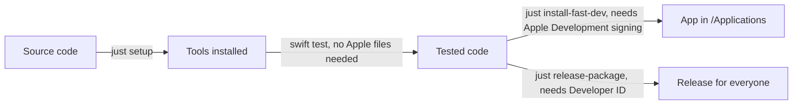

# Building From Source

How to turn the source code into a working app on your own Mac. Run everything through `just`, a list of ready-made commands (recipes). `just` on its own lists them.



## What You Need First

| Need | Detail |
| --- | --- |
| Xcode | Opened once, for the macOS SDK and `xcodebuild`. `Package.swift`: swift-tools-version:6.4.0, oldest macOS 13. CI: Xcode 27.0, xcode-27 runner. Without Xcode, see [Building Without Xcode](#building-without-xcode). |
| Swift toolchain | With Xcode, use Xcode's, at least `.swift-version` (6.4.0, the oldest that builds the package). `Scripts/Platform/environment.sh` runs before every Swift command: it puts `$DEVELOPER_DIR/Toolchains/XcodeDefault.xctoolchain/usr/bin` first on `PATH` and stops when that `swift` is older. Without Xcode, use a swift.org toolchain that swiftly installs. |
| Homebrew | Install `just` first. `just setup` installs the pinned Swift toolchain (when swiftly is present), swiftlint, ruff, and shellcheck (when missing), and sets the Git hooks path. |
| Python 3 | `just schema-env` sets up the Python tools that check schemas. |

These need full Xcode, not only the Command Line Tools: check-profiles, check-schemas, driverkit-check, catalog-regenerate, errors-regenerate, diagnose-record, test-parsers-macos14, build-dext, and every release recipe. The first four build OJDRepositoryTool, the only tool that checks controller records, protocol descriptions, profiles, and personas. It also prints fixed values that Swift owns, such as apiVersion and the `ojd` exit statuses. `build-dev`, `install-dev`, and `install-fast-dev` also run without Xcode; see [Building Without Xcode](#building-without-xcode).

Clone and set up:

```bash
git clone https://github.com/xsyetopz/OpenJoystickDriver.git
cd OpenJoystickDriver
just setup
```

## What Each Set of Apple Signing Files Unlocks

| Signing files | Works | Doesn't work |
| --- | --- | --- |
| None | `swift build`, `swift test`; `just check-profiles`, `check-schemas`, `driverkit-check`; `just catalog-regenerate --check`; `just driverkit-generate`; `just test-parsers-macos14`; `just diagnose-record <json> --validate-only`; the checks in [`CLAUDE.md`](../../CLAUDE.md) | Any `build` command, any install, live USB tests through the DEXT |
| Apple Development identity and the two development profiles | `just build-dev` (signed app bundle, no DEXT); `build-dext` (DriverKit extension embedded into the app in `.build/`); `install-dev` (full rebuild and install); `install-fast-dev` (app-only rebuild, keeps the installed system extension) | `package-tester` and `release-*` recipes |
| Developer ID identity, Developer ID profiles, and notarization credentials | `build-release`, `install-release`, `package-tester`, `release-package`, `release-local-install` | Nothing more. These are for maintainers |

| Note | Detail |
| --- | --- |
| Development signing | build-dev, build-dext, install-dev, and install-fast-dev need `.env.dev`, both profiles, and matching Keychain identities. Run `just signing-install-profiles` and `just signing-configure`. |
| Ad-hoc signing | `build-dext` stops with "DriverKit extensions cannot use ad-hoc signing" when `CODESIGN_IDENTITY` is unset or `-`. |
| Host entitlement | The host app needs `com.apple.developer.hid.virtual.device`, and the build refuses a host profile without it. The development profile's device list must include your Mac. If it doesn't, macOS ignores the entitlement when the app runs, and making the virtual gamepad fails. See [Signing](signing.md). |
| DEXT | `com.openjoystickdriver.XboxUSBDevice` carries only `com.apple.developer.driverkit` and the Apple-issued restricted USB entitlement for a fixed list of Microsoft product IDs. The build refuses a DEXT profile without that exact grant. The app, not the DEXT, makes the virtual gamepads. |
| No userclient-access | A development host profile without that grant builds the app without the DEXT. USB work then runs through IOUSBHost, and `--validate-only` checks records. |
| install-fast-dev | Needs an install-dev first. Stops when `/Applications/OpenJoystickDriver.app` is missing. |
| DriverKit change | A full install can need a restart. Use install-fast-dev while you work. |

### Who May Run an Unsigned Build

| Who runs the build | Rule |
| --- | --- |
| Only you, on your own Mac, with SIP or AMFI turned off by your own choice | An unsigned or ad-hoc build is fine for testing and development. Keep it on that Mac. |
| Anyone else | Sign and notarize it. This covers releases and tester builds, whoever makes them. `package-tester` notarizes the tester DMG. |

Turning off SIP or AMFI makes a Mac less safe, so these docs never ask for it and don't show how. `build-dev` and the install recipes still refuse to run without a signing identity, and no build ships the Xbox USB driver unsigned.

See [Environment files](environment.md) and [Signing](signing.md) for setup, [Create a tester build](tester-builds.md) for tester DMGs, and [Release reconciliation](releases.md) for releases.

## Everyday Steps

```bash
swift test
just check-profiles
just install-fast-dev      # needs Apple Development signing
```

`just verify` runs every check, the same ones CI runs.

## Building Without Xcode

People who use editors such as VS Code can build without Xcode. With only the Command Line Tools, `just build-dev`, `install-dev`, and `install-fast-dev` build the app with SwiftPM. On a Mac with Xcode, set `DEVELOPER_DIR=/Library/Developer/CommandLineTools` to do the same. Install [swiftly](https://www.swift.org/install/macos/), then run `just setup`, which installs the `.swift-version` toolchain.

| Part | Without Xcode |
| --- | --- |
| Swift | The swift.org toolchain that swiftly installs. The Command Line Tools' own `swift` stops with an error: their macOS 27 SDK makes `@State` a macro whose plugin only comes with Xcode, and their macOS 26 SDK has a standard library interface that strict memory safety refuses. |
| SDK | The newest Command Line Tools SDK whose SwiftUI macros the toolchain can expand, the macOS 26 SDK on Command Line Tools 27. The build prints which SDK it uses. |
| App bundle | `Scripts/Build/bundles.sh` puts together `.build/swiftpm-app/OpenJoystickDriver.app` with the same layout an Xcode build has, then signs it the same way. |
| Xbox USB driver | Left out, because the DriverKit SDK ships only with Xcode. `install-dev` removes an installed driver. |
| Shortcuts | The app has no `Metadata.appintents`, which only Xcode extracts, so Shortcuts lists none of its actions. |
| Release builds | `build-release` stops: a release needs the driver and the App Intents metadata. |
| Tests | `just test` and `just typecheck` build the package for macOS 13, the lowest macOS with Swift Testing's `.timeLimit`, and skip the Xcode schemes, which need `xcodebuild`. |

## Building in Xcode

Build or run the `OpenJoystickDriverApp` scheme of `OpenJoystickDriver.xcodeproj`. Build recipes run it through `xcodebuild`, because only an Xcode build pulls out the App Intents metadata that Shortcuts reads.

An Xcode build is signed to run locally, without the restricted entitlements in `Sources/OpenJoystickDriver/App/Host.entitlements`, so it can't make the virtual gamepad (no `com.apple.developer.hid.virtual.device`). Test the signed app with `just install-fast-dev`.

The app target passes `-package-name $(OJD_SWIFT_PACKAGE_NAME)` to see the package's `package` symbols. SwiftPM names the package after the checkout folder, in lowercase, with characters a C99 name can't hold swapped out. The default `openjoystickdriver` only fits a checkout named `OpenJoystickDriver`. Build recipes pass the right name for you. For a direct `xcodebuild` or an Xcode build in a differently named clone or worktree, set `OJD_SWIFT_PACKAGE_NAME`, such as `my_clone`.

With a swift.org toolchain selected through `TOOLCHAINS`, `xcodebuild` can't find the package. Build recipes unset `TOOLCHAINS`. In a shell, run `env -u TOOLCHAINS xcodebuild`.

## Git Hooks and Commits

`just setup` points core.hooksPath at `.githooks/`, so the pre-commit hook runs `just pre-commit` before each commit. `just check-whitespace` reports whitespace errors in the working tree and in commits ahead of `origin/main`. Run `just verify` before a pull request.

Commit messages use Conventional Commits: `type(scope): subject`, with a lowercase subject. The first line and each body line hold at most 100 characters. Merge commits read `Merge <branch> into <target>`.

## Screenshots

`just shots-capture` takes pictures of the installed app's windows and menus. Options: `--all`, `--area <name>`, `--settings-pane <name>`, `--menus`, and `--popup <value>`. `--popup` opens the Controllers pop-up button that shows the value and saves `main-popup.png` with the open menu in it. Add `--row <label>` to pick a controller first and `--scroll <0 to 1>` to scroll the details down to the button, as in `just shots-capture --popup "Generic HID gamepad (Generic)" --row "Sony Sixaxis, Working" --scroll 0.35`. `--profile-section <name>` shows that section of the profile editor, such as `Controller`, saves `main-profiles-<name>.png`, and switches the editor back to Assignments. It writes one PNG per sidebar area, Settings tab, and menu to the git-ignored `.ojd-shots/<timestamp>/`. Runs in the same second get a number added. It makes no shutter sound and keeps the screen's full sharpness (2x on Retina). Commit a capture only when the README or wiki uses it.

`just shots-terminal <name> <ojd arguments>` runs the installed `ojd` with color off. It draws the command and its real output as a Terminal window, saved as `<name>.png` in a new `.ojd-shots/<timestamp>/` folder. The drawing shows a plain `$` prompt and the title "Terminal", so no user name, host name, or folder appears. `--rows <count>`, given before the name, keeps at least that many text rows so short output leaves room for callouts. Example: `just shots-terminal --rows 7 controller-list controller list`.

Each PNG holds one window alone on a see-through background (screencapture -l), with no shadow, desktop, or other apps, so it shows nothing private. Translucent materials such as Liquid Glass show no backdrop.

Before each capture the script brings the app forward and raises the window (AXFrontmost, NSRunningApplication, AXRaise). Then it reads the window list every 0.25 s until nothing covers the window. It waits at most `--front-timeout <seconds>` (finite, above zero, default 5). The Dock and menu bar do not count as covering. A window that stays covered fails with "covered by windows of", the app names, and "after `<seconds>` s of bringing the app forward (--front-timeout)".

--menus (part of --all) opens each main menu after the Apple menu, the Activate Profile submenu, and the status item menu (AXExtrasMenuBar). It presses them (AXPress) and finds them by AXIdentifier, using the app's menu model ids. A menu bar item uses `menu.<section>`, a menu item its item id, and the status item its entry id. It works in every UI language.

For each menu, the script waits until exactly the menu windows (layer 101) it opened are on screen. Their bounds and alpha must stay the same over two reads. Then it captures the last opened menu alone: the submenu for menu-profile-activate-profile.png, and the only menu for the others. It closes each open menu with one Escape (a CGEvent through the HID event tap, only while a menu of the app is open).

Output: `menu-<section>.png` (menu-app.png to menu-help.png), menu-profile-activate-profile.png, menu-status-item.png. Failures, each by name:

| Failure | Cause |
| --- | --- |
| App menu open | A menu of the app is open before a capture opens one |
| Covered | A window covers a menu |
| Disabled item | A disabled menu item is on the path |
| Window count | A menu does not open as many windows within 5 s |
| Stuck menu | A menu stays open after four Escape presses |

The script puts back the open windows, sidebar area, and Settings tab it recorded, and closes only windows it opened. Restore failures go to stderr and set exit status 2. The sidebar and Settings scripts click English labels, so --area, --settings-pane, and --all need English first in the app's languages. Otherwise the capture refuses and suggests --menus.

The script drives the app through the Accessibility API with `osascript -l JavaScript Scripts/GUI/ax.js`, not System Events. Its only keystroke is the menu-closing Escape. Needs:

| Need | Failure |
| --- | --- |
| Exactly one running `/Applications/OpenJoystickDriver.app` | None: "OpenJoystickDriver is not running"; more: names the pids |
| Logged-in, unlocked GUI session | "the screen is locked" or "not on the console" |
| Accessibility for the host app that runs the command (Terminal, iTerm, or another; System Settings > Privacy & Security > Accessibility, called Device Control and Data Access on macOS 27) | See Accessibility errors |
| Screen Recording | None listed |

Accessibility errors:

| Error | Result |
| --- | --- |
| AXError -25211 (or an untrusted host app) | Stops with "Accessibility is not granted to the host app" |
| AXError -25204 | The app isn't answering yet, for example right after launch. Polls every 0.25 s for up to `--ready-timeout <seconds>` (finite, above zero, default 15), then stops and names the app, the time limit, and the last AXError |
| Any other non-zero AXError | Stops with "Accessibility call to OpenJoystickDriver failed ... although the host app is trusted"; doesn't ask for permission |

Later failed reads report the attribute and the AXError.
