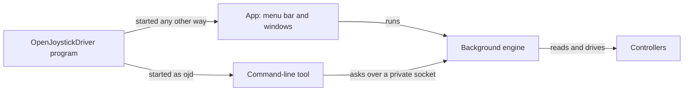

# CLI and Application Runtime

One program wears two hats. The signed app shows the menu-bar icon and the settings windows. When you start the same program under the name `ojd` (its `argv[0]`), it acts as the command-line tool (CLI) instead. Under any other name it runs the app host, which never calls the CLI itself. How the parts talk and when they start and stop: [Architecture](architecture.md).



Both sides use the same code for each job:

| Job | Code that does it |
| --- | --- |
| Controller listing and input state | `DeviceManager` and application-service payloads |
| Permission status and requests | `PermissionManager` in the running host |
| Virtual-device mode and diagnostics | `ApplicationServiceServer` |
| Physical output and remapping | Application-service messages and the remapping router |
| Runtime health | `ApplicationServiceManager` and the RPC socket PID |
| Logs | `ApplicationServiceLogService` |
| Updates and reports | CLI commands and shared report/update services |

## Application Host

Launching `OpenJoystickDriver.app` starts `ApplicationServiceRuntime` once, then installs the status-item menu and settings window. Who the app is, its sockets, and starting at login: [Architecture](architecture.md).

## CLI

`ojd` covers scripts, every mapping action, live input, and diagnostics. Options, output formats, exit codes: [Using the command line](../../wiki/Command-Line.md). The menu bar and settings window cover whether things are ready, permissions, controllers, profiles, and everyday remapping.

A repository build run as `ojd` (for example `ln -sf OpenJoystickDriver .build/debug/ojd`) uses the installed signed program when there is one. The server still checks the user, signing identifier, and team identifier. If the source files are newer than the installed program, the command stops and asks you to install. Run `just install-fast-dev` after source changes. `OJD_RUN_REPOSITORY_CLI=1` runs a local command that skips the application service. An unsigned program built from the repository can't connect to the running service.

`OpenJoystickDriverHIDTool` is an internal tool for poking at hardware. When the service holds a controller for itself alone, `OpenJoystickDriverHIDTool --monitor` reads the service's packet log like `ojd controller capture`. The service refuses a tool it didn't sign, and the tool hints to run `ojd controller capture`.

CLI command families:

```text
ojd status
ojd service start|stop|wait
ojd controller list|show|watch|check|capture|rumble|light|player|speaker|suspend|resume|disconnect|calibrate|pair|unpair|claim|release|lookup
ojd profile ...
ojd binding ...
ojd macro ...
ojd virtual show|set|reset|feed|export-mapping|launch
ojd record ...
ojd mod ...
ojd protocol ...
ojd permission list|request
ojd transport-extension status|activate|deactivate
ojd setting list|get|set|reset|test-notification
ojd config ...
ojd access status|enable|disable|list|grant|revoke|web
ojd log show|path|export
ojd diagnose [--output PATH] [--soak SECONDS] [--frames SECONDS]
ojd update check
ojd explain <code>
ojd migrate
ojd generate
```

`ojd <command> --help` lists subcommands and options.

## Where Each Command Lives in the App

| Command | Place in the app |
| --- | --- |
| `status` | Menu-bar status row and the banner of the main window |
| `service start/stop/wait` | Menu-bar Quit and app launch |
| `permission list/request` | Access area permission rows |
| `transport-extension status/activate/deactivate` | Settings, Advanced pane, Xbox USB Driver |
| `setting list/get/set` | Settings |
| `log show/path/export` | Activity area, Log mode |
| `diagnose --output` | Copy Support Report |
| `update check` | Settings update check |
| JSON/JSONL output, scripting, soak tests, catalog diagnostics, packaging, catalog generation, and DriverKit generation | Command line only |

| Option or operand | Behavior |
| --- | --- |
| `--timeout <seconds>` | Longest wait for an application-service call |
| `<controller>` | ID from `ojd controller list`, or `VVVV:PPPP` (hexadecimal vendor and product ID); a VVVV:PPPP that matches two connected controllers is refused, and both are listed |
| `--json` | Output for scripts, where supported |

Packet capture is off until something asks for it. The service records raw packets only while a reader holds a five-second pass, which each packet-log read renews. Readers: Developer Tools (opening it or picking a controller), its Live capture, and `ojd controller capture`. When the pass runs out, recording stops and the captured packets are thrown away. Logs, `status`, and `controller list` show only whether a controller has a serial number, never its value.

Command line only: raw packets, long health runs, catalog inspection, permission audits, and virtual-device self-tests.

## Controller Sessions and Virtual HID Profiles

| Command | Effect |
| --- | --- |
| `controller suspend` | Lets go of the controller but keeps its Bluetooth or USB link. Puts input, rumble, and lights at rest, removes OJD's virtual output, keeps it in the list, and closes every HID and USB handle OJD holds |
| `controller resume` | The only way to reopen handles (they stay closed even if the HID backend accepts the controller again). Sends the startup output again and turns input back on. If it fails, the session stays suspended |
| `controller disconnect` | Bluetooth only. Suspends, then asks macOS to close the connection within a time limit. If closing fails, the session stays suspended. OJD never reconnects by itself. `controller resume` accepts the controller again |

Unplugging and reconnecting gives an active session. A controller suspended before sleep is still suspended after wake, unless a Bluetooth disconnect reaches OJD before the sleep notice. That ends the suspension.

`ojd controller show --json` reports `publication.state`, which says whether the virtual gamepad is up:

| Field | Values |
| --- | --- |
| `publication.state` | Published, NotPublished, Failed |
| `publication.reason` | Only when NotPublished: OutputDisabled, SystemGamepad, NativeHIDPassThrough, UpstreamVirtualDevice, SessionSuspended, NoVirtualProfile, Suppressed, NoInputYet, HeldByAnotherClient |
| `publication.failure` | Only when Failed: text from the send that failed (never empty) |

`ApplicationServicePublicationStatus` builds and reads only these combinations. The road the driver extension owns waits as NoInputYet, like the virtual HID road.

Parsers that see full reports show input health in status and support reports. DualShock 4 health watches the sensor timestamp move forward. If reports stop, or the timestamp stops moving, health goes stale after one second: OJD puts its output at rest and waits for a fresh at-rest report. Stale health stays Needs attention (the controller's own HID may still be visible to another app).

Each controller model (vendor and product) gets a virtual HID profile, the identity the virtual gamepad shows games. OJD picks it unless you saved a choice for that model:

| Profile | ID | Selection |
| --- | --- | --- |
| SDLCompatible | 045E:0B0C | Picked when the pad's controls fit |
| GameControllerCompatible | 045E:0B13 | Only when you choose it |
| Generic | | When you choose it, or when nothing else fits |

| Command | Effect |
| --- | --- |
| `ojd virtual reset <controller>` | Clears your saved choice |
| `ojd virtual reset --all` | Clears every saved choice. Can't be used with a controller |
| `ojd virtual show [<controller>]` | Shows each profile in use and the choices |
| `ojd virtual launch [--] <program> [<arguments>]` | Runs the program with `SDL_GAMECONTROLLERCONFIG` set by `SDLLaunchEnvironment.environment(adding:to:)` to each served profile's mapping line (a value already set stays first). Exit: `E2013` when no controller has a profile in use, `E2033` when the program can't start, otherwise the program's own status |

- `ojd virtual set <sdl-compatible|game-controller-compatible|generic> <controller>`: saves a choice for the model. `--unit` applies it to one controller by unit ID.
- `ojd virtual export-mapping [<profile>] [--format sdl|w3c]`: prints each profile's SDL mapping or W3C description from `VirtualHIDProfileID.gamepadMapping()`.

`set` and `reset` print the line for the profile in use. A request that didn't fully take effect (for example `controllerNotFound`, `overrideRejectedByController`, `activationFailed`) prints a failure to stderr and exits 1.

`ApplicationServiceVirtualHIDProfileStatus` reports each controller's selected profile, source (automatic, override, automaticAfterRejecting), saved choice, and whether no profile fits.

## Never Waiting Forever

The app and the command line never wait without a limit on system tools, login registration, permission APIs, or engine calls.

| Area | How |
| --- | --- |
| System commands | `BoundedProcessRunner`, off the main actor |
| Headless live-state calls | Local RPC with time limits to connect, send, and receive |
| Permission requests | Wait on the `PermissionManager` actor. No shell commands, and no checking System Settings over and over |
| System-extension and signing checks | A set time limit or a failure state |
| Host | Main dispatch queue. Quits through the engine's signal handlers |

## Runtime Health

Every diagnostic check, plus a timed health run (a soak) of the installed app:

```bash
ojd diagnose \
  --soak 300 \
  --interval-ms 1000 \
  --rss-limit-mib 0 \
  --footprint-limit-mib 512
```

| Option | Range |
| --- | --- |
| `--soak` | 1 to 86400 seconds |
| `--interval-ms` | 100 to 60000 |
| each limit | 0 to 65536 |

Use `--json` for scripts. The sampler records memory (resident set size, and physical footprint including dirty and compressed allocator pages) and how fast it grows, average CPU, open files and threads and how fast they grow, and the highest values against the limits.

A run shorter than 60 seconds reports insufficientData, unless it already went over a limit. A steady run only proves the work that ran during it. To collect results:

| Step | What to do |
| --- | --- |
| 1 | Run against the signed installed build, not only `.build/debug` |
| 2 | Confirm the sampled PID matches `ApplicationServiceManager.health()` |
| 3 | Keep a controller active for the window |
| 4 | Record the verdict and high-water limits |
| 5 | Reinstall or restart the app after changing its program file |

## Further Reading

- [Architecture](architecture.md)
- [Using the command line](../../wiki/Command-Line.md)
