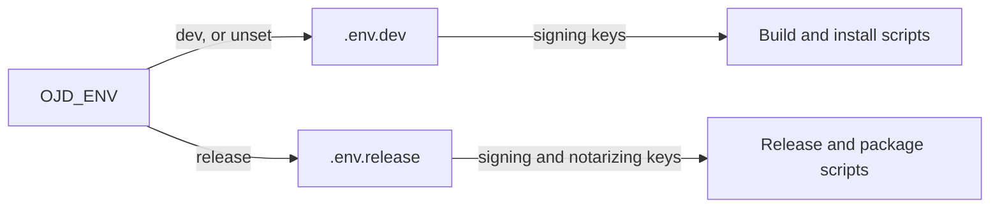

# Environment Files

An env file is a short list of `KEY=value` lines that tells the build scripts which signing identity and profiles to use, like a sticky note on your desk that only you can see. Repository scripts load one optional local file from the project root:



- `.env.dev`: development commands (default).
- `.env.release`: release, notarization, and packaging commands.

`OJD_ENV` picks `dev` or `release`, and any other value fails at once. Scripts never load a plain `.env` or a `Scripts/.env*` file. Signed build and package commands create or fix the file from the Apple signing files they find on your Mac.

Never copy identities, profiles, Team IDs, or passwords from examples. Read [Signing assets](signing.md) first. Development needs two development profiles and an Apple Development identity. Developer ID files are optional.

Unsigned `swift build` and `just driverkit-check` load no env file. Signed local installs fix `.env.dev` first. Notarization keys go only in `.env.release`. The signing setup tool only changes signing keys. Never commit either file.

## GitHub Actions Secrets

`.github/workflows/release.yml` names the secrets. The single-app release uses `DEVELOPER_ID_APPLICATION_CERT_BASE64`, `CERTIFICATE_SECRET`, `KEYCHAIN_SECRET`, `OPENJOYSTICKDRIVER_GUI_DEVID_PROFILE_BASE64`, `OPENJOYSTICKDRIVER_DEXT_DEVID_PROFILE_BASE64`, `NOTARIZE_APPLE_ID`, and `NOTARIZE_PASSWORD`.

CI needs no local `.env`. What to use on your own Mac instead:

- certificate and profile secrets: Keychain identities plus the Developer ID profiles `signing configure` reads (`signing ci-release-setup` on the runner);
- `NOTARIZE_APPLE_ID` and `NOTARIZE_PASSWORD`: the same keys in `.env.release`, or `NOTARIZE_KEYCHAIN_PROFILE` after storing credentials in Keychain.

Never copy the CI-only `*_BASE64`, `CERTIFICATE_SECRET`, or `KEYCHAIN_SECRET` keys into `.env.dev` or `.env.release`.

The GUI profile must allow the host app's `com.apple.developer.driverkit.userclient-access` list, which holds exactly `com.openjoystickdriver.XboxUSBDevice`. The DriverKit profile (`DEXT_PROVISIONING_PROFILE`) allows the system extension, and the build passes its `Name` to Xcode as the specifier. The build refuses a user-client entitlement that allows anything, in either file. A development GUI profile without the grant builds the app without the DEXT. See [Signing](signing.md).

## Environment Variables

The repository reads no variable outside this table. Env files hold only these keys: `CODESIGN_IDENTITY`, `DEVELOPMENT_TEAM`, `GUI_PROVISIONING_PROFILE`, `DEXT_PROVISIONING_PROFILE`, `OJD_USE_LOCAL_SWIFTERKIT`, plus `NOTARIZE_*` in `.env.release`. `Scripts/Platform/env_file.py` reads them. On any other key, or a line that isn't `KEY=value`, it exits 2 and names the file, the line, and the allowed keys.

| Name | Set by | Read by | Status | Reason |
| --- | --- | --- | --- | --- |
| `OJD_ENV` | contributor, release routes, release workflow | environment.sh, package.py, package_tester.py, notarize.sh, driverkit.sh, bundles.sh | kept | Selects .env.dev or .env.release. |
| `CODESIGN_IDENTITY` | .env.* (written by signing configure) | environment.sh, build.sh, driverkit.sh, package.py, package_tester.py | kept | The one identity that signs the app, its bundles and the DEXT; unset signs ad hoc. |
| `DEVELOPMENT_TEAM` | .env.* | environment.sh, bundles.sh, driverkit.sh, notarize.sh | kept | Team ID. |
| `GUI_PROVISIONING_PROFILE` | .env.* | environment.sh | kept | Path of the app provisioning profile. |
| `DEXT_PROVISIONING_PROFILE` | .env.* | driverkit.sh | kept | Path of the DEXT provisioning profile; the build passes its Name to Xcode as the profile specifier. |
| `NOTARIZE_APPLE_ID` | .env.release, GitHub secret | notarize.sh | kept | Notarization account. |
| `NOTARIZE_PASSWORD` | .env.release, GitHub secret | notarize.sh | kept | Notarization app-specific password. |
| `NOTARIZE_KEYCHAIN_PROFILE` | .env.release (written by notarize store-credentials) | notarize.sh | kept | Keychain profile that replaces the Apple ID and password. |
| `DEVELOPER_ID_APPLICATION_CERT_BASE64` | GitHub secret | `signing.sh ci-release-setup` | kept | Release certificate on the runner. |
| `CERTIFICATE_SECRET` | GitHub secret | `signing.sh ci-release-setup`, `export-github-secrets.sh` | kept | Password of the release certificate. |
| `KEYCHAIN_SECRET` | GitHub secret | `signing.sh ci-release-setup`, `export-github-secrets.sh` | kept | Password of the runner keychain. |
| `OPENJOYSTICKDRIVER_GUI_DEVID_PROFILE_BASE64` | GitHub secret | `signing.sh ci-release-setup` | kept | App Developer ID profile on the runner. |
| `OPENJOYSTICKDRIVER_DEXT_DEVID_PROFILE_BASE64` | GitHub secret | `signing.sh ci-release-setup` | kept | DEXT Developer ID profile on the runner. |
| `OJD_BUNDLE_SHORT_VERSION` | repository scripts: package.py, package_tester.py | bundles.sh, driverkit.sh | kept | Version of the bundle being built, passed from the Python release route to the bash build. |
| `OJD_BUNDLE_VERSION` | repository scripts: package.py, package_tester.py, install.sh | bundles.sh, driverkit.sh | kept | Build number of the app and the DEXT; install.sh passes a development-stage number so a rebuilt tree replaces the installed one. |
| `OJD_SOURCE_COMMIT`, `OJD_SOURCE_STATE` | repository scripts: package.py, package_tester.py | bundles.sh | kept | Source facts stamped into the bundle, passed from the Python release route to the bash build. |
| `OJD_USE_LOCAL_SWIFTERKIT` | contributor, CI (0) | `Package.swift`, driverkit.sh | kept | Builds the sibling ../SwifterKit checkout; CI and release builds reject 1. |
| `OJD_RUN_REPOSITORY_CLI` | contributor, validate_schemas.py | `InstalledCLIForwarder.swift` | kept | Runs a repository build of ojd; named in error E2020. |
| `OJD_HIDDEN` | contributor, screenshot scripts (open -g --env OJD_HIDDEN=1 -a OpenJoystickDriver) | `AppForeground.swift` | kept | 1, true or yes keeps the app inactive and orders each window it shows behind other apps' windows, so `screencapture -l` can capture it without taking focus. |
| `OJD_SWIFT_PACKAGE_NAME` | bundles.sh | the Xcode build of the app | kept | Passes the name of the Swift package to xcodebuild. |
| `OJD_GENERATE_HELPER` | GenerateRunner.swift | the `ojd` executable | kept | Makes the executable run as the helper of `ojd generate`. |
| `TEST_RUNNER_OJD_SYSEXT_LIST` | just diagnose-driver-ui | the UI test runner | kept | Hands the output of `systemextensionsctl list` to the driver-repair UI test. |
| `OJD_COLOR`, `OJD_NO_INPUT`, `OJD_TIMEOUT` | user | `GlobalOptions.swift` | kept | User options documented in the wiki page Command-Line. |
| `OJD_TOKEN` | user, WebRTC bridge launcher | reference_client.py, `WebRTCBridge` | kept | Endpoint token, documented in docs/sdk/endpoint.md and the wiki page WebRTC-Bridge. |
| `OJD_SNAPSHOT_WRITE`, `OJD_SNAPSHOT_ACTUAL_DIR` | equivalence_snapshots.py | `EquivalenceSnapshotStore.swift` | kept | `swift test` takes no arguments, so `just snapshots-check` and `snapshots write` tell the test process through the environment. |
| `VISUAL`, `EDITOR` | user | `ProfileFileCommands.swift` | kept | Editor that `ojd profile edit` opens, documented in the wiki page Command-Reference. |
| `SDL_GAMECONTROLLERCONFIG`, `SDL_JOYSTICK_*` | SDLLaunchEnvironment.swift, user | `SDLLaunchEnvironment.swift`, `Tools/SDLGamepadProbe`, backend.sh, SDL games | kept | SDL settings that `ojd virtual launch` passes to a game; the launcher appends to an existing SDL_GAMECONTROLLERCONFIG, and the probe prints them. |
| `DEVELOPER_DIR`, `SDKROOT` | contributor, CI, environment.sh | Xcode tools, `swift`, `swiftlint`, `justfile` | kept | Select the Xcode SDK and tools; the compiler is the swift on PATH. |
| `TOOLCHAINS` | contributor | bundles.sh (unset for `xcodebuild`) | kept | xcodebuild cannot resolve the package under a swift.org toolchain. |
| `CI` | GitHub Actions | driverkit.sh, signing.sh, notarize.sh | kept | Turns off prompts and rejects local SwifterKit. |
| `GITHUB_REPOSITORY`, `GITHUB_REF_NAME`, `GITHUB_SHA`, `GITHUB_TOKEN` | GitHub Actions | `wiki/build.py`, package.py, wiki.yml | kept | Repository and ref facts only the runner knows. |
| `RUNNER_TEMP`, `GITHUB_OUTPUT`, `GITHUB_PATH` | GitHub Actions | `signing.sh ci-release-setup`, workflow and action steps | kept | Runner scratch directory and step outputs. |
| `RELEASE_TAG`, `RELEASE_TAG_INPUT`, `GH_TOKEN` | release workflow | workflow shell steps | kept | Tag and token of the release job. |
| `NO_COLOR`, `TERM`, `PAGER`, `HOME`, `PATH`, `TMPDIR` | shell, Git, user | scripts, hooks | kept | Standard variables with their standard meaning. |
| `NOTARIZE_TIMEOUT_MINUTES`, `NOTARIZE_POLL_INTERVAL`, `NOTARIZE_MAX_RETRIES` | nobody | notarize.sh | removed | Fixed values of the script (180 minutes, 30 seconds, 5 retries). |
| `NOTARIZE_KEYCHAIN` | nobody | notarize.sh | removed | No route sets a custom keychain. |
| `DEV_ENV`, `REL_ENV`, `SCRIPT_DIR`, `PROJECT_DIR` | signing.sh | configure.py | removed | configure.py takes --project-dir and derives the root .env.dev and .env.release paths from it. |
| `GUI_CODESIGN_IDENTITY`, `DEXT_BUILD_IDENTITY` | .env.* | environment.sh, driverkit.sh, package_tester.py | removed | Both profiles embed one identity, so CODESIGN_IDENTITY signs the app and the DEXT. |
| `DEXT_BUILD_PROFILE` | .env.* | driverkit.sh, package_tester.py | removed | The build reads the profile specifier from the Name inside DEXT_PROVISIONING_PROFILE. |
| `GUI_DEV_PROFILE`, `GUI_DEVID_PROFILE`, `DEXT_PROFILE`, `DEXT_DEVID_PROFILE` | nobody | signing.sh, configure.py | removed | `signing install-profiles` copies the profiles under fixed names, which `signing configure` reads. |
| `APPLE_DEV_IDENTITY`, `DEVID_APP_IDENTITY` | contributor | signing.sh | removed | `signing configure --development-identity <sha1>` and `--release-identity <sha1>` pick an identity. |
| `OJD_SIGNING_MODE` | signing.sh ci-release-setup | signing.sh, configure.py | removed | `signing configure --mode` and `signing install-profiles --mode` take development, release or all. |
| `OJD_NOTARIZE_APP`, `OJD_NOTARIZE_ZIP` | package.py, package_tester.py, install.sh | notarize.sh | removed | `notarize.sh submit <app> <zip>` takes them as arguments. |
| `DEXT_BUNDLE_VERSION` | install.sh | driverkit.sh | removed | install.sh passes the build number in OJD_BUNDLE_VERSION, which driverkit.sh reads. |
| `OJD_ENABLE_CONTRIBUTOR_USB_PASSIVE` | contributor | `PassiveUSBDescriptorProbe.swift` | removed | The probe reads IORegistry facts of one allowlisted device and claims nothing, the same read the app makes on every USB attach; --usb-passive and the tuple allowlist are its opt-in. |
| `DEVELOPER_ID_APPLICATION_IDENTITY_EXPORT`, `OPENJOYSTICKDRIVER_GUI_DEVID_PROFILE`, `OPENJOYSTICKDRIVER_DEXT_DEVID_PROFILE` | nobody | `export-github-secrets.sh` | removed | Overrides of fixed paths and of the --identity option. |
| `OJD_REGENERATE_REPORT_FIXTURE` | contributor | `SupportReportBindingTests.swift` | removed | The support report fixture is the equivalence snapshot Tests/EquivalenceSnapshots/support-report-binding.json, which `just snapshots-write` rewrites and `snapshots check` diffs. |
| `OJD_ENV_FILE` | environment.sh | notarize.sh | removed | notarize.sh sources environment.sh, so it is a shell variable, not an exported one. |

Not read from the environment: shell variables local to one script (`IDENTITY`, `OJD_HOST_USERCLIENT`, `OJD_APP_INFO_PLIST`, `OJD_DEFAULT_BUNDLE_SHORT_VERSION`, `OJD_APP_CLI`, `OJD_ENV_FILE`) and test fixture parameters (`OJD_ARGUMENT`, `OJD_LAUNCH_TEST`).

Count names by status:

```sh
awk -F'|' '$5 ~ /^ (kept|removed) $/ { status = $5; gsub(/ /, "", status)
  count[status] += gsub(/`[A-Z][A-Z0-9_]*\*?`/, "&", $2) }
  END { print "kept", count["kept"]; print "removed", count["removed"] }' docs/development/environment.md
```

Output: `kept 53`, `removed 27` (`SDL_JOYSTICK_*` counts as one name).

## Swift Toolchain

Every Swift command runs the chosen Xcode's `swift`, so one compiler writes `.build`. `Scripts/Platform/environment.sh` puts `$DEVELOPER_DIR/Toolchains/XcodeDefault.xctoolchain/usr/bin` first on `PATH`. It exits 2 unless `swift --version` reports the release in `.swift-version` or newer (a missing patch number counts as `.0`). `just typecheck` and `just test` treat warnings as errors. The CI Toolchain step prints the selected `swift`.

## Further Reading

- [Signing](signing.md)
- [Building From Source](building-from-source.md)
