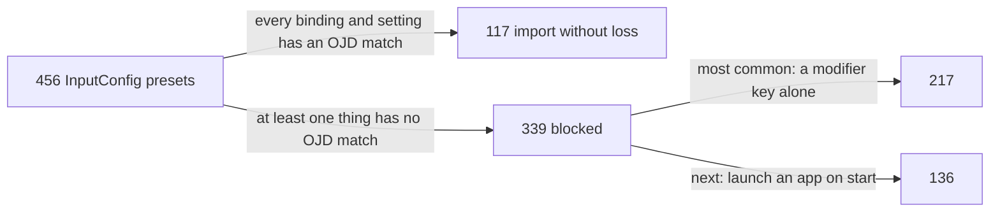

# InputConfig Preset Library: Import Measurement

InputConfig is another Mac app with 456 ready-made button layouts (presets) for games and apps. This page measures how many of them OJD could take in without losing anything, to decide whether an importer is worth writing. Think of moving house: some furniture fits the new rooms as-is, and some doesn't fit anywhere.

Claims with no label were seen directly (read in a file or printed by the script). The rest are marked Inferred (worked out, not seen) or Not checked.



## What Was Read

- Repository `https://github.com/ryleighnewman/InputConfig`, commit `958bdd97ceecb182004b3d7d8521761b5a7e7756` ("1.8 (34)"), read in a separate clone, not run or built.
- The library is a JSON array in the raw string `ExamplePresets.swift` (`static let libraryJSON`, decoded into `SmartPresetProfile` at line 2996). It holds 456 profiles, 456 distinct ids: 294 game, 125 app, 37 workflow. The 46 built-in presets (`static var ...: Preset`) are left out.
- `LICENSE` at the repository root is MIT, "Copyright (c) 2026 Ryleigh Newman". No `NOTICE` file, no separate license for the preset data.

## The Library Preset Format

Profile fields: `id`, `category`, `displayName`, `subtitle`, `appPath`, `launchURL`, `light` (r, g, b), `confineCursor`, `autoRecenter`, `hideCursor`, `bindings`, `tips`, and in one profile `drive`. Binding fields (`SmartPresetProfile.Binding`): `input`, `outputs`, `note`, and optional `hold`/`holdMs`, `double`/`doubleMs`, `with`, `toggle`, `turbo`, `repeatCount`/`repeatMs`, `deadzone`, `outer`, `curve`, `variable`, `ramp`, `rumble`, `speak`, `needs`.

- Inputs are GameController numbers that are the same for every controller: `btn 0..13`, `axi 0..5` with a sign, `hat 0 U|D|L|R`. Per the file header: buttons 0 to 3 face, 4 and 5 shoulders, 8 Options/Share, 9 Menu/Start, 10 Home, 11 and 12 stick clicks, 13 touchpad; axes 0 to 3 sticks, 4 and 5 triggers.
- Outputs are short text codes. Keys are USB HID usage codes (`key 4` is A, `key 227` is Left Command). Used: `key`, `mbt` (0, 1, 2 = left, right, middle), `mou <axis> <sign> <speed>`, `whe <axis> <sign> <speed>`, `whs <axis> <sign>`, one `sys dct`.
- Other `OutputType` values (MIDI, `txt`, `app`, `avl`, `lit`, `cpf`) don't appear.

## How One Preset Maps to an OJD Profile

The OJD shape is `Resources/Schemas/profile.schema.json` (`v1alpha4`). An OJD profile names a `device`, but the library names none, so one preset becomes one profile per controller model. Inferred: an importer must ask which model, and handle buttons the model lacks (`btn 13`, `btn 10`).

| Library field | OJD field | Result |
| --- | --- | --- |
| `displayName` | `name` (at most 80 characters, no outer spaces) | maps; the script checks the length |
| (generated) | `id`, `apiVersion`, `kind`, `device` | importer supplies |
| `btn 0..3` | Button South, East, West, North | maps |
| `btn 4`, `5` | LeftShoulder, RightShoulder | maps |
| `btn 6`, `7` | LeftTrigger, RightTrigger as buttons | maps (doesn't appear in the library) |
| `btn 8`, `9`, `10` | Back, Start, Guide | maps |
| `btn 11`, `12`, `13` | LeftStickClick, RightStickClick, TouchpadClick | maps |
| `axi 0..3 +/-` | AxisDirection on LeftStickX/Y, RightStickX/Y, Positive/Negative | maps; see the Y direction note |
| `axi 4 +`, `axi 5 +` | AxisDirection Positive on LeftTrigger, RightTrigger | maps |
| `hat 0 U/D/L/R` | Dpad DpadUp/Down/Left/Right | maps |
| `key N` (not a modifier) | Keyboard `key` | maps for every code in the library (the script lists the codes that have an OJD name) |
| `key 224..227` with a key in the same row | Keyboard `modifiers` (Control, Shift, Alt, Meta) | maps |
| `key 224..227` alone | none | blocks |
| several outputs in one row | the first key is `destination`; the rest are `additionalActions` | maps |
| `mbt 0, 1, 2` | MouseButton Left, Right, Middle | maps |
| `mou <axis> <sign> <speed>` | MouseMovement X/Y; `-` is `axisTuning.inverted`; speed is `axisTuning.gain` | maps; speed needs calibration |
| `whe <axis> <sign> <speed>` | Scroll X/Y, same tuning | maps; speed needs calibration |
| `whs` | none | blocks |
| `sys dct` (start dictation) | `systemKey` has no dictation; `systemAction` holds only `MissionControl`, `Launchpad`, `Screenshot`, `LockScreen`, and `ShowDesktop` | blocks |
| `hold` + `holdMs` | `longHold` (`destination`, `durationMs` 100 to 5000) | maps for one output |
| `double` | `multiTap` with `count` 2 | maps for one output |
| `toggle` | `behavior` Toggle | maps |
| `repeatCount` + `repeatMs` | a Macro of Tap, Wait, Tap (16 macros at most) | maps |
| `needs` | the source exists only on a model that has it | maps per model |
| `light` | `physicalColor` | maps for models with a light |
| `confineCursor` | none | blocks (no match for confine, recenter, or hideCursor in Sources, Resources, wiki, or docs) |
| `autoRecenter`, `hideCursor` | none | would block; no profile in the library sets them |
| `appPath` | `applicationScope` needs a bundle identifier, which the data lacks; InputConfig also launches the app when the preset starts, and OJD has no launch on activation | blocks |
| `launchURL` | no profile-level launch | blocks |
| `drive` (one-stick driving) | none | blocks |
| `subtitle`, `tips`, row `note`, `category` | none (`additionalProperties` is `false`) | text only; not counted |

Notes on the table:

- `Destination.swift` and the schema give Keyboard a required `key` from a list without modifier keys. A lone modifier, such as sprint on Left Shift, has no destination.
- In the Minecraft rows, `axi 1 -` is "Walk forward" (`key 26`), so the library takes negative as up. `wiki/Controller-Records.md` lists W3C as "negative is left or up" and Apple GameController as "positive up". Not checked: which the engine reads for LeftStickY. An importer needs it for `axi 1` and `axi 3` rows.
- Inferred: speed 6 to 28 in `mou` and `whe` has no matching OJD unit, and the counts treat it as mapped. Matching speed exactly needs measuring (360 presets with `mou`, 130 with `whe`).
- Inferred: `hold` and `double` (two presets) map by type and range. Nobody compared the timing.

## How Things Were Counted

- A blocker is a binding, modifier, or setting the table marks as having no OJD match. A preset with no blocker imports without loss (lossless).
- A feature counts once per preset, so the counts add up to more than the blocked total. Numbers in brackets: presets blocked only by that feature.
- Description text (subtitle, tips, note, category) isn't counted. If it were, 0 of 456 would be lossless.
- Totals: all rules, and bindings only (`confineCursor`, `appPath`, `launchURL`, `drive` ignored).
- Not blockers: things to tune (speed, Y direction) and choices made per model (device, missing buttons).
- The script counts unused row fields (`turbo`, `deadzone`, `with`, and the others) as blockers.

## Result

Run at the pinned commit (`git -C <clone> rev-parse HEAD` prints `958bdd97ceecb182004b3d7d8521761b5a7e7756`):

```sh
python3 -I docs/development/inputconfig-presets-count.py <clone>/InputConfig/Resources/ExamplePresets.swift
```

Output:

```text
presets read: 456 | distinct ids: 456
categories: {'app': 125, 'game': 294, 'workflow': 37}
rows read: 8513 | rows with no blocker: 8062
Presets that map without loss (all rules): 117 of 456
Presets whose bindings alone map without loss (preset settings ignored): 218 of 456
Blocking feature -> presets blocked (sole blocker in brackets):
    217 [ 45]  output: modifier key alone (OJD keyboard destination needs a key)
    164 [  2]  setting: confine cursor
    136 [ 84]  setting: launch app on activation (appPath)
     58 [  3]  setting: launch URL on activation (launchURL)
     38 [ 13]  output: wheel step (one notch per press)
      1 [  1]  output: system function dct (OJD systemKey/systemAction lacks it)
      1 [  0]  setting: one-stick driving (drive)
Blocking feature -> rows blocked:
   380  output: modifier key alone (OJD keyboard destination needs a key)
    70  output: wheel step (one notch per press)
     1  output: system function dct (OJD systemKey/systemAction lacks it)
rows with a mou/whe speed: {'mou': 1456, 'whe': 284}
presets with at least one mou output: 360
presets with at least one whe output: 130
presets with repeatCount rows: 6
presets with hold/double/toggle rows: 2
presets with btn 13 or a needs row: 1
presets with subtitle, tips, or notes (text OJD has no field for): 456
```

Reading the totals:

- 117 presets map without loss, and 339 have a blocker (modifier-only blocks 217, wheel step 38).
- Of 8513 rows, 8062 (94.7%) map, and 451 don't (380 modifier-only, 70 wheel step, 1 dictation).
- With preset settings dropped, 218 map. The other 101 are blocked only by `confineCursor`, `appPath`, `launchURL`, or `drive`.
- `appPath` is the largest sole blocker (84). Its scope part can be solved by reading the named app's bundle identifier. Launching the app when the preset starts can't.

## What the MIT Notice Requires

The license text of `LICENSE` at `958bdd97`, quoted in full:

```text
MIT License

Copyright (c) 2026 Ryleigh Newman

Permission is hereby granted, free of charge, to any person obtaining a copy
of this software and associated documentation files (the "Software"), to deal
in the Software without restriction, including without limitation the rights
to use, copy, modify, merge, publish, distribute, sublicense, and/or sell
copies of the Software, and to permit persons to whom the Software is
furnished to do so, subject to the following conditions:

The above copyright notice and this permission notice shall be included in all
copies or substantial portions of the Software.

THE SOFTWARE IS PROVIDED "AS IS", WITHOUT WARRANTY OF ANY KIND, EXPRESS OR
IMPLIED, INCLUDING BUT NOT LIMITED TO THE WARRANTIES OF MERCHANTABILITY,
FITNESS FOR A PARTICULAR PURPOSE AND NONINFRINGEMENT. IN NO EVENT SHALL THE
AUTHORS OR COPYRIGHT HOLDERS BE LIABLE FOR ANY CLAIM, DAMAGES OR OTHER
LIABILITY, WHETHER IN AN ACTION OF CONTRACT, TORT OR OTHERWISE, ARISING FROM,
OUT OF OR IN CONNECTION WITH THE SOFTWARE OR THE USE OR OTHER DEALINGS IN THE
SOFTWARE.
```

This reading is not legal advice.

- Condition: "The above copyright notice and this permission notice shall be included in all copies or substantial portions of the Software." The notice is the copyright line, the permission text, and the warranty disclaimer.
- Inferred: an importer that ships the presets or converted profiles must include the notice, as `THIRD_PARTY_NOTICES.md` does per third party. Converted profiles need it beside them (data folder, About text).
- MIT allows sublicensing. OJD's MPL-2.0 covers OJD's own files, and the MIT notice and disclaimer stay with the InputConfig parts. Inferred: converted profiles stay under MIT.
- An importer reading user-exported presets and shipping no data needs no notice, but the library is a compiled Swift string with no export file. Inferred: only shipping a converted copy is practical, so the notice applies.
- MIT gives no rights to game and app names or trademarks in the presets. Not checked beyond the license text.
- OJD copies nothing from InputConfig and has no notice for it. A bundled importer must change `THIRD_PARTY_NOTICES.md` in the same commit.

## Answer

- Inferred: an import without loss covers 117 of 456 presets (26%). Preset settings block most of the rest.
- Inferred: two missing OJD features block most: a keyboard destination for a lone modifier (217 presets), and a profile-level app launch or a way to drop it (136 with `appPath`).
- Not measured: the 46 built-in presets, `mou` and `whe` speed, Y direction, `hold` and `double` timing.
