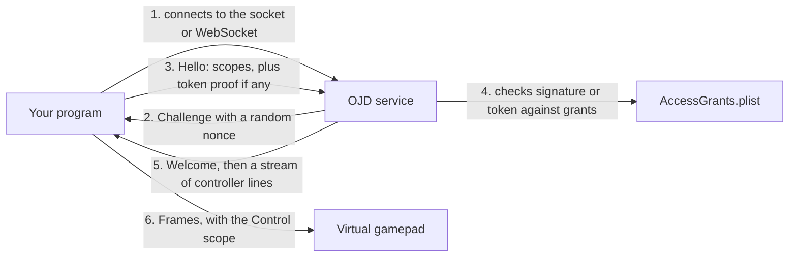

# Public Endpoint Design

The endpoint is a private door on the Mac where other programs can read controller events or drive a virtual gamepad, if the user gives them a key (a grant). This page explains why the door is built the way it is. For the list of messages, errors, grants, and versions, see [SDK Endpoint](../sdk/endpoint.md).

## Contents

- [Goal](#goal)
- [The Internal Socket](#the-internal-socket)
- [Who It Guards Against](#who-it-guards-against)
- [How Programs Connect](#how-programs-connect)
- [Saying Hello](#saying-hello)
- [Read Stream (Slice 3.3)](#read-stream-slice-33)
- [Control Stream (Milestone 4)](#control-stream-milestone-4)
- [Grants](#grants)
- [Tests (Slice 3.3)](#tests-slice-33)
- [Token Grants and WebSocket (Slice 3.4)](#token-grants-and-websocket-slice-34)
- [What We Agreed](#what-we-agreed)
- [Further Reading](#further-reading)

## Goal

Programs you allowed, such as overlays and accessibility tools, read controller events and drive a virtual gamepad without starting `ojd`.



## The Internal Socket

- The internal socket is `/tmp/com.openjoystickdriver.<uid>.rpc`, mode `0600`. Each connection carries one request and one response, framed as a 4-byte big-endian length and JSON.
- `ApplicationServiceServer.isTrustedClient` accepts only the service's own process, or a process with its signing identifier and team ID.
- `ojd controller watch --all` polls each controller every 16 ms and the list every 250 ms.
- `VirtualFeedRegistry` allows 4 feeds from `ojd virtual feed` and closes idle ones.

The endpoint is a separate door. The internal socket's one-request messages and signature rule don't suit a stream that another developer's program keeps open for a long time.

## Who It Guards Against

The endpoint serves the logged-in user's own programs. Other computers aren't covered, and the WebSocket only listens on `127.0.0.1`. Other users on the Mac can't reach the Unix socket, and tokens keep them off the WebSocket.

A grant records that you said yes. It doesn't stop malware running as you, which could already run `ojd`. Controller input needs the input-read permission, so the endpoint is off until you turn it on, and each program needs its own grant.

## How Programs Connect

- The Unix socket is `$(getconf DARWIN_USER_TEMP_DIR)com.openjoystickdriver.endpoint.sock`, mode `0600`, in a `0700` folder. The service only creates it while the endpoint is on.
- `getpeereid` must return the same user as the service.
- The service identifies the other program by its audit token (`LOCAL_PEERTOKEN`, then `SecCodeCopyGuestWithAttributes`), not by PID, because PIDs get reused. `SecCodeCheckValidity` refuses a program file that was changed.
- Messages are UTF-8 JSON objects, one per line, at most 64 KiB.
- The socket and the WebSocket each allow 8 connections, so web pages can't use up the socket's places. The hello exchange must finish within 5 seconds.

## Saying Hello

The service sends a `Challenge`. The client answers with a `Hello`. Every line except a watch line has `apiVersion` and `kind`:

```json
{"apiVersion":"openjoystickdriver/v1alpha4","kind":"Challenge","nonce":"..."}
{"apiVersion":"openjoystickdriver/v1alpha4","kind":"Hello","scopes":["Read"]}
```

The nonce is 32 random bytes, fresh for each connection, from `SecRandomCopyBytes`, in unpadded base64url. A signed program ignores it. A program using a token signs it.

The service answers with one line, then streams or closes:

```json
{"apiVersion":"openjoystickdriver/v1alpha4","kind":"Welcome","version":"0.6.0-alpha.3","scopes":["Read"]}
{"apiVersion":"openjoystickdriver/v1alpha4","kind":"Status","status":"Failure","code":"E1002","message":"..."}
```

- The service accepts only `openjoystickdriver/v1alpha4`. Any other `apiVersion` gets `E1009` with `details.supportedAPIVersions`, then a close.
- The service grants every requested `scope`, or refuses with `E1002`.
- Error codes `E1001` to `E1011` are in `Resources/ErrorCodes.plist` and the wiki page Error-Codes.

## Read Stream (Slice 3.3)

After `Welcome`, the client sends `{"apiVersion":"openjoystickdriver/v1alpha4","kind":"Subscription","stream":"Controllers","output":false}`. The service then sends the watch lines of `ojd controller watch --all --json`. `output: true` adds `output`, as `--output` does.

- One poller serves every subscriber. Its `watchAll()` code lives in `OpenJoystickDriverKit`.
- A slow reader gets only the latest `input` line for each controller. Connect and disconnect lines are never dropped. At 256 waiting lines, the service closes with `E1006`.
- `cli-output.schema.json` and `endpoint.schema.json` describe the lines.

## Control Stream (Milestone 4)

With the `control` scope, the client sends a `FeedRequest`. The service answers `FeedSession` once the virtual gamepad exists. Each later client line is a `Frame`, the keys of an `ojd virtual feed` input line plus `apiVersion` and `kind`. The service sends `RumbleCommand` lines.

```json
{"apiVersion":"openjoystickdriver/v1alpha4","kind":"FeedRequest","as":"Generic"}
{"apiVersion":"openjoystickdriver/v1alpha4","kind":"FeedSession","as":"Generic"}
{"apiVersion":"openjoystickdriver/v1alpha4","kind":"Status","status":"Failure","code":"E1007","message":"..."}
```

- `control` works on the Unix socket for a signed program or a token. Having `read` never gives `control`.
- On the WebSocket, `control` needs a token without origins and a client that sends no `Origin`. A page never drives a pad. `ojd access grant --token` refuses `--origin` with `--scope control`. A grants file with that mix still loads, and the service removes `control` from the token.
- A `control` scope without `controlGrantedAt` is broken. The service never accepts it.
- Errors: `E1002` for a `feed` without `control`, `E1007` for a fifth endpoint feed, `E1008` when the gamepad fails to start or the service stops it.
- One connection is one feed. Closing it removes the gamepad. A gamepad that takes over 2 seconds to start fails the `feed`.
- A program that freezes would hold buttons down. After 2 seconds with no frame, `KeepAlive`, or `Drain` line (`VirtualFeedExchangeResult.idleTimeoutSeconds`), the endpoint closes the feed with `E1008`.
- Idle time starts when no frames are waiting and the last frame's `holdMilliseconds` (at least 8 ms) has passed. `KeepAlive` counts as activity and does nothing else. Asking for rumble doesn't count.
- Closing a connection throws away frames not yet played. A macro client sends `Drain` after its last frame and waits for `Drained`. That wait is never idle time.
- Endpoint clients and `ojd virtual feed` each have a limit of 4 feeds in `VirtualFeedRegistry`.
- At 256 waiting frames, the service stops reading. A close still ends the feed at once.

## Grants

Grants live in `~/Library/Application Support/OpenJoystickDriver/AccessGrants.plist`. Only the service writes it. `ojd access` asks the service over the internal socket, so taking access away works at once.

A grant is looked up by the program's code signature:

| Client | Key | Why |
| --- | --- | --- |
| Signed with a Developer ID or App Store certificate | signing identifier and team ID | Apple certifies the team ID, so another developer can't reuse the key. |
| Apple platform binary, such as `/usr/bin/python3` | signing identifier, with the `anchor apple` requirement | The identity is real, but a grant covers every script the interpreter runs. `ojd access grant` warns of this. |
| Ad-hoc signed or unsigned | refused | Anyone can ad-hoc sign a binary with any identifier, so the key proves nothing. |

Each grant has `scopes` (`Read`, `Control`), when it was granted, and the path where the program was first seen (shown only, never checked).

### Commands

```text
ojd access status                    whether the endpoint is on, its socket path, and live connections
ojd access enable | disable          turn the endpoint on or off; disable closes every connection
ojd access list                      grants, and clients refused in the last 24 hours
ojd access grant CLIENT --scope read [--scope control]
ojd access revoke CLIENT [--scope SCOPE]
```

- `CLIENT` is an app or executable path, or the ID of a refused client from `ojd access list`.
- `grant` and `enable` ask for confirmation, and need `--force` with `--no-input`. Granting `control` warns that the client can press buttons in any game.
- `revoke` closes that client's connections with `E1005`.
- Every command supports `--json`.

## Tests (Slice 3.3)

Swift tests run the endpoint on a private socket, the way `FakeService` does:

- A program with no grant, or an ad-hoc signed one, gets `E1002`.
- A program with a grant receives `ADDED`, `MODIFIED`, and `DELETED` lines that match the schema.
- A program whose grant was taken away is disconnected with `E1005`.
- An endpoint that's off has no socket. Another `apiVersion` gets `E1009`.

Tests swap in their own identity lookup, because a unit test can't sign with a team ID. Checking with a real Developer ID program is done by hand.

## Token Grants and WebSocket (Slice 3.4)

### Token Grants

`ojd access grant --token NAME --scope read [--origin URL]...` prints the token once.

- The token is `ojd_` plus 32 random bytes in base64url. `AccessGrants.plist` stores its SHA-256 in `tokens`. A lost token can't be shown again: revoke it and grant a new one.
- The grant ID is `token:NAME`. Names are unique and match `[A-Za-z0-9._-]{1,64}`.
- `hello` carries `tokenName` and a `proof`, never the token: `{"apiVersion":"openjoystickdriver/v1alpha4","kind":"Hello","scopes":["Read"],"tokenName":"NAME","proof":"..."}`.
- The proof is the lowercase hex HMAC-SHA256, keyed with the token's SHA-256, of four lines ending in `\n`: `OpenJoystickDriver endpoint hello 1`, the nonce, the normalized `Origin`, and the WebSocket port. On the Unix socket, the origin and port lines are empty. The service compares them in constant time, so timing gives nothing away.
- A proof only works for one connection, origin, and port, so a fake listener can't reuse it.
- A token skips the signature check, so ad-hoc signed tools work. Any process of the user that reads the token can use it.
- `AccessGrants.plist` is a secret: its hashes are the HMAC keys. It has mode 0600 in a 0700 folder, and the support report leaves it out. If it leaks, revoke every token.
- `--origin` ties the token to web pages, written as `scheme://host[:port]`, `http` or `https` only. `null` is refused, because any site can send `Origin: null`.
- A wrong proof, an unknown name, or a wrong origin gets `E1002`. `ojd access list` names a token in a refusal only when the proof was right. Refusals last 24 hours.
- `ojd access revoke token:NAME` closes its connections with `E1005`.

### WebSocket

`ojd access web enable [--port N]` opens a TCP listener on `127.0.0.1`. The first time, the system picks a free port and the service saves it, so there's no fixed port anyone can guess. `ojd access status` shows it. The switch (`web.enabled`, `web.port`) is off until you turn it on, and separate from `ojd access enable`. `ojd access web disable` closes connections with `E1001`.

- Clients connect to `ws://127.0.0.1:PORT/endpoint`. The upgrade needs `Host: 127.0.0.1:PORT`, which blocks DNS rebinding tricks, and an `Origin` that some token grant names. Without `Origin`, some token grant must have no origins.
- The challenge is the first message after the `101`. `hello` names a token whose grant fits the `Origin`.
- One text message is one protocol line, at most 64 KiB. A binary frame or a longer message ends with `E1003`. Client frames must be masked (RFC 6455).
- The Unix socket limits apply per transport.
- The service handles the upgrade itself on a BSD socket. `NWProtocolWebSocket` only shows headers to a handler shared by every connection, so it can't link `Origin` to the token.

### Overlay Pages

The listener serves `~/Library/Application Support/OpenJoystickDriver/Overlays/` at `http://127.0.0.1:PORT/`. That origin is one a token can name, so overlays and OBS browser sources need no `null` origin.

- `GET` and `HEAD` only. `/` and folders serve `index.html`. The server lists no folders.
- A path must stay inside the folder after symbolic links resolve.
- A `Sec-Fetch-Site` other than `same-origin` or `none` is refused. Responses carry `Cross-Origin-Resource-Policy: same-origin`, so another site can't load a page's script with a `<script>` tag.
- All pages share one origin, so any page can use a token granted to it.

### Extra Risks the WebSocket Adds

- Every local user can reach the TCP port. Only the token protects it. The `Host` and `Origin` checks stop websites, not local programs.
- Anything that reads a page's file reads its token.
- Another local user can bind the port first. Pages then reach that listener, which can read events and send fake ones but learns no token. `ojd access web enable` then fails with the port in use, and `ojd access status` shows the WebSocket as on but not listening. Revoke the token and choose another port.
- A listener on `[::1]:PORT` is possible, so the service refuses `Host: localhost:PORT`. Pages use `127.0.0.1`.
- A listener on `0.0.0.0:PORT` doesn't get loopback connections, because macOS picks the most specific address. The service doesn't set `SO_REUSEPORT`, so nothing else binds `127.0.0.1:PORT`.
- The 5-second `hello` limit runs from connect, so slow programs can't hold all 8 places.
- The `101` or `403` answer tells a local program whether a token names an origin. Origins aren't secret.
- A browser always sends `Origin`, so a page can't use a token without origins. A native client can send any `Origin`, so only the token protects it.

## What We Agreed

1. Script programs. Slice 3.3 has signature grants only: a grant for an interpreter covers every script it runs, and ad-hoc tools are refused. Slice 3.4 adds token grants.
2. Socket path. The socket is in the per-user temporary folder, and `ojd access status --json` prints it. An Application Support path could go over the 104-byte limit on socket paths.
3. Sandboxed programs. An ad-hoc signed app with `com.apple.security.app-sandbox` on macOS 27 gets `EPERM` from `connect()` to a socket in `DARWIN_USER_TEMP_DIR`. That holds with `com.apple.security.network.client` and with a `temporary-exception.files.absolute-path.read-write` naming the socket, its `/private` path, or the folder. The same app connects to a socket in its own container. A test in the S5 slice showed that it reaches the WebSocket with a token when it has `com.apple.security.network.client`, and fails without it. So a sandboxed program uses the WebSocket with a token that has no origins and sends no `Origin`.
4. Internal socket. Both sockets share one audit-token check with `SecCodeCheckValidity`, so a reused PID can't fool either one.

## Further Reading

- [Architecture](architecture.md)
- [CLI and Application Runtime](cli-and-runtime.md)
