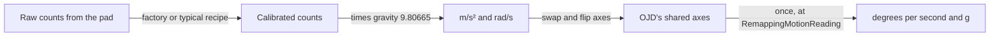

# Remapping Calibration

A motion sensor reports raw counts, like a kitchen scale that shows numbers but not grams. Calibration is the recipe that turns those counts into real units, using numbers the factory measured and stored in each controller. See the [remapping overview](remapping.md).

## Turning Sensor Counts Into Real Units

`ControllerMotionSample` carries only SI units: `acceleration` in m/s² and `angularVelocity` in rad/s. Both use one shared, right-handed set of axes. +X points right. +Y points away from the player along the face. +Z points up out of the face. Raw counts never leave the drivers. Each sample says where its calibration came from (provenance) and which revision it is. Vectors that aren't finite numbers are refused.

Each driver does three steps, in order:

1. Apply the factory calibration, or the typical (nominal) one if there's none.
2. Scale to SI units (standard gravity is 9.80665 m/s²).
3. Swap and flip the axes to match the shared axes.

The swaps come from the [SDL sensor axes](https://wiki.libsdl.org/SDL3/SDL_SensorType) (X right, Y up, Z toward the player). In OJD's shared axes those read as (x, -z, y). `MotionFrameTests` pins every axis and sign.

The engine converts each sample once, at `RemappingMotionReading`. It turns it into degrees per second and g, in the [GamepadMotion input axes][1] (X right, Y up, Z toward the player). Tuning, pointer scales, and calibration offsets all use those axes. A controller lying flat measures acceleration of about +Y.

DualSense and Edge send typical readings right away: gyro ADC / 16 degrees per second and acceleration ADC / 8192 g, marked `nominalDeviceScale`. At startup OJD asks for feature report `0x05` (41 bytes). The parser takes the factory calibration in one go. First it checks the ID, the length, all six axes, and the Bluetooth CRC32 with feature seed `0xA3`.

- Gyro: subtract the bias, then scale by the reported speed sum divided by the range between the end points.
- Acceleration: subtract the middle of the end points, then scale by 2 / the range.
- The allowed limits follow SDL's PS5 code. Packet framing and CRC follow Linux hid-playstation.
- A refused reply keeps the last good calibration, or the typical conversion if none was ever accepted.

If the pipeline stopped or was replaced, it refuses feature replies that arrive late. Hardware checks must confirm the reply arrives, its framing, and the axis signs.

[1]: https://github.com/JibbSmart/GamepadMotionHelpers/blob/39b578aacf34c3a1c584d8f7f194adc776f88055/GamepadMotion.hpp

### Typical Conversion for DS4, Nintendo, and Steam

| Pad | Scale | Axis swap |
| --- | --- | --- |
| DS4 | Sony's typical /16 gyro and /8192 accelerometer, as in the [SDL DS4 parser][2] | Both sensors (X, -Z, Y) |
| Nintendo | 14.2842 counts per degree/second and 4096 counts per g, per the [SDL Switch parser][3] | Both sensors (-Y, X, Z) on Pro and left Joy-Con, (Y, X, -Z) on right Joy-Con. The parser doesn't turn the axes for a Joy-Con held sideways. |
| Steam | Gyro 2000/32768 degrees/second per count; accelerometer 2/32768 g per count | Gyro (X, -Y, Z), accelerometer (X, Y, Z). These are SDL's (X,Z,Y) and (X,Z,-Y), which Linux hid-steam also uses. The two differ by a Y mirror, which still needs checking on hardware. |
| GameSir | Enhanced HID reports carry motion bytes, but no source confirms the scale, axes, or byte order | The GameSir driver sends no motion. |

All these readings are marked nominalDeviceScale, never factory calibration.

[2]: https://github.com/libsdl-org/SDL/blob/f9abf9e843cb1b9c18aa2401ceb9cfbd7a0d4c74/src/joystick/hidapi/SDL_hidapi_ps4.c
[3]: https://github.com/libsdl-org/SDL/blob/f9abf9e843cb1b9c18aa2401ceb9cfbd7a0d4c74/src/joystick/hidapi/SDL_hidapi_switch.c

## What Counts as Passing

Checks with a signed app must each show, on their own: the real controller kept apart, the virtual gamepad recognized, and the output arriving. Each check records USB or Bluetooth, the macOS HID generation, and the app reading it. A release lists every hardware check nobody could run. None of those excuses a failing automated check.

### DS4 Factory Calibration

At startup, DS4 reads USB feature report `0x02` (37 bytes). Over Bluetooth it first reads that report to switch on the full input mode, then reads calibration report `0x05` (41 bytes). Only `0x05` can set Bluetooth calibration, and it must pass CRC32 with feature seed `0xA3`.

- Over USB the gyro end points alternate axis by axis. Over Bluetooth all the positive end points come first, then the negative ones.
- Gyro: subtract the factory bias, multiply by `speedSum / (abs(plus - bias) + abs(minus - bias))`.
- Accelerometer: subtract the middle of the end points, multiply by `2 / (plus - minus)`.
- All six axes must pass the DualSense bias and scale limits before the snapshot becomes deviceFactory.
- Broken or missing replies keep the last snapshot, which starts out typical.

Layout and conversion follow the pinned SDL DS4 code. Lengths and CRC framing follow the pinned Linux hid-playstation. Wireless USB dongles keep the typical calibration. Framing and accuracy on real pads are hardware checks.

### Nintendo Factory Calibration

Switch Pro and Joy-Con startup adds a request to read the pad's memory chip (SPI flash read subcommand `0x10`): 24 bytes at `0x6020`. The parser takes a reply only when report `0x21` says the request worked. The reply also needs the matching subcommand, the exact address and length, and the whole block of numbers. Blank memory, ranges that aren't positive, and broken replies leave the last snapshot alone. A good reply sets all six axes at once.

SDL's Switch code computes:

- gyro: `(raw - gyroOffset) * 936 / (gyroSensitivity - gyroOffset)` degrees per second
- accelerometer: `raw * 4 / (accelSensitivity - accelOffset)` g Both then use the typical axis swaps. Factory samples are marked deviceFactory.

Startup also asks for 20 bytes from `0x8026`. If that user block starts with the little-endian marker `0xA1B2`, it replaces the offsets and keeps the factory sensitivity, marked factoryWithUserOffsets.

- The order replies arrive in doesn't matter. User data alone can't calibrate a sample.
- A missing marker, or ranges that don't make sense together, keep the factory conversion.
- Repeat replies are ignored. A fresh parser starts typical. OJD never writes to the memory chip.
- Whether the read arrives on real pads, and how accurate it is, are hardware checks.

### How Long Startup Reads Stay Valid

- Startup plans run on the actor of the pipeline in use.
- Before each delayed startup send or calibration read, OJD checks three things again. The original pipeline still runs, the manager is the same, and nothing else has taken the device. Cancelling ends the wait loop.
- Calls already on their way rely on the HID backend's own checks. Timing on real pads isn't confirmed.
- Bluetooth Switch Pro startup skips the USB handshake commands. Bluetooth DS4 feature reads include report `0x05`.

### How Many Times OJD Retries a Calibration Read

- A startup feature read that feeds calibration tries at most three times, 20 ms apart. Missing reports and refused data count as failures.
- Success, cancelling, or losing the original pipeline ends the loop. Running out of tries leaves calibration as it was, and startup goes on. Reads that don't feed calibration try once.
- macOS's waiting IOKit reads have no timeout, so in the code startup can take any amount of time. Nobody has measured it on hardware.
- Nintendo memory reads use the recovery steps below.

### Nintendo Memory Read Retries and Giving Up

- After startup, the manager plans two retry rounds. Each waits 200 ms for replies, then asks again only for memory reads still missing, using the parser's current output sequence and rumble state.
- A last 200 ms wait gives up on requests nobody answered. Each address is sent at most three times, counting startup. Stopping the pipeline gives up on waiting requests at once.
- Calibration already accepted stays after giving up, and late replies can't change it. A fresh round clears the temporary factory and user blocks first.
- Lost replies and timing on real pads aren't confirmed.

### Gyro Bias While Running

`RemappingMotionBias` belongs to one controller. It runs after unit conversion, and keeps its offset separate from where the calibration came from. Collecting by hand takes an average weighted by time, and supports pause, reset, and setting finite offsets directly.

Automatic collection only learns while the controller sits still:

| Rule | Value |
| --- | --- |
| Time and samples needed | two seconds and at least ten samples |
| Most an axis may wobble | 0.5 degrees/second (gyro) and 0.025 g (acceleration) |
| Samples left out | any gyro axis above 10 degrees/second, or total acceleration outside 0.8 to 1.2 g |
| Gaps that clear collecting (the learned offset stays) | bad, zero or negative, or longer than 100 ms |

These numbers differ from the GamepadMotionHelpers estimator. Its pinned code defines the manual and automatic modes.

### Working Out Which Way the Controller Faces

`RemappingMotionFusion` adds up the gyro's turning into a quaternion, a compact way to store a 3D rotation. The quaternion maps the controller's axes to a reference where Y is up.

- The first accelerometer reading sets the starting pose, whether the pad is flat, on its side, or upside down.
- Gravity slowly corrects tilt drift, at a rate of 2 per second. It does so only while total acceleration is between 0.8 and 1.2 g, so the pad isn't being shaken.
- Gravity is the reference "down" seen from the controller. Linear acceleration is measured acceleration plus gravity. Heading (which way you face) is only relative, and can drift.
- In free fall a pose that's already set keeps going without gravity correction. A free-fall sample before any pose is set gives no result.
- Refused without changing the pose:
  - numbers that aren't finite
  - a gyro axis above 1,000,000 degrees/second
  - an acceleration axis above 1,000 g
  - gaps outside 0 to 100 ms

The filter isn't a number-for-number copy of GamepadMotionHelpers. Timestamps, bias, tuning, and actions: [Remapping Motion](remapping-motion.md).
