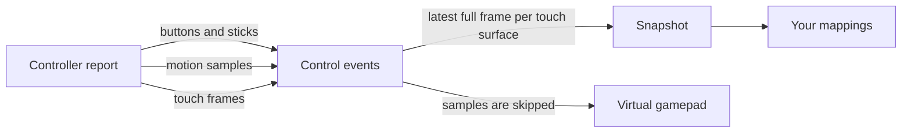
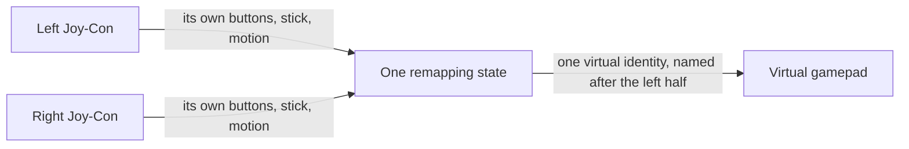

# Remapping Input Samples

Buttons are simple: pressed or not. Motion sensors and touchpads send a stream of readings instead, like frames in a film. This page explains how OJD carries those readings from the controller to your mappings. See the [remapping overview](remapping.md).

## How Motion and Touch Readings Travel

DS4 and DualSense parsers attach motion samples and touch frames to the control events. Snapshots keep the latest complete frame for each touch surface. The virtual gamepad ignores samples.

Layouts follow [Linux hid-playstation][1]. Motion samples use m/s² and rad/s on OJD's shared axes: right-handed, +X right, +Y away from the player, +Z up out of the face. Drivers use factory calibration when the pad has it, or the typical (nominal) scale otherwise, and write which one in `calibrationSource`.

### Timestamps

Each timestamp keeps the pad's raw counter, how many nanoseconds one tick lasts (as a fraction), and a sequence number. A sample's time is the session's first `MonotonicTimestamp` plus the ticks counted since.

| Pad | Counter | One tick |
| --- | --- | --- |
| DS4 | 16-bit | 16000/3 ns |
| DualSense | 32-bit | 1000/3 ns |

- Leftover fractions carry over from one sample to the next.
- Ticks use the typical rate, so sample time can slowly drift away from `ControllerEvent.timestamp`.
- When the counter goes down, OJD assumes it wrapped around once. A reset, or a gap of a whole counter loop or more (about 350 ms on DS4), can't be recovered.
- `resetProtocolState` restarts the clock at the next report and keeps the sequence number counting.

### Touch Contacts

A touch contact (one finger) has a slot, an on/off flag, X and Y scaled to 0 to 65535, and optional `UnipolarValue` pressure (no driver reports it). A frame has a surface and a timestamp.

- The slot is the finger's place in the report. The pad's own finger-tracking counter isn't passed on.
- 0 is the left or top edge, 65535 the right or bottom edge. Drivers state the raw start and size in `ControllerTouchGeometry`: DS4 1920x942, DualSense 1920x1080.
- Scaling first keeps the raw offset within `0...span-1`, then works out `(offset * 65535 + (span - 1) / 2) / (span - 1)` in whole numbers.
- Sony's raw Y grows downward and isn't flipped. Sony frames carry the report's sensor clock time.
- DS4 keeps up to three USB or four Bluetooth past frames, in packet order, each with the report's time.
- A broken DS4 past-frame count drops the touch history and keeps motion. Short DS4 reports that only carry buttons send no samples.

The connected-device payload shows the parser's `capabilities` (whether it has motion, and the most fingers per touch frame). A payload without that key fails to decode. Capabilities describe what OJD can decode, not what was tested on hardware. Other families offer no calibrated motion.

### Nintendo Timing Is a Guess

[Linux hid-nintendo][2] documents three motion samples per report and no timestamp you can trust. So OJD estimates the timing.

- The Switch Pro parser converts all three samples, in the order they arrive, to SI units on the shared axes.
- At HID startup it asks the pad to turn on motion (`0x40`, value `1`).
- Short reports with only buttons don't move its sensor clock.
- Timestamps use the `hostEstimate` basis (pads with real counters use `deviceCounter`) and keep the raw report counter as extra information.
- A sample's time is when the first report arrived plus the estimated time since. The newest sample in a report is dated up to 10 ms after it arrived.
- The first report spaces samples 5 ms apart. After that, spacing is a capped moving average of how often reports arrive.
- Arrival times that go backward are held in place. Gaps longer than 30 ms keep their real length.

[1]: https://github.com/torvalds/linux/blob/893e11787f78e43b534e252249ac3fff4d1333f8/drivers/hid/hid-playstation.c
[2]: https://github.com/torvalds/linux/blob/893e11787f78e43b534e252249ac3fff4d1333f8/drivers/hid/hid-nintendo.c

### Steam Controller Motion

The parser converts the accelerometer and gyro from full-state messages (type 0x01) to SI units at the typical scale, following [SDL's Steam HID parser][3] and [Linux hid-steam][4]. Startup asks for raw output with motion mode 0x18. Shutdown puts the defaults back.

- Axis swaps follow SDL. The gyro and accelerometer swaps differ by a mirror. Which one is right-handed stays unknown until someone captures real hardware.
- Sequence numbers are extra information only. Timestamps use when the Mac received the report: the first accepted motion report starts the session clock, and arrival times that go backward are held in place.
- A repeated sequence number sends no second sample. When the counter wraps, the next report is accepted.
- The receiver connecting, disconnecting, or resetting the session restarts timing and duplicate tracking. Reports while disconnected don't move motion forward.
- Bluetooth LE packets split into chunks aren't supported.

Not checked yet: accuracy on real pads, and whether wireless firmware sends it.

[3]: https://github.com/libsdl-org/SDL/blob/634dff3725b8419902b832d1c84363da211a3596/src/joystick/hidapi/SDL_hidapi_steam.c
[4]: https://github.com/torvalds/linux/blob/893e11787f78e43b534e252249ac3fff4d1333f8/drivers/hid/hid-steam.c

### Steam Trackpads

Full-state packets send a left and a right touch surface, each with one finger in slot 0. Raw positions are signed 16-bit (start -32768, size 65536). X is `raw + 32768`. Raw Y grows upward, so Y is `65535 - (raw + 32768)`.

The pads have no touch clock, so frames carry the report's motion sample time, and touch is only sent in reports that have a motion sample. Per the SDL code, the left pair of axes takes turns between the left pad and the stick.

- Pad packets keep the last stick value. Stick packets keep the last pad position.
- When the stick stops, its push goes back to rest. Lifting a finger from a pad sends an "off" finger frame.
- The receiver resetting clears remembered pad positions and the motion clock.

Not yet checked on real hardware.

### Touch Mappings

Profiles name three surfaces: Primary, Left, and Right. Button-like sources are: a finger touching, a grid cell (1x1 up to 16x16), and a swipe up, down, left, or right of at least a set distance (on the 0 to 1 scale). Command-line forms:

- `touch:<surface>:contact`
- `touch:<surface>:grid:<columns>:<rows>:<zero-based-column>:<zero-based-row>`
- `touch:<surface>:swipe:<direction>:<minimum-distance>`

Clicking the pad down is its own button source. Touching never fakes a click.

Each surface takes at most one sliding mapping: move the pointer, or act as a left or right virtual stick.

- Pointer sensitivity is screen points per full width of the surface.
- Touch-stick radius is a fraction of the surface, the deadzone is 0...1, and output is -1...1. Touch-stick modes need a virtual output setting.
- Axes are `value / 65535`, with no fix for the surface's shape. State is kept per controller and per surface.

How fingers are tracked:

- The lowest active slot is the main finger until it lifts. The same slot with no "off" frame in between is the same finger.
- A new finger, profile, or controller session resets the pointer and stick starting point.
- An "off" frame lets go of touch and grid bindings, and returns the touch stick to rest.
- A swipe fires once, when the main finger lifts.
- Swapping the profile, unplugging, a paused permission, shutting down, and a failed send empty the engine and let go of every button and virtual push touch was holding.

### Steam Grips and Pad Clicks

Steam full-state packets offer the grips and pad clicks as controls: `button:left-paddle2`, `button:right-paddle2`, `button:left-trackpad-click`, `button:right-trackpad-click`. They work with every binding behavior, chord, sequence, and layer. The label translations are drafts. Visual, VoiceOver, and native-speaker review are still open.

They're inputs you can map, not buttons on the virtual gamepad. The checks refuse them as `GamepadButton` targets, and target menus and virtual state leave them out.

- On the classic Steam Controller the right pad is the right stick, so an unmapped right-pad click passes through as the right stick click. A binding takes it over.
- The Steam Deck and Steam Triton have a real right stick click, so their right-pad click reaches no virtual controller.

Not yet checked on real hardware.

### Each Joy-Con on Its Own

The HID catalog picks the left and right Joy-Con layouts for Nintendo 057e:2006 and 057e:2007. Each layout ignores the stick it doesn't have and the other half's button bits, offers one rumble motor, and reads three motion samples per report. Startup asks for full input reports and turns on motion and rumble, without the Pro Controller's USB handshake. The schema and the decoder at runtime refuse conflicting side choices. Steps to check: [Joy-Con validation](../testing/joy-con.md).

### Two Joy-Cons as One Controller

Profiles for the left Joy-Con model can turn on `joyConPair` and choose the left, right, or no gyro. It doesn't run on a single half. Use `ojd controller pair <left> <right> --profile <profile>` and `ojd controller unpair <pair>`. The app's profile screen offers the same choice. A pair only lives in memory. Its session token ends when either controller disconnects.

- Each half is compared with its own last snapshot, so one half never lets go of the other's button.
- The parser turns both halves' motion into the shared axes before calibration and gyro routing, and drops the motion of the half not chosen.
- Buttons, sticks, and rail buttons stay with their own half. Output reports keep separate rumble bytes for each half.

If a half disconnects, you unpair, or the profile library changes, OJD empties the shared output, removes the virtual controller, and ends the session. A half that's still connected goes back to its own virtual gamepad. After a reconnect, pair again. An old session UUID can't unpair the session that replaced it. Not checked yet: Bluetooth pickup, how accurate the pose is, rumble on each half, and games recognizing the virtual gamepad.

Joy-Con rail buttons are `button:auxiliary3` through `button:auxiliary6`, each belonging to its own half. The Pro Controller layout ignores these bits. Rail buttons can map to gamepad buttons or system actions, not to virtual button identities.

### DualSense Edge Buttons and Extra Controls

The generated Edge record (054c:0df2) lists `LeftPaddle1`, `RightPaddle1`, `Auxiliary1`, and `Auxiliary2` in `capabilities.present`, which picks the Edge layout. The standard DualSense (054c:0ce6) uses the standard map. Profiles call the Edge buttons `button:auxiliary1`, `button:auxiliary2`, `button:left-paddle1`, `button:right-paddle1`. They map to the usual output targets.

Bit masks follow [SDL's PS5 parser][5]. Edge on real hardware isn't confirmed.

`capabilities.controls` lists the control IDs the parser declares, in `Control` order, including the basic gamepad controls. Sony touchpad and mute, Steam grips and pad clicks, Joy-Con rail, and Edge controls use their slot IDs.

- `capabilities.absent` removes controls: xpad rows where triggers are on/off buttons drop the analog triggers, and rows with no sticks drop the stick axes.
- `capabilities.present` adds controls the parser sends.
- An unknown control ID or a missing key fails to decode.

Touch surfaces are worked out from the controls. A `touchContactCount` of zero means no surface. Each declared `LeftTrackpadTouch` or `RightTrackpadTouch` control gives a left or right surface. Otherwise there's one primary surface. Sony offers primary, Steam left and right, Nintendo none.

[5]: https://github.com/libsdl-org/SDL/blob/0c8feecce6e57a7a8c1b1eb06631e0a7a56fcd8f/src/joystick/hidapi/SDL_hidapi_ps5.c
