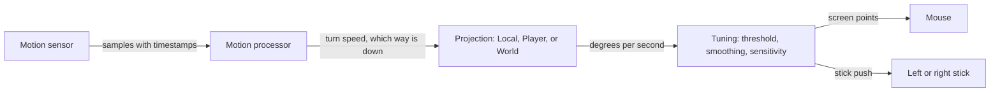

# Remapping Motion Processing

How OJD turns a controller's motion sensor (the gyro, which feels turning, and the accelerometer, which feels gravity and pushes) into mouse or stick movement. See the [remapping overview](remapping.md).



## Per-Device Motion Processing

Each RemappingDeviceState has its own processor. It adds up samples using the time stamped on each sample (in nanoseconds), not the time the sample happened to arrive. It keeps the latest corrected gyro, the estimated orientation, gravity, the movement with gravity taken out (linear acceleration), and the time between samples. Units: [Remapping Calibration](remapping-calibration.md).

| What happens | What the processor does |
| --- | --- |
| A sequence number repeats or goes backward, or a sample time repeats or goes backward | Ignores it |
| A gap longer than 100 ms, a change of clock or tick unit, or calibration from a different source | Resets bias and orientation, and starts timing again from zero |
| A reading out of range | Clears its estimates; the next good sample starts fresh |

Releasing the controller, swapping the profile, or the engine shutting down throws the processor state away. Sony and Nintendo readings carry a calibration revision number that lasts for one session. It goes up when the coefficients or their source change. It stays the same when identical coefficients arrive again or a reply is refused. A new revision resets the estimates. A reading without a revision fails to decode.

## Calibrating the Gyro by Hand

A gyro at rest should read zero, but most read a little off. That small error is the bias, and calibration measures it. The command-line tool and the app's checked service both run it:

```text
ojd controller calibrate <controller> [start|pause|reset]
```

`<controller>` is an ID from `ojd controller list` or a VVVV:PPPP model. With no action, it prints the calibration. With `--json`, each action returns `controller`, `calibrated`, `collecting`, and `offsetDegreesPerSecond` (X/Y/Z). The action `sticks` with `--step <rest|circle|triggers|gyro>` measures stick centres, ranges, trigger ends, and the gyro, and saves them for that controller model.

| Action | What it does |
| --- | --- |
| start | Needs a remapping road that allows it and a good motion starting point. Keep the controller still. |
| pause | Stops collecting by hand and keeps the offset. Automatic collection can go on if the profile turns it on. |
| reset | Clears motion estimates and saved stick values, then waits for a fresh starting point. |

Unplugging, swapping the profile, bad samples, and jumps in the clock or calibration cancel collecting. Calibration never changes the factory coefficients and never saves an offset into a profile. The engine refuses commands from an older mapping session.

The input-test window's **Motion Calibration** panel has **Refresh**, **Start Calibration**, **Pause**, and **Reset**. They send the same commands. The panel shows whether it's collecting, and the X/Y/Z bias in degrees per second. Closing the panel doesn't stop collecting. Not checked yet: how it looks in the app, VoiceOver, and the calibration translations.

### Which Way Is "Turning"

Turning a controller can mean different things depending on how you hold it. Codable RemappingMotionSpace offers three ways to read it:

| Projection | What it means |
| --- | --- |
| Local | The controller's own axes: X is pitch (nodding), Y is yaw (shaking your head). |
| Player | Local pitch, with the Y and Z gyro mixed around the direction of gravity, so yaw feels the same however you tilt the pad. Default yaw relaxation is 1.41, never more than the combined Y/Z rate. |
| World | Yaw is the gyro measured around "up". Pitch is the pitch axis measured flat against gravity. Near a sideways pose pitch gets shaky, so a default 0.125 side-reduction threshold quiets it, and an exactly sideways pose gives zero. |

Each projection gives degrees per second, using gravity scaled to length 1. The motion-action layer in the app then applies the pointer direction, sensitivity, smoothing, and output mapping. The Player and World formulas come from the pinned MIT GamepadMotionHelpers reference. [THIRD_PARTY_NOTICES.md](../../THIRD_PARTY_NOTICES.md) keeps its notice, and release packages must include it.

### Motion Tuning Settings

Codable RemappingMotionTuning fills in defaults for missing fields, and refuses values that aren't finite numbers or are out of range. It sets the projection, inversion, automatic bias, Player yaw relaxation, World side reduction, and these ranges:

| Setting | Range |
| --- | --- |
| Pitch and yaw sensitivity | 0 to 100 |
| Smoothing half-time | 0 to 1000 ms |
| Radial rate threshold (ignore slow turns below this) | 0 to 1000 degrees/second |
| Gravity correction rate | 0 to 100 per second |

The steps run in this order: the threshold, then smoothing over time, then sensitivity and inversion. The same tuning feeds bias, orientation, and projection. Changing it resets processing and the smoothing history.

Tuning that differs from the defaults is saved under `motionTuning`, set with `ojd profile edit` or `ojd profile set`. The profile editor's **Motion Tuning** sheet won't save text that isn't valid. The labels have draft translations. Not checked yet: which languages still show English motion labels, review by native speakers, and how it looks and works with accessibility tools.

### Gyro Output and Turning It On

Profiles accept `gyroOutput` (off if missing). Modes: Disabled, Mouse, LeftStick, RightStick. Stick modes need a virtual gamepad output setting. Mouse needs permission to send system input. Set `gyroOutput.mode`, `gyroOutput.pointerPointsPerDegree`, and `gyroOutput.fullStickDegreesPerSecond` the same way.

- **Mouse:** adds up the time between samples into how many screen points to move.
- **Stick:** divides the turning speed by the full-stick speed, caps each axis, and adds the result to whatever else is pushing that stick.
- If no sample arrives for 100 ms, or calibration resets, only the gyro's part of the stick is removed. If sending fails, OJD lets go of everything (fail-closed).

How the gyro is switched on: Always (no button), WhileHeld, WhileReleased, Toggle. Set `gyroOutput.activationMode` and `gyroOutput.activationSource`. The source is a button, a D-pad direction, or one direction of an axis. A whole axis that slides smoothly is refused.

- Switching on starts from a fresh sample. Switching off removes the gyro's stick push at once.
- While gyro output is on, OJD hides what the activation control would normally do on the virtual gamepad. To let an unmapped activation control through, set `gyroOutput.consumesActivationSource` to false, or turn off the matching toggle in the app.
- Using an axis direction as the switch reserves that whole virtual axis.

Not checked yet: which way real motion moves things, keyboard navigation, VoiceOver. The gyro editor labels need translating.

### Trackball

Trackball mode works like flicking a trackball: let go of the switch and the movement keeps rolling, slowing down over time. Settings live under `gyroOutput.trackball` (`source`, `axes`, `decayHalvingsPerSecond`, `consumesSource`), set the same way. Defaults: both axes, speed halves once per second, the source is hidden from the virtual gamepad. A decay of zero keeps the speed constant. Not checked yet: rules for changing only part of the settings, and for removing the trackball.

While the source is held, the chosen axes use the last accepted turning speed, not live motion (JSM averages the last 125 ms instead). Mouse travel uses the exact sum of the slowing curve. Sticks use the slowed speed. Gaps clear the stored motion. Not checked yet: translation, native review, and how it feels in the hand.

### Motion Settings per Layer

A layer can hold its own `motionTuning`. The most recently switched-on layer that has one supplies the whole value. Releasing or switching off that layer brings back the one before, or else the profile's tuning. A tuning change removes the gyro stick push and clears stored trackball motion, calibration collecting, and the motion starting point. Output comes back after a fresh starting point.

Edit a layer's tuning with `ojd profile edit <profile>` (there are no command-line tuning options). Remove it to fall back to the profile's tuning. Each layer row in the app has a **Motion Tuning** button, and **Use Profile Tuning** in the sheet removes the layer's own tuning. Not checked yet: how it looks in the app, keyboard navigation, VoiceOver, and translations.
