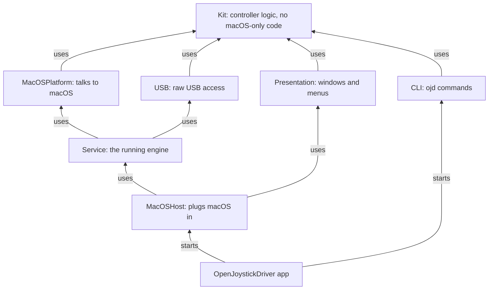

# Source Topology

A map of the source folders. The code is split into layers, like floors in a building: a lower floor never reaches up to a higher one, and the build refuses code that tries. Inside each target, folders group code by what it does. Generated DriverKit output is never source.



## Targets

| Target | What it holds |
| --- | --- |
| OpenJoystickDriverKit | controller logic, HID/USB ports, parsers, profiles, policy, shared RPC contracts |
| OpenJoystickDriverMacOSPlatform | macOS implementations of Kit ports: IOKit HID access and streams, the `IOHIDUserDevice` virtual-device publisher, GameController synthetic HID, access control, login-item registration, code signing identity, physical report descriptors |
| OpenJoystickDriverUSB | IOUSBHost/USBDriverKit facade and restricted DEXT configuration |
| OpenJoystickDriverService | runtime RPC server, output dispatch, remapping library/routing/system events, status, diagnostics |
| OpenJoystickDriverCLI | command words and what each command does. Has no macOS-only code, and reaches macOS through `PlatformHost` |
| OpenJoystickDriverPresentation | AppKit lifecycle and SwiftUI user flows |
| OpenJoystickDriverMacOSHost | macOS host adapter: `MacOSPlatformHost` conformance and the headless application host |
| OpenJoystickDriver | executable: main, host installation, App Intents, bundle resources |
| DriverKitGenerator | entry point that writes the DriverKit project at build time |
| OJDRepositoryTool | development executable that checks controller records, protocol descriptions, profiles and virtual devices, applies built-in patches and rewrites property lists in canonical form (`format-plist`); not shipped |
| OpenJoystickDriverHIDTool | internal tool for poking at hardware |
| OpenJoystickDriverGameControllerProbe | small separate tool that checks whether GameController sees a pad |
| OpenJoystickDriverGameControllerViewer | window that shows every GameController input element of each connected controller and prints each change as a JSON line, to test GameController input by hand; not shipped |

OJDRepositoryTool ships in neither the app nor `ojd`, depends only on Kit, and needs no localization. For each problem it prints one JSON line `{code, file, message}`. It exits with 1 when it finds any problem, and 64 when the call itself is wrong. Calls:

- `swift run OJDRepositoryTool validate controllers|descriptions <directory>`
- `validate profiles|virtual-devices <path>...`
- `apply-patches --controllers <directory> --patches <directory> --out <directory>`

## Who May Use Whom

`Package.swift` lists these links, and the compiler refuses any other import.

```text
Kit
MacOSPlatform             -> Kit
USB                       -> Kit
Service                   -> Kit, MacOSPlatform, USB
CLI                       -> Kit
Presentation              -> Kit
MacOSHost                 -> Kit, MacOSPlatform, USB, Service, Presentation
OpenJoystickDriver        -> Kit, Service, CLI, Presentation, MacOSHost
DriverKitGenerator        -> Kit, USB
OJDRepositoryTool         -> Kit
HIDTool                   -> Kit, MacOSPlatform, USB
GameControllerProbe       -> Kit, MacOSPlatform
GameControllerViewer
```

- Presentation reaches the runtime through `ApplicationServiceGateway` (implemented by `ApplicationServiceClientGateway` over the Kit RPC client) and functions passed in from outside. It never imports Service, CLI, or USB.
- Kit declares `PlatformHost` and the `PlatformHosts` registry. The executable installs `MacOSPlatformHost` (OpenJoystickDriverMacOSHost) at launch. The CLI calls `PlatformHosts.current` for extension status, activation, USB scanning, entitlement checks, access state, code signing identities, report descriptors, and login-item registration. Without a host, a command stops with a failed precondition.
- Kit declares the other host ports: `AccessControlSystem`, `ApplicationServiceRegistration`, `HIDAccessBackend`, `VirtualHIDDevicePublisher` with `VirtualDeviceBackend`, and `Switch2BluetoothLEWriter`. OpenJoystickDriverMacOSPlatform implements the IOKit, Security, ServiceManagement, and IOHIDUserDevice ones. The composition roots, `ApplicationServiceRuntime`, `MacOSPlatformHost`, and the two investigation executables, pass them in. Kit imports no macOS-only framework.
- Only OpenJoystickDriverUSB, DriverKitGenerator, and their tests import SwifterKit. Kit owns stable Sendable transport values and protocols; USBDriverKit, IOUSBHost, and SwifterKit lifetimes stay in USB.
- The executable's headless host owns one `ApplicationServiceRuntime`, which starts the authenticated RPC server. Both live in Service.

## What Each Folder Holds

```text
Sources/OpenJoystickDriverKit/
  ApplicationService/  shared client, RPC, payload, lifecycle, and remapping contracts
  Bluetooth/           Switch 2 Bluetooth LE routing
  CommandLine/         kebab-case spellings of enum values for command-line output
  Concurrency/         locking and blocking-work helpers
  Platform/            `PlatformHost` protocol and `PlatformHosts` registry
  Device/              identity types (model, hardware, port key, session token, reference),
                       Controller state, Manager, Discovery (HID, USB), PhysicalOutput, Pipeline
  Diagnostics/         support reports, probes, health, build identity, and packet logs (read by CLI and app)
  Errors/              the `ErrorCode` catalog
  HID/                 the `HIDAccessBackend` port, bounded reads, and `HIDManager` over a host backend
  Localization/        string lookup over the bundled locale tables
  Migration/           conversion of stored documents of an older version (`ojd migrate`)
  Output/              the `VirtualHIDDevicePublisher` port, dispatchers, reports, formats, and profiles
  Packages/            mod package manifest, validation, and the installed-package store
  Permissions/         app permission policy
  Process/             bounded external process runner and the command-line tool link status
  Protocol/            catalog, GIP, parsers, drivers, classification, and physical-output
                       capabilities
  Remapping/           reusable profile and mapping engine
  Resources/           generated controller records (Controllers/), protocol descriptions
                       (Protocols/), virtual devices (VirtualDevices/), and localization tables
  Settings/            the `Settings.plist` store, document, and watcher (defaults, then the user file)
  Storage/             DataDirectory port and its macOS implementation; the only path builder
  Streaming/           `InputSource` and `OutputSink`, the frame boundary every path attaches to
  Update/              release version parsing and update checking

Sources/OpenJoystickDriverMacOSPlatform/
  HID/                 IOHID access backend, device streams, synthetic-device filter, physical
                       report descriptors, and IOReturn failure mapping
  Output/              `IOHIDUserDevice` publisher and virtual-device backend
  Permissions/         `AccessControlSystem` over IOHID access and CoreGraphics post-event access
  ApplicationService/  main-app login-item registration over `SMAppService`
  Security/            code signing identity and socket-peer code checks

Sources/OpenJoystickDriverUSB/
  Configuration.swift  restricted DEXT USB configuration
  PassiveProbe/        passive USB registry and descriptor probing
  Transport/           IOUSBHost and USBDriverKit transports

Sources/OpenJoystickDriverService/
  Remapping/           Profiles (library and persistence), Routing, SystemEvents
                       (CoreGraphics adaptation)
  Runtime/             runtime composition, Automation, Endpoint, OutputDispatch, RPC, file
                       watchers, and virtual device diagnostics
  Status/              SystemExtension submission, probe, and setup client

Sources/OpenJoystickDriverCLI/
  Commands/            one directory per command group: Access, Binding, Config, Controller,
                       Diagnose, Explain, Generate, Log, Macro, Migrate, Mod, Permission,
                       Profile, Protocol, Record, Service, Setting, Status,
                       TransportExtension, Update, Virtual
  Root/                global options, failure and terminal handling, service connection

Sources/OpenJoystickDriverMacOSHost/
  MacOSPlatformHost.swift, HeadlessApplicationHost.swift

Sources/OpenJoystickDriverPresentation/
  Access/  Activity/  Components/  Controllers/  InputCapture/  Library/  MainMenu/  MainWindow/
  MenuBar/  Profiles/  Runtime/  Settings/  SettingsWindow/

Sources/OpenJoystickDriver/
  main.swift, App/ (Info.plist, Host.entitlements), Resources/
  platform/macos/      PlatformHostInstallation.swift and the App Intents (compiled into the app target for discovery)
```

Targets with no macOS-only code (no macOS device, security, or app framework): `Sources/OpenJoystickDriverKit`, `Sources/OpenJoystickDriverCLI`, and the executable's files outside `Sources/OpenJoystickDriver/platform`.

| Target with no macOS-only code | May import |
| --- | --- |
| Kit | CryptoKit, Darwin, Dispatch, Foundation (Apple platforms only) |
| CLI | ArgumentParser, Darwin, Dispatch, Foundation, Glibc, Kit |
| Executable | Dispatch, Foundation, CLI, Kit |

## Tests

Tests copy the source layout for Kit, MacOSPlatform, USB, Service, CLI, and Presentation: `Sources/<Target>/A/B/File.swift` is tested in `Tests/<Target>Tests/A/B/`. Shared fixtures: `Tests/OpenJoystickDriverTestSupport/` (fake `PlatformHost`, access, registration, and HID backend fakes) and `Tests/ProtocolPacketFixtures/`. `Tests/ParserCompatibilityHarness/` backs `just test-parsers-macos14`. Tests check what the code does. They don't search the source text for strings.

## Naming and Limits

Extension files are named `Type+Concern.swift`, where the concern is a noun such as `+Queries`, `+Parsing`, or `+Lifecycle`. Delete empty stubs.

SwiftLint `file_length` fails a Swift file over 500 lines under Sources and Tools, or 1000 under Tests (`Tests/.swiftlint.yml`); comment-only and blank lines don't count.

## Rules

- Each job has one home. No second names, files that only pass calls along, or old entry points.
- Keep Kit independent of SwifterKit and of app, runtime, and platform composition.
- IOUSBHost and DriverKit adaptation live in USB; parsing lives in Kit.
- Use IOKit HID (`IOHIDManager`, `IOHIDDevice`, `IOHIDUserDevice`) in OpenJoystickDriverMacOSPlatform on every supported macOS. HID code is the same on every macOS version, and the package doesn't link CoreHID.
- Never edit or commit `.build/driverkit/generated/`. Check it with `just driverkit-check`. `just driverkit-generate [path]` writes only into a missing folder (default `.build/driverkit/generated/`); delete it to regenerate.

## Ideas We Turned Down

- Folders only, without targets: nothing checked the layers, and Status ended up depending on CLI. Targets make the compiler refuse imports like that.
- More services or processes: no part needs to ship or grow on its own, so the app runs one engine.

## Further Reading

- [Architecture](architecture.md)
- [Building From Source](building-from-source.md)
