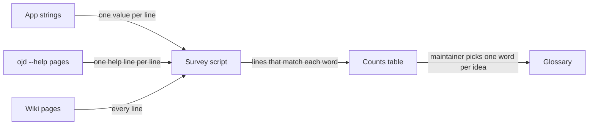

# Terminology Survey

One idea often ends up with several names, like "sofa", "couch", and "settee". This page counts how often the app, the command line, and the wiki use each name for the ideas below. The maintainer picked the `wiki/Glossary.md` words from these counts.



## How the Counts Are Made

One script makes every number.

```sh
swift build --product OpenJoystickDriver
Scripts/Quality/terminology_survey.sh [WORKDIR]   # default WORKDIR .build/terminology
```

The script writes three tab-separated input files to `WORKDIR` and counts each term in each. Running it twice prints the same table (`cmp`). Each `ojd ... --help` call takes about 9 s, so 112 pages take several minutes.

| Source | Input file | Built by | Counted lines |
| --- | --- | --- | --- |
| Strings | `strings.tsv` | `find Sources -path '*/en-US.lproj/*' \( -name '*.strings' -o -name '*.stringsdict' \)`; for `.strings`, the value of each `"key" = "value";` line, for `.stringsdict`, each `<string>` line (2619 lines) | one value |
| Help | `help.tsv` | `OJD_RUN_REPOSITORY_CLI=1 .build/debug/ojd [sub...] --help`, following each `SUBCOMMANDS:` entry down: 112 pages, 2137 lines | one help line |
| Wiki | `wiki.tsv` | every line of `wiki/*.md`, including `AGENTS.md`, `_Sidebar.md`, `_Footer.md`, code blocks and tables (5521 lines) | one line, plus the number of pages in parentheses |

Reading the numbers:

- Only `OpenJoystickDriverKit` has an `en-US.lproj`, holding every GUI and CLI string (`LOCALIZATION.md`).
- A count is the number of lines that match the pattern, ignoring case. A line with two matches counts once. The script searches values, help text, and wiki text, not keys.
- Terms overlap: "profile" includes "remapping profile", "driver (any)" includes "Xbox USB driver", and "persona" sits under concepts 2 and 3. So the counts aren't shares of a whole.
- Help text comes mostly from `cli.*` and `platform.macos.cli.*` values, so help lines often repeat a string.
- `Strings` includes `.stringsdict` plurals: "Xbox USB driver" has 12 here, 7 in `.strings` alone.
- Wiki numbers include command examples. `SDLCompatible` and `GameControllerCompatible` count names in code.
- Example columns show the first two matching lines: `Localizable.strings:N` or `Localizable.stringsdict:N` in `Sources/OpenJoystickDriverKit/Resources/en-US.lproj/`, the help page command, `Page.md:N` in `wiki/`. `-` means no match.

To count one term by hand after a run, change the pattern:

```sh
perl -ne 'chomp; my ($l,$t)=split /\t/,$_,2; print "$l\n" if $t =~ /\bpersonas?\b/i' .build/terminology/strings.tsv | wc -l
```

## Counts

| Concept | Term | Strings | Help lines | Wiki lines (pages) | Strings example | Help example | Wiki example |
| --- | --- | ---: | ---: | ---: | --- | --- | --- |
| 1 Profile | profile | 231 | 151 | 473 (28) | Localizable.strings:70, Localizable.strings:76 | ojd, ojd | Automating-OpenJoystickDriver.md:3, Automating-OpenJoystickDriver.md:29 |
| 1 Profile | remapping profile | 10 | 6 | 15 (10) | Localizable.strings:1569, Localizable.strings:3127 | ojd, ojd profile | Automating-OpenJoystickDriver.md:342, Automating-OpenJoystickDriver.md:343 |
| 1 Profile | mapping | 14 | 9 | 28 (7) | Localizable.strings:520, Localizable.strings:522 | ojd profile set, ojd virtual | Command-Reference.md:38, Command-Reference.md:88 |
| 1 Profile | preset | 0 | 0 | 0 (0) | - | - | - |
| 2 Virtual gamepad | virtual gamepad | 46 | 22 | 58 (13) | Localizable.strings:190, Localizable.strings:280 | ojd, ojd controller | Automating-OpenJoystickDriver.md:3, Automating-OpenJoystickDriver.md:52 |
| 2 Virtual gamepad | virtual device | 6 | 1 | 12 (6) | Localizable.strings:334, Localizable.strings:2959 | ojd migrate | Building-from-Source.md:26, Building-from-Source.md:71 |
| 2 Virtual gamepad | virtual controller | 2 | 0 | 46 (17) | Localizable.strings:2359, Localizable.strings:4914 | - | Automating-OpenJoystickDriver.md:310, Automating-OpenJoystickDriver.md:312 |
| 2 Virtual gamepad | virtual HID | 7 | 0 | 5 (3) | Localizable.strings:300, Localizable.strings:308 | - | Playing-Games.md:47, Troubleshooting.md:102 |
| 2 Virtual gamepad | persona | 12 | 0 | 15 (7) | Localizable.strings:2663, Localizable.strings:2987 | - | Automating-OpenJoystickDriver.md:31, Automating-OpenJoystickDriver.md:214 |
| 2 Virtual gamepad | virtual joystick | 0 | 0 | 0 (0) | - | - | - |
| 3 Virtual gamepad kind | kind | 12 | 0 | 68 (11) | Localizable.strings:3467, Localizable.strings:3469 | - | Automating-OpenJoystickDriver.md:29, Automating-OpenJoystickDriver.md:49 |
| 3 Virtual gamepad kind | persona | 12 | 0 | 15 (7) | Localizable.strings:2663, Localizable.strings:2987 | - | Automating-OpenJoystickDriver.md:31, Automating-OpenJoystickDriver.md:214 |
| 3 Virtual gamepad kind | SDLCompatible | 0 | 0 | 27 (9) | - | - | Automating-OpenJoystickDriver.md:214, Command-Reference.md:239 |
| 3 Virtual gamepad kind | GameControllerCompatible | 0 | 0 | 12 (6) | - | - | Automating-OpenJoystickDriver.md:214, Command-Reference.md:239 |
| 3 Virtual gamepad kind | Generic (HID gamepad) | 3 | 3 | 45 (13) | Localizable.strings:1008, Localizable.strings:1010 | ojd virtual set, ojd virtual feed | Automating-OpenJoystickDriver.md:214, Automating-OpenJoystickDriver.md:215 |
| 3 Virtual gamepad kind | SDL-compatible (spaced) | 0 | 3 | 6 (2) | - | ojd virtual set, ojd virtual feed | Automating-OpenJoystickDriver.md:31, Automating-OpenJoystickDriver.md:280 |
| 3 Virtual gamepad kind | For Steam and SDL games | 0 | 0 | 0 (0) | - | - | - |
| 3 Virtual gamepad kind | For Apple Game Controller games | 0 | 0 | 0 (0) | - | - | - |
| 3 Virtual gamepad kind | backend | 0 | 2 | 5 (2) | - | ojd virtual launch, ojd virtual launch | Command-Reference.md:50, Command-Reference.md:236 |
| 4 Who reads the controller | Served by | 5 | 0 | 2 (2) | Localizable.strings:268, Localizable.strings:1352 | - | Controller-Records.md:82, Using-the-App.md:143 |
| 4 Who reads the controller | Handled by | 0 | 0 | 0 (0) | - | - | - |
| 4 Who reads the controller | Left to macOS | 1 | 0 | 2 (1) | Localizable.strings:2007 | - | Playing-Games.md:38, Playing-Games.md:89 |
| 4 Who reads the controller | macOS (native) | 2 | 0 | 1 (1) | Localizable.strings:270, Localizable.strings:2695 | - | Using-the-App.md:145 |
| 4 Who reads the controller | OpenJoystickDriver (virtual) | 1 | 0 | 1 (1) | Localizable.strings:272 | - | Using-the-App.md:145 |
| 4 Who reads the controller | native | 8 | 2 | 13 (6) | Localizable.strings:266, Localizable.strings:270 | ojd controller claim, ojd controller release | Command-Reference.md:88, Command-Reference.md:94 |
| 4 Who reads the controller | owner / ownership | 4 | 2 | 2 (2) | Localizable.strings:2633, Localizable.strings:2655 | ojd controller, ojd controller show | Command-Reference.md:88, Remapping-Profiles.md:67 |
| 5 DriverKit extension | Xbox USB driver | 12 | 0 | 22 (11) | Localizable.strings:1328, Localizable.strings:1332 | - | Building-from-Source.md:89, Connecting-Controllers.md:3 |
| 5 DriverKit extension | Driver Extension | 7 | 0 | 28 (14) | Localizable.strings:282, Localizable.strings:1356 | - | Building-from-Source.md:17, Building-from-Source.md:58 |
| 5 DriverKit extension | system extension | 4 | 1 | 11 (8) | Localizable.strings:1000, Localizable.strings:1002 | ojd | Building-from-Source.md:58, Building-from-Source.md:70 |
| 5 DriverKit extension | transport extension | 4 | 6 | 12 (3) | Localizable.strings:2173, Localizable.strings:2183 | ojd, ojd transport-extension | Command-Reference.md:18, Command-Reference.md:94 |
| 5 DriverKit extension | DriverKit | 1 | 2 | 8 (5) | Localizable.strings:2263 | ojd, ojd transport-extension | Automating-OpenJoystickDriver.md:9, Building-from-Source.md:17 |
| 5 DriverKit extension | dext | 1 | 0 | 1 (1) | Localizable.strings:2273 | - | Building-from-Source.md:73 |
| 5 DriverKit extension | USB driver (any) | 12 | 0 | 23 (12) | Localizable.strings:1328, Localizable.strings:1332 | - | Building-from-Source.md:89, Command-Reference.md:265 |
| 5 DriverKit extension | driver (any) | 31 | 3 | 81 (20) | Localizable.strings:282, Localizable.strings:874 | ojd, ojd config | Automating-OpenJoystickDriver.md:212, Automating-OpenJoystickDriver.md:330 |
| 6 How a controller reaches the Mac | connection | 18 | 7 | 44 (11) | Localizable.strings:1066, Localizable.strings:1380 | ojd controller disconnect, ojd record test | Automating-OpenJoystickDriver.md:9, Automating-OpenJoystickDriver.md:75 |
| 6 How a controller reaches the Mac | transport | 12 | 6 | 31 (9) | Localizable.strings:2173, Localizable.strings:2183 | ojd, ojd transport-extension | Building-from-Source.md:17, Building-from-Source.md:18 |
| 6 How a controller reaches the Mac | Wireless Link | 2 | 0 | 2 (1) | Localizable.strings:4459, Localizable.strings:4571 | - | Using-the-App.md:62, Using-the-App.md:109 |
| 6 How a controller reaches the Mac | wireless | 4 | 0 | 14 (7) | Localizable.strings:214, Localizable.strings:1896 | - | Connecting-Controllers.md:24, Connecting-Controllers.md:32 |
| 6 How a controller reaches the Mac | receiver / dongle | 4 | 0 | 33 (11) | Localizable.strings:210, Localizable.strings:214 | - | Command-Reference.md:88, Connecting-Controllers.md:3 |
| 6 How a controller reaches the Mac | cable / wired | 4 | 0 | 13 (4) | Localizable.strings:188, Localizable.strings:234 | - | Connecting-Controllers.md:20, Connecting-Controllers.md:24 |
| 6 How a controller reaches the Mac | bus | 0 | 0 | 1 (1) | - | - | Controller-Records.md:590 |
| 7 What the controller's own switch selects | mode | 21 | 0 | 94 (14) | Localizable.strings:202, Localizable.strings:204 | - | Bindings-and-Actions.md:223, Bindings-and-Actions.md:286 |
| 7 What the controller's own switch selects | protocol | 29 | 17 | 66 (14) | Localizable.strings:166, Localizable.strings:170 | ojd, ojd protocol | Automating-OpenJoystickDriver.md:31, Command-Line.md:95 |
| 7 What the controller's own switch selects | switch | 7 | 0 | 42 (13) | Localizable.strings:740, Localizable.strings:1012 | - | Automating-OpenJoystickDriver.md:166, Bindings-and-Actions.md:9 |

## Search Patterns

Perl patterns. `\b` marks the edge of a word.

```text
profile                          \bprofiles?\b
remapping profile                remapping profiles?
mapping                          \bmappings?\b
preset                           \bpresets?\b
virtual gamepad                  virtual gamepads?
virtual device                   virtual devices?
virtual controller               virtual controllers?
virtual HID                      virtual HID
persona                          \bpersonas?\b
virtual joystick                 virtual joysticks?
kind                             \bkinds?\b
SDLCompatible                    SDLCompatible
GameControllerCompatible         GameControllerCompatible
Generic (HID gamepad)            \bGeneric\b
SDL-compatible (spaced)          SDL[- ]compatible
For Steam and SDL games          for steam and sdl
For Apple Game Controller games  for apple game controller
backend                          \bbackends?\b
Served by                        served by
Handled by                       handled by
Left to macOS                    left to macos
macOS (native)                   macos \(native\)
OpenJoystickDriver (virtual)     openjoystickdriver \(virtual\)
native                           \bnative(ly)?\b
owner / ownership                \bowner(ship)?\b
Xbox USB driver                  xbox usb driver
Driver Extension                 driver extensions?
system extension                 system extensions?
transport extension              transport[- ]extensions?
DriverKit                        driverkit
dext                             \bdexts?\b
USB driver (any)                 usb drivers?
driver (any)                     \bdrivers?\b
connection                       \bconnections?\b
transport                        \btransports?\b
Wireless Link                    wireless link
wireless                         \bwireless\b
receiver / dongle                \b(receivers?\|dongles?)\b
cable / wired                    \b(cables?\|wired)\b
bus                              \bbus\b
mode                             \bmodes?\b
protocol                         \bprotocols?\b
switch                           \bswitch(es)?\b
```

## Concepts With More Than One Term in Use

A term is in use when a source counts it above zero as a name for the idea. The general words "driver", "native", "kind", "switch", and "owner" don't count.

- 1 Profile: "profile" only. "mapping" and "preset" were searched as possible other names. Whether "mapping" means the same thing is the maintainer's call.
- 2 Virtual gamepad: five terms in strings: "virtual gamepad", "persona", "virtual HID", "virtual device", "virtual controller". The wiki adds 46 "virtual controller" lines. The help uses "virtual gamepad" and one "virtual device".
- 3 Virtual gamepad kind: "persona", `SDLCompatible`, `GameControllerCompatible`, "SDL-compatible", "Generic". The proposed labels "For Steam and SDL games" and "For Apple Game Controller games" appear nowhere.
- 4 Who reads the controller: "Served by", "Left to macOS", "macOS (native)", "OpenJoystickDriver (virtual)". "Handled by" appears nowhere, and the help has no "Served by".
- 5 DriverKit extension: "Xbox USB driver", "Driver Extension", "system extension", "transport extension" (also a command name), "DriverKit", "dext".
- 6 How a controller reaches the Mac: "connection", "transport", "Wireless Link".
- 7 What the controller's own switch selects: "mode" and "protocol". You have to read the "protocol" lines to tell which meaning each one has.

Counted on 2026-11-12 at commit `791b9d34a`.
