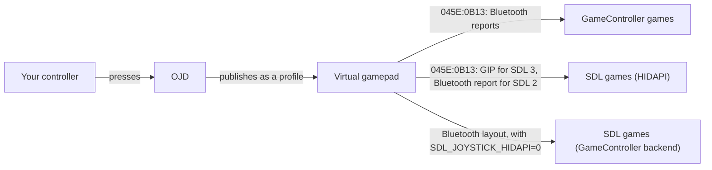

# Virtual Profile Selection: What GameController and SDL Read

Games read controllers in two main ways on a Mac: Apple's GameController.framework and SDL. Think of them as two readers who only understand certain handwriting. OJD can write its virtual gamepad in several hands (profiles). This page asks two things: is there one hand both readers understand, and what would it take to switch hands to suit the app in front? Everything here was measured.

Measured on the maintainer's Mac (macOS 27, Darwin 27.2.0) with installed app `0.6.0-alpha.2+build.1.27.48.sha.448cfab83661.dirty`, SDL 3.4.20, and an 8BitDo Ultimate 2C Wireless (`2DC8:301B`) over Bluetooth LE.

## Result

| Question | Answer |
| --- | --- |
| One profile both GameController and SDL's HIDAPI drivers read | SDLCompatible as `045E:0B13`: the Xbox Series Bluetooth reports with their usages for GameController and SDL 2, and the Xbox One GIP reports as vendor data for SDL 3. See [SDLCompatible as 0B13](#sdlcompatible-as-0b13). GameController reads input only from the Bluetooth report layout, and SDL 3's HIDAPI drivers only from the GIP layout. |
| A profile both read, with a condition | 045E:0B13 (GameControllerCompatible) or 045E:0B20 over the Bluetooth layout, with `SDL_JOYSTICK_HIDAPI=0`. SDL then reads the pad through its GameController backend. `ojd virtual launch --sdl-gamecontroller-backend` sets this up (see `wiki/Playing-Games.md`). |
| Home (Guide) | SDL 2 and SDL 3 read Guide as button 5. macOS reads Guide from report 1 as Consumer AC Home. With Enable Home Button Actions on, one press opens the Games app. With it off, a front app that sets Home's `preferredSystemGestureState` to `.disabled` gets one press and one release. A background app, or a front app that keeps the default gesture state, gets none, which is why the background GameController probe never reported it. Steam opens Big Picture on Guide. |
| Swapping the published gamepad | SDL sees it removed within 36 ms, then added 2.0 s later with a different instance ID. GameController sees connect or disconnect within 76 ms. See [What a running game observes when OJD replaces the gamepad](#what-a-running-game-observes-when-ojd-replaces-the-gamepad). |

## How We Measured

Logs: `docs/development/virtual-profile-selection/`, named `.txt` because the repository ignores `*.log` (`.gitignore:186`). Each log records the command line its run used. A `candidates/` log names `Scripts/Diagnostics/backend.sh gamecontroller` or `backend.sh sdl3`; `just diagnose-gamecontroller` and `just diagnose-sdl3` take the same arguments.

| Tool | What it does |
| --- | --- |
| `run.sh <profile> <tag> <probe...>` | Publishes a bundled profile with `ojd virtual feed --as <profile>`, feeding `frames.jsonl`. The probe starts 1.5 s later. The log ends with `# probe exit:` and `# feed exit:`; feed output goes to `<profile>.<tag>.feed.txt`. No controller was connected. |
| `candidate.sh <name> <persona> <vid> <pid> <version> <productName> <seconds> [parallel] [tags...]` | Publishes the 2C's virtual gamepad under another identity via the user file `~/Library/Application Support/OpenJoystickDriver/VirtualDevices/2dc8-301b.plist` (match, persona, identity; format in `wiki/Controller-Records.md`). The service keeps the persona's report layout and swaps in the identity (`Sources/OpenJoystickDriverKit/Output/Profiles/VirtualDeviceProfile.swift:51-65`). `candidate.sh --clear` removes the file. Each log starts with `ojd virtual show`. |
| `just diagnose-gamecontroller --seconds N` | GameController probe (`Sources/OpenJoystickDriverGameControllerProbe/main.swift`). Lists HID gamepads (`GCController.supportsHIDDevice`) and `GCController`s. Prints a `button:` line for each button change and a `direction:` line for each d-pad or stick change. The last line has `live_input=true` once input arrived. |
| `just diagnose-sdl3 --seconds N --wait-devices 5` | SDL3 probe (`Tools/SDLGamepadProbe/main.m`). Prints `GAMEPAD_BUTTON`, `GAMEPAD_AXIS`, `GAMEPAD_ADDED`, `GAMEPAD_REMOVED`, and nothing for a joystick without a gamepad mapping. HIDAPI ran three ways: default (unset), `SDL_JOYSTICK_HIDAPI=1`, and `SDL_JOYSTICK_HIDAPI=0`. |
| `ojd controller watch 2DC8:301B --output --duration N` | Shows what OJD got from the 2C and sent on (`out buttons=0x…`), which proves a press reached OJD even when a probe saw nothing. |

`ojd virtual feed` publishes only bundled identities: `makeVirtualFeedDevice` in `Sources/OpenJoystickDriverService/Runtime/ApplicationServiceRuntime+UserSpaceDispatcherFactory.swift` applies no user identity. Candidates use the 2C as input, and the maintainer pressed each control.

`frames.jsonl` starts with 6 s at rest, then holds each control for 700 ms with 300 ms at rest between. Order: South, East, West, North, LeftShoulder, RightShoulder, LeftTrigger and RightTrigger as buttons, LeftStickClick, RightStickClick, Start, Back, Guide, DpadUp/Down/Left/Right, then LeftStickX, LeftStickY, RightStickX, RightStickY, LeftTrigger, RightTrigger as axes at 1.0.

SDL buttons: 0 South, 1 East, 2 West, 3 North, 4 Back, 5 Guide, 6 Start, 7 left stick, 8 right stick, 9 left shoulder, 10 right shoulder, 11 to 14 d-pad up, down, left, right. Axes: 0 to 3 left X, left Y, right X, right Y; 4 left trigger; 5 right trigger.

Button names follow `docs/testing/8bitdo-ultimate-2c.md`: View (small, left of center) reaches games as Back, Menu (right of center) as Start, Home (round, center) as Guide. Ignore the stray 045E:028E pad (`GamePad-1` or `GamePad-2`) in most GameController logs. No run published it.

## Bundled Profiles

These runs measured installed app `0.6.0-alpha.2`, whose sdl-compatible published `045E:0B0C` with GIP reports alone. [SDLCompatible as 0B13](#sdlcompatible-as-0b13) measures the bundled profile.

Logs: `<profile>.<tag>.txt` for sdl-compatible, game-controller-compatible, generic; tags gc, sdl-hidapi-default, sdl-hidapi-on, sdl-hidapi-off. Each ends with `# probe exit: 0` and `# feed exit: 0`.

| Profile | Identity seen | GameController | SDL default and `HIDAPI=1` | SDL `HIDAPI=0` |
| --- | --- | --- | --- | --- |
| sdl-compatible | `045E:0B0C`, layout Xbox One GIP | HID gamecontroller=yes, 0 controllers, `connect=false` | gamepad "Xbox Adaptive Controller", GUID 0300faeb5e0400000c0b000000006800, every control | Found 0 joystick(s) |
| game-controller-compatible | `045E:0B13`, layout Xbox Series Bluetooth | controller "Xbox Wireless Controller", `extended_profile=true live_input=true`, every control but Home | gamepad "Xbox Series X Controller", GUID 0300c6515e040000130b000000006800, 0 events | gamepad, ver=0xa33b, GUID 0500509d5e040000130b00003ba36d04, every control but Guide |
| generic | `1209:4A4F`, OJD generic layout | HID gamecontroller=no, 0 controllers | joystick, is_gamepad=no, GUID 0300be1c091200004f4a000008040000, 0 events | same |

Fed controls:

| Control | sdl-compatible, SDL default and `HIDAPI=1` | game-controller-compatible, GameController | game-controller-compatible, SDL `HIDAPI=0` |
| --- | --- | --- | --- |
| South, East, West, North | buttons 0 to 3 | Button A, B, X, Y | buttons 0 to 3 |
| LeftShoulder, RightShoulder | buttons 9, 10 | Left Shoulder, Right Shoulder | buttons 9, 10 |
| LeftTrigger, RightTrigger (button and axis) | axes 4, 5, 2 presses each | Left Trigger, Right Trigger, 2 presses each | axes 4, 5, 2 presses each |
| LeftStickClick, RightStickClick | buttons 7, 8 | Left, Right Thumbstick Button | buttons 7, 8 |
| Start | button 6 | Button Menu | button 6 |
| Back | button 4 | Button Options | button 4 |
| Guide | button 5 | no line | no event |
| DpadUp/Down/Left/Right | buttons 11 to 14 | `direction: Direction Pad`, 8 lines | buttons 11 to 14 |
| Left stick X, Y; right stick X, Y | axes 0 to 3 | `direction: Left Thumbstick` and Right Thumbstick, 4 lines each | axes 0 to 3 |

Every other cell reads nothing:

- sdl-compatible: GameController has no controller, and SDL `HIDAPI=0` finds no joystick.
- game-controller-compatible: SDL default and `HIDAPI=1` list the gamepad but print no event.
- generic: no app reading it prints an event. The SDL probe prints no raw joystick events, so it can't show whether the generic joystick's raw buttons change. Generic only has an SDL mapping when `ojd virtual launch` or `ojd virtual export-mapping` supplies one (see `wiki/Command-Reference.md`). These runs used neither.

## SDLCompatible as 0B13

SDLCompatible publishes `045E:0B13` "Xbox Wireless Controller" with a USB transport. Its descriptor is the Xbox Series Bluetooth descriptor (reports 1, 2, 3 and 4 with their usages), followed by GIP reports `0x20`, `0x07` and `0x09` as vendor data (`XboxOneGIPHIDDescriptor`).

- GameController binds it, because the kext lists `0b13` with `GCIOMatchVirtual`. It reads the Bluetooth usages, and the vendor GIP reports add no controls.
- SDL 2 reads Bluetooth reports 1, 2 and 4, because `0b13` is on `SDL_IsJoystickBluetoothXboxOne`.
- SDL 3 reads the GIP reports and drops report 1, as in [SDL 2](#sdl-2) below.

Measured with `ojd virtual feed --as sdl-compatible < frames.jsonl` and default hints, with the 2C connected over USB. Logs: `sdl-compatible-0b13/`.

| Reader | Result | Log |
| --- | --- | --- |
| GameController | "Xbox Wireless Controller", `extended=true`, `live_input=true`; Button A, B, X, Y, both shoulders and triggers, both thumbstick buttons, Menu, Options, Direction Pad, both thumbsticks; no Home | `feed.gc.txt` |
| SDL 3.4.20 | gamepad "Xbox Series X Controller", GUID 0300c6515e040000130b000000006800; buttons 0 to 14, Guide (button 5) included; axes 0 to 5 | `feed.sdl3.txt` |
| SDL 3.4.20, `SDL_JOYSTICK_IOKIT=0` | `SDL_RumbleGamepad=ok` on the 2C's published pad; the maintainer felt the rumble | `rumble.sdl3-iokit-off.txt` |
| SDL 2.30.12 (CrossOver 26.3) | gamepad "Xbox Series X Controller", same GUID; buttons and axes read; left Y rests at 15 after a move | `feed.sdl2-crossover.txt` |
| SDL 2.30.12, beside the SDL 3 and GameController probes | listed the pad and read no event | `parallel.sdl2-crossover.txt` |
| Wine XInput and DirectInput (CrossOver 26.3, `wine-probe.c.txt`) | DirectInput "Controller (Xbox One For Windows)" `vidpid=0b13045e`; XInput and DirectInput read A, B, X, Y, LB, RB, LT, RT, L3, R3, Start, Back, the D-pad and every axis | `wine-xinput-dinput.txt` |
| Wine XInput rumble | `XInputSetState` returned 0 on the 2C's published pad; the maintainer felt the rumble. It returns 1167 (not connected) once the fed pad is gone. | `wine-rumble.txt` |
| Cave Story (CrossOver 26.3, DirectInput) | opened `hid#vid_045e&pid_0b13` and read 53 reports while the pad was fed | `wine-cave-story.dinput.txt` |

Wine's winebus reads the pad through its bundled SDL 2, and its IOHID bus skips the duplicate. Wine starts a hot-plugged pad a few seconds after it appears and drops its input until then, so these runs rested 25 s before the first press. Each `ojd virtual feed` pad has a new serial, so Wine installs it as a new device.

Costs of the combined descriptor:

- Left stick precision: X keeps 12 bits and Y 11, so left Y can rest at 15 of 32768 and full deflection reads about 99.6%.
- No Share button, unlike GameControllerCompatible.
- Guide is button 13 of report 1, which macOS can claim for its own Home gesture.
- A game that saved bindings for `045E:0B0C` sees a new GUID.

## SDL 2

SDL 2 and SDL 3 pick a parser for SDLCompatible's ID differently, so SDLCompatible sends each its own report.

- SDL 2 sets `ctx->bluetooth = SDL_IsJoystickBluetoothXboxOne(vid, pid)` (`SDL_hidapi_xboxone.c:384`), which is true for `0B0C` and `0B13`. In that mode it parses only report 1 (at least 16 bytes), 2, and 4, and skips every other ID (`:1162-1192`), GIP report `0x20` included.
- SDL 3.4.20 claims the pad with its GIP driver, which runs before the Xbox One driver. `GIP_ReceivePacket` reads the options from byte 1 and a varint length from byte 3, and drops a packet whose length runs past the report (`SDL_hidapi_gip.c:2565-2672`, `:2765-2780`).
- SDLCompatible carries Xbox Series Bluetooth report 1 (17 bytes) and rumble output 3 beside its GIP reports. It declares the Guide report 2 and never sends it, so SDL 2 reads Guide from byte 15 of report 1. In report 1, OJD clears bits 0 to 2 and 7 of byte 1 (`& 0x78`), and sets the low nibble of byte 3 and clears its bit 7 (`& 0x70 | 0x0F`), so SDL 3 reads a length of 15 to 127 and drops the packet. Left stick X keeps 12 bits and left stick Y 11: rest reads 15 on Y, and full right reads 32632 on X.

Measured with the `045E:0B0C` identity and the Bluetooth reports declared as vendor data, `ojd virtual feed --as sdl-compatible`, `just diagnose-sdl2` for SDL 2 (`Tools/SDL2GamepadProbe`), and default hints, on installed app `0.6.0-alpha.4+build.1.33.33.sha.2303f8a64d7c.dirty`:

| Reader | South | LeftStickY -1 | LeftStickX 1 | RightTrigger 1 | DpadUp |
| --- | --- | --- | --- | --- | --- |
| SDL 2.30.12 (CrossOver 26.3 `lib64/libSDL2-2.0.0.dylib`) | button 0 | axis 1 -32753 | axis 0 32632 | axis 5 32767 | button 11 |
| SDL 3.4.20 | button 0 | axis 1 -32767 | axis 0 32767 | axis 5 32767 | button 11 |
| SDL 3.4.20, `SDL_JOYSTICK_HIDAPI_GIP=0` | button 0 | not checked | axis 0 read | not checked | not checked |
| GameController | 0 controllers, `connect=false` | | | | |

With GIP reports alone, SDL 2.30.12 listed the pad and read no input.

### GameControllerCompatible in SDL 2

SDL 2 also reads `045E:0B13` through the Bluetooth parser, because `0b13` is on `SDL_IsJoystickBluetoothXboxOne` (SDL 2.30.12 `SDL_joystick.c:2769-2784`, `usb_ids.h:141`). The kext lists `0b13` with `GCIOMatchVirtual` (`AppleGameControllerPersonality.kext`, personality "Xbox Series X Wireless Controller"), so GameControllerCompatible is the one bundled profile that SDL 2 and GameController both read. On macOS, SDL 2's Xbox One HIDAPI driver takes only Bluetooth IDs (`SDL_hidapi_xboxone.c:355-367`), and its MFi backend skips an Xbox pad that HIDAPI holds (`SDL_mfijoystick.m:409-419`), so the pad is listed once.

Measured with `ojd virtual feed --as game-controller-compatible < frames.jsonl`, CrossOver 26.3's SDL 2.30.12 through `just diagnose-sdl2 --library`, and `just diagnose-gamecontroller` in parallel, on installed app `0.6.0-alpha.4+build.1.33.33.sha.2303f8a64d7c.dirty`. Logs: `game-controller-compatible.sdl2-crossover.*`.

| Reader | Result |
| --- | --- |
| SDL 2.30.12 | `045e:0b13` "Xbox Series X Controller", `gamecontroller=1`; buttons 0 to 14, Guide (button 5) included; stick axes 0 to 3 at 32767; triggers on axes 4 and 5, -32768 at rest |
| GameController | "Xbox Wireless Controller", `extended=true`; Button A, B, X, Y, both shoulders and triggers, both thumbstick buttons, Menu, Options, Direction Pad, both thumbsticks; no Home |

## Candidate Identities

Each candidate publishes the 2C's virtual gamepad with another Microsoft identity over one of three layouts (identity version 0). Logs: `candidates/<name>.<tag>.txt`. Listing runs had no input. Press runs used `parallel`, with the maintainer pressing each control.

Layouts: GIP is SDLCompatible's Xbox One layout over USB transport. BT is GameControllerCompatible's Xbox Series layout over Bluetooth transport. Generic is the OJD generic layout.

| Candidate | GameController | SDL default and `HIDAPI=1` | SDL `HIDAPI=0` |
| --- | --- | --- | --- |
| G1 0B13 "Xbox Wireless Controller" over GIP | controller, `extended_profile=true` | gamepad "Xbox Series X Controller" | gamepad, ver=0xa33b |
| G2 0B12 over GIP | HID gamecontroller=yes, 0 controllers | 0 joysticks (also in `G2-0b12-over-gip.repeat.sdl-hidapi-default.txt`) | 0 joysticks |
| G3 02EA over GIP | HID gamecontroller=no, 0 controllers | 0 joysticks (also in `G3-02ea-over-gip.repeat.sdl-hidapi-default.txt`) | 0 joysticks |
| B1 0B0C "Xbox Adaptive Controller" over BT | HID gamecontroller=yes, 0 controllers | gamepad "Xbox Adaptive Controller" | 0 joysticks |
| B2 0B20 over BT | controller, `extended_profile=true`, no Share | gamepad "Xbox One S Controller" | gamepad seen as 045E:02E0, ver=0x5326, GUID `0500a54b5e040000e002000026536d04` |
| B3 02FD over BT | controller, `extended_profile=true` | gamepad "Xbox One S Controller" | gamepad seen as 045E:02E0 |
| N1 0B13 over generic | controller, `extended_profile=true` | gamepad "Xbox Series X Controller" | gamepad, ver=0xa33b |

GameController lists a controller by VID:PID. With `HIDAPI=0`, SDL lists a pad only when GameController has one, reporting its own VID:PID and version (02E0, `0x5326`) for BT candidates.

Press runs:

| Candidate | GameController | SDL default | SDL `HIDAPI=0` | Logs |
| --- | --- | --- | --- | --- |
| G1 0B13 over GIP | 0 lines, `live_input=false` | axes 4 and 5 only, 6 events | 0 events | `G1-0b13-over-gip.press.*` |
| N1 0B13 over generic | 0 lines, `live_input=false` | 0 events | 0 events | `N1-0b13-over-generic.press3.*` |
| B2 0B20 over BT | every control but Home | 0 events | every control but Guide | `B2-0b20-over-bt.press.*`, `press2.*`, `view-menu.*` |

| Run | Finding |
| --- | --- |
| N1 | `N1-0b13-over-generic.press3.ojd-watch.txt` shows 88 `buttons=` lines and `out buttons=0x1` and others: presses reached OJD and were sent. The two earlier tries (`N1-0b13-over-generic.press.*`) read 0 events but prove nothing, because the maintainer wasn't told which button to press first. |
| B2 | GameController printed Button A, B, X, Y, Left and Right Shoulder, Left and Right Trigger (analog), both Thumbstick Buttons, Button Menu, Button Options, Direction Pad, Left Thumbstick, Right Thumbstick. SDL `HIDAPI=0` printed buttons 0 to 4, 6 to 14, axes 0 to 5. The first run started listening after A, B, X, Y, and LB were pressed; press2 covers them. |
| B2 View, Menu | `B2-0b20-over-bt.view-menu.*`: View reaches OJD as Back (`out buttons=0x200`), then Button Options, then SDL button 4. Menu reaches OJD as Start (`0x100`), then Button Menu, then SDL button 6. |
| B2 Home | `B2-0b20-over-bt.press.ojd-watch.txt` shows `buttons=[Guide]` and `out buttons=0x400`; GameController printed no Button Home and SDL no button 5. The probe says Home reaches only the frontmost app (`Sources/OpenJoystickDriverGameControllerProbe/main.swift:217-221`), and it ran in the background. `OpenJoystickDriverGameControllerViewer` wasn't used, so this is still open. |

## Choosing the Profile by the App in Front (9.14)

### How the Service Learns the Frontmost App

Per-app remapping already tracks it: `WorkspaceRemappingForegroundApplication` listens for `NSWorkspace.didActivateApplicationNotification` and reads the bundle identifier (`Sources/OpenJoystickDriverService/Remapping/SystemEvents/RemappingForegroundApplication.swift:16-39`), created at `Sources/OpenJoystickDriverService/Runtime/ApplicationServiceRuntime.swift:71`. A per-app profile choice can read it.

### How to Tell a GameController App From an SDL App

`apps/scan.txt` lists installed apps whose executable links GameController.framework or bundles a `libSDL` library:

| App | Executable links GameController | Bundled SDL |
| --- | --- | --- |
| DuckStation | no | libSDL3.0.dylib |
| PCSX2 2.8.2 | no | libSDL3.0.dylib |
| Melvor2 (Godot) | yes | none |
| OpenJoystickDriver | yes | none |

DuckStation's and PCSX2's libSDL3.0.dylib links GameController.framework itself (`apps/scan.txt`, "SDL3 links GameController"), so a GameController link doesn't prove an app uses only GameController. Look for a bundled `libSDL*` file, or a built-in SDL by symbol, first. Browsers and Steam showed neither link in their main program. They may load GameController through a framework (inferred, not checked), so a link scan can miss them. A list of apps the user sets is the dependable backup (inferred).

### What a Running Game Observes When OJD Replaces the Gamepad

Swapping profiles is like unplugging one pad and plugging in another. The game sees the old one leave and, about two seconds later, a stranger arrive.

Logs: `replace/run1.*`, `replace/run2.*`. The 2C was published as SDLCompatible. At 12 s `ojd virtual set game-controller-compatible 2DC8:301B` switched it to 0B13 over BT; at 27 s `ojd virtual reset 2DC8:301B` switched it back.

| Event | run1 | run2 |
| --- | --- | --- |
| `ojd virtual set` runs until it returns | 0.521 s | 0.501 s |
| SDL GAMEPAD_REMOVED after set returned | 27 ms | 36 ms |
| SDL `GAMEPAD_ADDED after that remove | 1.992 s | 1.979 s |
| GameController `connect:` after set returned | 36 ms | 76 ms |
| `ojd virtual reset` runs until it returns | 0.520 s | 0.503 s |
| SDL GAMEPAD_REMOVED after reset returned | 27 ms | 18 ms |
| SDL `GAMEPAD_ADDED after that remove | 1.999 s | 1.997 s |
| GameController `disconnect:` after reset returned | 10 ms | 4 ms |

What a game sees:

- SDL gives each published gamepad a different instance ID (which=1, then 3, then 4). A game that only opens gamepads at startup loses the pad at the first swap, as the probe does.
- The pad is missing from SDL for about 2 s each swap.
- After the switch to 0B13, SDL with HIDAPI drivers adds a gamepad that reads no input (see Bundled Profiles).

### What the User's Override Means Then

Inferred, not measured. The override is a choice per controller model that beats automatic picking (see `wiki/Playing-Games.md`). A per-app choice would be one more automatic step. The override fixes the kind for that model and turns per-app choice off. Each switch costs the game about 2 s without a pad and a fresh SDL instance, so only switch when the front app changes. While a user `VirtualDevices` file holds an identity, `ojd virtual reset` refuses with E2006, so an identity file pins the kind too.

## Not Measured

- GameController rumble, battery, and trigger rumble. Rumble was checked only through SDL 3 and Wine XInput on SDLCompatible.
- Steam, Chrome and Firefox with SDLCompatible as `045E:0B13`.
- Home (Guide) with a frontmost GameController app such as `OpenJoystickDriverGameControllerViewer`.
- Real games (PCSX2, Steam) during a replacement.
- Run-to-run repeats; each press cell comes from one run.
