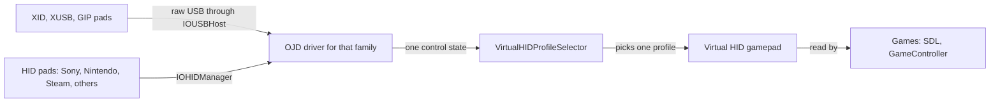

# Wire Protocols

A wire protocol is the language a controller speaks on its cable or radio. OJD sorts real pads by that language, a bit like a translator who first asks which language you speak. Games never hear these languages: XInput, DirectInput, SDL, and `GCController` only read the virtual HID device OJD makes.

| Family | Official name | USB identity | Linux | Windows | macOS 12+ without SIP |
| --- | --- | --- | --- | --- | --- |
| XID | Xbox Input Device | class `'X'/'B'/0` | `xpad` `XTYPE_XBOX` | no inbox driver | IOUSBHost if the kernel leaves the interface; userspace XID parser; virtual HID |
| XUSB | [MS-XUSBI](https://learn.microsoft.com/en-us/openspecs/windows_protocols/ms-xusbi/c0beb1e6-054f-4e2c-b6c3-7b5dff1299a5) | `FF/5D/01` wired (Krypton), `FF/5D/81` wireless adapter (Argon) | `XTYPE_XBOX360` / `XTYPE_XBOX360W` | `XUSB22.sys` | IOUSBHost userspace; virtual HID |
| GIP | [MS-GIPUSB](https://learn.microsoft.com/en-us/openspecs/windows_protocols/ms-gipusb/e7c90904-5e21-426e-b9ad-d82adeee0dbc) | `FF/47/D0` | `XTYPE_XBOXONE` | `xboxgip.sys` | IOUSBHost, or entitled DEXT for Apple-approved Microsoft pairs; virtual HID |
| HID | USB/Bluetooth HID | class `03` | `hid-sony`, `hid-playstation`, `hid-nintendo`, `hid-steam`, Generic | `hidclass.sys` | `IOHIDManager` / `IOHIDDevice`; virtual HID |

Xbox One S 1708+ over Bluetooth speaks HID, and only its USB side speaks GIP. DualShock 1/2 used the PlayStation's own controller-port serial bus.

Every family publishes through `VirtualHIDProfileSelector`, which picks one virtual profile per controller.

- `SDLCompatible`: `045E:0B0C`, the Xbox Adaptive Controller ID over Xbox One GIP reports. Picked when the main controls fit.
- `Generic`: `1209:4A4F`, input only. Picked otherwise, or by an Advanced override for that model. An override the controller can't meet falls back to automatic.
- `GameControllerCompatible`: chosen only by override (see [Xbox Fallback Identities](xbox-identities.md)).

`just catalog-regenerate --write` builds controller records from pinned Linux and SDL sources, plus controllers and patches written by hand. Apple's GameController MobileAsset is only used for diagnosis.

Event reports and replies to the Mac share one sender per device, which keeps them in order. Its queue holds `tuning.frameQueueCapacity` entries (64 by default, and the newest frame wins). A send gets two seconds to finish. When virtual output is switched off for a while (suppressed), the published input goes to rest. Closing refuses queued work and lets the current send finish.

SetReport buffers follow IOKit/HIDAPI framing. Numbered reports carry the report ID at byte zero. Unnumbered reports hold only data. OJD never guesses the framing from the contents. GetReport returns a whole report that fits the space the caller gave (which must be above zero). Type and ID pairs it doesn't support, and broken requests, fail with IOKit's own errors.

GetReport answers only the input report the virtual format declares. SetReport decodes one output report: the Xbox One rumble report of `SDLCompatible` (ID `03`, eight payload bytes). Any other type or ID isn't supported, and a wrong payload size counts as broken. No virtual session answers Sony or Nintendo feature reports or commands. Report IDs are hexadecimal.

PCSX2 2.8.2 (SDL 3.4.12) and DuckStation (SDL 3.4.16) map every `SDLCompatible` control as an Xbox pad with default hints (`worksWithDefaultSDLHints: true`). For `Generic` they report "No generic bindings were generated for device 'SDL-0'". It needs the SDL mapping that `ojd virtual export-mapping` prints. Not checked yet: Steam, SDL axis directions, reopening after a privacy (TCC) prompt, and output to the real pad.

Build with SwiftPM. You don't need Xcode.app, and SIP stays on.

## Protocol Coverage

Each family has two halves. Its description in `Resources/Protocols/` is the fixed data: endpoints, variants, controls, tuning keys, record sections, session writes, and rumble templates. Its driver is the code that reads input and builds output that depends on what's happening. `ProtocolParserCoverageTests` fails when a family has no parser test suite.

| Family | Described | Stays coded, and why | Parser test suite |
| --- | --- | --- | --- |
| `HIDDescriptor` | Usage map (`defaults.input`), tuning keys; a record may carry a HID rumble template and a HID player-indicator template (`recordSections`), the description has none | The driver reads the device's own HID report descriptor to find the elements, which only the device can state, and encodes the record's rumble and player-indicator templates into HID reports. | `HIDDescriptorDriverTests`, `HIDDescriptorRumbleTests`, `HIDDescriptorPlayerIndicatorTests` |
| `HIDReportLayout` | Sections, tuning keys | The interpreter of the layout; the byte layout is a record's `input`. | `ReportLayoutDriverTests` |
| `XboxXID` | Byte layout (`defaults.input`), rumble template (`defaults.session.rumble`) | Nothing: `ReportLayoutDriver` decodes the layout and sends the raw-USB rumble template to the interface's output endpoint within `usbTransferTimeoutMs`. | `XboxXIDParserTests` |
| `XboxXUSB` | Startup (the receiver's presence inquiry, `defaults.session.startup`), rumble templates (`defaults.variants.*.session.rumble`), the receiver power-off packet (`defaults.receiverPowerOff`; the shipped description sets none), a record's clone control reads (`session.control`, matched on the manufacturer string) | Input decoding follows the report type and length byte; a receiver slot is connected by a presence report that names a controller or by a decodable pad report, and a disconnect report resets it; the player-indicator packet (`XUSBDriver.ledPacket`) holds the requested pattern. | `XUSBDriverTests` |
| `XboxGIP` | Startup, keep-alive, named packets, handshake limits | GIP authentication (`GIP/Auth.swift`), the packet sequencer, frame reassembly and input decoding follow the exchange with the device. | `GIPDriverTests` |
| `SonySixaxis` | Variants, controls, tuning keys, `macOSOwnedOutput`, `inputStart` (USB waits for a PS press) | Input decoding skips a report whose byte 1 is `0xFF` (`SixaxisDriver.parse`); startup feature reads (see below); the output report follows the requested LEDs and rumble. | `SixaxisDriverTests` |
| `SonyDualShock4` | Startup, parameters, `macOSOwnedOutput` | Touch and motion decoding follows calibration data and sample timestamps; the output report carries the requested colour and rumble; Bluetooth CRC32 (`SonyBluetoothCRC32`). | `DualShock4DriverTests` |
| `SonyDualSense` | Variants, parameters, controls | Touch and motion decoding follows calibration data and sample timestamps; the output report carries the requested colour, triggers and rumble; Bluetooth CRC32. | `DualSenseDriverTests` |
| `NintendoSwitch1` | Subcommand requests, rumble template, startup | Input decoding, the subcommand header and the calibration replies (see below). | `Switch1DriverTests` |
| `NintendoSwitch2` | Command channel, startup, keep-alive period | Input decoding, flash calibration, the rumble keep-alive (see below). | `Switch2DriverTests` |
| `NintendoSwitchInputOnly` | Byte layout (`defaults.input`), variants, controls | Nothing: `ReportLayoutDriver` decodes the layout; the pads take no output. | `SwitchInputOnlyParserTests` |
| `NintendoWii` | Report-mode table, core and extension bit layouts (`defaults.session.wiiRemote`), extension IDs, the register scripts (handshake, calibration read, Motion Plus, IR, IR disable, speaker), IR sensitivity, tuning keys | The memory exchange, extension and Motion Plus decoding, IR decoding and the pointer, calibration math (see below). | `WiiDriverTests` |
| `NintendoGameCubeAdapter` | Endpoints, controls, tuning keys | One adapter report carries four ports, and each port runs its own driver. Port 0 sends the start report `13`. Axis ranges widen to the values seen, as in SDL. One rumble report holds all four motors, so the ports share them and resend them (see below). | `GameCubeAdapterDriverTests` |
| `ValveSteamController` | Activation (`81`, `8E 00`, then one settings write: settings 7 and 8 = 7, 24 = 0, 48 = `0x18`; over Bluetooth LE the same commands framed as `C0` report-3 segments, with setting 49 = 2 appended) and deactivation writes, write transports | Touch and motion decoding and the wireless receiver state follow the report stream; the held-rumble pulse train (see below). | `SteamControllerDriverTests` |
| `ValveSteamTriton` | Activation, deactivation, keep-alive | Touch and motion decoding follow sample timestamps and the logical controller's connection state; bits 28 and 29 of the state report's button word report `RightGripTouch` and `LeftGripTouch` (`SteamTritonDriver.buttonTable`); the rumble resend (see below). | `SteamTritonDriverTests` |
| `ValveSteamDeck` | Activation, deactivation, keep-alive | Touch and motion decoding follow the state report header; the rumble report holds the requested motor values. | `SteamDeckDriverTests` |
| `VendorFlydigi` (documented, bundled) | Byte layout (`defaults.input`, report ID 1, exactly 15 bytes), controls, tuning keys | Nothing: `ReportLayoutDriver` decodes the layout; the `D7D7:0041` record lists no output command. | `FlydigiParserTests` |
| `HIDReportLayout` (`37D7:2401`) | The record's layout, startup writes (`5A A5 cmd len payload sum`, sum8 over cmd, len and payload) and the command 18 rumble template (no checksum) | `ReportLayoutDriver` decodes the layout and fills the rumble bytes. | `FlydigiVaderFiveProTests`, `FlydigiGripRumbleTests` |
| `VendorPS3ThirdParty` | Parameters; a record may carry a rumble template (`recordSections`), the description has none | Input decoding picks the 19-byte or the compact layout by report length and runs only after the feature reply carries SDL's marker (see below). | `PS3ThirdPartyDriverTests` |
| `VendorGameSir` | Startup, keep-alive, rumble, parameters | Input decoding follows the protocol's readiness reports; the lighting and G7 command packets carry a sequence number and the requested colours or values. | `GameSirDriverTests` |
| `VendorNVIDIAShield` | Rumble template, parameters | Input decoding picks the v103 or v104 layout by report length and report ID. | `NVIDIAShieldDriverTests` |

## Coded Behavior

A driver only keeps behavior that depends on what the driver or rumble is doing right now. Fixed bytes and timings live in the descriptions, like a recipe card kept apart from the cook.

- Switch 2 rumble keep-alive (`Switch2Driver.keepAliveWrites()`): each tick re-sends the rumble report while a motor runs, then a few stop packets. The bytes differ every tick (rolling sequence number, current amplitudes). The description gives the period (`defaults.session.keepAlive.intervalMilliseconds`, 12) and no writes.
- Xbox 360 receiver presence and power-off (`XUSBDriver.decode(_:)`, `powerOffWrites()`). The startup write asks for presence once.
  - A first byte with bit `0x08` set carries presence (bit `0x80` of byte 1: controller present).
  - A decodable pad report (type `0x00`, length byte `0x14`, at least 24 bytes) connects the slot and is decoded in the same call.
  - A short or wrong-type report does not connect. A disconnect report resets state and rumble.
  - A slot returns the `defaults.receiverPowerOff` packet only while connected and only when the pipeline stops. A wired pad, or a slot after an input I/O error, returns none.
- Xbox 360 clone control reads: a record's `session.control` entries (`bmRequestType`, `bRequest`, `wValue`, `wIndex`, `wLength`, `timeoutMilliseconds`, `toleratesRejection`) run before the first startup write. They run only when `match.manufacturer` equals the device's manufacturer string. The `045e:028e` record lists three reads for `SHANWAN`: `0xC1`/1/`0x0100`/length 20, `0xC1`/1/`0x0000`/length 8, and `0xC0`/1/`0x0000`/length 4. Each tolerates rejection. Other devices get none.
- Sleep acknowledgement (`SystemPowerNotificationObserver`, `SystemPowerSource.allowPowerChange(notificationID:)`): after teardown, the service answers a system sleep once with `IOAllowPowerChange`. An idle sleep is allowed at once.
- Steam Controller held rumble (`SteamControllerDriver.hapticReports(left:right:durationMs:)`): a rumble with no duration is a 65 ms pulse (`steamControllerHeldPulseMilliseconds`). Pulse count and length follow the duration, capped at `maxRumbleDurationMs`.
- Steam Triton rumble resend (`SteamTritonDriver.keepAliveWrites()`): each tick appends the rumble report while a motor runs and the controller is connected. The lizard-mode-off write is data (`defaults.session.keepAlive.writes`, every `lizardResendTicks` ticks).
- Rumble template resend (`keepAliveWrites()` of the XID, XUSB, report-layout, PS3 third-party, NVIDIA Shield, and Switch 1 drivers). A template's `resendIntervalMilliseconds` makes the keep-alive resend the last rumble report while any motor is nonzero.
  - The keep-alive runs at that interval on the template's channel (raw-USB or HID).
  - A template with a counter byte takes the next session counter (Switch 1). Any other gives identical bytes.
  - All motors at zero, or a fresh session, ends the resends. An Xbox 360 receiver resends only while connected.
  - A record or description that names the interval together with a keep-alive (a mode's `session.keepAlive`, or a family such as `VendorGameSir`) is refused. Without the field the report goes out once.
- Switch 1 subcommand header (`Switch1Driver.subcommand(_:data:)`): the description gives the report id, the counter rule (`defaults.session.subcommands.counterModulus`, one counter for subcommand and rumble-only reports), the request list in send order, and the player-indicator subcommand (`subcommands.playerIndicator`). Code keeps the byte layout (counter at byte 1, rumble at 2 to 9, subcommand id at 10, data from 11), the counter value, and the 8 rumble bytes. `SwitchProRumbleCodec` encodes the last rumble sent.
- Switch 1 rumble-only report (0x10): encoded from `defaults.session.rumble` or a record's template, with the session counter in byte 1. Code picks intensities per Joy-Con side.
- Switch 1 calibration replies (`Switch1Driver.consumeMotionCalibrationReply(_:)`): the reply offsets (flag at 13, subcommand at 14, address at 15 to 18, length at 19, data from 20), the `0xB2 0xA1` user-calibration marker, and the factory and user decoding depend on the reply. The description names each read's request (`spiRead.purpose`), address, and length.
- Startup feature reads follow the transport, not a description field:
  - Sixaxis (`SixaxisDriver.startupFeatureReads()`): on USB, report 0xF2 (length 17) then 0xF5 (length 8). None on Bluetooth.
  - DualShock 4: report 2 of length 37 on USB, report 5 of length 41 on Bluetooth. `consumeFeatureReply` decodes the calibration data.
  - DualSense: report 5 of length 41 (calibration). A third-party controller first reads report 0x03 of length 48, and `consumeFeatureReply` checks marker byte 0x28.
  - PS3 third-party: report 0x03 then 0x00, both of length 64. `consumeFeatureReply` accepts the first 8-byte reply with SDL's marker. The marker offset depends on the request (IOKit keeps the report-ID byte for 0x03, not for 0x00).
- GameCube adapter rumble (`GameCubeAdapterRumbleBank`): report `11` holds one on-off byte per port (Dolphin `GCAdapter.cpp`). Each port writes through its own queue, so the four drivers of one adapter share one bank. A port's keep-alive resends the bank every 500 ms while any motor runs, and once after the last change. Rumble needs a wired pad and the second USB cable (status bit `04`); a wireless pad has no motor.
- Wii Remote layout: `WiiDriver` does not use `ControllerInputLayout` or `ReportLayoutDriver`. The `wiiRemote` section of `nintendo-wii.plist` uses its own `byte` and `mask` form, which `ReportBitField` and `ReportValueField` (`bitOffset`, `bitSize`) reject. `ProtocolDescription.WiiRemote` reads it.
- Wii report modes (`WiiDriver.parse(report:receivedAt:)`): `reportModes` (block kind, offset, length per report ID `0x30` to `0x3F`), `coreButtons`, and the mode choice (`reportModeWrite()`, `modeChoices`) are data. The resend after each status report (`ReportModeRestore`, `parseStatus`) is code because it follows a report.
- Wii Classic split fields (`WiiDriver.decodeExtension`): `ExtensionField.value(in:)` joins one to three `{byte, mask}` parts from the extension's `layout`. The stick center is the first sample after the handshake (`extensionCenters`), so it is code state. `halfRange` is data.
- Wii accelerometer (`rawAcceleration(high:core:)`, `AccelerometerCalibration.init(_:)`, `motionSamples(at:)`): `accelerometerLowBits` and the EEPROM read (`scripts.accelerometerCalibration`) are data. Joining 10-bit axes, reading zero and gravity points, and scaling to metres per second squared are code.
- Wii Motion Plus (`demultiplexMotionPlus`, `degreesPerSecond`, `measureRest`, `activatesMotionPlus`): the ID table, `motionPlusModeBytes`, and the activation script are data. Code splits alternating gyro and passthrough frames, picks the slow or fast scale per axis, and measures the rest offset over still frames.
- Wii IR (`WiiDriver.decodeIR`): modes `0x3E` and `0x3F` list their IR block in `reportModes`. Code picks which two of four points a full-mode report carries and computes the pointer (`updatePointer`, `rollAngle`: midpoint of the two largest points, turned by the roll). Sensitivity blocks and mode bytes are data.
- Wii memory exchange (`WiiDriver.advance`, `sendStep`, `handleReply`): the scripts list writes and reads. Code handles order, reply waits, `irWriteIntervalMs` spacing, the error nibble check. Addresses and bytes are in the description only (`ExtensionHandshake`, `IRSetupSpacing`).
- Wii rumble bit (`WiiDriver.outputReport(_:)`): `rumbleBit` is data. `RumbleBitCarry` ORs the motor state into every output report.
