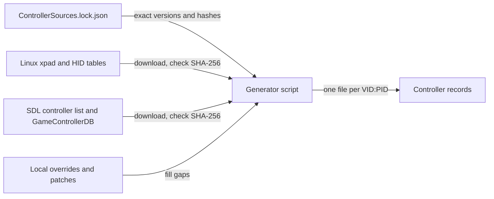

# Import Controller Identities From Linux xpad

Linux and SDL already keep long lists of game controllers. OJD copies the IDs from those lists with a generator script, the way you'd copy a phone book instead of asking every caller their number. So the result is the same every time, the generator reads the exact Linux and SDL versions and file hashes in `ControllerSources.lock.json`. It never reads a branch that keeps moving, such as master.



## Rebuild the Catalog

Check that the committed output matches:

```bash
just catalog-regenerate --check
```

Write it again after you change the lock file or an override on purpose:

```bash
just catalog-regenerate --write
just check-profiles
```

The generator downloads each locked source, checks its SHA-256, reads the full xpad device and startup tables and the supported HID registration tables, applies local overrides, and writes records to fixed VID/PID paths.

## How Linux Rows Become Records

Linux input mappings:

| Linux | Becomes |
| --- | --- |
| `XTYPE_XBOX` | `XboxXID:Gamepad` |
| `XTYPE_XBOX360` | `XboxXUSB:Wired` |
| `XTYPE_XBOX360W` | `XboxXUSB:Receiver` |
| `XTYPE_XBOXONE` | XboxGIP, no stored variant (the connection decides). xpad rows have no connection field, so every `xbox.*` family is reached through raw USB. |
| `MAP_SHARE_BUTTON` | XboxGIP parameter `shareButton` with `fromEnd` 18 (26 with `MAP_SHARE_OFFSET`), as xpad reads `data[len - 18]` or `data[len - 26]`. A row that needs a parameter its family doesn't list makes generation fail. A GIP pad with no `shareButton` has no Share. |
| `MAP_TRIGGERS_TO_BUTTONS`, `MAP_STICKS_TO_NULL` | `capabilities.absent` entries (`left-trigger`/`right-trigger`, the four stick axes). No trigger buttons are added, because the XID, XUSB and GIP parsers send none. |
| `MAP_DPAD_TO_BUTTONS` | Dropped: it changes how Linux reports the D-pad, not the bits the pad sends. |
| Supported PlayStation, Sony, Nintendo, Steam HID registrations | IOHID records from driver tables and hid-ids.h: SonySixaxis, SonyDualShock4, SonyDualSense, NintendoSwitch1, `ValveSteamController:Wired`, `ValveSteamController:Dongle` (Steam wireless receiver). |
| `FLAG_DELAY_INIT` on an `XTYPE_XBOXONE` row | Not a reason to skip: `DRIVER_HANDLED_DEVICE_FLAGS` in `generate_xpad_records.py` lists it, because GIPDriver resends its startup sequence on the announce packets before the first input. Any other device flag skips the row as `unsupported_device_flags`. |
| Non-default `xboxone_init_packets` | Ordered `protocol.initialization` action IDs: `XboxGIP/power-on`, `XboxGIP/s-init`, `XboxGIP/enable-extra-input`, `XboxGIP/hori-ack`, `XboxGIP/led-on`, `XboxGIP/auth-done`, `XboxGIP/rumble-begin`, `XboxGIP/rumble-end`. Bytes: `defaults.session.namedPackets` of `Resources/Protocols/xbox-gip.plist`. |

Records leave out endpoints and startup steps that the protocol already uses by default. Unknown types, quirks, mappings, and startup macros are skipped and counted. The `0xFFFF:0xFFFF` catch-all row is skipped, because it isn't a real USB identity. If the generator can only read part of a source table, generation fails.

## SDL_GameControllerDB

`mdqinc/SDL_GameControllerDB` is the third pinned upstream. The `sdlGameControllerDB` entry of `ControllerSources.lock.json` names the repository, the commit, and the SHA-256 of `gamecontrollerdb.txt` and its license. `regenerate` checks the download and writes `Sources/OpenJoystickDriverKit/Resources/SDLGameControllerDB/sdl-gamecontrollerdb.txt`, which starts with the upstream zlib license and a line naming the pin. Never edit it by hand.

The generator keeps lines whose `platform` is `Mac OS X` and counts the rest. It drops a line whose vendor and product appear in the pinned `controller_list.h` rows (SDL's HIDAPI drivers read those pads with another report format, so the `b#`, `a#` and `h#.#` indexes differ) or in a catalog record (a pad with a record never looks at the database). A line it can't read makes generation fail. `regenerate` prints the counts: kept, other platform, unparsable, skipped controller list, skipped catalog record, duplicate GUIDs. Kit matches a line to the pad's list of inputs when it connects. see [architecture](architecture.md).

## SDL Controller List

SDL's `src/joystick/controller_list.h` is the second pinned upstream (currently `release-3.4.16`). Its `arrControllers` rows are `{ MAKE_CONTROLLER_ID( vid, pid ), k_eControllerType_<type>, name }`. Commented-out rows are ignored, and any other row it can't read inside the table makes generation fail. A row only shows that an identity exists, and gets in through the source lock. The record has no source field.

| SDL type | Record |
| --- | --- |
| PS3Controller, Sony vendor ID | SonySixaxis |
| PS3Controller, other vendor IDs | VendorPS3ThirdParty, which tests for SDL's `PS3ThirdParty` report format |
| PS4Controller | SonyDualShock4 |
| PS5Controller | SonyDualSense, with the `maker` parameter `ThirdParty` for a non-Sony vendor ID; the driver tests such controllers for features, as SDL does |
| SwitchProController | NintendoSwitch1 |
| SwitchJoyConLeft, SwitchJoyConRight | NintendoSwitch1 with the `layout` parameter `JoyConLeft` or `JoyConRight` |
| XBox360Controller | `XboxXUSB:Wired` |
| XBoxOneController | XboxGIP |
| SteamController, SteamControllerV2 | ValveSteamController, variant from `STEAM_VARIANTS` |
| SteamControllerNeptune | ValveSteamDeck |
| SwitchInputOnlyController | NintendoSwitchInputOnly |
| SteamControllerTriton | ValveSteamTriton, variant from `STEAM_VARIANTS` |

One SDL Steam type covers wired pads, dongles and Bluetooth LE links, so the variant comes from `STEAM_VARIANTS` in `Scripts/Catalog/generate_controller_catalog.py`, which follows the per-row comments in `controller_list.h` and `IsProteusDongle` in `SDL_hidapi_steam_triton.c`. A Steam row missing from that list makes generation fail. In `sdl.plist` `steamVariants`, `28DE:1101` is the legacy Steam Controller (CHELL). Bluetooth LE rows (`1105`, `1106`, `1202`, `1303`) store `bluetooth-le`, dongles (`1142`, `1304`, `1305`) store `dongle`, the rest `wired`.

| Product ID | Identity |
| --- | --- |
| `1102` | Wired (D0G) |
| `1105`, `1106` | Bluetooth (D0G) |
| `1142` | Wireless dongle |
| `1201` | Wired (HEADCRAB) |
| `1202` | Bluetooth (HEADCRAB) |
| `1302` | Steam Triton Controller |
| `1303` | Triton BLE form |
| `1304` | Steam Proteus Dongle |
| `1305` | Steam Nereid Dongle |

The Switch 2 identities in `SWITCH_2_IDENTITIES` (`057e:2066`, `2067`, `2069`) get NintendoSwitch2, which selects Switch2Driver. The GameCube controller `057e:2073` is only in SDL `usb_ids.h`, so an add override gives it NintendoSwitch2 and the `gamecube` quirk.

`SDL_IDENTITY_FAMILIES` in `generate_controller_catalog.py` (`sdl.plist` `identityFamilies`) gives an identity the family of the SDL driver that claims it, where that differs from its type:

| Identity | Family | Reason |
| --- | --- | --- |
| ShanWan DS3 `2563:0523` | SonySixaxis | Claimed by SDL's `HIDAPI_DriverPS3_IsSupportedDevice` (`USB_VENDOR_SHANWAN` / `USB_PRODUCT_SHANWAN_DS3`). Its `is_shanwan` flag only skips the one-byte `0xF5` echo write, which OJD doesn't send. |
| HORI `0f0d:0086` | XboxXUSB | Xbox 360 protocol with PS3 buttons. |
| Backbone One PlayStation Edition Gen 2 `358a:0304` | HIDDescriptor | `HIDAPI_DriverPS5_IsSupportedDevice` rejects it: "This product doesn't appear to use the DualSense protocol". |
| DragonRise `0079:0006` ("DragonRise Generic USB PCB") | HIDDescriptor | Standard HID gamepad. |
| NVIDIA SHIELD `0955:7210` | VendorNVIDIAShield | `SDL_hidapi_shield.c` drives it; `HIDAPI_DriverXbox360_IsSupportedDevice` says it "doesn't talk Xbox controller protocol". Generation fails on any other NVIDIA row that is neither in the catalog nor listed. |
| Microsoft Bluetooth Xbox identities in `SDL_IsJoystickBluetoothXboxOne` (`045e:02e0`, `02fd`, `0b05`, `0b0c`, `0b13`, `0b20`, `0b21`, `0b22`; Xbox One S, Elite 2, Series pads) | HIDDescriptor | HID over Bluetooth, not GIP. HIDDescriptorDriver picks the layout from the report descriptor, covering the Linux and Windows firmware modes in xpadneo `docs/descriptors/xb1s_linux.md`, `xb1s_windows.md`, `xbxs.md`. |

Some rows get no record. `ProtocolClassifier` matches an identity without a record by the shape of its USB interface (XUSB or GIP), and falls back to HIDDescriptor. A record would lock in one protocol on a pad that picks its protocol from its firmware mode. `regenerate` counts these as bound by interface signature, not skipped:

| Rows | Detail |
| --- | --- |
| XInputPS4Controller, XInputSwitchController | Pads that switch to Xbox 360 mode on a PC. Console mode has no Xbox interface and reaches HIDDescriptor. |
| XBoxOneController with a Microsoft Xbox 360 product ID (`028e`, `0291`, `02a0`, `02a1`, `02a9`, `0719`) under another vendor | Linux xpad rows with such IDs (PDP `0e6f:02a0`/`02a1` are GIP) still win. |
| Identity SDL lists under two Xbox USB types | HORI `0f0d:00ed` is both XInputPS4Controller and XBoxOneController. |
| `SDL_EXCLUSIONS` in the `interface-signature` bucket | `045e:02a0` (Xbox 360 Big Button IR receiver), `045e:0867` (unnamed Microsoft ID SDL lists as "Unknown Controller"), `1038:b360` (SteelSeries Nimbus/Stratus XL). |

Every other unmapped type (mobile touch, unknown) is skipped with a per-type count.

Linux rows and hand-written add overrides win. An SDL identity already present with the same family is a duplicate. With a different family, it's a conflict. Both are skipped and counted, and so is an identity SDL lists under two types that aren't both Xbox USB types. Identities are decided after grouping, so the order of rows never changes the output.

Typed rows that don't use the protocol of a variant OJD has built are skipped by a rule or by `SDL_EXCLUSIONS` in `generate_controller_catalog.py`. A listed identity must still appear with its expected type, be missing from the catalog, and not be covered by a rule, so moving the lock to a newer version forces someone to review it. Generation also fails on any Microsoft (`045e`) `XBoxOneController` row that is neither in the catalog nor listed, so no Bluetooth or driver identity reaches the USB-only GIP driver without a review.

| Bucket | Rows |
| --- | --- |
| `virtual-identity` | Name no real USB device a computer can see: Apple's generic MFi identities `05ac:0001`, `05ac:0002`; Joy-Con pair `057e:2008`, `057e:2068` (OJD pairs two Joy-Con records itself); Steam's virtual gamepad `28de:11ff`; NVIDIA's streaming controller `0955:b400` |
| `windows-driver-identity` | `045e:02a1`, `045e:02ff`: identities of the Windows XUSB and XBOXGIP drivers |
| Vendor ID `0x0000` | Skipped |

`0e6f:0186` (PDP Afterglow Wireless) and `0f0d:00f6` (HORI Wireless Switch Pad) get a NintendoSwitch1 record with the `usbProtocol` parameter `ChargingOnly`: their USB link only charges the pad, so the driver only takes the Bluetooth Classic link. Added to the catalog from their SDL types: the DualShock 4 USB wireless adapter `054c:0ba0` and the STRIKEPAD PS4 grip add-on `054c:05c5` (SonyDualShock4), the Access Controller `054c:0e5f` (SonyDualSense).

Third-party DualShock 4 rows that get in keep the typical motion scale. Like SDL, OJD only uses the factory calibration report for Sony's vendor ID. `0079:181b` (Venom Arcade Stick), which SDL marks as possibly a PS3-protocol pad, gets in as SonyDualShock4, as listed.

`regenerate` prints the parsed, mapped, added, duplicate, conflict, and interface-signature counts and every skip bucket.

## Generator Rule Tables

The generators read family lists, flag sets, name maps and exclusions from `Resources/CatalogRules/` (`linux-xpad.plist`, `linux-hid.plist`, `sdl.plist`). Each file has `apiVersion` and `kind`, and the loader refuses missing or unexpected keys. Change these files, not generator code, then run `just catalog-regenerate --write`. `linux-xpad.plist` `driverHandledDeviceFlags`: see `FLAG_DELAY_INIT` under How Linux Rows Become Records.

## Local Source Overrides

Override inputs:

```text
Resources/Controllers/<vid>/<vid>-<pid>.plist
```

A `Controller` file gives a full record that the pinned source lacks. A `ControllerPatch` file in `Resources/ControllerPatches/<vid>/<vid>-<pid>.patch.plist` merges a patch into an existing imported record. `OJDRepositoryTool apply-patches` applies patches under Swift's merge rules (a number keeps the text of the file that writes it, and a patch file below the vendor folder is refused). `OJDRepositoryTool validate records` checks every record, including its stored variant. The generator refuses:

| Refused |
| --- |
| `Controller` files that clash with the upstream source |
| Patches without an upstream record |
| Duplicate authored identities |
| Patches that change nothing |
| Hand-written files that are broken or in the wrong place |

Review notes go in the controller's testing page, the upstream issue, and Git history, not in records the app reads. Linux knowing a pad only proves its ID numbers and which Linux driver takes it. It doesn't prove macOS permissions, the real USB descriptors, how Apple's frameworks map it, or that input and output work. Those need the app to read the descriptor from a real pad, and a test on hardware.
