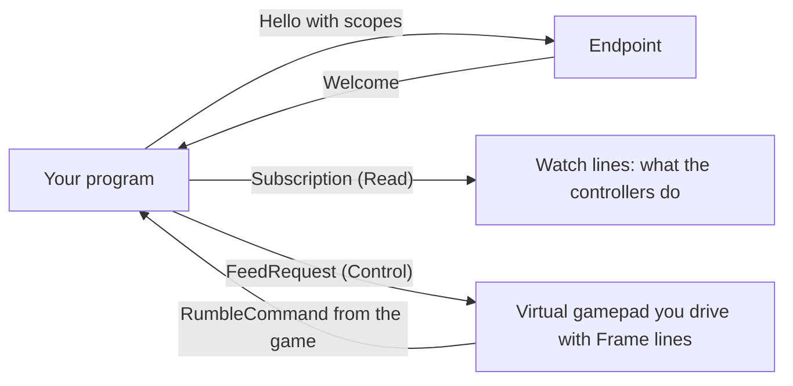

# SDK Endpoint

The endpoint is a private door on your Mac (a local socket). A program you gave a key (a grant) can use it to read controller events or drive a virtual gamepad. User steps: [Automating OpenJoystickDriver](../../wiki/Automating-OpenJoystickDriver.md). Design: [Public Endpoint Design](../development/public-endpoint-design.md).



## Connect

1. `ojd access enable` (it's off until you turn it on).
2. Give your program a key, by its signature or a token ([AccessGrants](#accessgrants)).
3. `ojd --json access status | jq -r .socketPath` prints the socket path. The socket only exists while the endpoint is on.

Each line holds one JSON object, at most 64 KiB. A WebSocket on `127.0.0.1` carries the same messages, one object per text message. [`endpoint.schema.json`](../../Resources/Schemas/endpoint.schema.json) describes the lines: `#/$defs/clientLine` for what programs send, `#/$defs/serviceLine` for what the endpoint sends.

## Saying Hello

1. Endpoint: Challenge.
2. Program, within 5 seconds: Hello with scopes. With a token, add `tokenName` and `proof`.
3. Endpoint: Welcome with the granted scopes. If something's wrong: Status, then it hangs up.
4. Program, any number: ProfileRequest, OutputRequest (both Control), ModList (Read). Each gets an answer straight away. A missing scope gets E1002 and a hang-up.
5. Program, once: Subscription (Read) or FeedRequest (Control). A subscription gets watch lines. A feed gets FeedSession, then the program sends Frame lines.

A line sent at the wrong moment gets E1010. Limits: 8 socket and 8 WebSocket connections. A slow reader only keeps the latest `MODIFIED` line for each controller. If 256 lines pile up, it gets E1006 and a hang-up.

### Token Proof

1. Join four newline-ended lines: `OpenJoystickDriver endpoint hello 1`, the `nonce`, the page origin, the WebSocket port (origin and port empty on the socket).
2. HMAC-SHA256 of those lines, keyed with the SHA-256 of the token.
3. Send it as lowercase hex in `proof`.

## Messages

Every line has `apiVersion` and `kind`, except watch lines. ModList, KeepAlive, Drain, and Drained take no other member (or you get E1003). Every example below passes the schema check.

### Challenge

First line on every connection. `nonce`: 32 random bytes, unpadded base64url, different for every connection.

```json
{"apiVersion":"openjoystickdriver/v1alpha3","kind":"Challenge","nonce":"ICEiIyQlJicoKSorLC0uLzAxMjM0NTY3ODk6Ozw9Pj8"}
```

### Hello

Sent once after Challenge. `scopes`: Read, Control, or both, and each must be granted.

```json
{"apiVersion":"openjoystickdriver/v1alpha3","kind":"Hello","scopes":["Read"]}
```

With a token, add `tokenName` and `proof`:

```json
{"apiVersion":"openjoystickdriver/v1alpha3","kind":"Hello","scopes":["Control"],"tokenName":"driver","proof":"2ea98b640f249c35c5644ae64b42d56812ec40516475aa62913b53b80e9551c9"}
```

### Welcome

The reply to a good Hello: `version` and the granted `scopes`.

```json
{"apiVersion":"openjoystickdriver/v1alpha3","kind":"Welcome","version":"0.6.0-alpha.1","scopes":["Read"]}
```

### Subscription

`stream`: Controllers, Profiles, or Mods (Read). `"output":true` on Controllers adds the virtual gamepad's values. The others refuse it with E1003. Sending any line after this ends the connection.

```json
{"apiVersion":"openjoystickdriver/v1alpha3","kind":"Subscription","stream":"Controllers"}
```

Watch lines match `ojd controller watch --all --json`: connected controllers first, then each change as `ADDED`, `MODIFIED`, or `DELETED`. Members: `type` and `object` (`kind` Controller), with no `apiVersion`.

```json
{"type":"ADDED","object":{"apiVersion":"openjoystickdriver/v1alpha3","kind":"Controller","id":"pad-1","name":"Test Pad","vendorID":1118,"productID":654,"connection":"usb","hasSerialNumber":false,"holders":[],"holdsExclusively":false,"ownedByAnotherClient":false,"alsoListedBySystem":false,"protocol":"XboxXUSB:Wired","session":"Active","waitsForGuidePress":false}}
```

Profiles and Mods send the whole list, then again on change. The list is read twice a second, so a burst of changes gives one line. A failed read sends nothing and is tried again.

```json
{"apiVersion":"openjoystickdriver/v1alpha3","kind":"Profiles","profiles":[{"id":"7B6B3C5E-9A4D-4A6E-8C55-1B2D3E4F5A6B","name":"Rally","model":"054C:0CE6","isActive":true}]}
```

### ProfileRequest

Changes a profile like `ojd profile activate`, `deactivate`, `set`. `action`: Activate, Deactivate, Set. `profile`: UUID or case-insensitive name. Set takes `key` (a dotted path, such as `name`) and `value` (`null` removes a member). Anything else gets E1003.

```json
{"apiVersion":"openjoystickdriver/v1alpha3","kind":"ProfileRequest","action":"Set","profile":"Racing","key":"name","value":"Rally"}
```

Answer: ProfileResult. If the service says no, you get a Status failure with the code `ojd` prints (E2012 for a missing profile), and the connection stays open.

```json
{"apiVersion":"openjoystickdriver/v1alpha3","kind":"ProfileResult","profile":{"id":"7B6B3C5E-9A4D-4A6E-8C55-1B2D3E4F5A6B","name":"Rally","model":"054C:0CE6","isActive":true}}
```

### ModList

Lists installed mod packages, as `ojd mod list --json` does.

```json
{"apiVersion":"openjoystickdriver/v1alpha3","kind":"ModList"}
```

Answer: Mods, one entry per package in name order: `name`, `files`, and, when stated, `version`, `author`. `problem` says why a package isn't used.

```json
{"apiVersion":"openjoystickdriver/v1alpha3","kind":"Mods","mods":[{"name":"arcade-pack","version":"1.2.3","author":"Tester","files":["Controllers/1234-abcd.plist"]}]}
```

### OutputRequest

Drives rumble, player number, or light like `ojd controller rumble`, `player`, `light`. `controller`: id or `VID:PID` model. `action`: Rumble, Player, Light. The schema gives the ranges.

| Action | Members |
| --- | --- |
| Rumble | `left`, `right`, `leftTrigger`, `rightTrigger` (0 to 255); `duration` (seconds, at most 5, default 0.45). Name no motor and both main motors run at 180. Strength 0 on every named motor stops the rumble. |
| Player | `player`, 0 to 4. 0 turns the player light off. |
| Light | `color` (six hex digits), `brightness`. Send at least one. |

E1003: unknown `action`, wrong member, out-of-range value, or no `controller`.

```json
{"apiVersion":"openjoystickdriver/v1alpha3","kind":"OutputRequest","controller":"054C:0CE6","action":"Rumble","left":200,"duration":1.5}
```

Answer: OutputResult, one `results` entry per command. If the controller can't do it, doesn't answer, is unknown, or matches more than one pad, you get a Status failure with the code `ojd` prints, and the connection stays open.

```json
{"apiVersion":"openjoystickdriver/v1alpha3","kind":"OutputResult","controller":"pad-1","results":[{"command":"rumble","outcome":"Delivered","droppedRumbleChannels":[]}]}
```

### FeedRequest

Publishes a virtual gamepad (Control). `as`: the persona id Generic, SDLCompatible, or GameControllerCompatible. An unknown id gets E1003 with the list of accepted personas. Closing the connection removes the gamepad.

```json
{"apiVersion":"openjoystickdriver/v1alpha3","kind":"FeedRequest","as":"Generic"}
```

### FeedSession

Answers FeedRequest once the gamepad exists.

```json
{"apiVersion":"openjoystickdriver/v1alpha3","kind":"FeedSession","as":"Generic"}
```

### Frame

Keys of an `ojd virtual feed` line. A control you leave out is at rest. Sticks run -1 to 1 (positive Y is down), triggers 0 to 1. `holdMilliseconds` is the shortest time the frame stays on. Without it, the frame stays until the next one.

```json
{"apiVersion":"openjoystickdriver/v1alpha3","kind":"Frame","buttons":["South"],"axes":{"LeftStickY":0.5},"holdMilliseconds":100}
```

Frames play in order, like slides in a slideshow.

| Rule | Value |
| --- | --- |
| Frame time | at least 8 ms or `holdMilliseconds`, counted from when its send returns. A slow send never shortens it. |
| Waiting frames | at 256 the endpoint stops reading lines. Closing throws them away. |
| Ending | send Drain, then wait for Drained. With no frame to send, send KeepAlive. |
| Idle | after the last frame has played, 2 seconds without a line closes with E1008 |
| Gamepads | at most 4 virtual gamepads. One more FeedRequest gets E1007. |

### KeepAlive

Restarts the 2-second idle timer. There's no reply, and the gamepad keeps its state. KeepAlive and Drain before FeedSession, or on a Subscription connection, get E1010 and a hang-up.

```json
{"apiVersion":"openjoystickdriver/v1alpha3","kind":"KeepAlive"}
```

### Drain

Answered with Drained once every earlier frame has played, the last for its full `holdMilliseconds` (at least 8 ms). No line is read while you wait, and the wait doesn't count as idle. The idle timer starts when the last frame ends, so sending nothing after Drained gets E1008. A Drain with nothing waiting is answered at once, and you can send it again. Closing while you wait ends the feed.

```json
{"apiVersion":"openjoystickdriver/v1alpha3","kind":"Drain"}
```

### Drained

The reply to Drain. The program may then close.

```json
{"apiVersion":"openjoystickdriver/v1alpha3","kind":"Drained"}
```

### RumbleCommand

Sent for each rumble command a game gives the virtual gamepad. `type`: `SetRumble` or `StopRumble`. Intensities 0 to 65535.

```json
{"apiVersion":"openjoystickdriver/v1alpha3","kind":"RumbleCommand","type":"SetRumble","intensities":{"lowFrequency":65535,"highFrequency":0,"leftTrigger":0,"rightTrigger":0,"leftHaptic":0,"rightHaptic":0},"durationMilliseconds":200}
```

```json
{"apiVersion":"openjoystickdriver/v1alpha3","kind":"RumbleCommand","type":"StopRumble"}
```

### Status

Sent when the endpoint refuses a line or ends the connection. `code` is an [error code](#errors). `message` is English text for logs, so your program should decide what to do from `code`.

```json
{"apiVersion":"openjoystickdriver/v1alpha3","kind":"Status","status":"Failure","code":"E1007","message":"The endpoint runs 4 virtual gamepads already."}
```

With E1009, E1010, and E1011, `details.supportedAPIVersions` lists the accepted `apiVersion` values.

```json
{"apiVersion":"openjoystickdriver/v1alpha3","kind":"Status","status":"Failure","code":"E1009","message":"The apiVersion is not supported.","details":{"supportedAPIVersions":["openjoystickdriver/v1alpha3"]}}
```

## Errors

An error is a Status line, then a hang-up. When the service refuses a ProfileRequest, it uses another code and keeps the connection open. Codes keep their meaning: `ojd explain E1002` or [Error codes](../../wiki/Error-Codes.md).

| Code | Name | Meaning |
| --- | --- | --- |
| `E1001` | `endpointDisabled` | The endpoint is off, or its WebSocket is off. |
| `E1002` | `notGranted` | The program, or its token, has no grant for the scopes in the Hello. |
| `E1003` | `invalidMessage` | The line is not valid for its kind. |
| `E1004` | `tooManyConnections` | The endpoint serves the maximum number of connections. |
| `E1005` | `revoked` | A user revoked the grant while the connection was open. |
| `E1006` | `tooSlow` | The program reads too slowly, and 256 lines wait. |
| `E1007` | `tooManyFeeds` | The endpoint runs the maximum number of virtual gamepads. |
| `E1008` | `feedClosed` | The virtual gamepad closed: it did not start, the service stopped it, or the program sent no Frame, KeepAlive, or Drain line in time. |
| `E1009` | `unsupportedEndpointVersion` | `apiVersion` is a string the endpoint does not accept. |
| `E1010` | `unexpectedKind` | `kind` is unknown, or not accepted at this point. |
| `E1011` | `missingHeader` | `apiVersion` or `kind` is missing, `null`, or not a string. |

Don't guess a version. On E1009, E1010, or E1011, read `details.supportedAPIVersions`, then use one of those versions, or report them and stop.

## AccessGrants

Without a grant in AccessGrants, a program gets E1002. Only the service writes `AccessGrants.plist` in the Application Support folder, when `ojd access` runs, so taking access away works at once. [`access-grants.schema.json`](../../Resources/Schemas/access-grants.schema.json) describes the file.

| Key | Content |
| --- | --- |
| `grants` | signature grant: signing identifier and publisher; ad-hoc signed and unsigned programs are refused; `ojd access grant PATH` |
| `tokens` | token name and its SHA-256 only; may limit web `origins`, and a token with `origins` cannot have `control`; `ojd access grant --token NAME` |
| `scopes` | Read, Control, or both; a Control grant records `controlGrantedAt` |
| `web` | WebSocket switch and port |

Treat the file like a password (the hashes are the proof keys). The service writes it with mode 0600. Keep it out of reports and backups.

```json
{"apiVersion":"openjoystickdriver/v1alpha3","kind":"AccessGrants","enabled":true,"grants":[{"publisher":{"kind":"Signed","id":"ABCDE12345"},"identifier":"com.example.overlay","scopes":["Read"],"grantedAt":"2026-01-01T00:00:00Z","path":"/Applications/Overlay.app"}],"tokens":[{"name":"driver","tokenSHA256":"0000000000000000000000000000000000000000000000000000000000000000","origins":[],"scopes":["Control"],"grantedAt":"2026-01-01T00:00:00Z","controlGrantedAt":"2026-01-01T00:00:00Z"}],"web":{"enabled":false,"port":49152}}
```

## Versioning

The only accepted `apiVersion` is `openjoystickdriver/v1alpha3`, as in the schemas and user files.

- No version translating: any other `apiVersion` gets E1009 with the supported list.
- An alpha version can change with no promise to stay compatible. Release notes list each change.
- A change older programs can't read gets a new `apiVersion`. Error codes and persona ids keep their meaning, and persona ids never name an operating system.

## Reference Client

[`Scripts/SDK/reference_client.py`](../../Scripts/SDK/reference_client.py) only uses the Python standard library and isn't packaged, so copy it. Set `OJD_TOKEN` to the token `ojd access grant --token driver` printed:

```shell
OJD_TOKEN=ojd_… python3 Scripts/SDK/reference_client.py watch
OJD_TOKEN=ojd_… python3 Scripts/SDK/reference_client.py feed
```

| Item | Behavior |
| --- | --- |
| `watch` | subscribes to Controllers, prints the first watch line; `--count N` prints N lines; `--timeout SECONDS` exits with an error after that long without a line |
| `feed` | presses South for 100 ms, prints received rumble commands, sends Drain, waits for Drained |
| E1009, E1010, E1011 | stops and reports the supported versions |
| `--socket PATH` | names the socket; otherwise the client runs `ojd --json access status` |

`EndpointReferenceClientTests` runs the client against a real endpoint server. `Tools/WebRTCBridge/` is another client: see [WebRTC Bridge](webrtc-bridge.md).
