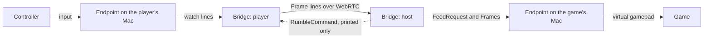

# WebRTC Bridge

`ojd-webrtc-bridge` carries one controller between two Macs over the network, like a long cable. It uses WebRTC, the same technology video calls use to send data straight between two computers. It's an [SDK endpoint](endpoint.md) program with only the access `ojd access` gives it. The app, service, and `ojd` contain no WebRTC code.



Source: `Tools/WebRTCBridge/`, a Swift package depending on [LiveKitWebRTC](https://github.com/livekit/webrtc-xcframework) 150.7871.03. The main package doesn't download it.

## Build

```shell
cd Tools/WebRTCBridge
swift build -c release
```

First build downloads about 70 MB. Binary: `.build/release/ojd-webrtc-bridge`.

## Roles

| Role | Runs on | Scope | Endpoint request | Does | Checks |
| --- | --- | --- | --- | --- | --- |
| `host` | Mac running the game | Control | FeedRequest | Sends each Frame to the virtual gamepad and each RumbleCommand back; sends KeepAlive every 0.5 seconds while no frame arrives (the endpoint closes a feed after 2 seconds). | Drops a message from the other Mac over 64 KiB, and a broken Frame (unknown members, an unknown or repeated control name, `holdMilliseconds` above 60000). Passes on the latest frame every 8 ms. |
| `player` | Mac with the controller | Read | Subscription | Sends controller input as Frame lines; only prints each RumbleCommand that comes back, because the endpoint can't make a real controller rumble. | Prints only a schema-valid RumbleCommand (`SetRumble` with all six intensities and at most 5000 ms, or bare `StopRumble`). Refuses a connection message over 64 KiB. |

## Connect Two Macs

1. On each Mac, run `ojd access enable` and create a token: `ojd access grant --token bridge --scope control` (host) or `--scope read` (player).
2. Start the player: `OJD_TOKEN=ojd_… ojd-webrtc-bridge --role player`. It prints its offer as one stdout line.
3. Copy the line to the host, run `OJD_TOKEN=ojd_… ojd-webrtc-bridge --role host`, and paste the offer on stdin. The host prints its answer as one line.
4. Paste the answer on the player's stdin. When the data channel opens, both bridges connect to their endpoint.

Send the offer and answer over a channel you trust, because anyone with both can try to join. DTLS encrypts the channel. Each blob is base64 of a JSON object with `type` and `sdp` (the SDP holds the ICE candidates).

Options:

- `--socket PATH`: endpoint socket; otherwise `ojd --json access status`.
- `--token-name NAME`: default `bridge`.
- `--controller ID` (player): `id` from the watch lines. The default is the first controller.
- `--persona Generic|SDLCompatible` (host): the `as` of the FeedRequest.
- `--ice-server URL`: adds a STUN or TURN server. Without it, only addresses on your own network are tried.
- `--signal offer|answer`: swaps who offers (the player by default).

## Data Channel Messages

Channel `ojd`, which keeps messages in order and never loses one. Each message is one endpoint line as UTF-8 JSON.

- Player to host: a Frame built from the `input` of a `MODIFIED` watch line: `pressed` becomes `buttons`, `hat` becomes `dpad`, sticks and triggers become `axes`. Controls with no matching Frame button are dropped.
- Host to player: a RumbleCommand, as the endpoint sent it.

## Sockets

The bridge never waits for incoming connections: ICE only opens outgoing UDP sockets, and TCP is off. `testLoopbackPassesAFrameOneWayAndRumbleBack` checks this.

## Limits

- One controller and one peer per process.
- A lost packet holds up the frames after it.
- Without a STUN server, peers must reach each other directly.

## Test

```shell
cd Tools/WebRTCBridge
swift test
```

Loopback test (run by `just check-tools` and CI): a player and a host in one process, over a real data channel, talking to a fake endpoint. A frame reaches the host's feed and a RumbleCommand comes back.

`Tools/BridgeCore/` holds the endpoint client and bridge logic (`HostBridge`, `PlayerBridge`). `EndpointBridgeTests` runs a `HostBridge` against an in-process `EndpointServer`: a feed with a grant reaches the virtual gamepad and stays open on KeepAlive. A token without `control`, or an unknown token, gets E1002.

## Further Reading

- [SDK Endpoint](endpoint.md)
- [Automating OpenJoystickDriver](../../wiki/Automating-OpenJoystickDriver.md)
