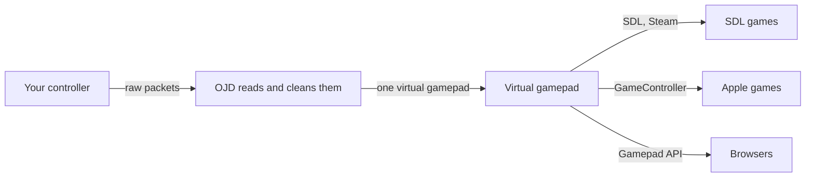

# Consumer-Binding Evidence

A "consumer" is any program that reads the gamepad OJD makes: a game, SDL, Steam, a browser, or Apple's GameController framework. This page holds the proof behind each claim that a consumer works with OJD. For the user-facing summary, see [virtual HID profiles](../../wiki/Using-the-App.md).

| Mark | Meaning |
| --- | --- |
| ✅ | Confirmed on hardware for the named controller mode and consumer |
| ⚠️ | The code supports it, but nobody has seen it work in that consumer yet |
| 🧪 | Someone reported a failure, or it's an experiment |
| 🔬 | Research only |
| ❌ | Not available |

## What Falls Back and Where Consumers Stop

| Topic | Result on record |
| --- | --- |
| GameSir G7 Pro 3537:100A, 3537:1022 | Input only. OJD doesn't switch modes or make the pad reconnect. To get an ID that accepts settings, hold Menu+Share before you connect it. |
| GameSir Microsoft Bluetooth IDs 045E:02FD, 045E:02FF | Shared with other pads, so OJD handles them as Microsoft or Generic HID. OJD names no GameSir model for them without an exact hardware capture. |
| GameSir 3537:1004 | An XUSB ID from Linux that the T4 Kaleid shares. The report of a White G7 Pro dongle with the same ID isn't enough reason to change how OJD connects it. 3537:100F and 3537:1010, also from Linux, use XUSB and GIP too. |
| Generic HID | Maps the controls the descriptor declares. It can't guess a vendor's own protocol. |
| Raw and vendor-specific USB | Direct IOUSBHost when macOS lets the app take the device. Models that Apple's entitlement restricts need OJD's signed USB DriverKit extension. |
| Steam | `hid_init` hangs (bundled SDL 3.5.0, 5 s watchdog). sdlHIDAPI is supported in the code, but there's no Steam HIDAPI result yet. |
| Browsers | Xbox Series 045E:0B13 in Blink and WebKit, and 045E:02E0 in Gecko: same stick and trigger order, D-pad only as a hat, standard B0 to B16 mapping. Firefox's own remapper doesn't show Xbox Share as B17. |
| ASTRO C40 9886:0024 | A DualShock-style third-party pad that SDL HIDAPI's Xbox 360 driver handles as a special case. OJD has nothing to pose as for it, so it doesn't pretend to be it. |
| Windows behavior | No virtual HID VID/PID gives XInput or GIP behavior on macOS in every case. Test the ID, descriptor, connection type, and report behavior one at a time. |

- **Xbox Series over Bluetooth LE.** Idle, the interrupt IN endpoint streams 17-byte Series reports (`0x01` plus sticks at 0x8000, the official Bluetooth LE rest value). HIDAPI xboxone's Bluetooth LE HandleStatePacket turns them into signed 0 (`raw - 0x8000`). A 12 s watch saw 48 idle reports and no button bit. A report built by the packer with A pressed decodes as SOUTH true through the same layout (nobody pressed a real button).
- **A leftover IOHID 045E:028E AppleGCSyntheticDevice called "GamePad-1".** Ignore it. GameController makes that Xbox 360 HID stand-in when it binds an Xbox ID (045E:0B13 too). OJD skips registry entries marked synthetic before it opens any user client. The name GamePad-1 alone doesn't make OJD skip a real device. Stock SDL's match-everything search locks up on a leftover stand-in that got stuck.
- **Real GIP, GameSir G7 SE.** It finishes Hello (`0x02`) and sends one rest input (`0x20`, a 36-byte Share report, all-zero payload). After that, `0x20` frames follow the GIP rule of only sending changes. A later stretch of 8-byte status (`0x03`) keep-alives doesn't mean the handshake failed: the 48-entry log simply pushed out that rest `0x20`. A 20 s `controller trace` with no press saw only status.
- **Xbox One Bluetooth 045E:02FD.** With the BT1 and BT2 descriptors, SDL HIDAPI gets no usable input. On 045E:02FD, a GIP-only descriptor reads through SDL in Steam, PCSX2, and DuckStation, and GameController binds it but gets no input. SDLCompatible publishes 045E:0B13 with the Xbox Series Bluetooth reports and the GIP reports; `docs/development/virtual-profile-selection.md` holds its probe and Wine results. Nobody has checked Steam, PCSX2, or DuckStation on 045E:0B13.

Results for published IDs (SDL here means a custom SDL 3.4.16 HIDAPI+IOKit build, without GameController.framework):

| ID | Connection, report | GameController | SDL |
| --- | --- | --- | --- |
| Xbox Series 045E:0B13 "Xbox Wireless Controller" | Bluetooth LE 17-byte, `bus_type` 2, not USB GIP | bound, on a GameSir G7 SE over USB GIP | HIDAPI xboxone over Bluetooth |
| DualShock 4 054C:09CC "Wireless Controller" | USB, 64-byte report `0x01`, 114-byte descriptor | supportsHIDDevice yes | `SDL_OpenGamepad` opened ps4 |
| DualSense 054C:0CE6 "Wireless Controller" | USB, 64-byte report `0x01`, 273-byte descriptor | supportsHIDDevice yes | `SDL_OpenGamepad` opened ps5 |
| Switch Pro 057E:2009 "Pro Controller" | USB Joystick, 64-byte reports, 203-byte descriptor | supportsHIDDevice yes, no hang | `SDL_OpenGamepad` opened switchpro |
| 045E:028E "Xbox 360 Wired Controller" | USB Joystick, 14-byte reports, `bcdDevice` 0x0114, 201-byte descriptor | supportsHIDDevice yes | `SDL_OpenGamepad` opened xbox360 |

## Browser Gamepad API Testing

Test site: ControllerTest.io (<https://controllertest.io/>). Results: [Browser Gamepad API Manual Evidence](browser-gamepad-api.md). One browser's result says nothing about another. A pad that only shows up, or only rumbles, doesn't prove support.

Generic HID uses `mapping: n/a`: sticks on axes 0 to 3, analog LT/RT pressure on axes 4 and 5, and on/off controls on B0 to B5 and B8 to B17. Triggers that are only on or off send full-scale values on axes 4 and 5. There's no B6 or B7, and no D-pad axis.

## Identities OJD Doesn't Pose As

ASTRO C40 PS4 mode 9886:0025 might fit the third-party DS4 family, but it's research only. Nobody has its full descriptor, feature and calibration reports, input, or output, so OJD doesn't pose as anything for it. OJD prefers the official DS4 and DS5 IDs once their exact protocol details are proven.

OJD doesn't pose as a different controller for each family (no separate Xbox 360, Switch Pro, or DualSense virtual gamepad for each consumer). There are four profiles. OJD picks SDLCompatible or Generic from the controls a pad declares, and a per-model or per-controller override can pick any of the four. InControlCompatible publishes the DualShock 4 v2 054C:09CC ID with its USB report layout, for older Unity games that rumble only a DualShock 4. GameControllerCompatible publishes the Xbox Series 045E:0B13 ID from the first row, with its Bluetooth report layout. The table below records how consumers bound per-family IDs published during testing. You can't choose any of them. Browser results stay per engine, because Blink, WebKit, and Gecko can map a family differently.

| Real controller family or mode | SDL/HIDAPI | Apple GameController |
| --- | --- | --- |
| Xbox GIP, exact GameSir G7 SE mode | ⚠️ Series 045E:0B13; custom HIDAPI xboxone Bluetooth LE idle rest `0x8000`→0; no real button pressed; not Steam | ✅ Xbox Series 045E:0B13 |
| Xbox GIP, other modes | ⚠️ first-party Series, unless someone reported a failure for that exact setup | ⚠️ Xbox Series profile |
| Xbox 360 family | ⚠️ sdl2-3 (Microsoft 045E:028E) | 🔬 Series Bluetooth isn't used for 360 |
| XInputHID/XUSB wire protocol | ❌ no claim that macOS can imitate it | ❌ no claim that macOS can imitate it |
| Xbox One Bluetooth 045E:02FD | 🧪 BT1/BT2 experiments got no SDL input | 🔬 not checked |
| Nintendo Switch Pro | ⚠️ switchpro USB packer; G7 SE published on purpose: custom HIDAPI switchpro SDL_OpenGamepad ok, not Steam | ⚠️ switchpro; G7 SE published on purpose: supportsHIDDevice yes |
| PlayStation DS4/DS5 | ⚠️ dualshock4 / dualsense; G7 SE published on purpose: custom HIDAPI ps4/ps5 SDL_OpenGamepad ok, not Steam | ⚠️ first-party packers; G7 SE published on purpose: supportsHIDDevice yes |
| Other | 🔬 no posing across families | 🔬 no posing across families |

Automatic selection ignores this table. The Xbox One Bluetooth row records the BT1 and BT2 experiments, not SDLCompatible.

## Apple GameController Support

Test with GCController.supportsHIDDevice and real hardware. Pick GameControllerCompatible with `ojd virtual set game-controller-compatible CONTROLLER`. The OJD probe checks whether macOS created GCXboxGamepad, buttonShare, and any paddle inputs.

With a Razer Wolverine Tournament Edition (1532:0A15), GameController binds SDLCompatible's reports on 045E:02FD as `Xbox Wireless Controller (Xbox One)` but gets no input. The probe reports `live_input=false`.

A browser may leave out Share even when GameController.framework shows it. A pair missing from the optional private mapping catalog doesn't prove it won't work. See [Xbox fallback identity evidence](../development/xbox-identities.md).

By hand: `swift run OpenJoystickDriverGameControllerViewer` lists every input of each connected controller and prints each change as one JSON line with `time`, `controller`, `element`, and either `pressed` and `value` (button or trigger) or `x` and `y` (D-pad or stick). If a listed controller shows no change when you press something, it's bound but gets no input. Home and Share only reach the viewer while its window is in front.

For Firefox, Chrome, and Safari, run `just diagnose-browsers --as sdl-compatible` ([Automated Run](browser-gamepad-api.md#automated-run)) with each browser's window in front. Other controllers can stay connected.

## Input Integrity

Before a packet reaches an output, OJD tidies it up so only the final state is left:

- It drops repeated changes, and quick press-and-release blips that end where they started.
- It sends one clear D-pad direction.
- It keeps the last value when an analog input isn't a real number.
- It keeps sticks inside `-1...1` and triggers inside `0...1`.

It adds no delay and no dead zone for everything. Dead zones that one protocol needs stay in that protocol's reader.

OJD sends each batch to one virtual gamepad per real controller, and keeps that gamepad for as long as the controller is there, so SDL doesn't see it unplug and replug. OJD only saves a per-model override, never its automatic pick.

## Checks by Hand

Before you mark a mapping as confirmed, check the app and mode:

1. SDL2/3: `A2` and `A5` rest at zero, and the D-pad lets go cleanly.
2. Parsec from macOS to Windows: the D-pad and A/B/X/Y stay steady on the Windows computer.
3. Rumble: the app's output report reaches the real controller, if it can rumble.

## Further Reading

- [Browser Gamepad API Manual Evidence](browser-gamepad-api.md)
- [Xbox Fallback Identity Evidence](../development/xbox-identities.md)
