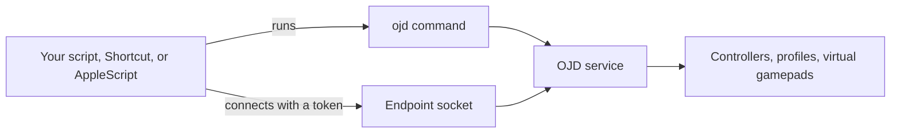
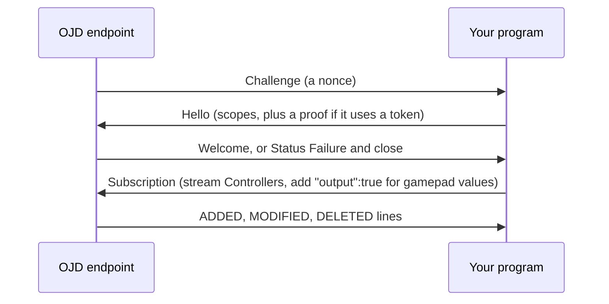
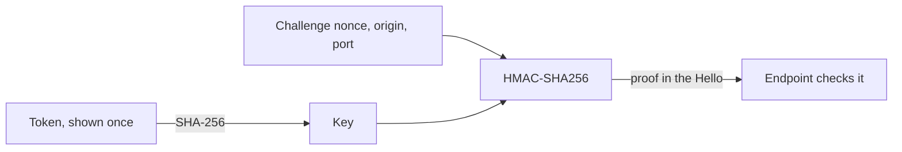
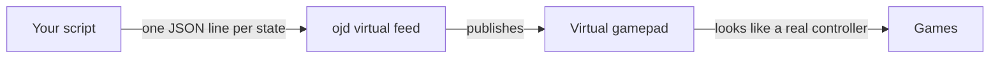

# Automating OpenJoystickDriver

Let a script, Shortcut, or AppleScript read your controllers, change [profiles](Glossary.md#terms), and drive a [virtual gamepad](Glossary.md#terms). Automate a job that repeats, such as switching to a racing profile when a racing game opens. Pick the smallest tool:

- One action, no code: [Shortcuts](#use-shortcuts).
- Terminal or a script: the `ojd` command.
- Your own program listening live: the endpoint, a private door on your Mac (a local socket).



## Contents

- [Choose the Interface](#choose-the-interface)
- [Write a Script](#write-a-script)
- [Read JSON Output](#read-json-output)
- [Name a Controller](#name-a-controller)
- [Watch Controllers](#watch-controllers)
- [Read the Endpoint](#read-the-endpoint)
  - [Use a Token](#use-a-token)
  - [Use the WebSocket](#use-the-websocket)
  - [Use the WebSocket From an App](#use-the-websocket-from-an-app)
  - [Drive a Virtual Gamepad Through the Endpoint](#drive-a-virtual-gamepad-through-the-endpoint)
  - [Other Endpoint Messages](#other-endpoint-messages)
- [Change Profiles](#change-profiles)
- [Drive a Virtual Gamepad](#drive-a-virtual-gamepad)
  - [What the Virtual Gamepad Carries](#what-the-virtual-gamepad-carries)
- [Use AppleScript or JavaScript for Automation](#use-applescript-or-javascript-for-automation)
- [Use Shortcuts](#use-shortcuts)

## Choose the Interface

Run `ojd` as a subprocess, read its `--json` output, and check its exit code. Global options and exit codes are in [Command line](Command-Line.md). The `ApplicationServiceClient` in `OpenJoystickDriverKit` works only for a process with the app's code signature, so use `ojd`.

## Write a Script

A good script starts the service, never stops to ask, and checks every exit code. An exit code is the number a command leaves behind: 0 means it worked.

1. Start the service and wait: `ojd service start`.
2. Add `--no-input` to each command, so it fails instead of asking, and `--json` where you read output.
3. Check each exit code. Code 69 means the service is not running.

Commands that delete or reset data need `--force` in a script. `--dry-run` previews a change.

```shell
ojd service start --timeout 30
ojd --no-input --json controller list | jq -r '.items[] | [.id, .name, .unit // ""] | @tsv'
```

## Read JSON Output

With `--json`, `ojd` prints JSON whose keys and values stay the same between releases and are never translated. A streaming command, such as `ojd controller watch` or `ojd virtual feed`, prints one object per line.

- Each object has `apiVersion` (`openjoystickdriver/v1alpha3`) and `kind`, such as `Controller`, `UnservedController` (a device OJD does not handle), or `SystemStatus`.
- List commands print a `kind` ending in `List` (`ControllerList`) with entries in `items`. An item has no `apiVersion` or `kind`. `binding list` adds a `profile` to each item.
- A command with nothing to print, such as `ojd profile delete`, prints a `Status`: `status` is `Success` and `details` holds the data. A failed command prints no JSON and exits non-zero.
- Enumerated values are UpperCamelCase in `--json` (`NotPublished`, `BluetoothLE`) and lowercase kebab-case in `--plain` and arguments (`not-published`). This includes routes, [virtual gamepad kinds](Glossary.md#terms), and protocol families (`xbox-gip`).

[`cli-output.schema.json`](../Resources/Schemas/cli-output.schema.json) describes each command's output in `$defs`, named by command path in lowerCamelCase, such as `controllerShow`. Validate against the schema from the same release.

## Name a Controller

A `CONTROLLER` operand takes one of these:

- Unit ID, `U-` and 16 characters: survives a reconnect or service restart on the same USB port, changes with another port. A Bluetooth LE unit ID comes from the identifier this Mac gave the controller. Scripts can store it.
- `VVVV:PPPP`, the vendor and product numbers in hexadecimal: names a model. When two connected controllers share it, the command fails and lists them.
- Listed ID, `E-` and 16 characters, from `ojd controller list`: lasts until the controller disconnects. Do not store it.

`ojd controller list --json` gives each unit ID in `unit`.

## Watch Controllers

`ojd controller watch --all --json` follows all controllers in one stream. Each line has a `type` and an `object` (a `Controller`), like a Kubernetes watch, with no `apiVersion` or `kind`.

- `ADDED`: a controller connected, with the fields of a `controller list` entry. The first lines list controllers already connected.
- `MODIFIED`: the input changed. `object` adds `input`, the whole input state. With `--output`, `output` holds the virtual gamepad values.
- `DELETED`: the controller disconnected. `object` is its last state.

```shell
ojd --no-input controller watch --all --json | jq -c 'select(.type != "MODIFIED")'
```

## Read the Endpoint

A long-running program can read events from the endpoint instead of rerunning `ojd controller watch`. The endpoint is off by default and serves only programs you grant. The **Access** area does the first two steps too:


1. Turn it on: `ojd access enable`.
2. Grant your program: `ojd access grant /Applications/Reader.app`. `ojd access list` shows the ID of a refused program.
3. Read the socket path: `ojd --json access status | jq -r .socketPath`. The socket exists only while the endpoint is on.

Each line is one JSON object of at most 64 KiB, with `apiVersion` and `kind` (a watch line has neither). Send `Hello` within 5 seconds. A granted program can ignore the challenge. A [token](#use-a-token) client signs it.



Bad lines get `E1009` (other `apiVersion`), `E1011` (missing or non-string `apiVersion` or `kind`), or `E1010` (a `kind` not accepted at that point). Every message, error, and version rule is in the [SDK endpoint reference](../docs/sdk/endpoint.md) and [`endpoint.schema.json`](../Resources/Schemas/endpoint.schema.json).

The [reference client](../Scripts/SDK/reference_client.py) is a complete Python example. Grant `/usr/bin/python3` to run it, which gives every Python script the access. For regular use, grant a signed app of your own.

### Use a Token

A program you can't grant by signature, such as a script, uses a token, like a password. It signs the challenge to prove it has the token and never sends it.



1. Create it: `ojd access grant --token reader`. The command prints the token once. The service keeps only its SHA-256 hash.
2. Join four lines, each ending with a newline: `OpenJoystickDriver endpoint hello 1`, the challenge `nonce`, the page origin, and the WebSocket port. On the socket, the origin and port lines are empty.
3. Compute the HMAC-SHA256 of those lines with the SHA-256 of the token as the key, as lowercase hex.
4. Add `"tokenName":"reader"` and `"proof":"..."` to the `Hello`.

Details: [SDK endpoint reference](../docs/sdk/endpoint.md#token-proof).

Any program that reads the token can use it, so store it like a password. Revoke it with `ojd access revoke token:reader`. `AccessGrants.plist` in the Application Support folder is secret too: its hashes are the HMAC keys. Keep it out of support reports, exports, and backups. If it leaks, revoke every token.

### Use the WebSocket

A web page, such as a stream overlay, can read the endpoint through a WebSocket.

1. Run `ojd access web enable`. It listens on `127.0.0.1`. The system picks a free port the first time. Choose one with `--port`. `ojd access status` shows it.
2. Grant a token for the page origin: `ojd access grant --token overlay --origin http://127.0.0.1:PORT`.
3. Put the page in the `Overlays` folder that `ojd access status` shows. It is served at `http://127.0.0.1:PORT/`, and a folder serves its `index.html`.
4. The page connects to `ws://127.0.0.1:PORT/endpoint`, sends the same messages as one JSON object per text message, and signs the challenge with its [token](#use-a-token), its origin, and the port.

Only an origin you granted a token for gets in. Pages opened from a file (origin `null`) and the address `localhost` are refused. Use `127.0.0.1`.

If another program holds the port, `ojd access web enable` fails. Pick another port with `--port` and grant tokens for that origin.

Error lines are a `Status` of `Failure` with a code from `E1001` to `E1011`. See [Error codes](Error-Codes.md). The endpoint serves at most 8 socket and 8 WebSocket connections. For a slow reader, it keeps only the newest `MODIFIED` line of each controller. At 256 waiting lines, it sends `E1006` and closes.

### Use the WebSocket From an App

A sandboxed app can't connect to the socket (`EPERM`) but can use the WebSocket.

1. Give the app the `com.apple.security.network.client` entitlement.
2. Run `ojd access web enable`, then `ojd access grant --token myapp` (no `--origin`).
3. Connect to `ws://127.0.0.1:PORT/endpoint` with no `Origin` header.
4. Sign the challenge with the token, an empty origin line, and the port.

Any local program with the token can use it, including programs of other users. Store it like a password. A token without origins works only from a client that sends no `Origin`, so web pages can't use it.

### Drive a Virtual Gamepad Through the Endpoint

A `control` program can press buttons on a virtual gamepad, as [`ojd virtual feed`](#drive-a-virtual-gamepad) does.

1. Run `ojd access grant --token driver --scope control`. Add `--scope read` for both. A token with `--origin` can't have `control`.
2. Send a `Hello` with `"scopes":["Control"]`.
3. After the `Welcome`, send `{"apiVersion":"openjoystickdriver/v1alpha3","kind":"FeedRequest","as":"Generic"}`. The kinds are `Generic`, `SDLCompatible`, and `GameControllerCompatible`. An unknown one gets `E1003` with the accepted list.
4. After the `FeedSession` answer, send one `Frame` per line, with the keys and rules of an `ojd virtual feed` line. While 256 frames wait, the endpoint stops reading.
5. Game rumble commands return as `RumbleCommand` lines.

Closing the connection removes the gamepad and drops unplayed frames. To end cleanly, send `{"apiVersion":"openjoystickdriver/v1alpha3","kind":"Drain"}` after the last frame and stay connected until `Drained` arrives. A `Drain` before the `FeedSession` gets `E1010`.

After the last frame plays, 2 seconds with no line closes the connection with `E1008` and removes the gamepad, so a stalled client holds no button. Send any line within 2 seconds to keep it. The endpoint runs at most 4 virtual gamepads and answers another `feed` with `E1007`. It also sends `E1008` if the gamepad does not start or the service stops it.

The [reference client](../Scripts/SDK/reference_client.py) uses only the Python standard library. It presses South for 100 ms and prints rumble commands. Set `OJD_TOKEN` to the token that `ojd access grant` printed, then run `python3 reference_client.py feed` (or `watch`). Games and latency through the endpoint are not verified.

### Other Endpoint Messages

After the `Welcome`, a `control` program can change profiles and drive outputs, and a `Read` program can watch lists. Field rules and answers are in the [SDK endpoint reference](../docs/sdk/endpoint.md#messages).

- `ProfileRequest`: does what `ojd profile activate`, `deactivate`, and `set` do. Example: `{"apiVersion":"openjoystickdriver/v1alpha3","kind":"ProfileRequest","action":"Set","profile":"Racing","key":"name","value":"Rally"}`. A refusal carries the code `ojd` prints, such as `E2012`, and the connection stays open.
- `OutputRequest`: does what `ojd controller rumble`, `player`, and `light` do, with the same code as the Shortcuts actions. `Rumble` takes motor strengths (0 to 255) and a `duration` of at most 5 seconds. With no motor named, both main motors run at 180. `Player` takes 0 to 4. `Light` takes a six-digit hex `color` and a `brightness`.
- `Subscription` with `"stream":"Profiles"` or `"stream":"Mods"` (no `output`): the endpoint sends the whole list on each change. Any later line ends the connection.
- `ModList`: lists mod packages once, as `ojd mod list --json` does. An entry with a `problem` is a package the service does not use.

On the installed build (`8456f9de8665`, a token with `Read` and `Control`), these worked as described, and a `Read`-only client got `E1002`. `OutputRequest` on an 8BitDo Ultimate 2C over Bluetooth LE (no rumble, player lights, or light color) got `E2013`. Whether a controller carries out rumble, a player number, or a light color is not verified. Evidence: [`evidence/scripting/`](../evidence/scripting/).

## Change Profiles

Profiles are XML property lists. See [`profile.schema.json`](../Resources/Schemas/profile.schema.json) and the [Profile file reference](Profile-File-Reference.md). Read one with `plutil -convert json -o - FILE.plist`. Options for each command are in the [command reference](Command-Reference.md#profile).

- `ojd profile get PROFILE KEY` and `ojd profile set PROFILE KEY VALUE`. `KEY` is a path of key names and array indexes joined by dots.
- `ojd profile export PROFILE` prints the file. `ojd profile import FILE` adds it or replaces the profile with the same ID. `-` reads standard input.
- `ojd profile validate FILE` checks a file without the service.
- `ojd profile activate PROFILE` and `ojd profile deactivate PROFILE`.

```shell
ojd profile get Racing stickMappings.0.tuning.innerDeadzone
ojd profile set Racing stickMappings.0.tuning.innerDeadzone 0.15
ojd profile export Racing --output racing.plist
ojd profile validate racing.plist
```

To limit a profile to one controller, set `device.unit` to its unit ID. To pick the virtual gamepad for one controller, run `ojd virtual set PROFILE CONTROLLER --unit`.

## Drive a Virtual Gamepad

`ojd virtual feed --as PROFILE` publishes a virtual gamepad and reads one JSON object per line from standard input. Each line is the whole state. A control it does not name is neutral. `--as` takes a [virtual gamepad kind](Glossary.md#terms): `sdl-compatible`, `generic`, or `game-controller-compatible`.



```shell
{
  echo '{"buttons":["South"]}'
  sleep 1
  echo '{"axes":{"LeftStickX":-1,"RightTrigger":0.5}}'
  sleep 1
} | ojd virtual feed --as generic
```

This holds South for 1 second, then moves the left stick fully left and pulls the right trigger halfway for 1 second. When the input ends, OJD removes the gamepad.

To tap a button without waiting, add `holdMilliseconds` and send the release after it:

```shell
printf '%s\n' '{"buttons":["South"],"holdMilliseconds":50}' '{}' | ojd virtual feed --as generic
```

- `buttons` and `dpad` list pressed controls by the names of `button:` and `dpad:` binding sources, such as `South` and `up`.
- `axes` maps names to values. Sticks (`LeftStickX`) run from -1 to 1, with Y down. Triggers run from 0 to 1.
- Each line plays for at least 8 ms. `holdMilliseconds` (0 to 60000) keeps one longer. Queue rules, rumble output, and limits (at most 4 feeds, plus 4 for endpoint clients) are in the [command reference](Command-Reference.md#virtual).
- The gamepad goes away when the input ends and every line has played, on Control-C, or after 2 seconds with no update.
- An invalid line, such as an unknown key or a control listed twice, stops the command with exit code 64.

Games and latency with `ojd virtual feed` are not verified.

### What the Virtual Gamepad Carries

The virtual gamepad has a fixed set of buttons. A control it does not carry does nothing, whether passed through or assigned to a gamepad output. This covers `generic` and `sdl-compatible`. `game-controller-compatible` is not verified here.

- Carried by both: South, East, West, North, shoulders, Back, Start, stick clicks, Guide (in its own report for `sdl-compatible`), sticks, and triggers.
- D-pad: a hat and 4 buttons in `generic`, a hat in `sdl-compatible`.
- Capture: `generic` only.
- Carried by neither: touchpad click, microphone, paddles, grips, auxiliary buttons, stick touch, trackpad touch, left trackpad click.
- Right trackpad click: the right stick click on the classic Steam Controller, otherwise not carried. The Steam Deck and Steam Triton have their own right stick click.
- `generic` has 16 buttons, all in use. Its layout is the contract for product ID `1209:4A4F`, so a seventeenth button needs another ID.
- `sdl-compatible` sends the Xbox One USB packets that the SDL HIDAPI driver reads: an 18-byte input report with no Capture field, and Guide in a second report. Its D-pad buttons stay clear, because the D-pad is the hat.

## Use AppleScript or JavaScript for Automation

The app has no AppleScript dictionary. Both languages run `ojd` through `do shell script`, whose `PATH` lacks `/usr/local/bin`, so name the link in full and turn it on in Settings first. These examples read another path from the `OJD` environment variable.

```applescript
set ojd to system attribute "OJD"
if ojd is "" then set ojd to "/usr/local/bin/ojd"
set state to do shell script quoted form of ojd & " --no-input --json status | /usr/bin/plutil -extract service.state raw -o - -"
set controllers to do shell script quoted form of ojd & " --no-input --json controller list | /usr/bin/plutil -extract items raw -o - -"
return "Service: " & state & ". Connected controllers: " & controllers & "."
```

```javascript
const app = Application.currentApplication();
app.includeStandardAdditions = true;
const ojd = app.systemAttribute("OJD") || "/usr/local/bin/ojd";
const status = JSON.parse(app.doShellScript(`'${ojd}' --no-input --json status`));
const lines = status.unboundDevices.map((device) => `${device.name} (${device.connection})`);
`Service ${status.service.state}; ${status.controllers.length} controllers; unbound: ${lines.join(", ") || "none"}`;
```

Run them with `osascript FILE` or `osascript -l JavaScript FILE`. Sample output is in [`evidence/scripting/`](../evidence/scripting/).

## Use Shortcuts

On macOS 13 or later, the Shortcuts app lists these actions, so you can control OJD with no code. They run in the app and do not use `ojd`.

- Get Controllers, Get Battery Level (a controller, returns percent), Get OpenJoystickDriver Version.
- Activate Profile, Deactivate Profile, Set Profile Value (profile, key, value).
- List Mod Packages, Install Mod Package (a folder, and whether to replace a package of the same name), Remove Mod Package (a name).
- Rumble Controller (controller, intensity 0 to 255, duration in seconds), Set Player Indicator (controller, 0 to 4), Set Controller Light (controller, color, brightness).

A shortcut stores the controller in the forms of [Name a Controller](#name-a-controller). A single controller stores its unit ID, or its list ID when it has none. A model entry, such as `Any connected 2DC8:310A`, stores `VVVV:PPPP` and finds that model on any port. If two connected controllers share a model, the action fails and lists them.

Shortcuts does not refresh an open list, so reopen it after you connect a controller. With no controller connected, a shortcut asks for one in a window, even from `shortcuts run`. Get Battery Level fails when the controller reports no level, and returns the lowest value of a range such as `30-39%`. To use no fixed controller, start with Get Controllers and Get Item from List (First Item), and pass that item.

Run a shortcut from another program with the `shortcuts` command or a `shortcuts://` link, such as Raycast (`shortcuts run "Low Battery Check"`) or a Stream Deck Open action (`shortcuts://run-shortcut?name=Low%20Battery%20Check`). No command runs an action by name, only a shortcut you built. For Install Mod Package, pass the folder as a `file://` URL. A plain path fails with "Invalid URL". This runs shortcuts you build, each with one action taking the Shortcut Input:

```sh
printf '%s' "file://$PWD/docs/sdk/sample/" > folder.txt
printf 'ojd-sample' > name.txt
shortcuts run "OJD Install Mod Package" --input-path folder.txt
shortcuts run "OJD List Mod Packages"
shortcuts run "OJD Remove Mod Package" --input-path name.txt
```

To rename a profile, give Set Profile Value the chosen profile and the Shortcut Input as the value:

```sh
printf 'OJD Shortcut Renamed' > value.txt
shortcuts run "OJD Set Profile Value" --input-path value.txt
```
