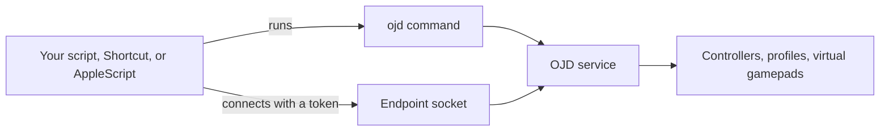
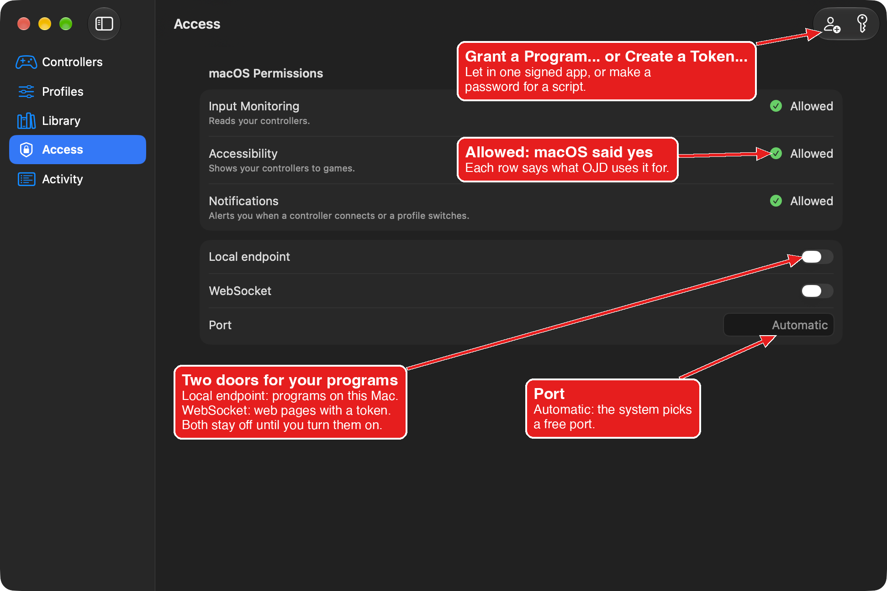

# Automating OpenJoystickDriver

Write scripts, Shortcuts, and AppleScript that read your controllers, change [profiles](Glossary.md#terms), and drive a [virtual gamepad](Glossary.md#terms).

Automating means letting a small program do a job for you, such as switching to your racing profile whenever a racing game opens.

For one action with no code, see [Use Shortcuts](#use-shortcuts). The other sections cover two ways in:

- the `ojd` command, which you type in Terminal or call from a script
- the endpoint, a private door on your Mac (a local socket) where your own programs can listen to controller events as they happen

- **Who:** anyone who writes scripts, Shortcuts, or AppleScript.
- **What:** read controllers, switch profiles, and drive a virtual gamepad from your own program.
- **When:** a job repeats, such as switching to a racing profile whenever a racing game opens.
- **Where:** Terminal with `ojd`, the Shortcuts app, or the endpoint socket on your Mac.
- **How:** start with Shortcuts for one action; use `ojd` or the endpoint for more.



## Contents

- [Choose the Interface](#choose-the-interface)
- [Write a Script](#write-a-script)
- [Read JSON Output](#read-json-output)
- [Name a Controller](#name-a-controller)
- [Watch Controllers](#watch-controllers)
- [Read the Endpoint](#read-the-endpoint)
- [Change Profiles](#change-profiles)
- [Drive a Virtual Gamepad](#drive-a-virtual-gamepad)
- [Use AppleScript or JavaScript for Automation](#use-applescript-or-javascript-for-automation)
- [Use Shortcuts](#use-shortcuts)
- [Further Reading](#further-reading)

## Choose the Interface

To control OpenJoystickDriver from a script, run `ojd` as a subprocess, read its `--json` output, and check its exit code. For global options, output rules, and exit codes, see [Command line](Command-Line.md).

The `ApplicationServiceClient` in the Swift package `OpenJoystickDriverKit` works only for a process with the app's code signature, so a program you build can't use it with a released app. Use `ojd`.

## Write a Script

A good script starts the service, never stops to ask you a question, and checks every exit code. An exit code is a number a command leaves behind when it ends: 0 means it worked, and any other number names what went wrong.

1. Start the service and wait until it accepts requests: `ojd service start`.
2. Add `--no-input` to each command, so it fails instead of asking, and `--json` where you read output.
3. Check each exit code. Code 69 means the service is not running.

Commands that delete or reset data need `--force` in a script. To preview a change, use `--dry-run`.

```shell
ojd service start --timeout 30
ojd --no-input --json controller list | jq -r '.items[] | [.id, .name, .unit // ""] | @tsv'
```

## Read JSON Output

With `--json`, `ojd` prints JSON, a text format programs read easily. The keys and values stay the same between releases and are never translated, so your script keeps working in any language. A streaming command, such as `ojd controller watch` or `ojd virtual feed`, prints one JSON object per line.

Each object has `apiVersion` (`openjoystickdriver/v1alpha3`) and `kind`, the singular UpperCamelCase name of the output. `ojd controller show` prints `Controller`, or `UnservedController` for a device OJD does not handle. `ojd status` prints `SystemStatus`.

The list commands (`controller list`, `permission list`, `setting list`, `binding list`, `profile list`, `record list`) print a `kind` ending in `List`, such as `ControllerList`. Entries are in `items`, and `metadata` is empty. An item has no `apiVersion` or `kind`. `binding list` gives each item a `profile`.

`profile list` and `record list` warn on standard error for a profile that cannot load or a record OJD skipped.

A command with no object to print, such as `ojd profile delete` or `ojd controller rumble`, prints a `Status`: `status` is `Success` and `details` holds the data. A failed command prints no JSON, exits non-zero, and writes the error on standard error.

In `--json` output, enumerated values are UpperCamelCase, such as `NotPublished`, `InputRead`, and `BluetoothLE`. In `--plain` output and command-line arguments, they are lowercase kebab-case, such as `not-published` and `input-read`. The `status` of a `Status` and the `type` of a watch line keep the Kubernetes spelling. This includes routes, [virtual gamepad kinds](Glossary.md#terms), and protocol families (`virtual-hid`, `sdl-compatible`, `xbox-gip`).

[`cli-output.schema.json`](../Resources/Schemas/cli-output.schema.json) describes each command's output in `$defs`. The entry is named after the command path in lowerCamelCase, such as `controllerShow` for `ojd controller show`.

Validate against the schema from the same release, which rejects keys that release does not print. Do not parse the human-readable output.

## Name a Controller

A `CONTROLLER` operand takes one of these forms:

- A unit ID, `U-` and 16 characters. It survives a reconnect or service restart on the same USB port, and changes with another port. Replacing `~/Library/Application Support/OpenJoystickDriver/PortKeyInstallation.key` changes every unit ID. A Bluetooth LE controller's unit ID comes from the identifier this Mac gave the controller, not a port. Scripts can store it.
- `VVVV:PPPP`, the vendor and product numbers in hexadecimal. It names a model. When two connected controllers share a model, the command fails and lists them.
- An ID from `ojd controller list`, `E-` and 16 characters. It lasts only until the controller disconnects. Do not store it.

`ojd controller list --json` gives each unit ID in `unit`.

## Watch Controllers

Run `ojd controller watch --all --json` to follow all controllers in one stream. Each line has a `type` and an `object`, as in a Kubernetes watch, and no `apiVersion` or `kind`. `object` is a `Controller` whose `id` is the ID from `ojd controller list`.

- `ADDED`: A controller connected. `object` has the fields of a `controller list` entry, including `unit`. The first lines list connected controllers.
- `MODIFIED`: The input changed. `object` has the same fields and `input`, the whole input state. With `--output`, `output` has the values of the controller's virtual gamepad.
- `DELETED`: The controller disconnected. `object` is its last state.

```shell
ojd --no-input controller watch --all --json | jq -c 'select(.type != "MODIFIED")'
```

`ojd` asks the service for input every 16 ms. The interval for the controller list is not verified.

## Read the Endpoint

A long-running program can read controller events from the endpoint, a local socket, instead of running `ojd controller watch` repeatedly. The endpoint is off by default and serves only programs you grant.

You can do the first two steps below in the **Access** area of the app, too:



1. Turn on the endpoint: `ojd access enable`.
2. Grant your program: `ojd access grant /Applications/Reader.app`. To find the ID of a refused program, run `ojd access list`.
3. Read the socket path: `ojd --json access status | jq -r .socketPath`. The socket is in your user's temporary folder and exists only while the endpoint is on.

Each line is one JSON object of at most 64 KiB. Each line except a watch line has `apiVersion` and a `kind`.

1. The endpoint sends `{"apiVersion":"openjoystickdriver/v1alpha3","kind":"Challenge","nonce":"…"}`. A granted program can ignore it. A [token](#use-a-token) client signs it.
2. Within 5 seconds, the program sends `{"apiVersion":"openjoystickdriver/v1alpha3","kind":"Hello","scopes":["Read"]}`.
3. The endpoint answers with a `Welcome` (`version` and granted `scopes`), or with a `Status` of `Failure` and closes the connection.
4. The program sends `{"apiVersion":"openjoystickdriver/v1alpha3","kind":"Subscription","stream":"Controllers"}`. Add `"output":true` for the virtual gamepad values.
5. The endpoint sends the `ADDED`, `MODIFIED`, and `DELETED` lines of `ojd controller watch --all --json`.

The endpoint refuses some lines with an error code:

- `E1009`: The line has another `apiVersion`.
- `E1011`: The line has no `apiVersion` or `kind`, or one is `null` or not a string.
- `E1010`: The endpoint does not accept that `kind` at that point.

```python
import json
import socket
import subprocess

status = json.loads(subprocess.check_output(["ojd", "--json", "access", "status"]))
with socket.socket(socket.AF_UNIX) as endpoint:
    endpoint.connect(status["socketPath"])
    lines = endpoint.makefile("rw")
    lines.readline()  # the challenge
    lines.write('{"apiVersion":"openjoystickdriver/v1alpha3","kind":"Hello","scopes":["Read"]}\n')
    lines.flush()
    print(lines.readline(), end="")
    lines.write('{"apiVersion":"openjoystickdriver/v1alpha3","kind":"Subscription","stream":"Controllers"}\n')
    lines.flush()
    for line in lines:
        event = json.loads(line)
        if event["type"] != "MODIFIED":
            print(event["type"], event["object"]["id"])
```

To run this example, grant `/usr/bin/python3`, which gives every Python script the access. For regular use, grant a signed app of your own.

### Use a Token

A program you can't grant by signature, such as a script, can use a token, which works like a password. The program signs the challenge to prove it has the token and never sends it.

1. Create the token: `ojd access grant --token reader`. The command prints it once. The service keeps only its SHA-256 hash.
2. Join four lines, each ending with a newline: `OpenJoystickDriver endpoint hello 1`, the challenge `nonce`, the origin of the page, and the WebSocket port. On the socket, the origin and port lines are empty.
3. Compute the HMAC-SHA256 of those lines, with the SHA-256 of the token as the key. Write it as lowercase hex.
4. Add the token name and HMAC to the `Hello`: `{"apiVersion":"openjoystickdriver/v1alpha3","kind":"Hello","scopes":["Read"],"tokenName":"reader","proof":"…"}`.

```python
import hashlib
import hmac
import json

TOKEN = "ojd_…"

nonce = json.loads(lines.readline())["nonce"]
message = "".join(line + "\n" for line in ["OpenJoystickDriver endpoint hello 1", nonce, "", ""])
key = hashlib.sha256(TOKEN.encode()).digest()
proof = hmac.new(key, message.encode(), hashlib.sha256).hexdigest()
hello = {
    "apiVersion": "openjoystickdriver/v1alpha3",
    "kind": "Hello",
    "scopes": ["Read"],
    "tokenName": "reader",
    "proof": proof,
}
lines.write(json.dumps(hello) + "\n")
```

This code replaces the `readline` and first `write` above.

Any program that reads the token can use it. Store it like a password. To remove it, run `ojd access revoke token:reader`.

`AccessGrants.plist` in the Application Support folder is also secret. Its SHA-256 hashes are the HMAC keys, so a program that reads it can sign as any token in it. Keep it out of support reports, exports, and backups. If it leaks, revoke every token.

### Use the WebSocket

A web page, such as a stream overlay, can read the endpoint through a WebSocket.

1. Turn on the WebSocket: `ojd access web enable`. It listens on `127.0.0.1`. The first time, the system picks a free port and the service saves it. Choose one with `--port`. `ojd access status` shows it. `ojd access enable` does not turn on the WebSocket.
2. Grant a token for the page origin with the port from `ojd access status`: `ojd access grant --token overlay --origin http://127.0.0.1:PORT`.
3. Put the page in the `Overlays` folder that `ojd access status` shows. The port serves it at `http://127.0.0.1:PORT/`, and a folder serves its `index.html`.
4. The page connects to `ws://127.0.0.1:PORT/endpoint` and exchanges the same messages, one JSON object per text message. It signs the challenge with its [token](#use-a-token), its origin, and the port.

```javascript
const token = "ojd_…";
const apiVersion = "openjoystickdriver/v1alpha3";
const encoder = new TextEncoder();

async function proof(nonce) {
  const secret = await crypto.subtle.digest("SHA-256", encoder.encode(token));
  const key = await crypto.subtle.importKey("raw", secret, { name: "HMAC", hash: "SHA-256" }, false, [
    "sign",
  ]);
  const lines = ["OpenJoystickDriver endpoint hello 1", nonce, location.origin, location.port];
  const code = await crypto.subtle.sign("HMAC", key, encoder.encode(lines.map((line) => line + "\n").join("")));
  return Array.from(new Uint8Array(code), (byte) => byte.toString(16).padStart(2, "0")).join("");
}

// The page is served from the WebSocket's port, so its origin and port are the ones to sign.
const endpoint = new WebSocket(`ws://${location.host}/endpoint`);
endpoint.onmessage = async (message) => {
  const event = JSON.parse(message.data);
  switch (event.kind) {
    case "Challenge":
      endpoint.send(
        JSON.stringify({
          apiVersion,
          kind: "Hello",
          scopes: ["Read"],
          tokenName: "overlay",
          proof: await proof(event.nonce),
        }),
      );
      break;
    case "Welcome":
      endpoint.send(JSON.stringify({ apiVersion, kind: "Subscription", stream: "Controllers" }));
      break;
    default:
      // A watch line has a type and an object, and no kind. A Status is an error.
      if (event.type === "MODIFIED") {
        console.log(event.object);
      }
      break;
  }
};
```

The WebSocket accepts a page only from an origin you granted a token for. A page from another origin, such as `http://127.0.0.1:8080`, signs its own origin and the WebSocket port. It refuses pages opened from a file (origin `null`) and the address `localhost`. Use `127.0.0.1`.

If another program uses the port, `ojd access web enable` fails, or `ojd access status` shows the WebSocket as on but not listening. Choose another port with `ojd access web enable --port PORT` and grant tokens for the new origin.

An error line is a `Status` of `Failure` with a `code` from `E1001` to `E1011`. See [Error codes](Error-Codes.md). With `E1009` to `E1011`, `details.supportedAPIVersions` lists the accepted `apiVersion` values.

The endpoint serves at most 8 socket and 8 WebSocket connections. For a slow reader, it keeps only the newest `MODIFIED` line of each controller. At 256 waiting lines, it sends `E1006` and closes the connection.

[`endpoint.schema.json`](../Resources/Schemas/endpoint.schema.json) describes each line. The [SDK endpoint reference](../docs/sdk/endpoint.md) documents messages, errors, grants, and versions.

### Use the WebSocket From an App

A sandboxed app can't connect to the socket (`EPERM`) but can use the WebSocket.

1. Give the app the `com.apple.security.network.client` entitlement.
2. Turn on the WebSocket with `ojd access web enable`. Create a token without `--origin`: `ojd access grant --token myapp`.
3. Connect to `ws://127.0.0.1:PORT/endpoint` without an `Origin` header.
4. Sign the challenge with the token, an empty origin line, and the port.

Any local program with such a token can use it, including programs of other users. Store it like a password. A token without origins works only from a client that sends no `Origin`, so web pages can't use it.

### Drive a Virtual Gamepad Through the Endpoint

A `control` program can press buttons on a virtual gamepad, as [`ojd virtual feed`](#drive-a-virtual-gamepad) does.

1. Run `ojd access grant --token driver --scope control`. Add `--scope read` for both. A token with `--origin` can't have `control`.
2. Send a `Hello` with `"scopes":["Control"]`.
3. After the `Welcome`, send `{"apiVersion":"openjoystickdriver/v1alpha3","kind":"FeedRequest","as":"Generic"}`. The kind IDs are `Generic`, `SDLCompatible`, and `GameControllerCompatible`. An unknown ID gets `E1003`, whose message lists the accepted kinds.
4. The endpoint answers `{"apiVersion":"openjoystickdriver/v1alpha3","kind":"FeedSession","as":"Generic"}`.
5. Send one frame per line, with `apiVersion` and `"kind":"Frame"`. A frame has the keys of an `ojd virtual feed` line and plays by the same rules. While 256 frames wait, the endpoint stops reading lines.
6. The endpoint sends each game rumble command as a `RumbleCommand` line, as `ojd virtual feed` prints. Its `type` is `SetRumble` or `StopRumble`. See `virtualFeed` in the output schema.

Closing the connection removes the virtual gamepad and drops unplayed frames. After the last frame, send `{"apiVersion":"openjoystickdriver/v1alpha3","kind":"Drain"}` and stay connected until the endpoint answers `Drained`, when every earlier frame has played. Before the `FeedSession`, a `Drain` gets `E1010`.

After the last frame has played, 2 seconds with no line closes the connection with `E1008` and removes the virtual gamepad, so a stalled client holds no button. To keep the gamepad, send another line within 2 seconds. The endpoint runs at most 4 virtual gamepads and answers another `feed` with `E1007`. It sends `E1008` if the virtual gamepad does not start or the service stops it.

The [reference client](../Scripts/SDK/reference_client.py) uses only the Python standard library. It presses South for 100 ms and prints rumble commands. Set `OJD_TOKEN` to the token that `ojd access grant` printed. Run `python3 reference_client.py feed`, or `watch` to subscribe. Games and latency through the endpoint are not verified.

### Change a Profile Through the Endpoint

A `control` program can activate, deactivate, or change one profile, as `ojd profile activate`, `deactivate`, and `set` do. After the `Hello` and `Welcome`, send `{"apiVersion":"openjoystickdriver/v1alpha3","kind":"ProfileRequest","action":"Set","profile":"Racing","key":"name","value":"Rally"}`.

- `action` is `Activate`, `Deactivate`, or `Set`. `profile` is the UUID or name.
- `Set` takes a `key` and `value`, read as `ojd profile set` does. A `value` of `null` removes a member.
- The endpoint answers with a `ProfileResult`, or with a `Status` failure carrying the code `ojd` prints, such as `E2012`. The connection stays open for another `ProfileRequest`. A `Subscription` or `FeedRequest` ends the exchange.

### Rumble, Player Number and Light Through the Endpoint

A `control` program can drive one controller, as `ojd controller rumble`, `player`, and `light` do. The Shortcuts actions run the same code. After the `Hello` and `Welcome`, send `{"apiVersion":"openjoystickdriver/v1alpha3","kind":"OutputRequest","controller":"054C:0CE6","action":"Rumble","left":200,"duration":1.5}`.

- `controller` is a controller ID or a `VID:PID` model. `action` is `Rumble`, `Player`, or `Light`.
- `Rumble` takes `left`, `right`, `leftTrigger`, and `rightTrigger` (0 to 255), and `duration` in seconds (above 0, at most 5, default 0.45). With no motor named, both main motors run at 180.
- `Player` takes `player` (0 to 4). `Light` takes a `color` of six hex digits and a `brightness` (0 to 255). Give at least one.
- The endpoint answers with an `OutputResult`, one entry for each command that ran. If the controller lacks the output, or is unknown or ambiguous, it answers with a `Status` failure and keeps the connection open. A malformed request gets `E1003` and the connection closes.

### Watch Profiles and Mod Packages Through the Endpoint

A `Read` program can watch profiles or mod packages. After the `Hello` and `Welcome`, send `{"apiVersion":"openjoystickdriver/v1alpha3","kind":"Subscription","stream":"Profiles"}`, or `"stream":"Mods"`. These streams refuse `output`.

The endpoint answers with a `Profiles` line (every profile, and whether it is active) or a `Mods` line, and resends the whole list on each change. It reads the lists twice a second. Any later line ends the connection.

### List Mod Packages Through the Endpoint

A `Read` program can list installed mod packages, as `ojd mod list --json` does. After the `Hello` and `Welcome`, send `{"apiVersion":"openjoystickdriver/v1alpha3","kind":"ModList"}`.

The endpoint answers with `Mods`, one entry for each package: `name`, `files`, and `version` and `author` when stated. An entry with a `problem` is a package the service does not use. The connection stays open for another `ModList` or `ProfileRequest`.

### Results From the Installed Build

These messages ran through the socket against build `8456f9de8665`, with a token holding `Read` and `Control`. See [`evidence/scripting/`](../evidence/scripting/).

- Profile requests, `ModList`, the `Profiles` and `Mods` subscriptions, and `FeedRequest` for each kind worked as described. A missing profile got `E2012`, and a `Read`-only client got `E1002`.
- `OutputRequest` on an 8BitDo Ultimate 2C over Bluetooth LE (no rumble, player lights, or light color) got `E2013`. Whether a controller carries out rumble, a player number, or a light color is not verified.

## Change Profiles

A profile is an XML property list. [`profile.schema.json`](../Resources/Schemas/profile.schema.json) describes it, and the [Profile file reference](Profile-File-Reference.md) explains its fields. In a script, change a profile with the commands below rather than by hand, and read one with `plutil -convert json -o - FILE.plist`.

- `ojd profile get PROFILE KEY` prints one value. `ojd profile set PROFILE KEY VALUE` changes one. `KEY` is a path of key names and array indexes joined by dots.
- `ojd profile export PROFILE` prints the whole file. `ojd profile import FILE` adds a file or replaces the profile with the same ID. Use `-` as `FILE` to read standard input.
- `ojd profile validate FILE` checks a file against the schema and cross-field rules. It does not need the service.
- `ojd profile activate PROFILE` applies a profile. `ojd profile deactivate PROFILE` stops it.

```shell
ojd profile get Racing stickMappings.0.tuning.innerDeadzone
ojd profile set Racing stickMappings.0.tuning.innerDeadzone 0.15
ojd profile export Racing --output racing.plist
ojd profile validate racing.plist
```

To limit a profile to one controller, set `device.unit` to its unit ID. To choose the virtual gamepad for one controller, use `ojd virtual set PROFILE CONTROLLER --unit`.

## Drive a Virtual Gamepad

`ojd virtual feed --as PROFILE` publishes a virtual gamepad. It reads one JSON object per line from standard input. Each line is the whole gamepad state, and a control it does not name is neutral. `--as` takes a [virtual gamepad kind](Glossary.md#terms): `sdl-compatible`, `generic`, or `game-controller-compatible`.

```shell
{
  echo '{"buttons":["South"]}'
  sleep 1
  echo '{"axes":{"LeftStickX":-1,"RightTrigger":0.5}}'
  sleep 1
} | ojd virtual feed --as generic
```

This holds South for 1 second, then moves the left stick fully left and pulls the right trigger halfway for 1 second. When the input ends, OJD removes the gamepad.

To tap a button without waiting, write the press with `holdMilliseconds` and the release after it:

```shell
printf '%s\n' '{"buttons":["South"],"holdMilliseconds":50}' '{}' | ojd virtual feed --as generic
```

- `buttons` and `dpad` list the pressed controls, using the names of `button:` and `dpad:` binding sources, such as `South` and `up`.
- `axes` maps axis names to values. Sticks, such as `LeftStickX`, go from -1 to 1, with Y down. `LeftTrigger` and `RightTrigger` go from 0 to 1.
- The service plays lines in order. Each lasts at least 8 ms, then until the next plays. Add `holdMilliseconds` (0 to 60000) to keep a line longer.
- Lines that arrive faster than every 8 ms wait in a queue of at most 256 (about 2 seconds when full). A line without `holdMilliseconds` replaces the last waiting line when that has none and the same `buttons` and `dpad`. The service never drops a press or release.
- Each game rumble command prints on standard output as one JSON object per line (see `virtualFeed` in the output schema).
- The service removes the virtual gamepad when the input ends and every line has played, on Control-C, or after 2 seconds with no update (the command sends updates while it waits).
- An invalid line stops the command with exit code 64: an unknown key, or a button or D-pad direction listed twice.
- The service runs at most 4 `ojd virtual feed` feeds at once. Endpoint clients have 4 more.

Games and latency with `ojd virtual feed` are not verified.

### What the Virtual Gamepad Carries

The virtual gamepad has a fixed set of buttons, so some physical controls have no output. A control it does not carry does nothing, whether passed through or assigned to a gamepad output. The table covers `generic` and `sdl-compatible`. The controls of `game-controller-compatible` are not verified here.

| Control | `generic` | `sdl-compatible` |
| --- | --- | --- |
| South, East, West, North | Carried | Carried |
| Left and right shoulder | Carried | Carried |
| Back, Start | Carried | Carried |
| Left and right stick click | Carried | Carried |
| Guide | Carried | Carried, in its own report |
| D-pad | Carried as a hat and as 4 buttons | Carried as a hat |
| Sticks and triggers | Carried | Carried |
| Capture | Carried | Not carried |
| Touchpad click, microphone | Not carried | Not carried |
| Paddles, grips, and auxiliary buttons | Not carried | Not carried |
| Stick touch, trackpad touch, left trackpad click | Not carried | Not carried |
| Right trackpad click | Right stick click on the classic Steam Controller, otherwise not carried | Right stick click on the classic Steam Controller, otherwise not carried |

- `generic` has 16 buttons, all in use. Its layout is the contract for product ID `1209:4A4F`, so a seventeenth button needs another ID.
- `sdl-compatible` sends the Xbox One USB packets that the SDL HIDAPI driver reads: an 18-byte input report, and Guide in a second report. They have no Capture field.
- The classic Steam Controller's right pad is its right stick, and its pad click is the right stick click. The Steam Deck and Steam Triton have their own right stick click, and their right pad click is not carried.
- The D-pad buttons of `sdl-compatible` stay clear, because the D-pad is the hat.

## Use AppleScript or JavaScript for Automation

The app has no AppleScript dictionary. AppleScript and JavaScript for Automation run `ojd` through `do shell script`, whose `PATH` lacks `/usr/local/bin`, so name the link in full and turn it on in Settings first. These examples read another path from the `OJD` environment variable.

```applescript
set ojd to system attribute "OJD"
if ojd is "" then set ojd to "/usr/local/bin/ojd"
set state to do shell script quoted form of ojd & " --no-input --json status | /usr/bin/plutil -extract service.state raw -o - -"
set controllers to do shell script quoted form of ojd & " --no-input --json controller list | /usr/bin/plutil -extract items raw -o - -"
return "Service: " & state & ". Connected controllers: " & controllers & "."
```

`osascript service-state.applescript` prints `Service: Running. Connected controllers: 0.` with no controller connected.

```javascript
const app = Application.currentApplication();
app.includeStandardAdditions = true;
const ojd = app.systemAttribute("OJD") || "/usr/local/bin/ojd";
const status = JSON.parse(app.doShellScript(`'${ojd}' --no-input --json status`));
const lines = status.unboundDevices.map((device) => `${device.name} (${device.connection})`);
`Service ${status.service.state}; ${status.controllers.length} controllers; unbound: ${lines.join(", ") || "none"}`;
```

`osascript -l JavaScript unbound-devices.js` prints `Service Running; 0 controllers; unbound: 8BitDo Ultimate 2C Wireless Controller (USB)` while another program holds that controller. Both are in [`evidence/scripting/`](../evidence/scripting/).

## Use Shortcuts

On macOS 13 or later, the Shortcuts app lists these actions, so you can control OpenJoystickDriver with no code:

| Action | Takes | Returns |
| --- | --- | --- |
| Get Controllers | Nothing | Connected controllers, each with name and model |
| Get Battery Level | A controller | Battery charge in percent |
| Activate Profile | A profile | The profile |
| Deactivate Profile | A profile | The profile |
| Set Profile Value | A profile, key, and value | The changed profile |
| Get OpenJoystickDriver Version | Nothing | Installed app version |
| List Mod Packages | Nothing | Installed mod package names |
| Install Mod Package | A folder, and whether to replace a package of the same name | Installed package name |
| Remove Mod Package | A package name | Removed package name |
| Rumble Controller | A controller, intensity (0 to 255), duration in seconds | Nothing |
| Set Player Indicator | A controller and player number (0 to 4) | Nothing |
| Set Controller Light | A controller, color, and brightness | Nothing |

The actions run in the app and do not use `ojd`.

The controller list shows each connected controller, then one entry for each connected model. A shortcut stores the controller in the forms of [Name a Controller](#name-a-controller):

- A single controller shows its model and ID, such as `2DC8:310A  U-kZ7dCdQP-6vkJyz4`. The shortcut stores its unit ID, or its list ID when it has none.
- A model entry reads like `Any connected 2DC8:310A`. The shortcut stores `VVVV:PPPP` and finds that model on any port. When two connected controllers share a model, the action fails and lists them. You can type `VVVV:PPPP` in the search field.

Shortcuts does not refresh an open list, so reopen it after you connect a controller. With no controller connected, a shortcut asks for one in a window, even from `shortcuts run`. Get Battery Level fails when the controller reports no level, and returns the lowest value of a range such as `30-39%`.

Run a shortcut from another program with the `shortcuts` command or a `shortcuts://` link.

- Raycast: The Shortcuts extension runs a shortcut by name, or a Script Command runs `shortcuts run "Low Battery Check"`.
- Stream Deck: An Open action with `shortcuts://run-shortcut?name=Low%20Battery%20Check`.

No command runs an action by name, only a shortcut you built. To pass the folder for Install Mod Package, pass a `file://` URL. A plain path fails with "Invalid URL".

This example runs four shortcuts you build, each with one action taking the Shortcut Input: "OJD List Mod Packages", "OJD Install Mod Package", "OJD Remove Mod Package", and "OJD Set Controller Light" (controller set).

```sh
printf '%s' "file://$PWD/docs/sdk/sample/" > folder.txt
printf 'ojd-sample' > name.txt
shortcuts run "OJD Install Mod Package" --input-path folder.txt
shortcuts run "OJD List Mod Packages"
shortcuts run "OJD Remove Mod Package" --input-path name.txt
shortcuts run "OJD Set Controller Light"
```

Run on the installed build with an 8BitDo Ultimate 2C (`2DC8:310A`) connected (`evidence/scripting/shortcuts.txt`):

```text
ojd-sample
ojd-sample
ojd-sample
Error: 8BitDo Ultimate 2C Wireless Controller has no programmable light color. Run 'ojd controller show E-xNZcxwus_aDu6Q8k' to see what it supports.
```

Set Controller Light refuses with the text `ojd controller light` prints for a controller with no light. To use no fixed controller, start with Get Controllers and Get Item from List (First Item), and pass that item.

To rename a profile, set the Set Profile Value action to the chosen profile and the Shortcut Input as the value:

```sh
printf 'OJD Shortcut Renamed' > value.txt
shortcuts run "OJD Set Profile Value" --input-path value.txt
ojd profile list
```

```text
OJD Shortcut Renamed
AC3A22D0-3DA4-4E37-B71F-56458E46E1AE  OJD Shortcut Renamed  2DC8:310A  global
```

## Further Reading

- [Command line](Command-Line.md)
- [Command reference](Command-Reference.md)
- [Profile file reference](Profile-File-Reference.md)
- [SDK endpoint reference](../docs/sdk/endpoint.md)
