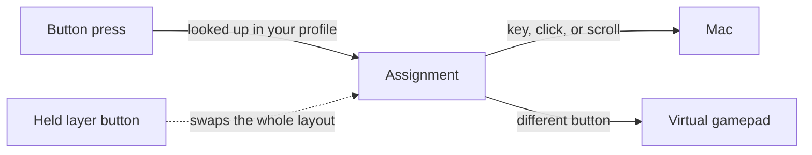
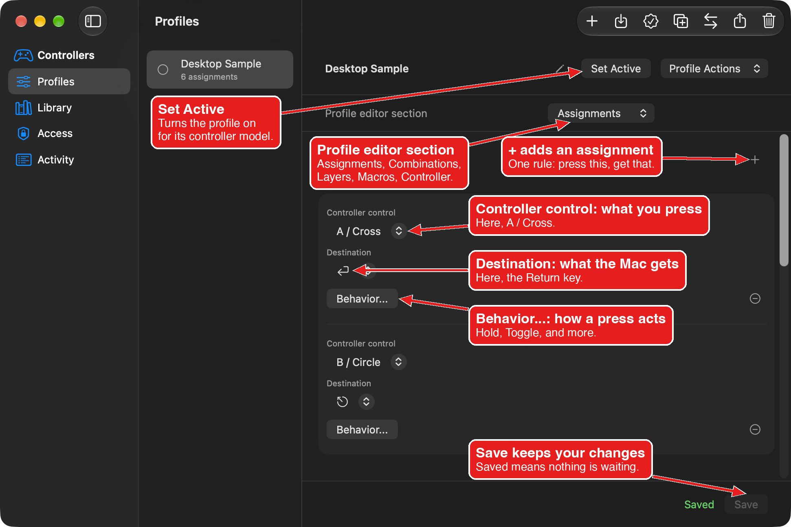
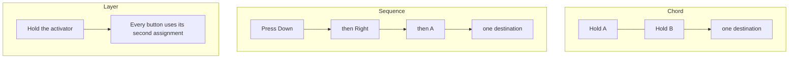

# Bindings and Actions

An assignment makes a button or stick do something else, such as press a key. Set one up in **Profiles** or with `ojd profile`.



## Contents

- [Assigning Buttons and Actions](#assigning-buttons-and-actions)
  - [Before You Begin](#before-you-begin)
  - [Destinations](#destinations)
  - [Add an Assignment in the App](#add-an-assignment-in-the-app)
  - [Add an Assignment With the Command Line](#add-an-assignment-with-the-command-line)
  - [Set a Behavior](#set-a-behavior)
  - [Turbo, Long Hold, and Multi-Tap](#turbo-long-hold-and-multi-tap)
  - [Macros](#macros)
  - [Spoken Phrases](#spoken-phrases)
  - [Tune an Analog Control](#tune-an-analog-control)
  - [Region Sources](#region-sources)
- [Switch Profiles, Set Layers, and Pause](#switch-profiles-set-layers-and-pause)
- [System Actions](#system-actions)
- [MIDI Output](#midi-output)
- [Combinations, Sequences, and Layers](#combinations-sequences-and-layers)
  - [Add a Chord or Sequence](#add-a-chord-or-sequence)
  - [Add a Layer](#add-a-layer)
- [Further Reading](#further-reading)

## Assigning Buttons and Actions

An assignment is a wire from one control (the source) to one destination. A control gets one assignment per profile.

### Before You Begin

[Create a profile](Remapping-Profiles.md#creating-a-profile). Connect the controller to use **Listen for Control**. Keyboard and pointer destinations need Accessibility access ([Permissions](Permissions-and-Security.md)).

### Destinations

- **Keyboard key, mouse button, Type text**: need Accessibility access.
- **Pointer movement, pointer position, scroll**: continuous. The axis sets speed, or places the cursor on the main display.
- **Gamepad button, D-pad, or axis**: need virtual gamepad output on in the profile ([About profiles](Remapping-Profiles.md#about-profiles)). Paddles, grips, and function buttons can't be outputs: [What the virtual gamepad carries](Automating-OpenJoystickDriver.md#what-the-virtual-gamepad-carries).
- **Physical output** (rumble, player indicator, color, brightness, adaptive trigger): supported controllers.
- **Button only** (no axis source; fires on press): [Macros](#macros), [profile switch, layer, pause](#switch-profiles-set-layers-and-pause), [system actions](#system-actions) (including Open application, Open URL, Run Shortcut), Type text, [Spoken Phrases](#spoken-phrases).
- **MIDI note or control change**: see [MIDI output](#midi-output).

### Add an Assignment in the App



1. Open **Assignments** and click **Add Assignment**.
2. Select a **Controller control**, or click **Listen for Control** and press it.
3. Select a **Destination**. For a key, click **Capture Key** and press it.
4. Click **Add Assignment**, then **Save**. Click **Remove Assignment** to remove one.

### Add an Assignment With the Command Line

```shell
ojd binding set "My controller" button:south key:space
```

It replaces the control's assignment. For `SOURCE` and the other `TARGET` forms, see the [Command reference](Command-Reference.md#binding). Not listed there:

```text
physical:rumble:MOTOR:0...1
physical:player:0...4
physical:color:RED:GREEN:BLUE
physical:brightness:0...1
physical:adaptive:left|right:off
physical:adaptive:left|right:resistance:START:STRENGTH
system-key:KEY | system:ACTION
open-app:BUNDLE-ID | open-url:URL
shortcut:NAME | text:TEXT
speak:TEXT (add --voice IDENTIFIER)
```

Remove one with `ojd binding clear PROFILE SOURCE`. List them with `ojd binding list PROFILE`. To remove all, see [Clear All Assignments](Remapping-Profiles.md#clear-all-assignments).

### Set a Behavior

Behavior decides what a press does. **Hold** is a doorbell. **Toggle** is a light switch. Click **Behavior...** on the row, select one, then **Apply** and **Save**.

| Behavior | Result |
| --- | --- |
| **Hold** | Active while held (default). |
| **Toggle** | Each press flips it on or off. |
| **Tap on press**, **Tap on release** | One tap then. |
| **Pulse** | Active for the **Pulse duration** (default 100 ms). |
| **Press only**, **Release only** | Sends only that half. |

Untested. **Note (optional)**: up to 200 characters.

### Turbo, Long Hold, and Multi-Tap

These need **Hold**. Turbo can't combine with the others.

- **Turbo** repeats the destination while held: **Repeat rate** 1 to 60 per second, **Duty cycle** 0.05 to 0.95 (share of each repeat the button stays down), optional delay (0 to 2500 ms) and cap (1 to 500). Keyboard, mouse button, and gamepad destinations only.
- **Long hold**: a second destination after the **Hold duration** (100 to 5000 ms).
- **Multi tap**: a destination for 2 to 5 taps, each within the **Tap window** (50 to 1000 ms) of the last release. Each count has its own.

Both need a button source and a non-continuous destination. Multi-tap delays the base destination by the longest window. **Add Action** adds more. Command line: [Command reference](Command-Reference.md).

### Macros

A macro is a recipe: press this, wait, press that. A profile holds up to 16 macros of 32 steps. Untested on real hardware.

1. Open **Macros** and click **Add macro**.
2. Enter a unique **Macro name** (1 to 40 characters).
3. Use **Add Step**: **Tap**, **Press**, **Release**, **Chord** (keys held for the **Hold time**), or **Wait** (0 to 5000 ms).
4. Set **Repeat** (**Fixed Number of Times**, 1 to 500, or **While Held**) and **When pressed again while running** (**Ignore** or **Restart**).
5. Optionally turn on **Stop when released**. Confirm, then **Save**.

Run it by choosing it as a **Destination**. A step can be a key, mouse button, gamepad button, or D-pad direction, not a macro, speech, or MIDI.

It stops and releases everything on a profile change, stop, or disconnect. One pass takes at most 30 seconds, a fixed repeat 5 minutes. Command line: [Command reference](Command-Reference.md#macro).

### Spoken Phrases

**Speak** makes the Mac say a short text on press. Untested on real hardware. Choose **Speak** as the **Destination**, enter the **Text** (1 to 128 characters), and optionally a **Voice identifier** (default: the system voice). Pressing again restarts it. OJD rejects a voice this Mac lacks at activation.

### Tune an Analog Control

For a stick or trigger axis, **Adjust...** (**All Controls** interface only) sets:

- Deadzone, 0 to 0.95 (default 0.1).
- **Gain**, 0.1 to 10 (default 1).
- **Invert axis**.
- **Response curve**: linear, ease-in, ease-out, or smooth-step.
- **Digital threshold**, 0.01 to 1 (default 0.5): when an axis counts as pressed.

Command line: [Command reference](Command-Reference.md).

### Region Sources

A region source is a pretend button, on while an input is inside a range.

```text
SOURCE: stick-region:left|right:INNER-OUTER[:FROM-TO]
        trigger-band:left|right:FROM-TO
        touch:SURFACE:area:X:Y:W:H
```

`INNER-OUTER`: stick deflection, 0 to 1 after the dead zone. `FROM-TO`: degrees clockwise from up (stick) or pull from 0 to 1 (trigger). Touch values are surface fractions. Example: `ojd binding set "My controller" stick-region:left:0.8-1 key:key-a` presses A while the left stick is past 0.8. In the app, use [Regions](Sticks-Triggers-Touchpad-and-Motion.md#set-regions). Regions of one stick must not overlap.

## Switch Profiles, Set Layers, and Pause

Each fires on press. Untested on real hardware.

- **Next profile**, **Previous profile**: activate the neighbor for the same model and scope, by name, wrapping. A named profile must match the model.
- **Turn layer on**, **Turn layer off**, **Toggle layer**: set a layer of the same profile.
- **Pause controller**, **Resume controller**, **Toggle pause**: releases everything, drops layers, and passes through unmapped. Only the pause assignment works. A profile change or disconnect ends it.

## System Actions

Untested on real hardware.

| Action | What it does |
| --- | --- |
| **System key** | Media, volume, brightness, or keyboard backlight key. Holding repeats it. |
| **Mission Control**, **Launchpad** | Opens it (Apps app if no Launchpad). |
| **Screenshot**, **Lock Screen**, **Show Desktop** | Presses Shift-Command-3, Control-Command-Q, F11. |
| **Open application** | Opens an app by bundle identifier, such as `com.apple.TextEdit`. |
| **Open URL** | Opens a URL. OJD rejects `file:` URLs. |
| **Run Shortcut** | Runs a Shortcuts app shortcut by name. |
| **Type text** | Types a fixed string. In a password field (secure input), macOS may drop the keys, and OJD reports it. |

Screenshot, Lock Screen, Show Desktop, and Type text need Accessibility access. A system shortcut you changed or turned off does nothing.

All except System key act once on press and accept only **Hold**, **Tap on press**, **Tap on release**, and **Press only**. A failed action is logged; the profile keeps working.

For App Exposé, set a keyboard shortcut in **System Settings**, then assign a **Keyboard** destination.

## MIDI Output

**MIDI note** and **MIDI control change** send MIDI to music apps. While an active profile uses one, OJD publishes a MIDI source named `OpenJoystickDriver`. Pick it as the app's input. If the system refuses the source, the assignment fails with `E3032`.

| Destination | Sends |
| --- | --- |
| MIDI note | Note-on on press, note-off on release. Channel 1 to 16, note 0 to 127, velocity 1 to 127. |
| MIDI control change | Button: 127 on press, 0 on release. Trigger: 0 to 127. Stick axis: position, centered at 64. Only changes are sent. |

`midi-note:CHANNEL:NOTE` sends velocity 127. Example: `ojd binding set PROFILE button:south midi-note:1:60:100` sends `90 3C 64` on press, `80 3C 00` on release. Only `midi-cc` fits an axis or trigger. The app offers note 60 and controller 1 on channel 1; for others edit the [profile file](Profile-File-Reference.md).

## Combinations, Sequences, and Layers

A chord is controls pressed together (a piano chord). A sequence is controls pressed in order (a fighting-game combo). A layer is a second set of assignments (like Shift), active while you hold an activator or after one press. Chords and sequences can't use axes or continuous destinations. A chord's control set must be unique.



### Add a Chord or Sequence

1. Open **Combinations**. Click **Add Chord** (in **Chords**) or **Add Sequence** (in **Sequences**).
2. Chord: select a control, then **Add Control** for at least one more. Sequence: add at least two controls in press order.
3. Chord: select a **Chord mode** (**Modifier** or **Simultaneous**) and the **Press window** (default 50 ms, 1 to 1000 ms). Sequence: set the **Completion window** (200 to 10000 ms).
4. Select a **Destination**, confirm the sheet, then click **Save**.

A chord fires while all its controls are down. Command line: change `chords` or `sequences` with `ojd profile edit PROFILE` ([Profile file reference](Profile-File-Reference.md)).

### Add a Layer

1. Open **Layers** and click **Add Layer**.
2. Enter a **Layer name** (1 to 40 characters).
3. Select the **Activator** (a button or D-pad direction, not also an assignment) and the **Activation**: **Hold** or **Toggle**.
4. Confirm the sheet, then click **Save**.
5. In the layer, click **Add Assignment** for assignments that work while it is active.

Command line: change `layers` with `ojd profile edit PROFILE`. For **Motion Tuning**, see [Sticks, triggers, touchpad, and motion](Sticks-Triggers-Touchpad-and-Motion.md).

## Further Reading

- [Sticks, triggers, touchpad, and motion](Sticks-Triggers-Touchpad-and-Motion.md)
