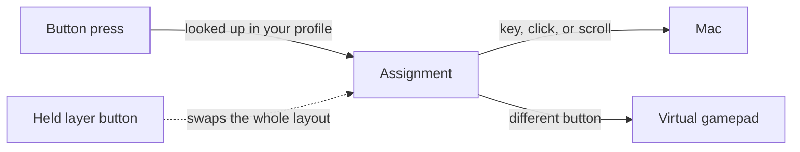
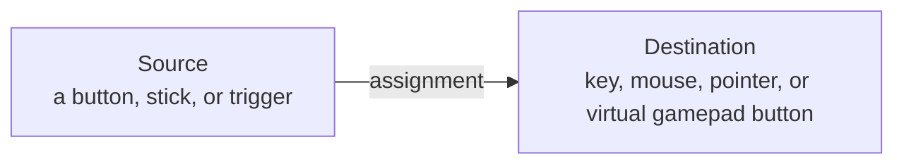
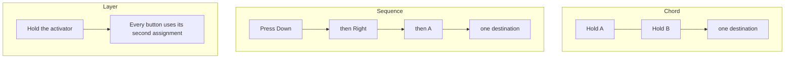

# Bindings and Actions

An assignment makes a button or stick do something else, such as press a key on the keyboard. Combinations and layers let one [profile](Glossary.md#terms) do more with the same few buttons, the way Shift gives each letter key a second job.

- **Who:** anyone who wants a button to do something different.
- **What:** assignments, combinations, sequences, and layers inside a profile.
- **Where:** the **Profiles** area of the app, or `ojd profile`.
- **Why:** a few buttons can do many jobs.
- **How:** pick a button, then pick what it does.



## Contents

- [Assigning Buttons and Actions](#assigning-buttons-and-actions)
- [Switch Profiles, Set Layers, and Pause](#switch-profiles-set-layers-and-pause)
- [System Actions](#system-actions)
- [MIDI Output](#midi-output)
- [Combinations, Sequences, and Layers](#combinations-sequences-and-layers)
- [Further Reading](#further-reading)

## Assigning Buttons and Actions

An assignment is a wire from one control (the source) to one destination (what happens), such as a keyboard key, a mouse button, or a [virtual gamepad](Glossary.md#terms) button. A control can have only one assignment in a profile.



### Before You Begin

- Create a profile. See [Creating a profile](Remapping-Profiles.md#creating-a-profile).
- Connect the controller to use **Listen for Control**.
- Grant Accessibility access for keyboard and pointer destinations. See [Permissions](Permissions-and-Security.md).

### Destinations

| Destination | Examples | Notes |
| --- | --- | --- |
| Keyboard | A key with optional modifiers | Needs Accessibility access |
| Mouse button | Left, right, middle, back, forward | Needs Accessibility access |
| Pointer movement | Horizontal or vertical | Continuous; the axis sets the speed |
| Pointer position | Horizontal or vertical | Continuous; the axis places the cursor on the main display |
| Scroll | Horizontal or vertical | Continuous |
| Gamepad button, D-pad, or axis | A virtual gamepad control | Needs virtual gamepad output |
| Physical output | Rumble, player indicator, color, brightness, adaptive trigger | Supported controllers only |
| Macro | A macro of the profile | Buttons only; see [Macros](#macros) |
| Profile switch, layer, pause | Change profile, layer, or pause state | Buttons only; see [Switch profiles, set layers, and pause](#switch-profiles-set-layers-and-pause) |
| System key or action | Media, volume, Mission Control, Screenshot | Buttons only; see [System actions](#system-actions) |
| Open application, Open URL, Run Shortcut | An app, a URL, or a named shortcut | Buttons only |
| Type text | A fixed string | Buttons only; needs Accessibility access |
| Speak | A phrase the Mac says | Buttons only; see [Spoken Phrases](#spoken-phrases) |
| MIDI note or control change | A note or controller number on a channel | See [MIDI output](#midi-output) |

"Buttons only" means an axis cannot be the source. These destinations fire on press.

A gamepad destination needs the virtual gamepad turned on in the profile. Paddles, grips, and function buttons cannot be gamepad outputs. See [What the virtual gamepad carries](Automating-OpenJoystickDriver.md#what-the-virtual-gamepad-carries) and [About profiles](Remapping-Profiles.md#about-profiles).

### Add an Assignment in the App


1. Open the profile's **Assignments** section and click **Add Assignment**.
2. Select a control in the **Controller control** list, or click **Listen for Control** and press it.
3. Select a **Destination**.
4. For a key, click **Capture Key** and press the key with any modifiers.
5. Click **Add Assignment**, then **Save**.

To remove an assignment, click its **Remove Assignment** button.

### Add an Assignment With the Command Line

```shell
ojd binding set "My controller" button:south key:space
```

The command replaces the control's assignment. The `SOURCE` and `TARGET` values use this syntax:

```text
SOURCE: button:NAME | dpad:DIRECTION
        axis:NAME[:negative|positive]
        trigger:left|right:soft|full
        touch:SURFACE:contact
        touch:SURFACE:grid:COLUMNS:ROWS:COLUMN:ROW
        touch:SURFACE:swipe:DIRECTION:MIN-DISTANCE
        motion:lean:left|right
TARGET: key:KEY[:mods=alt,control,meta,shift]
        mouse:BUTTON | move:x|y | position:x|y | scroll:x|y
        gamepad:button:NAME | gamepad:dpad:DIRECTION
        gamepad:axis:NAME
        physical:rumble:MOTOR:0...1
        physical:player:0...4
        physical:color:RED:GREEN:BLUE
        physical:brightness:0...1
        physical:adaptive:left|right:off
        physical:adaptive:left|right:resistance:START:STRENGTH
        midi-note:CHANNEL:NOTE[:VELOCITY]
        midi-cc:CHANNEL:CONTROLLER
        macro:NAME
        profile:switch:next|previous|PROFILE-ID
        layer:NAME:on|off|toggle
        pause:on|off|toggle
        system-key:KEY | system:ACTION
        open-app:BUNDLE-ID | open-url:URL
        shortcut:NAME | text:TEXT
        speak:TEXT (add --voice IDENTIFIER)
```

To remove an assignment, run `ojd binding clear PROFILE SOURCE`. To list them, run `ojd binding list PROFILE`. For all options, see [Command reference](Command-Reference.md).

### Set a Behavior

The behavior decides what one press does. **Hold** works like a doorbell (on while pressed), and **Toggle** works like a light switch (press once for on, again for off).

Click **Behavior...** on the assignment row, select a behavior, then click **Apply** and **Save**.

| Behavior | Result |
| --- | --- |
| **Hold** | The destination stays active while you hold the control. This is the default. |
| **Toggle** | Each press switches the destination on or off. |
| **Tap on press** | The destination taps once when you press. |
| **Tap on release** | The destination taps once when you release. |
| **Pulse** | The destination stays active for the **Pulse duration** (default 100 ms). |
| **Press only** | OJD sends only the press. |
| **Release only** | OJD sends only the release. |

Behaviors are untested on real hardware.

### Turbo, Long Hold, and Multi-Tap

These options need the **Hold** behavior. Turbo cannot combine with the other two.

- **Turbo** presses the destination again and again while you hold the control. Set the **Repeat rate** (1 to 60 presses per second) and **Duty cycle** (0.05 to 0.95, the share of each repeat the button stays down). You can add a delay (0 to 2500 ms) and a repeat cap (1 to 500). It works with keyboard, mouse button, and gamepad destinations.
- **Long hold** sends a second destination after the **Hold duration** (100 to 5000 ms).
- **Multi tap** sends a destination for 2 to 5 taps, each within the **Tap window** (50 to 1000 ms) of the last release. Each count has its own destination.

Long hold and multi-tap need a button source and a destination that is not continuous. With multi-tap, the base destination waits for the longest tap window, so it fires later. To add more actions to one assignment, use **Add Action** in the behavior sheet.

For the command line options, see [Command reference](Command-Reference.md).

The **Note (optional)** field of the behavior sheet takes up to 200 characters and shows under the assignment.

### Macros

A macro is a named list of steps that OJD plays back, like a recipe: press this, wait, press that. A profile holds up to 16 macros of up to 32 steps. Macros are untested on real hardware.

1. Open the **Macros** section and click **Add macro**.
2. Enter a **Macro name** (1 to 40 characters, unique in the profile).
3. Use **Add Step** to add steps:
   - **Tap** presses and releases a key or button.
   - **Press** and **Release** hold a key or button down, then let it go.
   - **Chord** presses several keys together, holds them for the **Hold time**, then releases them.
   - **Wait** pauses 0 to 5000 ms.
4. Set **Repeat** to **Fixed Number of Times** (1 to 500) or **While Held**.
5. Set **When pressed again while running** to **Ignore** or **Restart**.
6. Optionally turn on **Stop when released**.
7. Confirm the sheet, then click **Save**.

To run a macro, choose it as the **Destination** of an assignment. A step can be a key, a mouse button, a gamepad button, or a D-pad direction, not another macro.

A macro stops and releases everything it holds when the profile changes or stops, or the controller disconnects. One pass takes at most 30 seconds, and a fixed repeat at most 5 minutes. For the command line, see [Command reference](Command-Reference.md#macro).

### Spoken Phrases

The **Speak** destination makes the Mac say a short text aloud when you press the control. It is untested on real hardware.

1. Choose **Speak** as the **Destination**.
2. Enter the **Text**, 1 to 128 characters.
3. Optionally enter a **Voice identifier**. Without one, the Mac uses the system voice.

Pressing the control while the phrase plays restarts it. Speech needs no Accessibility access, and a macro step cannot speak. OJD rejects a voice this Mac does not have when you activate the profile.

### Tune an Analog Control

For a stick or trigger axis, **Adjust...** opens these settings. It needs the **All Controls** interface.

- Deadzone, 0 to 0.95 (default 0.1).
- **Gain**, 0.1 to 10 (default 1).
- **Invert axis**.
- **Response curve**: linear, ease-in, ease-out, or smooth-step.
- **Digital threshold**, 0.01 to 1 (default 0.5). It sets when an axis counts as pressed for a button destination.

Only axis sources take these settings. For the command line, see [Command reference](Command-Reference.md).

### Region Sources

A region source is a pretend button. It is on while a stick, trigger, or touch is inside a range you pick.

```text
SOURCE: stick-region:left|right:INNER-OUTER[:FROM-TO]
        trigger-band:left|right:FROM-TO
        touch:SURFACE:area:X:Y:W:H
```

`INNER-OUTER` are stick deflections from 0 to 1 after the dead zone. On a stick, `FROM-TO` are degrees clockwise from up. On a trigger, they are pulls from 0 to 1. Touch values are fractions of the surface. For example, `ojd binding set "My controller" stick-region:left:0.8-1 key:key-a` presses A while the left stick is pushed past 0.8. Regions of one stick must not overlap. In the app, use **Regions** in the **Controller** section. See [Sticks, triggers, touchpad, and motion](Sticks-Triggers-Touchpad-and-Motion.md#set-regions).

### Restore or Clear Assignments

To remove every assignment or return to pass-through, see [Clear All Assignments](Remapping-Profiles.md#clear-all-assignments).

## Switch Profiles, Set Layers, and Pause

Three destinations change what OJD does instead of sending input, and each fires on press. They are untested on real hardware.

- **Next profile** and **Previous profile** activate the neighbor of the active profile among profiles for the same controller model and scope. The order is by name and wraps. A named profile must be for the same model.
- **Turn layer on**, **Turn layer off**, and **Toggle layer** set a layer of the same profile.
- **Pause controller**, **Resume controller**, and **Toggle pause** pause the controller. A paused controller releases everything, drops its layers, and passes through unmapped. Only the pause assignment keeps working. A profile change or disconnect ends the pause.

## System Actions

These destinations make the Mac do something instead of sending a key or button. They are untested on real hardware.

- **System key** sends a media, volume, display brightness, or keyboard backlight key. Holding the control repeats the key.
- **Mission Control** and **Launchpad** open them. Where macOS has no Launchpad, it opens the Apps app.
- **Screenshot**, **Lock Screen**, and **Show Desktop** press Shift-Command-3, Control-Command-Q, and F11.
- **Open application** opens an app by bundle identifier, such as `com.apple.TextEdit`.
- **Open URL** opens a URL in its default app. OJD rejects `file:` URLs.
- **Run Shortcut** runs a Shortcuts app shortcut by name.
- **Type text** types a fixed string. While macOS has secure input on, such as in a password field, macOS may not deliver the keys, and OJD reports it.

Screenshot, Lock Screen, Show Desktop, and Type text need Accessibility access. The others need no permission.

If you changed or turned off a system shortcut in System Settings, its action does nothing.

All except System key act once on press and do nothing on release. They accept the behaviors **Hold**, **Tap on press**, **Tap on release**, and **Press only**. Other behaviors fail validation. A failed action writes its error to the logs, and the profile keeps working.

OJD offers no App Exposé or display brightness setting. For one, set a keyboard shortcut in **System Settings**, then assign a **Keyboard** destination with it.

## MIDI Output

A **MIDI note** or **MIDI control change** destination sends MIDI to music apps. While an active profile uses one, OJD publishes a MIDI source named `OpenJoystickDriver`. Pick it as the input of the app. No permission is needed. If the system refuses the source, the assignment fails with error `E3032`.

| Destination | Sends |
| --- | --- |
| MIDI note | Note-on on press and note-off on release; channel 1 to 16, note 0 to 127, velocity 1 to 127 |
| MIDI control change | A button sends 127 on press and 0 on release. A trigger sends 0 to 127. A stick axis sends its position, centered at 64. Only changes are sent. |

On the command line, `midi-note:CHANNEL:NOTE` sends velocity 127. For example, `ojd binding set PROFILE button:south midi-note:1:60:100` sends `90 3C 64` on press and `80 3C 00` on release. Only `midi-cc` fits an axis or trigger. A macro step cannot send MIDI.

The app offers note 60 and controller 1, both on channel 1. For other numbers, edit the profile file. See [Profile file reference](Profile-File-Reference.md).

## Combinations, Sequences, and Layers

### Concepts

- A chord is two or more controls pressed together, like playing a chord on a piano. It sends one destination.
- A sequence is two or more controls pressed in order, like a fighting-game combo. It sends one destination.
- A layer is a second set of assignments, like the Shift key on a keyboard. It is active while you hold an activator control, or after you press it once.

Chords and sequences cannot use axes or continuous destinations. A chord's control set must be unique in the profile.



### Before You Begin

[Create a profile](Remapping-Profiles.md#creating-a-profile) and open it.

### Add a Chord

1. Open the **Combinations** section.
2. In **Chords**, click **Add Chord**.
3. Select the first control, then click **Add Control** for at least one more.
4. Select a **Chord mode**: **Modifier** or **Simultaneous**.
5. Set the **Press window** (default 50 ms, range 1 to 1000 ms).
6. Select a **Destination**.
7. Confirm the sheet, then click **Save**.

The destination fires while all selected controls are pressed.

On the command line, run `ojd profile edit PROFILE` and change `chords`. See [Profile file reference](Profile-File-Reference.md).

### Add a Sequence

1. Open the **Combinations** section.
2. In **Sequences**, click **Add Sequence**.
3. Add at least two controls in the order you press them.
4. Set the **Completion window** (200 to 10000 ms).
5. Select a **Destination**.
6. Confirm the sheet, then click **Save**.

On the command line, change `sequences` with `ojd profile edit PROFILE`.

### Add a Layer

1. Open the **Layers** section.
2. Click **Add Layer**.
3. Enter a **Layer name** (1 to 40 characters).
4. Select the **Activator**, a button or D-pad direction.
5. Select the **Activation**: **Hold** or **Toggle**.
6. Confirm the sheet, then click **Save**.
7. In the layer, click **Add Assignment** for assignments that work while it is active.

**Hold** keeps the layer active while you hold the activator. **Toggle** switches it on or off with each press. The activator cannot also be an assignment in the profile.

On the command line, change `layers` with `ojd profile edit PROFILE`. For a layer's **Motion Tuning**, see [Sticks, triggers, touchpad, and motion](Sticks-Triggers-Touchpad-and-Motion.md).

## Further Reading

- [Sticks, triggers, touchpad, and motion](Sticks-Triggers-Touchpad-and-Motion.md)
- [Command reference](Command-Reference.md)
