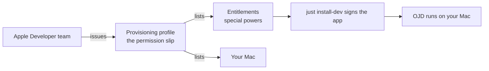
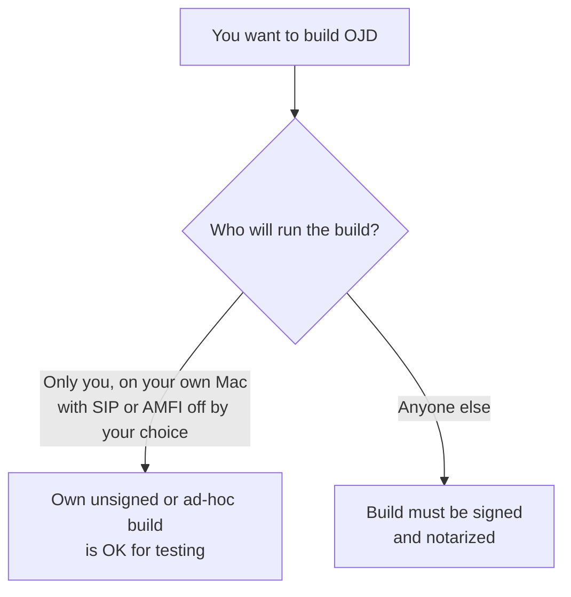

# Building From Source

Turn OpenJoystickDriver's source code into a working app on your own Mac, to get a fix before the next tester build.

You need Terminal, a copy of the repository, and the Xcode tools. Install your provisioning profiles, then run `just install-dev`. macOS gives OJD its powers only when the build is signed, and builds you share with others must be signed and notarized.

## Build OpenJoystickDriver

Most people never need this page. `CHANGELOG.md` lists what each build contains.

OpenJoystickDriver (OJD) runs only when it's signed, which makes building harder than usual. macOS gives an app special powers, such as making a [virtual gamepad](Glossary.md#terms), only if Apple has issued a permission slip for them:

- An **entitlement** is one special power, such as `com.apple.developer.hid.virtual.device` (make virtual gamepads).
- A **provisioning profile** is the permission slip from Apple. It lists which entitlements an app may use, and on which Macs.



### Before You Begin

You need these items:

- A Mac with the Xcode command-line tools. The [Xbox USB driver](Glossary.md#terms) and Shortcuts actions need full Xcode.
- An Apple Developer team.
- Two development provisioning profiles, one for the app and one for the Xbox USB driver (`com.openjoystickdriver.XboxUSBDevice`). Name the files `OpenJoystickDriver.provisionprofile` and `OpenJoystickDriver_XboxUSBDevice.provisionprofile`.
  - The app profile needs the `com.apple.developer.hid.virtual.device` entitlement. Its `com.apple.developer.driverkit.userclient-access` entitlement must name `com.openjoystickdriver.XboxUSBDevice`.
  - The Xbox USB driver profile needs `com.apple.developer.driverkit` and `com.apple.developer.driverkit.transport.usb` with Apple's exact seven VID:PID pairs, and no HID entitlement.
  - `just signing-install-profiles` copies the files under those names. `just signing-configure` writes their paths to `.env.dev`.
- The `transport.usb` capability from Apple (permission to talk to USB devices directly). Enable it on the `com.openjoystickdriver.XboxUSBDevice` App ID, then download the Xbox USB driver profile again. The publisher's team already has it. Your team must ask Apple for it.
- Your Mac in the list of devices in each provisioning profile.

### Build and Install

1. Clone the repository and open the folder.

   ```shell
   git clone https://github.com/xsyetopz/OpenJoystickDriver.git
   cd OpenJoystickDriver
   ```

2. Install the helper tools.

   ```shell
   just setup
   ```

3. Put both downloaded profile files in `~/Documents/Profiles` or in `~/Downloads`. Then set up signing.

   ```shell
   just signing-install-profiles
   just signing-configure
   ```

   `signing install-profiles` copies the profiles to `~/Library/MobileDevice/Provisioning Profiles`. `signing configure` reads them from there.

4. Build and install the app.

   ```shell
   just install-dev
   ```

   This also builds the Xbox USB driver. Without the `userclient-access` grant, the build skips the driver.

5. Open OJD from **Applications**.

## Build Options and Limits

### Build Conditions

| Condition | Result |
| --- | --- |
| Development signing with the correct profiles | `just install-dev` builds the app and the Xbox USB driver. Only Macs in the profiles can run it. |
| App profile without the `com.apple.developer.hid.virtual.device` entitlement | The build stops. |
| Ad-hoc signing for the app | No script builds it. |
| Ad-hoc signing for the Xbox USB driver | `just build-dext` stops with `DriverKit extensions cannot use ad-hoc signing`. |
| Plain `swift build` binary | No entitlements. Not verified: OJD reads controllers but can't publish the [virtual gamepad](Glossary.md#terms). |
| Xbox USB driver profile without the exact `transport.usb` entitlement | The build stops. |
| Only the Command Line Tools, no Xcode | Install [swiftly](https://www.swift.org/install/macos/) before `just setup`. `just install-dev` builds the app without the Xbox USB driver, and Shortcuts lists none of its actions. |
| Tester DMG | Signed and notarized by the maintainer. Runs on macOS 12 or later. Needs no Apple developer account. |

### Which Controllers Need the Xbox USB Driver

Only these USB product IDs use the Xbox USB driver: `045E:02D1`, `045E:02DD`, `045E:02E3`, `045E:02EA`, `045E:0B00`, `045E:0B0A`, and `045E:0B12`.

### Security Settings

SIP and AMFI are two safety locks in macOS. SIP (System Integrity Protection) guards the system files. AMFI (Apple Mobile File Integrity) checks each app's signature before it runs.

> **Warning:** Turning off SIP or AMFI makes your Mac less safe. OJD never asks you to, and this wiki does not show how. Keep both on and use `just install-dev`, unless you already turned them off on your own Mac by your own choice.

Who runs the build decides how it must be signed:

- **Your own Mac, for testing and development:** if you turned off SIP or AMFI on your own Mac, by your own choice, you may build and run your own unsigned or ad-hoc signed build there. (An ad-hoc signature is a homemade one that no one at Apple vouches for.) Never hand that build to anyone else.
- **Anyone else's Mac:** every build made for other people must be signed and notarized. This covers production releases and tester builds, whether the maintainer or anyone else makes them. (Notarized means Apple scanned the app and approved it.) The `just package-tester` recipe notarizes the tester DMG.



What the tools allow:

- `swift build` makes an unsigned binary with no entitlements. Not verified: whether turning off SIP or AMFI lets that binary publish the [virtual gamepad](Glossary.md#terms).
- No script builds an ad-hoc signed app. `just build-dev`, `just install-dev`, and `just install-fast-dev` need a real signing identity.
- `just build-dext` refuses ad-hoc signing for the Xbox USB driver. An unsigned or ad-hoc build therefore has no Xbox USB driver.

## Further Reading

- [Xbox USB driver](Connecting-Controllers.md#xbox-usb-driver)
- [Security model](Permissions-and-Security.md#security-model)
- [Building from source (developer guide)](../docs/development/building-from-source.md)
- [Signing (developer guide)](../docs/development/signing.md)
