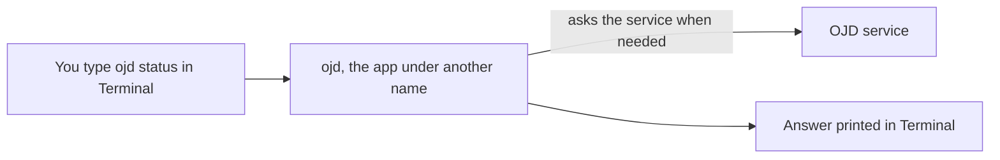
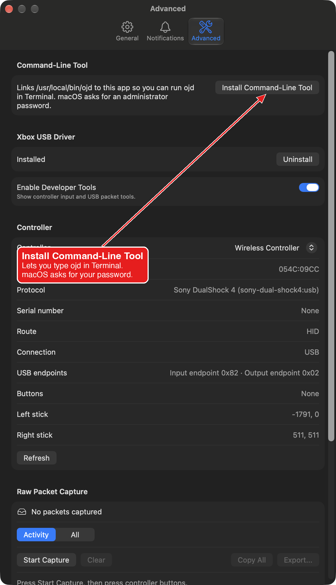

# Using the Command Line

`ojd` lets you control OpenJoystickDriver by typing commands in Terminal instead of clicking. It's handy for checking what's wrong, for scripts, and for bug reports. Everything you need day to day is also in the app, so you can skip this page if you don't use Terminal.

- **Who:** anyone comfortable typing in Terminal.
- **What:** `ojd`, which does what the app does by typed commands.
- **When:** checking what's wrong, writing scripts, or making a bug report.
- **Where:** Terminal, after you install the `ojd` command.
- **How:** type `ojd status`, then try the commands below.



## Run a Command

`ojd` isn't a separate download. It's the app itself under another name: started as `ojd`, it answers commands; started any other way, it opens the app window.

To install `ojd`:

1. Choose OpenJoystickDriver > **Settings...**.
2. Click **Advanced**, then click **Install Command-Line Tool** (needs the **All Controls** interface).
3. If macOS asks for an administrator password, type it.



The app puts a shortcut (a link) to itself at `/usr/local/bin/ojd`, where Terminal looks for commands. If a real file already sits there, the app leaves it alone. **Uninstall** in the same place removes the link.

To make the link yourself, put it in a folder on your `PATH` (the list of folders Terminal searches). Writing to `/usr/local/bin` can need `sudo`.

```shell
ln -s /Applications/OpenJoystickDriver.app/Contents/MacOS/OpenJoystickDriver /usr/local/bin/ojd
```

Then run a command:

```shell
ojd status
```

`ojd --help` lists every command, and `ojd COMMAND --help` shows the options of one. The [command reference](Command-Reference.md) covers them all.

## Common Commands

- `ojd status` checks the service, the [Xbox USB driver](Glossary.md#terms), and the permissions. It works without the service.
- `ojd diagnose` runs every check.
- `ojd controller list` lists connected controllers.
- `ojd controller show CONTROLLER` shows one controller, including which apps hold it open.
- `ojd controller suspend CONTROLLER` lets another app open the controller. `ojd controller resume CONTROLLER` takes it back.
- `ojd controller check CONTROLLER` asks for each control in turn and prints what each did.
- `ojd service start` and `ojd service stop` start and stop the service, the part of OJD that reads controllers in the background. No other command starts it.
- `ojd explain E2004` explains an error code. See [Error codes](Error-Codes.md).

## Global Options

These work on every command, before or after the command name.

- `--json`: Print JSON on standard output.
- `--plain`: Print one tab-separated record per line. It cannot be combined with `--json`.
- `-q`, `--quiet`: Do not print success messages.
- `--no-color`: Do not use color.
- `--no-input`: Never ask a question. A command that needs a missing value fails and names the option that gives it.
- `--timeout SECONDS`: How long to wait for each answer from the service. It must be above 0. The default is 0.5 seconds.
- `-h`, `--help`: Show help.
- `--version`: Show the version.

Each of `--no-input`, `--timeout`, and `--no-color` has a variable: `OJD_NO_INPUT`, `OJD_TIMEOUT`, and `OJD_COLOR` (`auto`, `always`, or `never`). A flag beats its variable. An invalid value exits with code 64.

## Shell Completion

Completion lets you press Tab to finish a command name or option. `ojd --generate-completion-script SHELL` prints the script that teaches your shell (`zsh`, `bash`, or `fish`) the `ojd` commands. In zsh, with the folder on your `fpath`:

```shell
ojd --generate-completion-script zsh > ~/.zfunc/_ojd
```

## Output

- Results go to standard output, the normal output a script reads. Progress, warnings, and errors go to standard error, so they don't mix into the results.
- The text meant for people can change between releases. Scripts should use `--json` or `--plain`, which stay stable.
- `--json` output follows [`cli-output.schema.json`](../Resources/Schemas/cli-output.schema.json). Within a major version, output only gains keys. Before 1.0, each minor version counts as a major version.
- Errors read `error[E2004]: WHAT FAILED. HOW TO FIX IT.` The code is stable, so a script can branch on it.
- Color appears only on a terminal. `NO_COLOR` and `TERM=dumb` turn it off.

## Exit Codes

| Code | Meaning |
| --- | --- |
| 0 | Success. |
| 1 | The command failed. |
| 64 | Usage error: an unknown command or option, or an invalid value. |
| 69 | The service is not running. Start it with `ojd service start`. |
| 77 | A macOS permission is missing. |
| 127 | A repository build of `ojd` could not hand the command to the installed app. |
| 130 | Interrupted with Control-C. |
| 143 | Terminated with SIGTERM. |

## Further Reading

- [Command reference](Command-Reference.md)
- [Writing controller mods](Writing-Controller-Mods.md)
- [Automating OpenJoystickDriver](Automating-OpenJoystickDriver.md)
- [Reporting a bug](Reporting-a-Bug.md)
