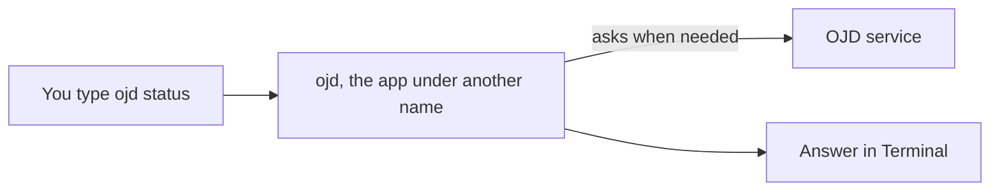

# Using the Command Line

`ojd` controls OpenJoystickDriver from Terminal, for diagnosis, scripts, and bug reports. The app covers daily use, so skip this page without Terminal.



## Run a Command

`ojd` is the app under another name. Started as `ojd`, it answers commands. Any other start opens the window.

1. Choose OpenJoystickDriver > **Settings...**.
2. Click **Advanced**, then **Install Command-Line Tool** (needs the **All Controls** interface).
3. Type your administrator password if asked.


The app links itself at `/usr/local/bin/ojd` and leaves a real file there alone. **Uninstall** removes the link.

To link it yourself, use a folder on your `PATH`. `/usr/local/bin` can need `sudo`.

```shell
ln -s /Applications/OpenJoystickDriver.app/Contents/MacOS/OpenJoystickDriver /usr/local/bin/ojd
ojd status
```

`ojd --help` lists commands. `ojd COMMAND --help` shows options.

## Common Commands

- `ojd status`: Checks the service, the [Xbox USB driver](Glossary.md#terms), and permissions, without the service.
- `ojd diagnose`: Runs all checks.
- `ojd controller list`: Lists controllers.
- `ojd controller show CONTROLLER`: Shows one controller and who holds it open.
- `ojd controller suspend CONTROLLER`: Lets another app open it. `resume` takes it back.
- `ojd controller check CONTROLLER`: Asks you to press each control.
- `ojd service start` and `ojd service stop`: Start or stop the background service. Nothing else starts it.
- `ojd explain E2004`: Explains an [error code](Error-Codes.md).

## Global Options

These work on every command, before or after its name.

- `--json`: JSON on standard output.
- `--plain`: One tab-separated record per line. Not with `--json`.
- `-q`, `--quiet`: No success messages.
- `--no-color`: No color. `NO_COLOR` and `TERM=dumb` do the same. Color shows only on a terminal.
- `--no-input`: Never ask. A missing value fails and names the option.
- `--timeout SECONDS`: Wait this long for each service answer. Above 0. Default 0.5.
- `-h`, `--help` and `--version`.

Variables: `OJD_NO_INPUT`, `OJD_TIMEOUT`, `OJD_COLOR` (`auto`, `always`, `never`). A flag beats its variable. An invalid value exits 64.

## Shell Completion

`ojd --generate-completion-script SHELL` prints a Tab-completion script for `zsh`, `bash`, or `fish`. In zsh, with the folder on your `fpath`:

```shell
ojd --generate-completion-script zsh > ~/.zfunc/_ojd
```

## Output

- Results go to standard output. Progress, warnings, and errors go to standard error.
- Human text changes between releases. Scripts should use `--json` or `--plain`.
- `--json` follows [`cli-output.schema.json`](../Resources/Schemas/cli-output.schema.json). Within a major version, output only gains keys. Before 1.0, each minor version is a major version.
- Errors read `error[E2004]: WHAT FAILED. HOW TO FIX IT.` Branch on the code.

## Exit Codes

- `0`: Success.
- `1`: The command failed.
- `64`: Usage error, such as an unknown option or invalid value.
- `69`: The service is not running. Run `ojd service start`.
- `77`: A macOS permission is missing.
- `127`: A repository build of `ojd` could not hand off to the installed app.
- `130`: Control-C.
- `143`: SIGTERM.
