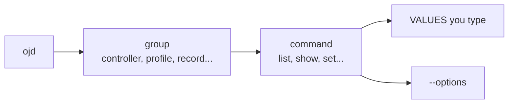
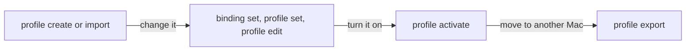
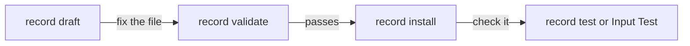

# Command Reference

Every `ojd` command and option, like a dictionary. For a gentle start, read [Using the Command Line](Command-Line.md).

Every command also takes the global options, such as `--json`. See [Command line](Command-Line.md#global-options).
Where a command has them, `-f` is short for `--force`, `-n` for `--dry-run`, `-a` for `--all`, `-o` for `--output`, and `-q` for `--quiet`.

With `--json`, each command prints the object that [cli-output.schema.json](../Resources/Schemas/cli-output.schema.json) describes. This page names a key only where it carries a rule.

In synopsis lines, a word in capitals is a value you type. `VVVV:PPPP` is a controller model ID: the hexadecimal vendor and product numbers, such as `045E:02D1`. Square brackets mark an optional part. `A|B` means choose one. `...` means you can repeat the part.

Each `ojd` command and option is listed here under its group, such as `controller` or `profile`, so a script can use the exact spelling. In Terminal, `ojd COMMAND --help` shows the same options. Read [Using the Command Line](Command-Line.md) first if `ojd` is new to you.



## Contents

- [status](#status)
- [controller](#controller)
- [profile](#profile)
- [binding](#binding)
- [macro](#macro)
- [virtual](#virtual)
- [record](#record)
- [mod](#mod)
- [protocol](#protocol)
- [service](#service)
- [permission](#permission)
- [transport-extension](#transport-extension)
- [setting](#setting)
- [config](#config)
- [access](#access)
- [log](#log)
- [diagnose](#diagnose)
- [update](#update)
- [explain](#explain)
- [migrate](#migrate)
- [generate](#generate)
- [Further Reading](#further-reading)

## status

Show the service, the [Xbox USB driver](Glossary.md#terms), macOS permissions, and connected controllers in one summary.

```text
ojd status
```

`ojd status` works when the service is not running. It reports the service as `Stopped` and shows the state of the Xbox USB driver. Permissions and controllers appear only while the service runs.

The request listener is the part of the service that accepts requests. When it stops on a fatal error, the service keeps running and writes a record beside its socket: `<socket path>.failure.json`. The record names the writing process and its start time.

- The service can't be reached, but the process in the record still runs: `ojd status` prints its report, then fails with `E2034` (exit code 69). The `Request listener` row shows the code, its text, the error number, and the time. With `--json`, `service.listenerFailure` holds `code`, `errno`, `time`, `message`, and `current`. With `--plain`, the row is `listener-failure`.
- The process in the record has ended: the report says that the last listener stopped, `current` is `false`, and the exit code is 0.
- `ojd` cannot use the record (damaged, another version or kind, too large, or not your file): exit code 1 with `E2035`. `--json` adds `service.listenerFailureProblem` and `--plain` a `listener-failure-problem` row, with the file and the reason.

The app shows `E2034` at once with a **Restart Listener** action, and deletes the record when the listener restarts or the app quits in order. If restarting fails, quit and reopen the app.

`ojd status` prints an Input mapping row for each HID controller and unbound device, as `controller show` does. `--plain` prints an `input-mapping` line after each.

Keys that need the service are absent when it is stopped. `commandLineTool.path` is `/usr/local/bin/ojd`, the link the app installs. When nothing is there, it is the first `ojd` link in a `PATH` folder, such as `/opt/homebrew/bin`, that points to this app's executable. `commandLineTool.state` is one of:

- `Installed`: a link to this app's executable.
- `LinkedElsewhere`: a link to another file that exists, such as another copy of the app.
- `Broken`: the link's target is gone.
- `BlockedByFile`: a file or folder that isn't a link. The app never replaces it.
- `Missing`: no link and no file.

Files in a `Personas` folder beside `VirtualDevices` are listed as skipped. Move them to `VirtualDevices`.

With `--plain`, the first field of each line is `service`, `extension`, `command-line-tool`, `permission`, `virtual-device`, `controller`, `unbound`, `pass-through`, `skipped-record`, `ignored-defaults`, or `skipped-virtual-device`.

## controller

List connected controllers, inspect them, and test their input and outputs. Every `controller` command needs the service running.

```text
ojd controller list
ojd controller show CONTROLLER
ojd controller watch CONTROLLER [--duration SECONDS] [--first-press] [--output]
ojd controller watch --all [--duration SECONDS] [--output]
ojd controller check CONTROLLER [--duration SECONDS] [--validate]
ojd controller capture CONTROLLER [--duration SECONDS]
ojd controller send CONTROLLER BYTES [--feature] [--report-id N] [--usb-endpoint N]
ojd controller rumble CONTROLLER [--left N] [--right N] [--left-trigger N] [--right-trigger N] [--duration SECONDS]
ojd controller light CONTROLLER [--color RRGGBB] [--brightness N]
ojd controller player CONTROLLER 1|2|3|4|off
ojd controller speaker play CONTROLLER FILE [--volume N]
ojd controller speaker stop CONTROLLER
ojd controller claim CONTROLLER [--dry-run]
ojd controller release CONTROLLER [--dry-run]
ojd controller lookup CONTROLLER
ojd controller suspend CONTROLLER
ojd controller resume CONTROLLER
ojd controller disconnect CONTROLLER
ojd controller calibrate CONTROLLER [start|pause|reset|sticks] [--step rest|circle|triggers|gyro]
ojd controller pair LEFT RIGHT --profile PROFILE
ojd controller unpair PAIR
```

`CONTROLLER` is an ID from `ojd controller list`, a unit ID, or `VVVV:PPPP`, in any letter case. When `VVVV:PPPP` matches two connected controllers, the command fails and lists them. Use an ID to pick one.

- An ID (`E-` and 16 characters) is a session token. It changes on each connection, so scripts should not store it.
- A unit ID (`U-` and 16 characters) comes from the model, USB port, and interface. A Bluetooth LE controller's comes from the model and the identifier this Mac gave the controller. It survives reconnects and restarts on the same port, and changes when the controller moves to another port. Scripts can store it.

When the controller does not deliver a result, the command prints no JSON, exits non-zero, and writes the error on standard error.

### controller list

- Each line shows the unit ID after the ID. With `--json`, `unit` holds it. With `--plain`, it follows the name.
- With `--plain`, these fields follow the unit ID, each empty when unknown: `owned-by-another-client`, the process ID and name of the app using the controller directly, the battery level, the charging state, and `also-listed-by-system`.
- `also-listed-by-system` (`alsoListedBySystem` with `--json`) marks a controller that the system also lists as a second controller with no input. Pick the [virtual gamepad](Glossary.md#terms) of OpenJoystickDriver in games.
- `waits-for-guide-press` (`waitsForGuidePress` with `--json`) marks a controller that has sent nothing since it connected. It waits for its home button, such as the PS button of a DualShock 3 over USB. `controller show` gives the input failure reason `guide-not-pressed` (`GuideNotPressed`).

### controller show

Show the unit ID, identity, ownership, capabilities, effective record, and virtual gamepad of one controller.

- Record: bundled or yours, with the file name. The command reads records from disk when you run it. A controller that connected before a record changed can keep the older record until it reconnects. With `--json`, `record` is absent when no record matches the model, as for a generic HID controller.
- Ownership: `ownership.server` is `system` or `ojd`. `serverSource` is the layer that sets it (`Bundled`, `Package`, `User`), or `Default`. A controller that macOS can't handle, such as one OJD reads over raw USB, shows `ojd` with `Route`. It is always [Handled by OpenJoystickDriver](Glossary.md#terms).
- Opened by: every process that holds the controller's HID device or USB interfaces open, with its process ID. A Who can use it line appears while only OpenJoystickDriver can use the controller. The Next step line names `ojd controller suspend`, or `ojd controller resume` while suspended. With `--plain`, a `holder` line follows `ownership` for each holder, then `holds-exclusively`.
- Input mapping: where a HID controller's mapping comes from: `record`, "mapped from SDL_GameControllerDB" (with match tier and GUID), or "standard HID usage map". A rejected database line adds its reason. The Unmapped controls row lists database fields OJD cannot express. See [Mapping source](Supported-Controllers.md#mapping-source).
- Battery: the level, such as `73%`, or a range such as `0-9%` when the controller reports steps, and the charging state. `power` is absent when the service reports no power state. `--plain` prints a `power` line with the charging state, level, and `wiredPower`.
- Wii Remote:
  - Report mode: a hex byte such as `0x31`.
  - Extension: the plugged-in extension, or the six ID bytes of an unknown one.
  - Motion Plus: off, calibrating, or ready. The app shows the same rows. `--plain` has `report-mode`, `extension`, `unknown-extension-id`, and `motion-plus` lines.
- The `protocol`, `controls`, `rumble-motors`, and `lighting` lines print lowercase kebab-case values, such as `xbox-gip` and `left-stick-x`. A binding with a variant adds `:` and the variant, such as `xbox-xusb:receiver`.
- Shown to games: whether games see a virtual gamepad for the controller, and if not, why. For a controller that is [handled by macOS](Glossary.md#terms), the reason is `system-gamepad`. With `--json`, `publication.state` is `Published`, `NotPublished`, or `Failed`, and `reason` is one of `OutputDisabled`, `SystemGamepad`, `NativeHIDPassThrough`, `UpstreamVirtualDevice`, `SessionSuspended`, `NoVirtualProfile`, `Suppressed`, or `NoInputYet`.
- Tuning: the record's tuning values as applied, such as `stickDeadzone=0.2`. Absent when the record sets none.
- Output owner: with `--json`, `capabilities.outputOwner` is `system` or `ojd`. `system` means macOS handles the controller, so the rumble and lighting lists hold only what macOS leaves undone. `ojd` means OJD drives all output. The human line appears only for `system`. The Output checks section lists commands that exercise each rumble motor and light.
- For a connected `VVVV:PPPP` that OJD doesn't handle, it prints why and the next step. A HID gamepad also gets a Draft a record row with `ojd record draft VVVV:PPPP`. A `no-protocol-match` device gets a Capture packets row. A controller that OJD handles under the same VID:PID is shown instead. The capture command does not resolve such a device. The app's Controllers list shows the same and offers Draft Record for a HID gamepad.

### Other controller commands

- `controller lookup`: Print the address that Lookup in the app opens. A model with a record gets the [Supported Controllers](Supported-Controllers.md) page. Any other gets a GitHub issue search for its `VVVV:PPPP`. `CONTROLLER` may be the `VVVV:PPPP` of a model that is not connected, and the command then needs no service. With `--json`, the `ControllerLookup` object has `identity`, `hasRecord`, and `url`. `--plain` prints the identity and address.
- `controller watch`: Print the input state each time it changes, until Control-C. Stick Y points down.
  - `--duration` stops after that many seconds.
  - `--first-press` prints the first control pressed and exits. It fails when `--duration` passes first.
  - `--output` also prints what the virtual gamepad sends after remapping, on an `out` line (`out none` when none publishes the controller).
  - `--all` watches every controller, naming each by its `ojd controller list` ID. Other lines report each controller that connects or disconnects, starting with those already connected. With `--json`, each line has `type` (`ADDED`, `MODIFIED`, or `DELETED`) and `object`.
- `controller check`: Ask for each control that the controller declares, one at a time, on standard error, and print one result per control.
  - A step ends in one of three ways: the control leaves rest; another control moves first (`OtherControl`, naming it); or `--duration` seconds (15 by default) pass with no move (`Skipped`).
  - A stick or trigger ends its step when it returns to rest. A control held when its step starts counts only after you release it.
  - `--validate`, after a check in which every control responded, prints the validation text and the address of the prefilled `controller-validation.yml` form. The text holds no serial number, unit ID, Bluetooth address, user name, or path. It opens the address only after you type `y`, never without a terminal. After any other result it prints a notice and offers nothing.
- `controller capture`: Print the raw packets that the controller sends and receives, each with time, direction, length, and hex bytes. It runs until Control-C or `--duration` seconds. With `--json`, it prints one `RawReport` per line, with the direction `Rx` or `Tx`.
- `controller send`: Write raw bytes to a controller, so a mod author can try a report without editing a record. `BYTES` are 1 to 64 hex pairs of the whole report, in one quoted argument or several.
  - By default the bytes go out as a HID output report. `--feature` sends a HID feature report instead.
  - `--report-id` (1 to 255) names a numbered report and must equal the first byte. Without it the report ID is 0.
  - `--usb-endpoint` (0 to 255) sends a USB interrupt OUT packet with a 1000 ms timeout, and cannot be combined with `--feature` or `--report-id`. A controller that macOS owns refuses it.
  - The write shares the output queue with the driver's own writes. A refused or failed write exits 1 with the controller error. With `--json`, the result is a `Success` status whose details hold `controller`, `destination`, `reportID` or `endpoint`, `bytes`, and `outcome`.
  - Example: `ojd controller send 0079:0006 "51 00 C8 00 C8 00 00"`.
- `controller rumble`: Run the rumble motors.
  - `--left`, `--right`, `--left-trigger`, and `--right-trigger` set each motor's intensity, 0 to 255. With none, both main motors run at 180. All 0 stops the motors.
  - `--duration` is in seconds, above 0 and at most 5. The default is 0.45.
- `controller light`: `--color` sets the lightbar color as hex, such as `FF8000`. `--brightness` sets the LED brightness, 0 to 255.
- `controller player`: Set the player indicator lights to 1 to 4, or turn them off with `off`.
- `controller speaker play`: Play a sound on the speaker and wait until it ends. See [Wii Remote](Wii-Remote.md#speaker).
  - `FILE` is an uncompressed PCM WAV file. `--volume` is 0 to 1. The default is 1.
  - A file longer than the speaker allows plays its first part, with a warning.
  - No speaker: `E2038`. Unsupported WAV file: `E2039`.
- `controller speaker stop`: Stop the sound.
- `controller claim` and `controller release`: Choose who handles the controller. `claim` makes the model Handled by OpenJoystickDriver (`ojd`). `release` makes it Handled by macOS (`system`).
  - Each sets `server` in your record for the model (`vvvv-pppp.plist` or `vvvv-pppp.patch.plist`) and keeps other fields. It creates a `ControllerPatch` file when you have none and a bundled or package record exists.
  - It needs the service running. The choice applies to every controller of the model, and the running service applies it without a replug.
  - Apple's driver holds three models: `045E:02EA`, `045E:0B00`, and `045E:0B12`. For these, `claim` sends the activation request of the Xbox USB driver, as `transport-extension activate` does, and writes no record. `release` fails for them.
  - `--dry-run` (`-n`) writes nothing. It exits with code 1 and `E2023` when the controller uses raw USB or macOS can't handle it. It does the same when the model has no record at all; `ojd record draft` starts one.
  - `controller show` prints the choice on its `serving-route` and `served-by` lines. They name its layer, the route, and the [virtual gamepad kind](Glossary.md#terms) the serving policy picks. A model that Apple's driver holds shows `macos`.
  - See [Choose who drives the controller](Controller-Records.md#choose-who-drives-the-controller).
- `controller suspend`: Stop OpenJoystickDriver from driving the controller until you resume it. It closes its handles, so another program can open the controller.
- `controller resume`: Let OpenJoystickDriver drive a suspended controller again.
- `controller disconnect`: Close the connection of a classic Bluetooth controller. It stays paired and reconnects when you turn it on. The command waits at least 6 seconds for Bluetooth to confirm. For a Bluetooth Low Energy controller, turn it off, or disconnect it in System Settings > Bluetooth.
- `controller calibrate`: Without an action, show the motion calibration of a controller with a gyro, which motion lean and steering bindings use.
  - `start` collects gyro drift while the controller lies still. `pause` stops the collection.
  - `sticks` runs four steps, each reading for about two seconds after a three-second wait. `--step` runs one.
    - `rest`: Release the sticks and triggers. Stores the stick centres and trigger rests.
    - `circle`: Roll each stick around its full circle. Stores the stick ranges.
    - `triggers`: Press each trigger all the way in. Stores the trigger ends.
    - `gyro`: Keep the controller still. Stores the mean gyro reading as the offset in radians per second. A controller with no gyro skips it.
  - The values go into your record of the model as tuning keys beside `stickDeadzone`. The model needs a record; see [Controller records](Controller-Records.md). The keys are `leftStickCenterX`, `leftStickCenterY`, `rightStickCenterX`, `rightStickCenterY`, `leftStickRange`, `rightStickRange`, `leftTriggerRest`, `leftTriggerFull`, `rightTriggerRest`, `rightTriggerFull`, `gyroOffsetX`, `gyroOffsetY`, and `gyroOffsetZ`. OJD applies them to input and motion samples before profile mapping. A control that does not move enough keeps its stored value, and the output names it.
  - `reset` removes those keys and the motion calibration.
- `controller pair`: Combine a left and a right Joy-Con into one controller that uses `PROFILE`, which must be a paired Joy-Con [profile](Glossary.md#terms). See [Sticks, triggers, touchpad, and motion](Sticks-Triggers-Touchpad-and-Motion.md). Joy-Con pairing is untested on real hardware.
- `controller unpair`: Separate a Joy-Con pair. `PAIR` is the session ID that `controller pair` prints, or the ID of either Joy-Con.

## profile

Create, change, activate, and move profiles. Every `profile` command needs the service running. See [Creating a profile](Remapping-Profiles.md).



```text
ojd profile list
ojd profile show PROFILE
ojd profile create NAME --controller CONTROLLER [--app BUNDLE-ID]... [--virtual-gamepad disabled|mapped|passthrough] [--physical-input shared|exclusive] [--template gyro-stick|keyboard-navigation|mouse-clicks [--stick left|right] [--activation SOURCE]]
ojd profile duplicate PROFILE NEW-NAME
ojd profile rename PROFILE NEW-NAME
ojd profile delete PROFILE [--force] [--dry-run]
ojd profile activate PROFILE [--allow-empty] [--confirm-actions]
ojd profile deactivate PROFILE
ojd profile edit PROFILE
ojd profile recover [--force] [--dry-run]
ojd profile import FILE|- [--app BUNDLE-ID]...
ojd profile validate FILE|-
ojd profile export PROFILE [--output FILE]
ojd profile get PROFILE KEY
ojd profile set PROFILE KEY VALUE
ojd profile convert PROFILE --controller CONTROLLER [--name NAME]
```

`PROFILE` is a profile ID, or a profile name in any letter case. A name that two profiles share is rejected, and the error lists their IDs. Use `-` to read a file from stdin. A command that asks first on a terminal needs `--force` otherwise. `--dry-run` (`-n`) prints what would change and changes nothing.

- `profile list`: List each profile with its ID, name, controller model, app scope, and number of bindings, and show which are active. It reports each unloadable saved profile on stderr, then prints "Repair them with 'ojd profile recover'."
- `profile show`: Show a profile's settings and bindings, in the `SOURCE` and `TARGET` forms of `ojd binding set`.
- `profile create`: Create an inactive profile for one controller model.
  - `--controller` is `VVVV:PPPP` or the ID of a connected controller.
  - The profile applies in every app unless `--app` gives an app ID. Repeat `--app` for more apps. The profile is in force while any of them is in front.
  - `--virtual-gamepad` sets what the virtual gamepad sends: nothing (`disabled`), bound controls only (`mapped`), or also every control that no binding uses (`passthrough`, the default).
  - `--physical-input` sets whether macOS still sees the controller (`shared`, the default) or OpenJoystickDriver takes it (`exclusive`).
  - `--template gyro-stick` starts from a gyro to stick profile. It fails for a model with no motion sensor. `--stick` picks `left` or `right` (default `right`). `--activation SOURCE`, such as `button:left-shoulder`, makes the gyro output active only while you hold that control. `--stick` and `--activation` need this template. See [Create a Gyro to Stick Profile](Sticks-Triggers-Touchpad-and-Motion.md#create-a-gyro-to-stick-profile).
  - `--template keyboard-navigation` binds the D-pad to the arrow keys, South to Return, and East to Escape.
  - `--template mouse-clicks` binds South, East, and North to the left, right, and middle mouse buttons.
  - A binding template skips each control that the model lacks and lists them.
- `profile duplicate`: Copy a profile under another name. The copy is inactive.
- `profile rename`: Give a profile a name of 1 to 80 characters.
- `profile delete`: Delete a profile. An active profile stops applying. Asks first on a terminal.
- `profile activate`: Apply a profile. It replaces the active profile of the same controller model and app scope.
  - A profile with the virtual gamepad set to `mapped` can end up doing nothing. That happens when it sends nothing to the gamepad, keyboard, pointer, or controller, and sets no light color. Add `--allow-empty` to activate it.
  - A profile with `OpenApplication`, `OpenURL`, `RunShortcut`, or `TypeText` destinations fails until you add `--confirm-actions`. The error lists each action, with each URL in full.
  - When Post Event access is missing for the profile, the missing permission is printed on stderr.
- `profile deactivate`: Stop applying a profile. The controller then sends its own input.
- `profile edit`: Open the profile file in `$VISUAL`, `$EDITOR`, or `vi`, then check and save it. Use it for chords, sequences, layers, tuning, and the app scope. It needs a terminal. Without one, export the profile, change the file, and import it. See [Profile file reference](Profile-File-Reference.md).
- `profile recover`: Repair the problems that `profile list` reports: it removes a damaged profile file and resets a damaged active profile list. The service first backs up each file beside the original (`.backup-` in the name). Asks first on a terminal.
- `profile import`: Add a profile from a file that `profile export` wrote. A profile with the same ID as an existing one replaces it. `--app` (repeatable) replaces the apps of the scope in the file.
- `profile validate`: Check a profile file without importing it. It needs no running service.
- `profile export`: Print a profile file to stdout, or write it to `--output`. The file is an XML property list, so `--json` and `--plain` do not change it.
- `profile get`: Print one value from the profile file. `KEY` is a path of member names and array indexes joined by dots, such as `stickMappings.0.tuning.innerDeadzone`. A string prints alone and any other value prints as JSON. A key with no value exits with code 1.
- `profile set`: Change one value in the profile file.
  - `VALUE` is read as JSON, or as a string when it is not JSON: `0.2` is a number and `space` is a string. To set the string `true`, write `'"true"'`.
  - `null` removes the key or array item. The index one past the end of an array adds an item.
  - OJD checks the whole profile first. It refuses a change that makes the profile invalid or changes `id`.
  - Example: `ojd profile set Racing physicalColor '{"red":255,"green":0,"blue":0}'`.
- `profile convert`: Copy a profile for another controller model, inactive. The original does not change.
  - `--controller` is the target model as `VVVV:PPPP`, or the ID of a connected controller.
  - The copy applies to the whole model, so the unit of the original is dropped. It is named `NAME`, or the profile name followed by the model.
  - It keeps each binding, chord, sequence, layer, and stick, trigger, and touch mapping whose source controls the target has. It prints one line for each part it leaves out. It also leaves out gyro output, pointer speed, and Joy-Con pair settings that the target cannot take.

Errors: a file that is not a valid profile exits with code 1 and `E3008`. A file with a missing or unsupported `apiVersion` exits with code 1 and `E5001`. `import`, `validate`, `edit`, and `set` all give these.

## binding

List, set, and clear the bindings of a profile. A binding sends a target when you use a control on the controller. Every `binding` command needs the service running. See [Assigning buttons and actions](Bindings-and-Actions.md).

```text
ojd binding list PROFILE
ojd binding set PROFILE SOURCE TARGET [options]
ojd binding clear PROFILE SOURCE... [--force] [--dry-run]
ojd binding clear PROFILE --all [--force] [--dry-run]
```

Every part that names a control, direction, key, or modifier is lowercase kebab-case: `LeftStickX` is `left-stick-x`, `KeyA` is `key-a`, and `DpadUp` is `dpad-up`.

`SOURCE` is one of these forms:

- `button:NAME`, such as `button:south` or `button:left-shoulder`
- `dpad:DIRECTION`
- `axis:NAME`, or `axis:NAME:negative` or `axis:NAME:positive` for one direction, such as `axis:left-stick-x:positive`
- `trigger:NAME:STAGE`
- `motion:lean:DIRECTION`
- `touch:SURFACE:contact`, `touch:SURFACE:grid:COLUMNS:ROWS:COLUMN:ROW`, or `touch:SURFACE:swipe:DIRECTION:DISTANCE`

`TARGET` is one of these forms:

- `key:KEY`, with modifiers as `key:KEY:mods=alt,control,meta,shift`
- `mouse:BUTTON`, `move:x`, `move:y`, `position:x`, `position:y`, `scroll:x`, or `scroll:y`
- `gamepad:button:NAME`, `gamepad:dpad:DIRECTION`, or `gamepad:axis:NAME`
- `physical:...` for rumble, lights, and adaptive triggers
- `midi-note:CHANNEL:NOTE[:VELOCITY]` (velocity 127 when omitted) or `midi-cc:CHANNEL:CONTROLLER`, with a channel from 1 to 16 and numbers from 0 to 127; see [MIDI output](Bindings-and-Actions.md#midi-output)
- `macro:NAME` for a macro of the profile, created with `ojd macro set`
- `profile:switch:next`, `profile:switch:previous`, or `profile:switch:ID` for a profile of the same controller model
- `layer:NAME:MODE` for a layer of the profile, with `MODE` one of `on`, `off`, or `toggle`
- `pause:MODE`, with `MODE` one of `on`, `off`, or `toggle`

A `macro` or `layer` name is matched without regard to case. A name the profile lacks exits with code 1 and changes nothing. `binding list` and `profile show` print the name.

- `binding list`: List a profile's bindings.
- `binding set`: Bind a source to a target. A source has one binding, so this replaces the existing one and keeps its ID. Options:
  - `--behavior`: When the target fires: `hold` (the default for a binding you add), `toggle`, `tap-on-press`, `tap-on-release`, `pulse`, `press`, or `release`.
  - `--pulse-ms`: How long `pulse` holds the target, 1 to 5000 ms. The default is 100.
  - `--deadzone`, `--gain`, `--invert`, `--response-curve`, `--digital-threshold`: Tuning for axis sources.
    - Dead zone: 0 to 0.95, default 0.1.
    - Gain: 0.1 to 10, default 1.
    - Response curve: `linear` (default), `ease-in`, `ease-out`, or `smooth-step`.
    - Digital threshold: the travel that counts as a press for button targets, default 0.5.
  - `--turbo-rate` and `--turbo-duty`: Repeat the target this many times a second while you hold the source. The duty is the part of each cycle that the target is held, above 0 and below 1. Turbo cannot be used with `--long-hold` or `--multi-tap`.
  - `--turbo-delay MS` and `--turbo-max COUNT`: Wait MS (0 to 2500) after the first press before repeating. Stop after COUNT repeats (1 to 500), until you release the source. Both need `--turbo-rate` and `--turbo-duty`.
  - `--long-hold MS:TARGET`: Send another target when the source is held this long, such as `500:key:key-b`.
  - `--multi-tap COUNT:MS:TARGET`: Send another target when you tap the source COUNT times, such as `3:300:key:key-c`. COUNT is 2 to 5. Each press must come within MS (50 to 1000) of the last release. Repeat the option for more counts. The base target waits for the longest window, which `ojd binding list` shows as `tap-delay`.
  - `--actions-json`: More actions, as a JSON array in the form that `ojd profile export` writes.
- `binding clear`: Remove the bindings of the given sources. It exits with code 1 and changes nothing when a source has no binding.
  - `--all` removes every binding, chord, sequence, and layer. Stick, trigger, touch, motion, and output settings stay.
  - `--all` asks first on a terminal. Otherwise it needs `--force`.
  - `--dry-run` (`-n`) prints what would change and changes nothing.
  - The result can leave an active profile on a connected controller with no inputs while OJD seizes the physical input. Then it warns on stderr and names `ojd binding set` and `ojd profile deactivate`. The exit code is still 0.

## macro

List, show, set, and remove the macros of a profile. A macro is a named list of steps that a binding runs with the target `macro:NAME`. Every `macro` command needs the service running. Hardware status: Not checked.

```sh
ojd macro list PROFILE
ojd macro show PROFILE NAME
ojd macro set PROFILE NAME --step STEP... [--repeat COUNT|while-held] [--while-running ignore|restart] [--interrupt-on-release]
ojd macro remove PROFILE NAME [--force]
```

A profile holds at most 16 macros of at most 32 steps. Names are 1 to 40 characters, unique without regard to case. A step or `--repeat` value in another form exits with code 64. A macro that does not exist exits with code 1.

- `macro list`: List a profile's macros with their repeat mode and number of steps.
- `macro show`: Show a macro's options and steps.
- `macro set`: Create a macro, or replace the one of the same name and keep its ID. A replaced macro keeps the options that you leave out.
  - `--step`: One step, in order. Repeat for more. `TARGET` has the forms of `ojd binding set`.
    - `tap:TARGET`, `press:TARGET`, `release:TARGET`: Send the target as a click, a press, or a release.
    - `wait:MS`: Wait 0 to 5000 milliseconds.
    - `chord:MS:TARGET+TARGET`: Hold the targets together for MS milliseconds.
  - `--repeat`: Passes to run, 1 to 500 or `while-held` (until you release the source). The default is 1.
  - `--while-running`: What a press of the source does while the macro runs: `ignore` (default) or `restart`.
  - `--interrupt-on-release` or `--no-interrupt-on-release`: Whether releasing the source stops the macro. The default is no.
- `macro remove`: Remove a macro. Asks first on a terminal, otherwise needs `--force`. It fails and changes nothing while a binding runs the macro.

## virtual

Show and choose the virtual gamepad that OpenJoystickDriver publishes for a controller. A choice applies to every controller of the same model. With `--unit`, it applies to that controller only, by its unit ID, and wins over the choice for its model.

```text
ojd virtual show [CONTROLLER]
ojd virtual set PROFILE CONTROLLER [--unit]
ojd virtual reset [CONTROLLER] [--unit] [--all] [--force] [--dry-run]
ojd virtual feed --as PROFILE
ojd virtual export-mapping [PROFILE] [--format sdl|w3c]
ojd virtual launch [--sdl-gamecontroller-backend] [--no-launch-settings] [--] PROGRAM [ARGUMENTS...]
ojd virtual launch-setting list
ojd virtual launch-setting show PROGRAM
ojd virtual launch-setting set PROGRAM [--sdl-gamecontroller-backend|--no-sdl-gamecontroller-backend] [--env NAME=VALUE]... [--argument ARGUMENT]...
ojd virtual launch-setting remove PROGRAM
```

- `virtual show`: Show the virtual gamepad of each controller and the profiles you can choose. Name a controller to show only that one.
  - A controller with a live profile also carries its `sdl` and `w3c` mapping, as `virtual export-mapping` prints them.
  - When the virtual gamepad kind does not work with the default SDL hints, the human output adds a note under the controller. `GameControllerCompatible` does not work with them. `SDLCompatible`, `Generic`, and `InControlCompatible` do.
- `virtual export-mapping`: Print how a game reads each virtual gamepad kind. Name a profile to print only that one.
  - `--format sdl` (default) prints one SDL mapping line per kind, as a valid SDL mapping file.
  - `--format w3c` prints the W3C Gamepad description: the button and axis indices of the standard layout and the virtual gamepad input that supplies each. A source is `bN` for a button, `aN` for an axis, and `h0.MASK` for a hat direction. The numbers follow SDL.
  - A profile that does not work with the default hints gets a `#` comment line before its mapping, so the output stays valid. Bundled `SDLCompatible` (`045E:0B0C`) and `Generic` (`1209:4A4F`) work with them. `InControlCompatible` (`054C:09CC`) carries the ID that SDL's PS4 driver matches. `GameControllerCompatible` (`045E:0B13`) does not work with them. `Generic` has a GUID with no CRC.
- `virtual launch`: Run a program with the SDL mapping of the connected virtual gamepads, so SDL in the program lists them.
  - It sets `SDL_GAMECONTROLLERCONFIG` to one line per virtual gamepad kind of the connected controllers. An existing value stays first.
  - With `--sdl-gamecontroller-backend`, it also sets `SDL_JOYSTICK_MFI=1`, `SDL_JOYSTICK_ALLOW_BACKGROUND_EVENTS=1`, `SDL_JOYSTICK_IOKIT=0`, and `SDL_JOYSTICK_HIDAPI=0`, replacing set values. SDL then reads controllers only through Apple's GameController framework. `SDL_JOYSTICK_HIDAPI=0` switches off every SDL HIDAPI driver, so no further HIDAPI variable is set. Without the option, no other variable changes.
  - SDL 3.4.18 listed the `SDLCompatible` kind only with `SDL_JOYSTICK_HIDAPI=0`. PCSX2 2.8.2 and DuckStation map it with the default hints, and SDL 2.30.12 and SDL 3.4.20 read it with them.
  - `PROGRAM` is a path, a name that `PATH` finds, or an `.app` (its main executable runs). It keeps the terminal and standard streams of `ojd`, so `--json` and `--plain` exit with code 64. Put `--` before `PROGRAM` when its arguments are also `ojd` options.
  - `ojd` exits with the program's exit code, or 128 plus the signal that ended it. Control-C or SIGTERM on `ojd` stops the program.
  - No connected controller with a virtual gamepad: exit code 1, `E2013`, nothing starts. A program that cannot be found or started: `E2033`.
  - A kind that does not work with the default SDL hints prints a note on standard error first, unless `--quiet` or `--sdl-gamecontroller-backend` is set.
  - The stored launch setting of `PROGRAM` applies first: its `environment` joins the variables of `ojd`, its backend flag can turn the hints on, and its `arguments` follow yours. `--sdl-gamecontroller-backend` turns the hints on whatever the stored value is. `--no-launch-settings` ignores the stored setting.
- `virtual launch-setting`: Keep the environment and arguments `virtual launch` adds to one program. A setting is keyed by the bundle identifier of the nearest enclosing `.app`, or by the absolute path of a program outside an `.app`. See [Launch Settings per App](Playing-Games.md#launch-settings-per-app).
  - `launch-setting list` prints every stored setting. `--json` prints `items`.
  - `launch-setting show PROGRAM` prints one setting. `PROGRAM` is a path, a name that `PATH` finds, an `.app`, or the stored key of a program that no longer exists.
  - `launch-setting set PROGRAM` stores the options it gets and keeps the others. `--env` and `--argument` repeat, and each replaces the stored list. A name that does not match `[A-Za-z_][A-Za-z0-9_]*`, or a value without `=`, exits with code 64 and stores nothing. `--argument` takes a value that starts with `-`.
  - `launch-setting remove PROGRAM` deletes the setting. A program with no setting exits with code 1.
  - `--json` and `--plain` work on all four. The settings live in `Settings.plist`, which the app edits too.
- `virtual set`: Choose the profile for the model of the controller: `sdl-compatible`, `game-controller-compatible`, `generic`, or `in-control-compatible`. With `--unit`, only for that controller, which needs a unit ID. Automatic selection never picks `game-controller-compatible` or `in-control-compatible`, so this command is the only way to publish them.
- `virtual reset`: Return the model of the controller to automatic selection. Asks first on a terminal, otherwise needs `--force`. `--dry-run` (`-n`) changes nothing.
  - `--unit` removes only that controller's own choice, so the choice for its model applies again. It cannot be used with `--all`.
  - `--all` returns every model, connected or not.
  - A virtual gamepad file that sets its own `identity` stays, and the command exits with code 1 naming the file (`overrideFileKept`). Edit or delete it yourself. Files from packages stay with no error.
- `virtual feed`: Publish a virtual gamepad with the `--as` profile and drive it from standard input.
  - Write one JSON object per line, such as `{"buttons":["South"],"dpad":["DpadUp"],"axes":{"LeftStickX":0.5,"RightTrigger":1}}`.
  - Buttons, D-pad directions, and stick axes take the names of the `button:`, `dpad:`, and `axis:` binding sources. The triggers are the axes `LeftTrigger` and `RightTrigger`. A missing control is neutral.
  - Sticks run from -1 to 1 with Y down. Triggers run from 0 to 1.
  - Frames play in order, each for at least 8 ms. `holdMilliseconds` (0 to 60000) keeps one longer.
  - A frame without `holdMilliseconds` replaces the last queued frame when both have the same buttons and D-pad. So a fast stream of stick or trigger moves doesn't pile up. A press or release always plays.
  - Each rumble command a game sends prints as one `RumbleCommand` object per line, with `type` `SetRumble` or `StopRumble`. It prints as soon as the service gets it, even while no input arrives. Commands print in the order the game sent them.
  - The service removes the gamepad when the input ends, on Control-C, or after 2 seconds with no update.
  - A line that is not a frame, such as one with an unknown key or a button listed twice, exits with code 64.
  - The service runs at most 4 feeds from this command. Endpoint clients have 4 more.

## record

Draft, list, check, install, or remove controller records. Only `record draft` needs the service. See [Adding or changing a controller record](Controller-Records.md).



```text
ojd record draft CONTROLLER [--duration SECONDS | --from-sdl]
ojd record list [--bundled]
ojd record show VVVV:PPPP
ojd record validate FILE|-
ojd record install FILE|- [--force] [--dry-run]
ojd record remove VVVV:PPPP [--force] [--dry-run]
ojd record test VVVV:PPPP --packets CAPTURE --expect STATE
```

`FILE` is a record file, or `-` for stdin. A command that asks first on a terminal needs `--force` otherwise.

- `record draft`: Draft a record for a connected controller. It reads the HID report descriptor. Then it captures input reports for `--duration` seconds (10 by default) while you press each control. Last, it prints a record to start from.
  - The record is a `Controller` for a model without a bundled record, otherwise a `ControllerPatch`.
  - It maps the buttons, sticks, triggers, and hat that the descriptor states plainly, with the `HIDReportLayout` family. When nothing maps, it names `HIDDescriptor`. With a bundled record and nothing mapped, it exits with code 1.
  - It lists each report byte that changed during the capture on stderr, with its lowest and highest value (`--plain`: one line per byte).
  - A `VVVV:PPPP` of a connected controller that OJD does not handle captures nothing and drafts from the USB interfaces. A HID gamepad interface gets a `HIDDescriptor` mode (a patch when a bundled record holds the model). A device with only vendor-class interfaces gets one `HIDReportLayout` mode per interface signature, with a note that the `input` section is missing.
  - `E2012`: the controller is not connected.
  - `--from-sdl` captures nothing. It converts the SDL_GameControllerDB line of the connected controller against its HID elements and prints a `Controller` record with the `HIDDescriptor` family and that `hidUsageMap`. It exits 1 with one of these errors:
    - `E2012`: the database has no line.
    - `E5008` and the reason: the line doesn't convert.
    - `E2013`: the model has a bundled record, the controller can't be read, or its descriptor fails the `HIDDescriptor` contract.
- `record list`: List every controller record with its model, protocol family, layer (`Bundled`, `Package`, or `User` with `--json`), and file. On stderr it names each of your files that was skipped and each package record that is ignored, and why. `--bundled` lists the bundled records alone.
- `record show`: Show the effective record of one model and the layer of each top-level field. It exits with code 1 when no record exists. The human output adds a Community verified line, with the validation issue address, for each mode that has a validation.
- `record validate`: Check a record without installing it. It shows the kind (`Controller` or `ControllerPatch`), model, family, file name, and whether the Xbox USB driver can claim the controller. It exits with code 1 when the record is not valid.
- `record install`: Check a record and write it to your record folder as `vvvv-pppp.plist`. Replacing an installed record asks first on a terminal. `--dry-run` (`-n`) checks and prints where it would go. It writes nothing and exits with code 1 when the record is not valid.
- `record remove`: Delete your record for a model. It exits with code 1 when you have none.
- `record test`: Replay captured reports through the record of a model and compare the parsed controller state with the state you expect. It needs no service.
  - `CAPTURE` is a file of the lines that `ojd controller capture --json` prints, one packet per line. Only received packets count.
  - `STATE` is a JSON file in the shape of one line of `ojd controller watch --json`. The `connection` field is not compared.
  - A match exits with code 0. A mismatch prints each differing field with its expected and parsed value and exits with code 1 and `E2022`.
  - `E2011` (exit 1): the capture or state isn't valid, or no report carries input. It also covers a parser that rejects a report and a record with no device-free parser.
  - A file that cannot be read exits with code 64.

## mod

Validate, install, list, or remove mod packages. A package is a folder with a `mod.plist` manifest. None of these commands needs the service. See [Writing controller mods](Writing-Controller-Mods.md).

```text
ojd mod validate FOLDER
ojd mod install FOLDER [--force] [--dry-run]
ojd mod list
ojd mod remove NAME [--force] [--dry-run]
```

- `mod validate`: Check a package folder without installing it. It checks the manifest, whether `requires` includes this version, the listed files, and clashes with your files and other packages. A refused package exits with code 1 and its `E4xxx` or `E5001` code.
- `mod install`: Check the package and install it to `Packages/NAME` in the OpenJoystickDriver folder. The running service applies it. A package of the same name is refused with `E4005` unless you pass `--force`. `--force` never overrides `requires`, a clash, or an invalid file. `--dry-run` (`-n`) writes nothing.
- `mod list`: List each installed package with its version, author, and files. A package that OpenJoystickDriver does not use, such as one whose `requires` leaves out this version, shows the reason and its code.
- `mod remove`: Delete one installed package. Asks first on a terminal, otherwise needs `--force`. `--dry-run` (`-n`) changes nothing. Not installed: code 1 and `E4006`.

## protocol

Validate, install, or list protocol descriptions. A description is a `.plist` file named after the family it defines, such as `VendorAcmePad.plist`. None of these commands needs the service. See [Controller records](Controller-Records.md#define-a-family-with-a-description).

```text
ojd protocol validate FILE
ojd protocol install FILE [--dry-run]
ojd protocol list
```

- `protocol validate`: Check a description file without installing it. The family name must be UpperCamelCase, equal the file name, and not be a built-in family. The file must set `displayName` and `defaults.input.layouts`. A refused file exits with code 1 and `E5002` or `E5003`.
- `protocol install`: Check the file and copy it to `Protocols/FAMILY.plist` in the OpenJoystickDriver folder, replacing an installed description of the same family. `--dry-run` (`-n`) writes nothing.
- `protocol list`: List the built-in and documented families with their source: built in or bundled, your `Protocols` folder, or a mod package. A refused description is not listed.

With `--plain`, `protocol list` prints `name`, `displayName`, `source`, `package`, and `file`.

## service

Start or stop the OpenJoystickDriver service, or wait until it accepts requests. With `--timeout`, each command waits at most that many seconds. The default is 5.

```text
ojd service start
ojd service stop
ojd service wait
```

- `service start`: Open the app in the background and wait until its service accepts requests. It needs the `ojd` inside `OpenJoystickDriver.app`, or a link to it.
- `service stop`: Stop the service and wait until it exits. Connected controllers return to macOS.
- `service wait`: Wait until the service accepts requests. It exits with code 69 when the time runs out.

## permission

List the macOS permissions OpenJoystickDriver needs, or ask the service to request them.

```text
ojd permission list
ojd permission request [input-read] [input-inject]
```

- `permission list`: Show each permission, its state, and what it is used for.
  - The permissions are `input-read`, `input-inject`, `usb-transport`, and `post-event` (`InputRead`, `InputInject`, `USBTransport`, and `PostEvent` with `--json`).
  - The state is `Granted`, `Denied`, or `Unknown` with `--json`, and lowercase with `--plain`.
  - `post-event` lets remapped keyboard, pointer, and scroll events reach other apps. It is `granted`, or `denied` when not authorized.
  - When the service is stopped, `ojd` reads the states itself and says so on stderr. It cannot tell then whether the active profile needs `post-event`.
- `permission request`: Ask the service to request each permission you name, or both `input-read` and `input-inject` when you name none. macOS shows the prompt. It exits with code 77 when a permission is still not granted.

## transport-extension

Show, activate, or deactivate the Xbox USB driver.

```text
ojd transport-extension status
ojd transport-extension activate
ojd transport-extension deactivate
```

- `transport-extension status`: Show whether the Xbox USB driver is in the app and registered with macOS. It works when the service is stopped and exits with code 1 when the registration is `Unavailable`.
  - `bundle` is `Present`, `Missing`, or `Invalid`. `registration` is `Active`, `Inactive`, `Absent`, or `Unavailable`. These are the `--json` spellings.
- With `--json`, `replacedVersionPending` is `true` while macOS keeps a replaced version of the driver, until the controller reconnects or the Mac restarts. The human output prints a note then.
- `transport-extension activate`: Ask macOS to activate the driver. macOS can ask you to approve it in System Settings. The command then reports that it awaits approval (`AwaitingApproval` with `--json`) and exits with code 0.
- `transport-extension deactivate`: Ask macOS to deactivate the driver. Connected controllers return to macOS.

`activate` and `deactivate` need the `ojd` inside `/Applications/OpenJoystickDriver.app`, or a link to it. With `--json`, all three print a `TransportExtension`. `activate` and `deactivate` add `state`: `Active`, `Inactive`, or `AwaitingApproval`.

## setting

List, read, or change app settings. The service applies each setting, so these commands need it running, except `reset`.

```text
ojd setting list
ojd setting get KEY
ojd setting set KEY true|false
ojd setting set pauseShortcut MODIFIERS+KEY|none
ojd setting set interfaceLevel Simple|Advanced
ojd setting set idleDisconnectMinutes MINUTES|off
ojd setting reset [--force]
ojd setting test-notification
```

The true or false keys, with their defaults:

- `launchAtLogin`: the macOS login item. `get` reads it from macOS, including changes made in System Settings. `set` registers or unregisters it. A change made with `ojd setting` or in the app also records your opt-out, so OJD does not register itself again at the next start.
- `showInMenuBar`: show the OJD item in the menu bar. On.
- `showInDock`: always show the OJD icon in the Dock. With it off, the icon shows only while a window is open (main, Settings, or Input Test). Off. `showInMenuBar` and `showInDock` cannot both be off, and the change that would turn off the last one fails.
- `notify.controllerConnected`: notify when a controller connects or needs attention. Off.
- `notify.controllerDisconnected`: notify when a controller disconnects. Off.
- `notify.profileActivated`: notify when a profile is activated or switched. Off.
- `notify.profileDeactivated`: notify when the active profile is turned off. Off.
- `notify.sounds`: play a sound with notifications. On.
- `updates.checkAutomatically`: check for updates at app start. Off.
- `updates.includePrereleases`: include prereleases when checking. Off.
- `developerTools`: show the developer tools, only while `interfaceLevel` is `Advanced` (the **All Controls** interface).

The keys below are not in `setting list`. For each, `get` prints the text, and with `--json` the `value` is that text. Invalid text fails with `E2003` and exit status 64 and changes nothing.

- `interfaceLevel`: `Simple` (default) or `Advanced`. The **Interface** picker and the **View** menu call `Advanced` **All Controls**. `ojd migrate` writes `Advanced` into a `Settings.plist` that it converts from an earlier version.
- `idleDisconnectMinutes`: minutes without input change after which the service disconnects a classic Bluetooth controller, as **Disconnect** in the menu does. A whole number from 1 to 480, or `off` (the fresh-install value). A Bluetooth Low Energy controller never disconnects, because macOS keeps that link up when an app asks to close it. A controller on a cable or a receiver never disconnects either. The service applies it within 30 seconds.
- `pauseShortcut`: the system-wide shortcut that pauses and resumes every controller. Modifiers and a key joined by `+`, such as `Control+Option+P`, or `none` (the fresh-install value). Modifiers are `Command`, `Control`, `Option`, and `Shift`. Use each once, and at least one that is not `Shift`. Keys are `A` to `Z`, `0` to `9`, `F1` to `F12`, or `Space`. Case does not matter. It works while another app is in front and needs no permission. When another app owns the combination, **Settings** shows an error.

Settings live in `~/Library/Application Support/OpenJoystickDriver/Settings.plist`. A setting that the file leaves out takes its built-in default. `setting set` writes the file. A file with an unsupported `apiVersion` is refused with `E5001`. It also refuses a damaged file, and one that turns off both `showInMenuBar` and `showInDock`. `{"showInMenuBar": false}` is one, because `showInDock` is off by default.

- `setting get` prints `true` or `false` alone.
- `setting reset` moves `Settings.plist` to the Trash, returning every setting to its default. It asks for confirmation unless you pass `--force`. It needs no service and changes nothing when there is no file. With `--json`, it prints a `Status` with `file` and `moved` in `details`.
- `setting test-notification` asks the service to announce a test notification to the open app, which shows it like **Send Test Notification** in **Settings**. The first app to ask the service for news takes the announcement. The command waits for the app to report. Without `--timeout`, it waits up to 38 seconds. With `--json`, it prints a `Status` with `outcome` (`Shown`) in `details`. `--plain` prints `shown`.
  - No app takes the announcement within 3 seconds, or the app does not report within 30 seconds: `E2036`, exit status 69.
  - Notifications not allowed for OJD: `E2037`, exit status 77. Turn them on in System Settings > Notifications.
  - A delivery that the system rejects: `E2006` with the system's reason.
  - A stopped service: `E2004`.

## config

Show the effective tuning values and the layer that set each one, or change one in your records.

```text
ojd config show [--controller VVVV:PPPP]
ojd config set KEY VALUE [--controller VVVV:PPPP]
ojd config unset KEY [--controller VVVV:PPPP]
```

### config show

It works without the service, which adds only the profile rows.

- Without `--controller`, it shows `Controllers/all.patch.plist` against the driver defaults. It marks each key with the protocol families whose drivers read it, such as `read by: SonyDualShock4, SonySixaxis` for `inputLivenessTimeoutMs`.
- With the service running and a controller connected, a key in `all.patch.plist` that no connected controller reads prints one warning on stderr. `--json` and `--plain` leave it out of stdout. When the service is stopped or no controller is connected, one note on stderr says the check was skipped.
- With `--controller`, it shows the record for that model. Each value comes from `driver`, `global`, `bundled`, or `user`. When the service runs and a profile is active for the model, it adds one `profile` row per stick mapping. The row uses the key name from `profile get`, such as `stickMappings.0.tuning.innerDeadzone`. A profile value calibrates that mapping and does not replace the record's `stickDeadzone`. See [Set a Default for Every Controller](Controller-Records.md#set-a-default-for-every-controller).
- `--plain` prints `key`, `value`, and `layer` per line, plus the families joined by commas without `--controller`.

### config set and config unset

They use the same Swift record writer as the app.

- With `--controller`, `set` writes the key to your Controller file for that model. Without one, it writes to the ControllerPatch file `vvvv-pppp.patch.plist`, which patches the bundled record or an installed package's record. Without it, `set` writes `Controllers/all.patch.plist`, which applies to every controller.
- `VALUE` must be valid as in a record. `stickDeadzone` is more than 0 and less than 1. An integer key takes a whole number.
- It prints an error and changes nothing for a value the record refuses, a name that isn't a tuning key, a key the model's driver doesn't read, or a model without a record.
- `unset` removes the key, and the `tuning` section with its last key, and a patch file left with no key. It refuses a key that your records do not set.
- The service applies the change to connected controllers without a replug. `ojd config show` then prints the value in the `user` layer, or the `global` layer for `all.patch.plist`.

## access

Turn on the endpoint and choose which programs may read controllers or drive a virtual gamepad through it. The endpoint is a local socket with an optional WebSocket for web pages. For its protocol, see [Read the Endpoint](Automating-OpenJoystickDriver.md#read-the-endpoint). These commands need the service running.

```text
ojd access status
ojd access enable [--force]
ojd access disable
ojd access list
ojd access grant CLIENT [--scope read|control]... [--force]
ojd access grant --token NAME [--origin URL]... [--scope read|control]... [--force]
ojd access revoke CLIENT|token:NAME [--scope read|control]...
ojd access web enable [--port PORT] [--automatic] [--force]
ojd access web disable
```

Where a command asks first, a script needs `--force`.

- `access status`: Show whether the endpoint is on, its socket path, the connected clients, the WebSocket, and the number of tokens.
  - A grant and a refused client have a `publisher` with a `kind` (`Signed`, `Platform`, or `AdHoc`) and an `id`. Each connection has a `transport`: `Socket` or `Web`.
- `access enable`: Turn on the endpoint, which is off until you run this. Asks first.
- `access disable`: Turn off the endpoint and close its connections. The grants stay.
- `access list`: List the granted clients and tokens, and those refused in the last 24 hours. A client has an 8-character ID. A token has the ID `token:NAME`.
- `access grant`: Allow a program to use the endpoint. Asks first.
  - `CLIENT` is the path of the program's app bundle or executable, or an ID from `access list`.
  - `--scope` is `read` by default.
  - The grant names the program's signature, so it survives updates and moves.
  - Without `--token`, it prints an `AccessGrant` with `--json`.
- `access grant --token`: Create a token named `NAME` instead of granting a program.
  - The command prints the token once, and the service keeps only its hash. A client signs the service's challenge with it and never sends it.
  - Each `--origin`, such as `http://127.0.0.1:8080`, lets web pages from that origin use the token on the WebSocket.
  - A token without `--origin` works on the socket. On the WebSocket, it works from a program that sends no `Origin` header, such as a sandboxed app.
- `access revoke`: Remove the grant of a client or token. With `--scope`, it removes only those scopes. The endpoint closes each connection that loses a scope. With `--json`, it prints a `Status`.
- `access web enable`: Turn on the WebSocket on `127.0.0.1`. It is independent of `access enable`. Asks first.
  - Without `--port`, it uses the saved port, or a free port the system picks the first time. `--port` names another port, 1024 to 65535. `--automatic` picks a free port even when one is saved and cannot be combined with `--port`. `access status` shows the port.
- `access web disable`: Turn off the WebSocket and close its connections. The tokens stay.

Security notes:

- `access grant` accepts only a program signed with a Developer ID or Apple Development certificate, or by Apple. It refuses ad-hoc signed and unsigned programs, because any program can claim that signature. For a program that Apple signed, such as `python3`, every script it runs gets the access.
- The `control` scope lets a program drive a virtual gamepad, which can press buttons in any game. `read` does not include `control`, and `control` does not include `read`.
- A granted program uses `control` on the socket. On the WebSocket, only a token without `--origin` can use it, from a program that sends no `Origin` header. A web page cannot. `access grant --token` refuses `--origin` with `--scope control`, and the service ignores the `control` scope of such a token in an existing grants file. See [Drive a virtual gamepad through the endpoint](Automating-OpenJoystickDriver.md#drive-a-virtual-gamepad-through-the-endpoint).
- Any local program that reads a token can use it, including other users' programs when the WebSocket is on. Treat a token as a password.

## log

Show the service logs or print the folder that holds them.

```text
ojd log show [--lines COUNT] [--follow]
ojd log path
ojd log export FILE [--lines COUNT] [--force]
```

- `log show`: Print the last lines of each service log. The default is 100 lines and the most is 10000.
  - On a terminal, the output goes through `$PAGER`, or `less -FRX` when it is unset. Set `PAGER` to an empty value to turn paging off.
  - `--follow` keeps printing until Control-C.
- `log path`: Print the log folder. To open it in Finder, run `open "$(ojd log path)"`. With `--json`, it prints a `LogLocation`.
- `log export`: Write the last lines of each service log to `FILE`. The default is 2000 lines and the most is 10000. Your home folder shows as `~`. It does not replace an existing file unless you pass `--force`. With `--json`, it prints a `Status` with `lines` and `path` in `details`.

## diagnose

Run every check and report what is wrong.

```text
ojd diagnose [--output PATH] [--soak SECONDS] [--interval-ms MS] [--rss-limit-mib MIB] [--footprint-limit-mib MIB] [--frames SECONDS]
```

The checks are `service`, `transport-extension-bundle`, `transport-extension-registration`, `input-read`, `input-inject`, `controller-records`, `input-mapping`, `switch-placeholder-serial`, `config-files`, `usb-access`, `virtual-device`, `hid-input-drops`, and `runtime-health`. Each reports `Pass`, `Warn`, `Fail`, or `Skip` with `--json`, and lowercase with `--plain`. Checks that need the service are skipped while it is stopped. The command exits with code 1 when any check fails.

- `controller-records` warns when one of your controller record files was skipped.
- `input-mapping` warns with `E5008` for each connected controller whose SDL_GameControllerDB line was rejected, naming the reason. That controller keeps the standard HID usage map.
- `switch-placeholder-serial` warns for each connected `057E:2009` controller that reports serial `000000000001`, the identity and serial of a Nintendo Switch Pro Controller. It is skipped when none is connected and does not change the driver that binds the controller.
- `config-files` warns when OJD ignored your `Controllers/all.patch.plist` or skipped one of your virtual gamepad files. It also warns when a `Personas` folder holds files OJD doesn't read.
- `hid-input-drops` warns when the system dropped input reports of a controller before the service read them, naming the controller and the count.
- `service` fails with `E2034` when the service can't be reached and left a record that its request listener stopped. The record gives the text, the error number, and the time. A record whose process has ended only warns that the last listener stopped. A record that cannot be used fails with `E2035`, with the file and the reason.

Options:

- `--output PATH`: Also write a support report to `PATH`. Read it before you share it.
- `--soak SECONDS`: Run the `runtime-health` check, sampling the service's memory, file descriptors, and CPU for 1 to 86400 seconds. Without it, that check is skipped. These options work only with `--soak`:
  - `--interval-ms MS`: Wait between samples, 100 to 60000. The default is 1000.
  - `--rss-limit-mib MIB`: Fail when the service's resident memory exceeds this, 0 to 65536. The default is 0 (no limit).
  - `--footprint-limit-mib MIB`: Fail when the service's physical memory footprint exceeds this, 0 to 65536. The default is 512. 0 turns the limit off.
- `--frames SECONDS`: Summarize only the frames read in the last `SECONDS` seconds (1 to 15). It prints a line to the error output telling you to keep the sticks moving, and waits `SECONDS` seconds. Then it asks the service once for the frames read in the last `SECONDS` seconds of its uptime clock.
  - Only `--frames` measures `read-to-read` and stalls. Without it, the summary covers the whole window of up to 15000 frames and has the stage gaps alone.
  - Some controllers report only when an input changes, such as the Razer Wolverine V1 Tournament Edition. Each pause counts as a stall for them, so keep the sticks moving.

### Frame Timings

Each connected controller lists the timing of its newest 8 frames (empty while the service is stopped). Every frame carries a time in nanoseconds on the service's monotonic uptime clock for each stage it reached: `Read`, `Parse`, `Dispatch`, `DeliveryVirtualDevice`, and `DeliveryEndpoint`.

- `DeliveryVirtualDevice` is present only when the report reached the virtual gamepad. A failed or suppressed publish leaves it out.
- `DeliveryEndpoint` goes on the newest frame when the endpoint polls. A frame replaced before the poll gets none.
- `--output` writes the same frames and summary to `data.frameTimings` of the support report.

Eight frames are too few to show a stutter. So the service also keeps the newest 15000 frames of each controller, and `ojd diagnose` summarizes them. To measure stutter, run `ojd diagnose --frames 10` and sweep the sticks while it waits.

The summary has the number of frames and the time from the first to the last `Read` stamp. For each gap, it has the samples, the median (`p50`), the 99th percentile (`p99`, nearest rank), and the maximum.

- The gaps are `read-to-parse`, `parse-to-dispatch`, `dispatch-to-delivery-virtual-device`, and `dispatch-to-delivery-endpoint`. With `--frames`, `read-to-read` is the time between the `Read` stamps of two consecutive frames.
- A stall is a read interval longer than 3 times the window's median read interval. The threshold follows the report rate: 24 ms at a steady 125 Hz, 3 ms at a steady 1000 Hz.
- With `--frames`, the summary counts the stalls and gives the threshold. The whole window, the app, and the support report have no read interval and no stall count. A `--frames` window with fewer than two frames has none either.

With `--plain`, the rows start with `timing-summary` and the controller, then a name and its columns, in nanoseconds:

| Name | Columns after the name |
| --- | --- |
| `window` | frames in the window, time span, seconds of `--frames` (empty without it) |
| a gap name in kebab-case | samples, median, 99th percentile, maximum |
| `stalls` | threshold, read intervals over the threshold (only with `--frames`) |

Without either flag, each controller gets one block before its frames: a header line, one line per gap in milliseconds, and the stall line.

## update

Check whether a newer release exists.

```text
ojd update check [--prerelease]
```

`--prerelease` includes prerelease versions. The command exits with code 1 when the check fails.

## explain

Explain an error code.

```text
ojd explain CODE
```

`CODE` is an error code such as `E2004`, in any letter case. The command works offline. It prints the code, its area (endpoint, command line, or remapping), and what it means. A command-line code also shows its exit code, and a remapping code its wire value. An unknown code is a usage error. With `--json`, it prints an `ErrorExplanation` with `code`, `area`, `explanation`, and `exitCode` or `wire`.

## migrate

Convert the documents of an older version to the current one.

```text
ojd migrate [--dry-run] [FOLDER]
```

The command scans the support folder (the root files, `ActiveProfiles`, `Profiles/`, `Controllers/`, `VirtualDevices/`, `Personas/`, and `Packages/`), or `FOLDER` and everything below it. It gives each `.json` and `.plist` file one verdict:

| Verdict | Meaning |
| --- | --- |
| `Migrated` | Converted to a `v1alpha3` property list, or a dry run found it would be. |
| `Current` | Already a property list of the current version. |
| `Failed` | Unchanged. `detail` says why. |
| `Foreign` | Not an OpenJoystickDriver document. Unchanged. |

- It converts `v1alpha1` and `v1alpha2` JSON documents of every kind, including the `mod.json` of an installed mod.
- It writes the result beside the original as a `.plist` and checks it with the current reader. It keeps the original under `Migrated/` in the scanned folder, at the same relative path.
- A backup is never overwritten. When `Migrated/<path>` or the `.plist` exists, the file fails and stays unchanged.
- A file that 0.5 wrote has no `apiVersion` and fails with "written by 0.5; re-create it".
- `--dry-run` writes nothing.
- The other files still convert when one fails. The command then exits with code 1 and `E5009`.

## generate

Run a generator script and write the documents it returns.

```text
ojd generate SCRIPT [--output FOLDER] [--replace]
```

The command runs the JavaScript file `SCRIPT` in a helper process and calls its `generate` function. It checks each returned document with the reader for its kind. When one document fails, it writes none and names the document, the key path, and the rule.

- With `--output`, it writes one property list file per document into `FOLDER`, named as OJD names that kind of file. Without it, it prints the documents and writes no file.
- A file that already holds the document is reported as unchanged. A file with other content stops the command. `--replace` overwrites it.
- The global `--timeout SECONDS` sets how long the script may run. The default is 5. A longer script ends the helper and exits with code 1 and `E2010`. A script error exits with code 1 and `E2011`, with the message and line number.

See [Generating documents with scripts](Generating-Documents-with-Scripts.md).

## Further Reading

- [Command line](Command-Line.md)
- [Automating OpenJoystickDriver](Automating-OpenJoystickDriver.md)
- [Reporting a bug](Reporting-a-Bug.md)
