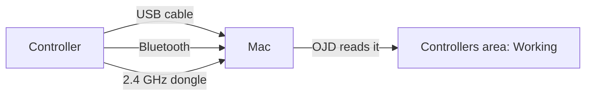
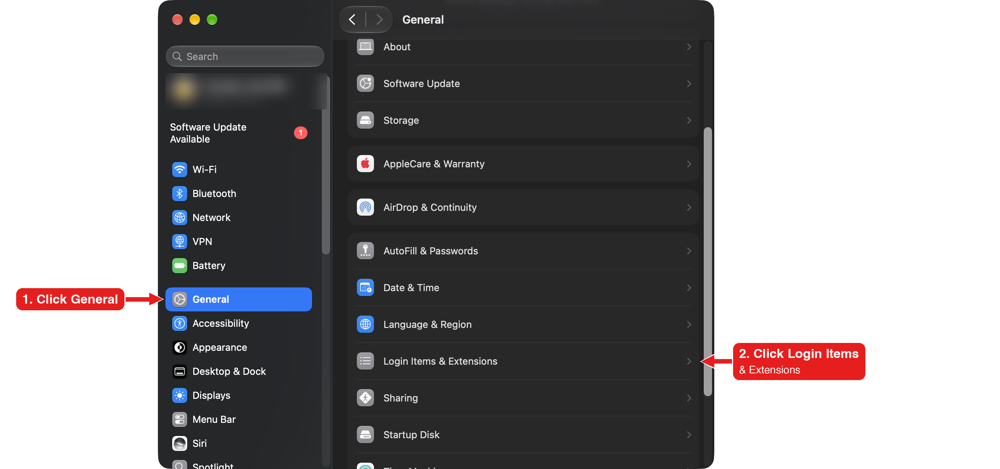
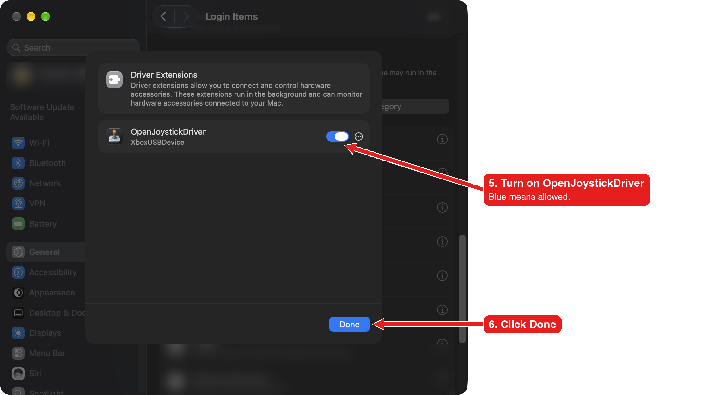
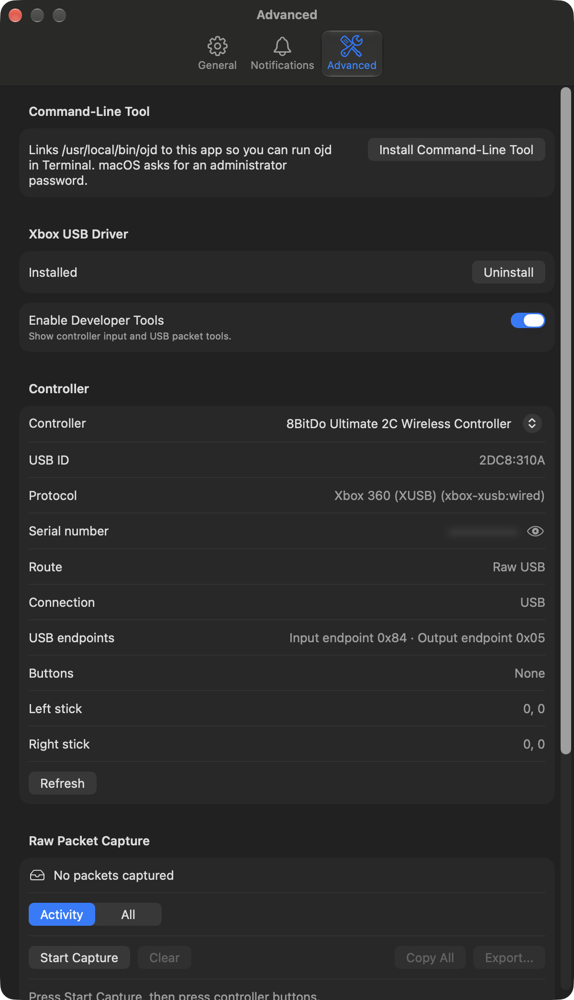

# Connecting Controllers

Connect a controller, find its ID, and set up the [Xbox USB driver](Glossary.md#terms) for Xbox controllers.

macOS must see a controller first. Then **Controllers** says **Working**.



## Contents

- [Connection Types](#connection-types)
- [Finding Your Controller ID](#finding-your-controller-id)
- [Xbox USB Driver](#xbox-usb-driver)
- [Further Reading](#further-reading)

## Connection Types

Each [connection](Glossary.md#terms) has its own ID, so OJD sees separate controllers. One may work while another doesn't. See [Supported Controllers](Supported-Controllers.md).

| Connection | What OJD sees |
| --- | --- |
| USB | The controller, with the wired ID. |
| Bluetooth | The controller, with the Bluetooth ID. |
| 2.4 GHz dongle | The dongle, with its own ID. |

Some controllers change ID with mode. For a problem, give the dongle's ID in a [bug report](Reporting-a-Bug.md).

### Connect Over Bluetooth

1. Put the controller in pairing mode (see its manual).
2. Choose Apple menu > **System Settings** > **Bluetooth**.
3. Point at the controller under **Nearby Devices**, then click **Connect**.

   

OJD never reconnects a Bluetooth controller by itself. To disconnect, select it in **Controllers** and click **Disconnect Bluetooth Connection**. Reconnect by hand. For the Wii Remote, see [Wii Remote](Wii-Remote.md).

## Finding Your Controller ID

An ID is two numbers, like a car's make and model: vendor, then product. Example: `045E:02D1`. Bug reports need it.

### Read the ID in the App

1. Click **Controllers** in the sidebar.
2. Select your controller.
3. Expand **Advanced**.
4. Read **USB VID/PID**.

The label says USB. Bluetooth controllers are untested. Or run this, using an ID from the list for `CONTROLLER`:

```shell
ojd controller list
ojd controller show CONTROLLER
```

### Read the ID of a USB Controller

Open **System Information**, select **USB**, then your controller. Read **Vendor ID** and **Product ID**: `0x045e` and `0x02d1` mean `045E:02D1`. Or run `system_profiler SPUSBDataType`.

## Xbox USB Driver

The [Xbox USB driver](Glossary.md#terms) reads genuine Xbox One and Xbox Series controllers on USB. Other controllers skip it. The app makes the [virtual gamepad](Glossary.md#terms).

A build includes the driver only if Apple granted `userclient-access`. See [Build Options and Limits](Building-from-Source.md).

### Approve the Driver

Only genuine Xbox One and Xbox Series controllers on USB need this. Allow **XboxUSBDevice** once.

1. Click **Open System Settings** in the app's **Xbox USB Driver** banner.
2. Click **General**, then **Login Items & Extensions**.

   

3. Scroll down to **Extensions** and click **By Category**.
4. Click the **(i)** button beside **Driver Extensions**.

   

5. Turn on **OpenJoystickDriver**. A blue switch means it's on.
6. Click **Done**.

   

**Check:** the banner disappears, and **Settings** > **Advanced** shows **Installed** for **Xbox USB Driver**. To repair the driver, click **Repair Xbox USB Driver** in the banner.



## Further Reading

- [Supported controllers](Supported-Controllers.md)
- [If a controller isn't detected](Troubleshooting.md#if-a-controller-isnt-detected)
- [Using the app](Using-the-App.md)
- [Security model](Permissions-and-Security.md)
