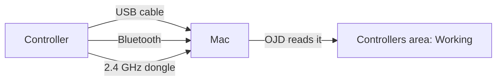
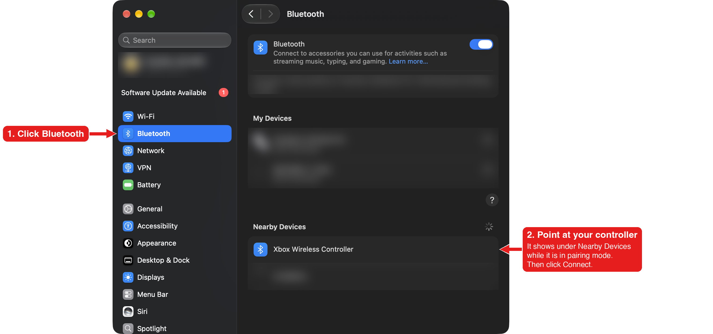
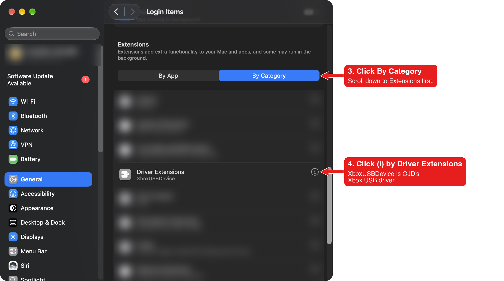

# Connecting Controllers

Connect a controller, find its ID, and set up the [Xbox USB driver](Glossary.md#terms) for Xbox controllers.

Connect with a cable, Bluetooth, or a wireless dongle. OJD can read a controller only after macOS sees it, so check that it says **Working** in the **Controllers** area.



## Contents

- [Connection Types](#connection-types)
- [Finding Your Controller ID](#finding-your-controller-id)
- [Xbox USB Driver](#xbox-usb-driver)
- [Further Reading](#further-reading)

## Connection Types

A controller can reach your Mac by USB, Bluetooth, or a 2.4 GHz dongle. Each [connection](Glossary.md#terms) has its own ID, so OJD treats each as a separate controller. A controller that works over one connection may not work over another. See [Supported Controllers](Supported-Controllers.md).

| Connection | What OJD sees |
| --- | --- |
| USB | The controller, with the wired ID. |
| Bluetooth | The controller, with the Bluetooth ID. |
| 2.4 GHz dongle | The dongle, with its own ID. |

Some controllers change ID when you change mode. A dongle is its own device, so give the dongle's ID when you report a problem. See [Reporting a Bug](Reporting-a-Bug.md).

### Connect Over Bluetooth

1. Put the controller in pairing mode. Its manual says how.
2. Choose Apple menu > **System Settings** > **Bluetooth**.
3. Point at the controller under **Nearby Devices**, then click **Connect**.

   

OJD never reconnects a Bluetooth controller by itself. To disconnect one, select it in **Controllers** and click **Disconnect Bluetooth Connection**, then reconnect it by hand. For the Wii Remote, see [Wii Remote](Wii-Remote.md).

## Finding Your Controller ID

A controller's ID is two numbers, like the make and model of a car. The first names the maker (vendor ID) and the second names the model (product ID), such as `045E:02D1`. Bug reports need it. Each connection has its own ID.

### Read the ID of a USB Controller

1. Connect the controller by USB.
2. Open **System Information**.
3. Select **USB** in the sidebar, then your controller.
4. Read **Vendor ID** and **Product ID**.

A value like `0x045e` and `0x02d1` means `045E:02D1`. Or run this in Terminal:

```shell
system_profiler SPUSBDataType
```

### Read the ID of Any Controller

1. Connect the controller.
2. Click **Controllers** in the sidebar.
3. Select your controller.
4. Expand **Advanced** in its details.
5. Read **USB VID/PID**.

The label says USB. Bluetooth controllers are untested. Or run this in Terminal, with an ID from the list for `CONTROLLER`:

```shell
ojd controller list
ojd controller show CONTROLLER
```

## Xbox USB Driver

The [Xbox USB driver](Glossary.md#terms) is a driver that OJD installs in macOS. It reads genuine Xbox One and Xbox Series controllers connected by USB. Other controllers don't need it. The driver only reads the controller, and the app makes the [virtual gamepad](Glossary.md#terms).

Apple must grant a special permission, `userclient-access`, before a build can include the driver. A build without it has no driver, and **Driver Extensions** in **System Settings** lists nothing from OJD. See [Build Options and Limits](Building-from-Source.md).

### Approve the Driver

Only genuine Xbox One and Xbox Series controllers on a USB cable need this step; skip it for every other controller. macOS runs OJD's Xbox USB driver, listed as **XboxUSBDevice**, only after you allow it once.

1. Open the app window. Until you approve the driver, a banner shows **Xbox USB Driver** and **Open System Settings**. Click **Open System Settings**. Or choose Apple menu > **System Settings** yourself.
2. Click **General**, then **Login Items & Extensions**.

   

3. Scroll down to **Extensions** and click **By Category**.
4. Click the **(i)** button beside **Driver Extensions**.

   

5. Turn on **OpenJoystickDriver**. A blue switch means it's on.
6. Click **Done**.

   

**Check:** the banner in OJD disappears, and **Xbox USB Driver** in **Settings** > **Advanced** says **Installed**. If the driver needs repair, click **Repair Xbox USB Driver** in the banner.


## Further Reading

- [Supported controllers](Supported-Controllers.md)
- [Adding or changing a controller record](Controller-Records.md)
- [If a controller isn't detected](Troubleshooting.md#if-a-controller-isnt-detected)
- [Reporting a bug](Reporting-a-Bug.md)
- [Build options and limits](Building-from-Source.md)
- [Using the app](Using-the-App.md)
- [Security model](Permissions-and-Security.md)
