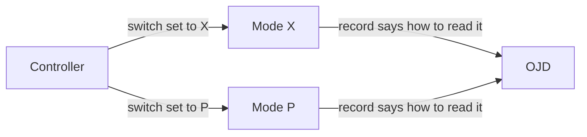
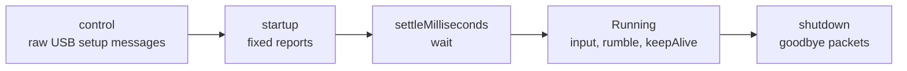
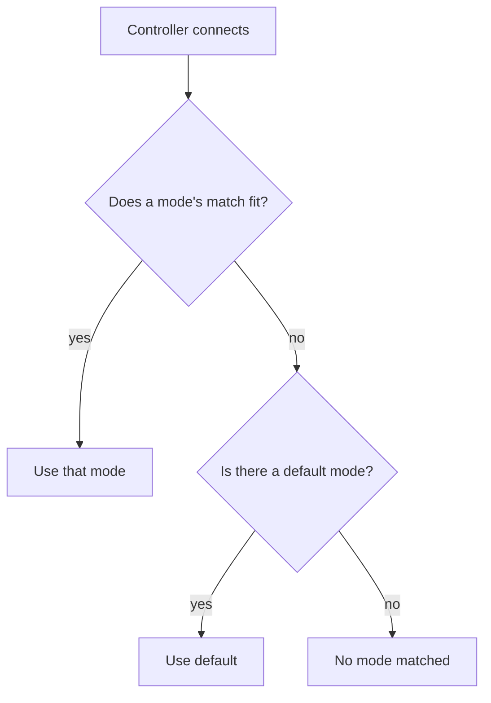

# Controller Record Modes

Many controllers can act in more than one way, like a switch on the back that turns them into an Xbox pad or a PlayStation pad. A mode is the part of a [controller record](Controller-Records.md) that tells OJD how to handle one of those ways.

This page covers two things:

- the session: what OJD sends to the controller when it starts, while it runs, and when it stops
- alternative modes: how OJD picks the right mode by connection (link), by the keys a record has, or by asking the controller (probes)

Some pads change identity with a switch, a key combination, or the cable, and each mode sends different reports. Describe each mode's session in your record, then say how OJD tells which mode is active.



## Contents

- [Describe a Mode's Session](#describe-a-modes-session)
- [Offer Alternative Modes Chosen by Link, Keys, and Probes](#offer-alternative-modes-chosen-by-link-keys-and-probes)
- [Further Reading](#further-reading)

## Describe a Mode's Session

A mode's `session` lists the steps OJD runs around a controller session, like a pilot's checklist for takeoff, flight, and landing. A description's `defaults.session` and a record's modes share these keys. A mode runs exactly the steps its own `session` names, and no mode inherits another's. A `session` names at least one key.



- `startup`: 1 to 16 writes of one format. See [Send Fixed Reports at Startup](Controller-Records.md#send-fixed-reports-at-startup).
- `rumble`: the rumble template. See [Add Rumble to a Controller](Controller-Records.md#add-rumble-to-a-controller).
- `control` (raw USB): 1 to 16 vendor control transfers, run in order before the startup packets inside each handshake attempt.
- `settleMilliseconds` (raw USB, 1 to 60000): the wait after the handshake and before the first input transfer.
- `shutdown` (raw USB): 1 to 8 packets sent when the session closes. OJD logs a failed packet and sends the next.
- `keepAlive` (raw-USB modes of `XboxXID` and `XboxXUSB`, whose descriptions declare none): `intervalMilliseconds` (1 to 60000) and 1 to 8 `writes`. Each write is a raw-USB packet with `bytes` and optionally `endpoint`, `timeoutMilliseconds`, and `sessionByte`.

A HID mode takes only `startup` and `rumble`. Write bytes as uppercase hex pairs with single spaces, such as `42 03 00 00`. Lowercase digits, a `0x` prefix, or other separators fail validation.

### Vendor Control Transfers

```xml
<key>session</key>
<dict>
 <key>control</key>
 <array>
  <dict>
   <key>bRequest</key>
   <integer>1</integer>
   <key>bmRequestType</key>
   <integer>192</integer>
   <key>match</key>
   <dict>
    <key>manufacturer</key>
    <string>SHANWAN</string>
   </dict>
   <key>wIndex</key>
   <integer>0</integer>
   <key>wLength</key>
   <integer>8</integer>
   <key>wValue</key>
   <integer>0</integer>
  </dict>
 </array>
</dict>
```

- `bmRequestType` is a vendor type: 64 to 67 (host to device) or 192 to 195 (device to host). `bRequest` is 0 to 255. `wValue` and `wIndex` are 0 to 65535.
- `wLength` is 0 to 64. An IN transfer (192 to 195) reads `wLength` bytes, needs `wLength` of at least 1, and has no `data`. An OUT transfer (64 to 67) writes `data`, whose byte count equals `wLength`. An OUT transfer with `wLength` 0 has no data stage and no `data`.
- `timeoutMilliseconds` is 1 to 60000. The default is 1000.
- `delayMilliseconds` (0 to 1000) waits after the transfer.
- `toleratesRejection` logs a rejected transfer and goes on instead of failing startup.
- `match` limits the transfer with `manufacturer`, `product` (non-empty text), and `bcdDevice` (`min`, `max`). The transfer runs only for a device where every present key holds. A device that doesn't report a keyed value never gets it. Without `match`, every device gets it.

## Offer Alternative Modes Chosen by Link, Keys, and Probes

Use modes when one VID:PID runs more than one protocol (XInput, DInput, Switch mode) or needs different handling over USB and Bluetooth. Every record has a `modes` list, and a controller's protocol is the `protocol` of one mode. The mode with id `default` has no `match` and runs when no other mode matches. A record may have no `default`. Then every mode has a `match`, which suits a VID:PID that several models share and a product string tells apart.



```xml
<key>modes</key>
<array>
 <dict>
  <key>id</key>
  <string>default</string>
  <key>protocol</key>
  <dict>
   <key>family</key>
   <string>SonySixaxis</string>
  </dict>
 </dict>
 <dict>
  <key>id</key>
  <string>bluetooth</string>
  <key>match</key>
  <dict>
   <key>link</key>
   <string>BluetoothClassic</string>
  </dict>
  <key>protocol</key>
  <dict>
   <key>family</key>
   <string>SonySixaxis</string>
  </dict>
  <key>session</key>
  <dict>
   <key>startup</key>
   <array>
    <dict>
     <key>bytes</key>
     <string>42 03 00 00</string>
     <key>report</key>
     <dict>
      <key>id</key>
      <integer>244</integer>
      <key>kind</key>
      <string>Feature</string>
      <key>length</key>
      <integer>5</integer>
     </dict>
    </dict>
   </array>
  </dict>
 </dict>
 <dict>
  <key>id</key>
  <string>feature-ef-answers</string>
  <key>match</key>
  <dict>
   <key>probes</key>
   <array>
    <dict>
     <key>expect</key>
     <string>Answers</string>
     <key>length</key>
     <integer>49</integer>
     <key>report</key>
     <integer>239</integer>
    </dict>
   </array>
  </dict>
  <key>protocol</key>
  <dict>
   <key>family</key>
   <string>SonySixaxis</string>
  </dict>
 </dict>
</array>
```

- `id`: lowercase words joined by hyphens, unique in a record.
- `protocol`: the protocol the mode runs.
- `match`: required except in `default`, with at least one key. OJD selects a mode only when all its keys hold.
- `interface` (`first` and `last`, inclusive, 0 to 255): limits the USB interface a HID mode binds to, the lowest one in range that the controller exposes. A raw-USB mode has no `interface`, because it claims the interface its `usb` section resolves.
- `session`: the mode's steps. See [Describe a Mode's Session](#describe-a-modes-session). A mode inherits nothing from the default mode.

The `match` keys:

- `link`: `USB`, `BluetoothClassic`, `BluetoothLE`, or `ProprietaryRadioReceiver`. It holds when every interface reaches the controller over that link, as discovery observed. Without discovery data, it is `proprietary-radio-receiver` for a model whose own record runs a `receiver` or `dongle` variant, and otherwise the host link macOS reports.
- `interfaceSignature`: holds when one interface has the `interfaceClass`, `interfaceSubclass`, and `interfaceProtocol` given (each 0 to 255). It also checks the HID `usagePage` and `usage` (0 to 65535, and `usage` needs `usagePage`) and the whole `endpoints` set when given. `endpoints` lists 1 or more endpoints, each with at least one of `address` (0 to 255), `direction` (`In`, `Out`), `transferType` (`Control`, `Isochronous`, `Bulk`, `Interrupt`), and `maxPacketSize` (0 to 65535). Each listed endpoint must pair with a different endpoint of the interface, and none may be left over. So two interfaces with one class triple and different endpoint sets select different modes. An interface whose endpoints discovery doesn't report never holds an `endpoints` key.
- `manufacturer`, `product`: hold when the device's strings equal the given non-empty text.
- `bcdDevice`: holds when the release number lies in `min` to `max` (inclusive, 0 to 65535).
- `probes`: 1 or more. A probe reads a feature report (`report` 0 to 255, `length` 1 to 65535) and expects `Answers`, `Stalls`, or `Bytes`. `Bytes` also takes `offset` (0 to 65534) and `bytes`, the uppercase hex pairs the reply must hold there. The others take neither.

OJD never switches a controller's mode. It tries modes in record order and runs the first whose keys all hold. A probe costs the most, so OJD reads it only after every other key of its mode holds, and reads a report that several probes name once. When no mode matches, the default mode runs. A record without one leaves the controller unsupported with the reason `NoModeMatched`. OJD sends it nothing, and the Controllers page says it matches no supported model. A mode with a probe needs a HID route. It never runs on another route, such as a Bluetooth LE GATT peripheral.

A probe only reads, and gives up after 2 seconds. With no usable reply, selection stops. The controller stays enabled in its default mode (or unsupported without one), and OJD logs a line naming the report. No usable reply means a timeout, an unavailable route, or any failure but a refusal, such as a device that isn't open, is gone, or is held exclusively. A refusal is a stalled pipe (`0xE000404F` or `0xE0005000`) or an unsupported request (`kIOReturnUnsupported`). It satisfies `Stalls` and fails the other expectations. A stall where a mode expects `Answers` leaves the default mode running.

A raw-USB record may list alternative modes. OJD selects them at USB detection from the passive keys (`link`, `interfaceSignature`, `endpoints`, and the strings). A probe never holds on a raw-USB route, which can't read a feature report, so a mode with probes there leaves the default mode running.

Every mode follows the record-level rules of its protocol for `input.layout`, `session.rumble`, `usb`, `server`, `route`, `heldByAppleDriver`, `tuning`, and `capabilities`. One exception: a `capabilities` delta needs only one mode's family description to declare it. A mode whose driver doesn't declare the delta ignores it.

At most one mode has the id `default`. A patch merges `modes` by `id`, so it names only the modes it changes or adds.

macOS reports a radio dongle as a USB device, so the `ProprietaryRadioReceiver` link comes from the model's own record. A model whose default mode runs a `Receiver` or `Dongle` variant reports it, and a mode keyed on that link refines the receiver. No bundled record attaches one product ID both through a dongle and over USB. The six receiver and dongle records (`045e:0291`, `045e:02a9`, `045e:0719`, `28de:1142`, `28de:1304`, `28de:1305`) each hold one default mode.

Only the raw USB scanner reports endpoint sets. The IOKit registry publishes only the interface's `bNumEndpoints`. A HID mode that names `endpoints` could never be selected, so the schema, the decoder, and the Python validator refuse it. Only a raw-USB mode may name `endpoints`.

The DualShock 3 record has the `bluetooth` mode above. It sends feature report `0xF4` (`42 03 00 00`) when the controller connects over Bluetooth Classic, as Linux `hid-sony.c` does. Its other mode probes feature report `0xEF` and is a candidate discriminator only. It runs the same protocol as the default mode, and the record doesn't say which unit is genuine. The `length` of 49 is the size of a Sixaxis input report. It was chosen, and not taken from a DualShock 3 reply.

Pairing is not part of the record. Pair a DualShock 3 with the Mac before a Bluetooth link exists, with macOS or a pairing tool. Not verified: pairing a real DualShock 3 is an open hardware check, so these docs list no pairing steps.

### Read Another Input In One Mode

Use this when two pads share a model ID but report differently. A mode other than `default` may hold its own `input` (`layouts` or `hidUsageMap`). While that mode runs, its `input` replaces the record's. Other modes read the record's `input`. A mode `input` has no `descriptorShapes`. The `default` mode and an idle mode hold no `input`. The `1949:0402` record reads touch contacts only in its `v3` mode. The `054C:0268` patch maps the face buttons of the NITHO MLT-KRMA-K only when the manufacturer is `Sony Computer Entertainment`. A patch mode entry sets `input` like any other key.

### Record an Identity That Handles Nothing

Use `idle` for an identity OJD recognizes but must not drive, such as a receiver that shows a controller only after it enumerates under another ID. While a mode with `idle` matches, OJD handles nothing: the controller is unsupported with the named reason, gets no data and no [virtual gamepad](Glossary.md#terms), and the Controllers page says why. The value is `NoControllerLinked` (a receiver with no controller linked) or `Bootloader` (a controller in its bootloader).

An idle mode has no `interface`, `session`, or `input`. A record whose modes are all idle has no `usb`, `bluetoothLE`, `capabilities`, `server`, `route`, `heldByAppleDriver`, `input`, or `tuning`. To add controls, replace `idle` with the `protocol` and `input` of a captured descriptor. A patch sets `idle` on a mode entry like any other key. A record whose default mode is `idle: Bootloader` belongs to the bundled catalog, and OJD refuses a user or package file that adds or patches that identity.

## Further Reading

- [Controller Records](Controller-Records.md)
- [Writing Controller Mods](Writing-Controller-Mods.md)
