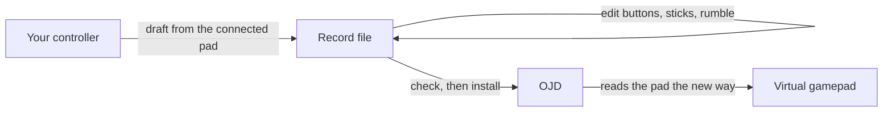
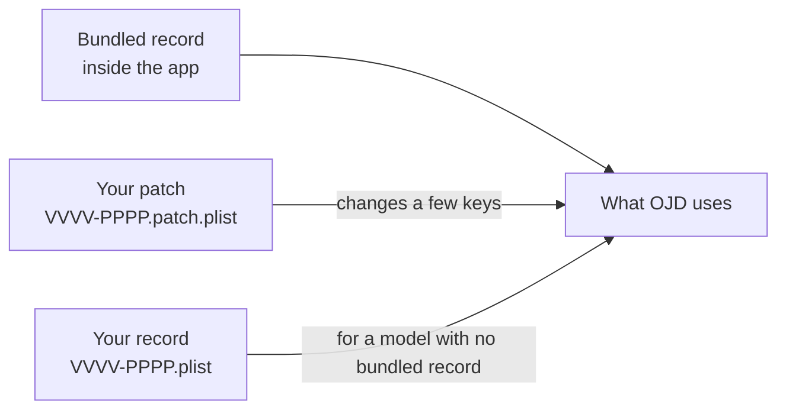
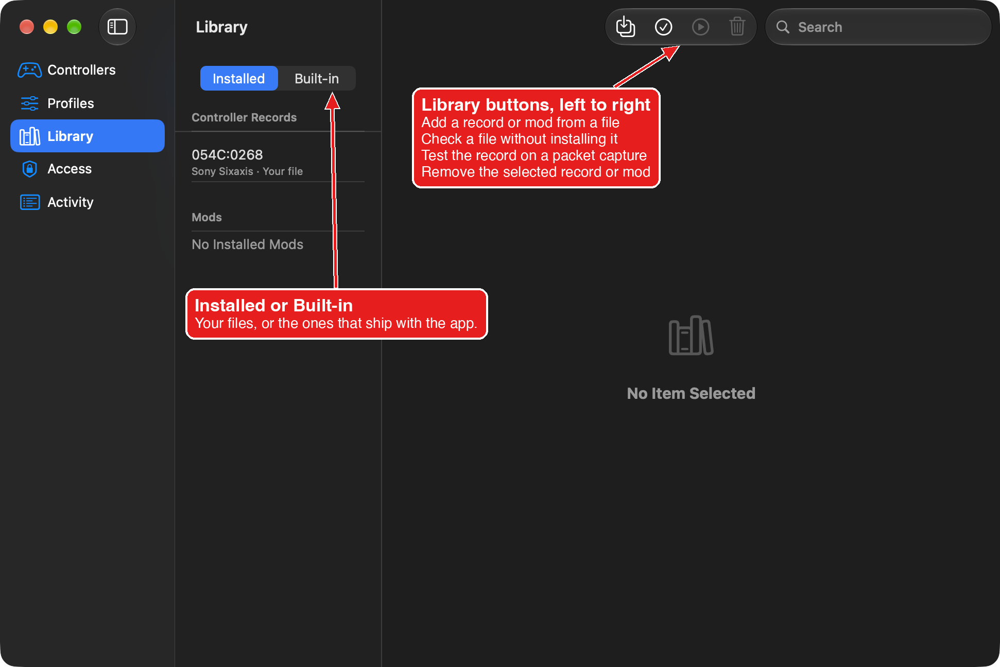
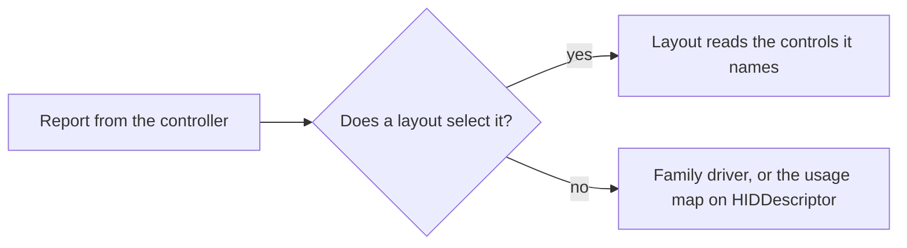
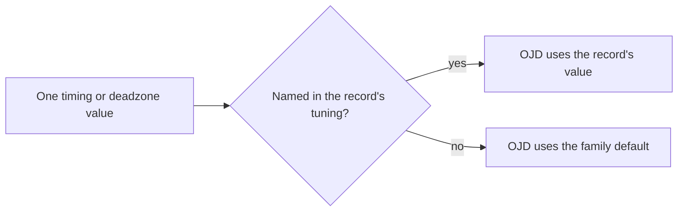

# Adding or Changing a Controller Record

Use a controller record to teach OpenJoystickDriver (OJD) about a controller, or to change how it drives one. A record is a small file in your own folder. Write one when a controller doesn't work or one detail is wrong, such as a button, a drifting stick, or rumble. The [Support Ladder](Support-Ladder.md) starts with the least work. The sections from [Describe a Controller's Input Reports](#describe-a-controllers-input-reports) on are for advanced users who read report bytes.

Records live in `~/Library/Application Support/OpenJoystickDriver/Controllers`. To make one, draft it from a connected controller, edit it, then check and install it. It fixes the controller without an app update.



## Contents

- [How Records Work](#how-records-work)
- [Choose Who Drives the Controller](#choose-who-drives-the-controller)
- [Describe a Controller's Input Reports](#describe-a-controllers-input-reports)
- [Add Rumble to a Controller](#add-rumble-to-a-controller)
- [Send Fixed Reports at Startup](#send-fixed-reports-at-startup)
- [Tune Timings and the Stick Deadzone](#tune-timings-and-the-stick-deadzone)
- [Select a Model with Protocol Parameters](#select-a-model-with-protocol-parameters)
- [Map HID Usages](#map-hid-usages)
- [Control Names and Other Vocabularies](#control-names-and-other-vocabularies)
- [Offer Alternative Modes Chosen by Link, Keys, and Probes](#offer-alternative-modes-chosen-by-link-keys-and-probes)
- [Connect a Switch 2 Controller Over Bluetooth LE][toc-2]
- [Draft a Record From a Connected Controller][toc-1]
- [Install a Record](#install-a-record)
- [Check Which Records Apply](#check-which-records-apply)
- [Remove a Record](#remove-a-record)
- [Schema Versions](#schema-versions)
- [Further Reading](#further-reading)

[toc-1]: #draft-a-record-from-a-connected-controller
[toc-2]: #connect-a-switch-2-controller-over-bluetooth-le

## How Records Work

A controller record is a recipe card for one model. It tells OJD which bytes mean which button and how to say hello to the controller. It names the protocol family, the language the controller and the Mac speak. The model's ID is its vendor and product numbers (VID:PID), such as `045E:028E`.



The app holds a bundled record for each supported model. Your records are XML property lists in `~/Library/Application Support/OpenJoystickDriver/Controllers`. Name each file after its model in lowercase hexadecimal, such as `045e-028e.plist`.

A record may hold a `name`: the model's USB product string (`kIOHIDProductKey`), copied verbatim from the device. The **Controller** pop-up in **New Profile** lists a disconnected model by `name`, or by VID:PID without one.

A file in that folder is one of two kinds:

- `Controller`: a complete record for a model with no bundled record. Name it `VVVV-PPPP.plist`.
- `ControllerPatch`: changes for a model with a record. Name it `VVVV-PPPP.patch.plist`. Its `selector` names the model by `vendorID` and `productID`. Its `patch` holds the changes.

The **Library** area in the app lists the records you installed and the built-in ones:



Every reader gives the same verdict: the app, `ojd record validate` and `install`, `ojd config`, `ojd diagnose record`, and mod packages.

- E5007: the file is not plain UTF-8 (a byte order mark or UTF-16 included), is not one property list dictionary, names a key twice in one dictionary, or nests deeper than 64 levels.
- E5010: the file is not an XML property list (a binary property list or JSON included), or holds a `date` or `data` value.

The app, `ojd record install`, and packages also refuse a `Controller` file for a model with a bundled record. Write a patch instead. `ojd diagnose record` probes a bundled model.

A patch has two parts:

- `remove` lists dotted key paths, such as `input.hidUsageMap` or `tuning.stickDeadzone`. OJD removes them first. A property list has no `null`, so `remove` is the only way to delete a key.
- `patch` merges in afterward. Objects merge key by key, a value overrides the record's, and an array overrides the whole array.

A `remove` path names a property (`modes`, `name`, `placeholderSerial`, `usb`, `bluetoothLE`, `capabilities`, `server`, `route`, `heldByAppleDriver`, `input`, `tuning`), a key below one, or `modes.<id>`. A path outside the schema, such as `bogus.key`, gives E5007. A path the record lacks changes nothing. Remove a whole section (`tuning`) instead of its last key, because an empty section is invalid. A patch sets every property except the identity (`vendorID`, `productID`), `capabilities` included.

`modes` is the exception to array override: entries merge by `id`. An entry with an existing `id` merges key by key into that mode. An entry with another `id` adds a mode, as in [Offer Alternative Modes](#offer-alternative-modes-chosen-by-link-keys-and-probes). `modes.<id>` in `remove` deletes one mode. A patch that removes a mode and lists it again replaces it. A patch file holds `patch`, `remove`, or both.

```xml
<?xml version="1.0" encoding="UTF-8"?>
<!DOCTYPE plist PUBLIC "-//Apple//DTD PLIST 1.0//EN" "http://www.apple.com/DTDs/PropertyList-1.0.dtd">
<plist version="1.0">
<dict>
 <key>apiVersion</key>
 <string>openjoystickdriver/v1alpha3</string>
 <key>kind</key>
 <string>ControllerPatch</string>
 <key>patch</key>
 <dict>
  <key>tuning</key>
  <dict>
   <key>stickDeadzone</key>
   <real>0.08</real>
  </dict>
 </dict>
 <key>selector</key>
 <dict>
  <key>productID</key>
  <integer>746</integer>
  <key>vendorID</key>
  <integer>1118</integer>
 </dict>
</dict>
</plist>
```

Several patches can apply to one model. The layers, weakest to strongest, are the bundled record, a bundled patch, a patch from an installed [mod package](Writing-Controller-Mods.md), and your patch. Inside a layer, `selector` `all` set to `true` applies first, then `vendorID` and `productID`, then `model` (a string such as `045E-028E`). Your `Controller` file replaces a package's for the same model. Your `ControllerPatch` applies over the package record. If you remove the package, OJD lists your patch as a problem and skips it.

A raw-USB record works only when macOS lets OJD open the device. The [Xbox USB driver](Glossary.md#terms) claims only the Xbox models in its signed product list, and a record can't add one. `ojd record validate` says when this applies.

## Choose Who Drives the Controller

A controller is [Handled by macOS](Glossary.md#terms) when the Game Controller framework lists it within one second of connecting. OJD then only reads its input. When macOS accepts a controller but lists none, OJD drives it. The `server` field overrides this check:

- No `server` (default): OJD checks the list.
- `System`: macOS drives the controller when it can.
- `OJD`: OJD opens the controller exclusively and drives it, even when macOS supports it.

A raw-USB family, such as `XboxGIP`, reaches the controller through raw USB, which macOS can't handle, so `server` there applies only to a HID device the record fits none of the interfaces of. OJD serves such a device through the `HIDDescriptor` fallback when `server` is `OJD`, and leaves it to macOS otherwise. A changed value applies to a connected controller when the service reloads records. No unplug is needed.

A mode may state its own `server`, which applies while that mode's keys hold. See [Record an Identity That Handles Nothing](Controller-Record-Modes.md#record-an-identity-that-handles-nothing) for a mode that holds a pad until it changes identity.

`ojd controller claim CONTROLLER` sets `OJD`. `ojd controller release CONTROLLER` sets `System`.

- Each command writes your record for the model, as a `ControllerPatch` when you have none and a bundled or package record exists.
- A value equal to the bundled or package `server` removes `server` from your patch instead. An empty file is deleted.
- E2023: a controller reached through raw USB, a controller macOS can't handle, or a model with no record. For the last, start with `ojd record draft`.

`ojd controller show` names the choice, its layer, the route, and the [virtual gamepad kind](Glossary.md#terms). It shows `default` when no layer sets `server`. The **Handled by** picker in the app's controller detail makes the same choice. It appears for a controller macOS can handle or a record gives to OJD, never for a controller reached through raw USB.

## Describe a Controller's Input Reports

Use this section when a controller sends input reports that its HID descriptor describes wrongly. The `input` field tells OJD which bit holds each control.

- A `HIDReportLayout` record requires `input`.
- Other families may take `input.layouts` too. The family driver keeps the session and decodes every report. A layout that selects a report overrides the controls it names, so a record can correct one button of an `XboxXUSB` or `XboxGIP` pad.
- A report that is no frame of its family reaches the layout that selects it. A report no layout selects belongs to the family driver.
- On a `HIDDescriptor` record, a layout selects raw reports and the usage map decodes the rest.



The bundled `XboxXID`, `NintendoSwitchInputOnly`, and `VendorFlydigi` descriptions declare their own layout (`defaults.input` in `Resources/Protocols`). A record layout overrides it.

```xml
<key>input</key>
<dict>
 <key>layouts</key>
 <array>
  <dict>
   <key>axes</key>
   <array>
    <dict>
     <key>bitOffset</key>
     <integer>24</integer>
     <key>bitSize</key>
     <integer>8</integer>
     <key>control</key>
     <string>LeftStickX</string>
    </dict>
    <dict>
     <key>bitOffset</key>
     <integer>32</integer>
     <key>bitSize</key>
     <integer>8</integer>
     <key>control</key>
     <string>LeftStickY</string>
    </dict>
   </array>
   <key>buttons</key>
   <array>
    <dict>
     <key>bitOffset</key>
     <integer>111</integer>
     <key>bitSize</key>
     <integer>1</integer>
     <key>control</key>
     <string>South</string>
    </dict>
    <dict>
     <key>bitOffset</key>
     <integer>8</integer>
     <key>bitSize</key>
     <integer>1</integer>
     <key>control</key>
     <string>Back</string>
    </dict>
   </array>
   <key>hat</key>
   <array>
    <dict>
     <key>down</key>
     <dict>
      <key>bitOffset</key>
      <integer>87</integer>
      <key>bitSize</key>
      <integer>1</integer>
     </dict>
     <key>encoding</key>
     <string>Directions</string>
     <key>left</key>
     <dict>
      <key>bitOffset</key>
      <integer>71</integer>
      <key>bitSize</key>
      <integer>1</integer>
     </dict>
     <key>right</key>
     <dict>
      <key>bitOffset</key>
      <integer>63</integer>
      <key>bitSize</key>
      <integer>1</integer>
     </dict>
     <key>up</key>
     <dict>
      <key>bitOffset</key>
      <integer>79</integer>
      <key>bitSize</key>
      <integer>1</integer>
     </dict>
    </dict>
   </array>
   <key>leftTrigger</key>
   <dict>
    <key>bitOffset</key>
    <integer>136</integer>
    <key>bitSize</key>
    <integer>8</integer>
   </dict>
   <key>report</key>
   <dict>
    <key>length</key>
    <dict>
     <key>atLeast</key>
     <integer>19</integer>
    </dict>
   </dict>
   <key>rightTrigger</key>
   <dict>
    <key>bitOffset</key>
    <integer>144</integer>
    <key>bitSize</key>
    <integer>8</integer>
   </dict>
  </dict>
 </array>
</dict>
<key>modes</key>
<array>
 <dict>
  <key>id</key>
  <string>default</string>
  <key>protocol</key>
  <dict>
   <key>family</key>
   <string>HIDReportLayout</string>
  </dict>
 </dict>
</array>
```

Offsets count from the first byte of the report as macOS delivers it. A `bitOffset` counts bits from bit 0 (least significant) of byte 0, so bit 7 of byte 13 is 111. A field is 1 to 32 bits (`bitSize`) inside the report length. With a report `id`, a field lies after byte 0.

- `layouts`: one or more. A layout reads the reports its `report` selects, by ID and length. No two layouts may select one report (`ojd record validate` rejects it). A `HIDReportLayout` record ignores a report no layout selects, and controls keep their values. Other families decode it. A layout changes only the controls it names: a control that report 0x31 names and 0x30 doesn't keeps its 0x31 value while 0x30 arrives. A record's controls are those of all its layouts.
- `report`: `length` has exactly one key, `atLeast` or `exactly`, set to an integer N from 1 to 64. `atLeast` reads N bytes or more. `exactly` reads only N. `id` (1 to 255) is optional. With `id`, byte 0 holds it and N counts it. OJD ignores other reports.
- `buttons`: each has `control`, `bitOffset`, and `bitSize`. A button is pressed while any bit is set. Repeat a control to read it from several places. A button can't be a D-pad direction or stick axis. A `LeftTrigger` or `RightTrigger` button reports the digital press. The analog value comes from `leftTrigger` and `rightTrigger`.
- `axes`: 1 to 4 entries with a stick-axis `control`, `bitOffset`, and `bitSize`. The value is unsigned unless `signed` is `true` (two's complement). `byteOrder` is `LittleEndian` (default) or `BigEndian`, which needs a `bitOffset` divisible by 8 and a `bitSize` of 16, 24, or 32. `min` and `max` set the raw range, by default the full range of `bitSize` and `signed`. A range you give lies inside it, with `max` minus `min` at least 2. `inverted` flips the direction. `symmetric` reads a signed value as raw divided by `max`, so the lowest raw value reads full negative. It requires `signed`, a negative `min`, and a positive `max`. X grows right and Y grows down, as in HID.
- `hat`: a list of sources. The first source that reads a direction wins. Each has an `encoding`:
  - `EightWay`: `bitSize` bits (3 to 8), 0 for north, clockwise to 7 for north-west. Other values read centered. `neutralUntilNonzero` also reads 0 as centered until the bits have been nonzero once, for a controller that sends 0 before its hat is live.
  - `Directions`: one field per direction (`up`, `right`, `down`, `left`), each with `bitOffset` and `bitSize`. Opposing directions cancel.
  - `Table`: `bitOffset`, `bitSize`, and `values`. `values` maps each number the bits can hold (decimal, no leading zeros) to `North`, `NorthEast`, `East`, `SouthEast`, `South`, `SouthWest`, `West`, or `NorthWest`. Other numbers read centered.
- `leftTrigger`, `rightTrigger`: an analog value, a `button` field, or both. The analog value has `bitOffset` and `bitSize`, with `byteOrder`, `signed`, `min`, and `max` as for an axis. It reads `min` to `max` as 0 to 1. The `button` field (`bitOffset`, `bitSize`) reads as fully pulled.
- `touch`: multi-touch contacts that stand for controls, for a pad that taps a phone screen for an app's key map. Name `contacts` and `radius`, and `spots`, `sticks`, or both.
  - `contacts`: slot 0 starts at `bitOffset`, and each next slot starts `stride` bits later, for `slots` slots. `count` (`bitOffset`, `bitSize`) holds how many leading slots hold a contact. `tip`, `id`, `x`, and `y` count from the slot start. A slot whose `tip` is 0 holds no touch.
  - Where a contact first lands fixes what it drives until it lifts. A contact that starts elsewhere drives nothing.
  - A contact within `radius` of a stick entry's `x` and `y` drags that stick. Its offset from the center along touch X drives the axis `alongX` names, and along touch Y the axis `alongY` names. `travel` is the offset that reads full deflection. `inverted` flips a direction.
  - Any other contact holds the nearest of `spots` within `radius`. A spot (`control`, `x`, `y`) holds a button, a D-pad direction, or a fully pulled trigger. A control may have several spots.
  - `touch` decides its controls after the rest of the layout.

Name at least one control per layout. `ojd record validate` checks that every field lies inside the report.

## Add Rumble to a Controller

Use this section to make a controller rumble. A `HIDReportLayout`, `HIDDescriptor`, or `VendorPS3ThirdParty` controller is input-only unless its mode names a rumble report in `session.rumble`:

```xml
<key>session</key>
<dict>
 <key>rumble</key>
 <dict>
  <key>highFrequency</key>
  <dict>
   <key>byte</key>
   <integer>2</integer>
  </dict>
  <key>lowFrequency</key>
  <dict>
   <key>byte</key>
   <integer>3</integer>
  </dict>
  <key>report</key>
  <dict>
   <key>id</key>
   <integer>2</integer>
   <key>kind</key>
   <string>Output</string>
   <key>length</key>
   <integer>8</integer>
  </dict>
 </dict>
</dict>
```

- `report`: the target. A HID report has `kind` (`Output` or `Feature`), `id` (0 to 255), and `length` of 2 to 64 bytes, counting the report ID. A raw-USB packet has `kind` `USB`, `length` of 1 to 64, and no `id`.
- `lowFrequency`, `highFrequency`, `leftTrigger`, `rightTrigger`: one motor each, with a `byte` offset (0 to 63) for its intensity. Name at least one.
- `encoding` (optional, per motor): `UInt8` (default, 0 to 255), `UInt16BigEndian` or `UInt16LittleEndian` (0 to 65535), or `SwitchHDRumble` (four bytes).
- `bytes` (optional): the whole report as uppercase hex pairs, at most 64. A numbered report starts with its ID. Without it, every byte is 0 except the ID.
- `counter` (optional): a `byte` (0 to 63) where OJD writes the session's rolling counter.
- `resendIntervalMilliseconds` (optional, 1 to 60000): while a motor runs, the keep-alive resends the last report at this interval. All motors at zero stop the resends. Without the key, the report goes out once. OJD rejects it beside a `session.keepAlive` in the mode, or when the family description declares a keep-alive (`VendorGameSir`).

OJD sets byte 0 to the report ID when it isn't 0, writes each motor's intensity, and sends the other bytes as `bytes` gives them. Motor and counter bytes must not overlap, and each lies after the report ID and inside the report. OJD sends this report even when macOS drives the controller, because macOS doesn't drive these motors. Only a family that encodes rumble from a template takes `session.rumble`. A `HIDDescriptor` mode takes a HID template only (`Output` or `Feature`, never `USB`). A bundled record declares no such template until a write is felt on hardware.

## Add Player Lights to a Controller

macOS serves some controllers but never lights their player LEDs. A `HIDDescriptor` mode can name the LED report in `session.playerIndicator`. Then `ojd controller player` and the virtual gamepad's player slot light them:

```xml
<key>session</key>
<dict>
 <key>playerIndicator</key>
 <dict>
  <key>byte</key>
  <integer>0</integer>
  <key>off</key>
  <integer>0</integer>
  <key>player1</key>
  <integer>1</integer>
  <key>player2</key>
  <integer>2</integer>
  <key>player3</key>
  <integer>4</integer>
  <key>player4</key>
  <integer>8</integer>
  <key>report</key>
  <dict>
   <key>id</key>
   <integer>0</integer>
   <key>kind</key>
   <string>Output</string>
   <key>length</key>
   <integer>1</integer>
  </dict>
 </dict>
</dict>
```

- `report`: the target, as in `session.rumble`, but `length` is 1 to 64 bytes and a report ID of 0 adds no ID byte.
- `byte`: the offset (0 to 63) of the byte that carries the slot value.
- `off`, `player1`, `player2`, `player3`, `player4`: the value (0 to 255) written to `byte` for each slot. All five are required, so a controller whose LED bits differ from the listed order is fixed in the record.

OJD sets byte 0 to the report ID when it isn't 0, writes the slot value at `byte`, and leaves every other byte 0. The report joins the `macOSOwnedOutput` allowance, so OJD sends it while macOS drives the controller, and sets the controller's slot after its first input report. Only a `HIDDescriptor` mode takes `session.playerIndicator`, and its report is a HID report (`Output` or `Feature`, never `USB`).

## Describe a Mode's Session

A mode's `session` lists the steps OJD runs around a controller session. See [Describe a Mode's Session](Controller-Record-Modes.md#describe-a-modes-session).

## Send Fixed Reports at Startup

Use this section when a HID controller needs a fixed report before it sends input. Name the report in the mode's `session.startup`. The DualShock 3 record `054c:0268` and the Sixaxis clone record `2563:0523` use it in a `bluetooth` mode. A write applies on every link unless a `transport` limits it. A write never names `ProprietaryRadioReceiver`.

```xml
<key>session</key>
<dict>
 <key>startup</key>
 <array>
  <dict>
   <key>bytes</key>
   <string>42 03 00 00</string>
   <key>report</key>
   <dict>
    <key>id</key>
    <integer>244</integer>
    <key>kind</key>
    <string>Feature</string>
    <key>length</key>
    <integer>5</integer>
   </dict>
   <key>transport</key>
   <string>BluetoothClassic</string>
  </dict>
 </array>
</dict>
```

- `report`: the HID report as in `session.rumble`: `kind` (`Output` or `Feature`), `id` (0 to 255), and `length` (2 to 128 bytes).
- `bytes`: every byte after the report ID as uppercase hex pairs. When `id` is 0, every byte of the report.
- `delayMilliseconds` (0 to 1000): the wait before this write. Without it, a `Startup` write waits the family's startup interval and an `Activation` write doesn't wait.
- `phase`: `Activation` (default) or `Startup`. OJD sends an `Activation` write after the protocol driver's own startup, when the controller opens. It sends a `Startup` write with the driver's startup writes.
- `crc32Seed` (0 to 255): OJD writes the Sony Bluetooth CRC-32 of the report, with this seed, in its last 4 bytes. `length` counts them and must exceed 4. The DualShock 4 Bluetooth report uses it.
- `transport`: `USB`, `BluetoothClassic`, or `BluetoothLE`. Without it, the write goes out on every transport.

List 1 to 16 writes. OJD sends them in order after the driver's own startup, only when it opens the controller. It logs a failed write and sends the next. A description may carry startup writes in `defaults.session.startup`. A mode's writes replace them when they have the same format. In a description, a HID write may add `variants` (the family variants it applies to) and `when`. `when` has a `parameter` that names a declared enumeration parameter, and `is` or `isNot`, an array of its values. A record may not use `variants` or `when`.

### Raw-USB Startup Writes

A raw-USB family can carry startup packets in its description (`XboxXUSB`, `XboxGIP`, `NintendoSwitch2`). A raw-USB mode's `session.startup` packets replace them. A raw-USB write has no `report`. Its keys:

- `bytes` (required, 1 to 64 bytes).
- `endpoint` (1 to 127). The default is the family's output endpoint.
- `timeoutMilliseconds` (1 to 60000). The default is the family's timeout.
- `delayMilliseconds` (0 to 1000).
- `sessionByte` (0 to 63): the index of a byte the driver fills with its per-session value, such as the GIP sequence.
- `toleratesRejection`.

One list holds one format. A mode that names `protocol.initialization` takes no raw-USB writes.

### Raw-USB Configuration

`usb.configuration` is optional. Without it, OJD sends SET_CONFIGURATION 1 before the claim only to a device that shows no interfaces and runs no configuration. `SetConfiguration1BeforeClaim` sends it to a device in any other configuration too. Either way, a device that already runs configuration 1 receives no request, because SET_CONFIGURATION ends every open interface of the device. Leave the key out unless a capture shows the device needs configuration 1 while it exposes interfaces.

## Tune Timings and the Stick Deadzone

A record's `tuning` field changes a value the protocol driver otherwise sets. Name at least one value. A value you leave out keeps the family default from its protocol description (see [Family Defaults](#family-defaults-live-in-protocol-descriptions)).



```xml
<key>tuning</key>
<dict>
 <key>hidStartupRecoveryRounds</key>
 <integer>3</integer>
 <key>stickDeadzone</key>
 <real>0.02</real>
</dict>
```

| Field | Range | Applies to | What it sets |
| --- | --- | --- | --- |
| `stickDeadzone` | above 0, below 1 | every family | Radial deadzone of both sticks on the [virtual gamepad](Glossary.md#terms), as a fraction of full deflection. Movement past it rescales to the full range. Without it, games and browsers get the reported values. |
| `inputLivenessTimeoutMs` | 1 to 60000 | `SonyDualShock4`, `SonySixaxis` over USB | Silence allowed before OJD releases held controls. Default 1000. |
| `hidStartupIntervalMs` | 0 to 60000 | HID families | Gap between startup writes. |
| `minimumHIDOutputIntervalMs` | 0 to 60000 | HID families | Shortest gap between rumble and lighting reports. 0 means no limit. |
| `hidStartupRecoveryIntervalMs` | 1 to 60000 | `NintendoSwitch1` | Gap between startup recovery rounds. Description default 200. |
| `hidStartupRecoveryRounds` | 1 to 10 | `NintendoSwitch1` | Recovery rounds before OJD gives up. Description default 2. |
| `lizardResendTicks` | 1 to 100000 | `ValveSteamTriton` | Keep-alive ticks between resends of the lizard-mode-off request. Description default 75. |
| `usbCommandTimeoutMs` | 1 to 60000 | `NintendoSwitch2`, `VendorGameSir` (USB) | Timeout of one USB command transfer. Description default 1000 (`NintendoSwitch2`), 2000 (`VendorGameSir`). |
| `presenceResendReports` | 1 to 1000 | `XboxGIP` | Input reports between resends of the announce request. Description default 4. |
| `adapterDisconnectDelayMs` | 1 to 60000 | `SonyDualShock4`, `SonyDualSense` | Silence allowed before an adapter's or dongle's controller counts as disconnected. Default 500. |
| `usbStartupIntervalMs` | 0 to 60000 | `XboxGIP` | Gap between raw-USB startup writes. Default 50. |
| `usbStartupRetryDelayMs` | 1 to 60000 | `XboxGIP` | Wait before the first startup retry. Each later retry waits twice as long. Default 1000. |
| `usbTransferTimeoutMs` | 1 to 60000 | `XboxGIP`, `XboxXID`, `XboxXUSB` | Timeout of each raw-USB transfer (startup, rumble, output). Description default 2000. |
| `irWriteIntervalMs` | 50 to 1000 | `NintendoWii` | Wait after each IR camera register write. WiiBrew asks for 50 ms or more, so lower is rejected. Description default 50. |
| `speakerMaxSeconds` | 1 to 60 | `NintendoWii` | Longest speaker clip. Description default 10. |
| `replyTimeoutMs` | 10 to 10000 | `NintendoWii` | Wait for a read reply or write acknowledgement. Description default 500. |
| `frameQueueCapacity` | 1 to 1024 | every family | Virtual gamepad reports that may wait behind the one being sent. Default 64. When full, the newest state replaces the oldest waiting state, so memory never grows. A reply to an app's output report is never dropped. |
| `leftStickCenterX`, `leftStickCenterY`, `rightStickCenterX`, `rightStickCenterY` | -1 to 1 | every family | Where that stick axis rests. The stored center reads as 0. |
| `leftStickRange`, `rightStickRange` | 0.05 to 2 | every family | Deflection from center that reads as full. |
| `leftTriggerRest`, `rightTriggerRest` | 0 to 0.95 | every family | Where the trigger rests. Below the matching `Full` value. |
| `leftTriggerFull`, `rightTriggerFull` | 0.05 to 1 | every family | Where the trigger reads fully pressed. Above the matching `Rest` value. |
| `gyroOffsetX`, `gyroOffsetY`, `gyroOffsetZ` | -1 to 1 | every family | Gyro offset about that axis, in radians per second. The stored offset reads as 0. |

The last five rows hold one controller's calibration. **Recalibrate** in the Input Test window and `ojd controller calibrate CONTROLLER sticks` measure and store them in your record. See [Testing a controller](Testing-a-Controller.md#recalibrate).

### Set the Deadzone of a Stick That Rests Off Center

OJD has no default deadzone. XInput leaves it to the game: Microsoft says "your game must implement dead zone correctly" and gives `XINPUT_GAMEPAD_RIGHT_THUMB_DEADZONE` (8689 of 32767). Rest positions differ per unit, and a driver deadzone stacks with the game's own. A default would be wrong for some controllers and doubled for others.

A stick that rests off center needs the setting. The Razer controller `1532:0A15` rested its right stick at `RS=(-4672,-1312)`, 0.148 of full deflection from center. `stickDeadzone` is radial: a stick closer to center than the value, measured as `sqrt(x² + y²)` over full deflection, reads centered. So the value must exceed the rest distance, here `sqrt(4672² + 1312²) / 32767`, about 0.148. Check the rest value with `ojd controller watch`:

```text
ojd config set stickDeadzone 0.15 --controller 1532:0A15
ojd config show --controller 1532:0A15
```

`ojd config unset stickDeadzone --controller 1532:0A15` removes it. The **Stick deadzone** stepper in the controller detail (needs the **All Controls** interface) writes the same key. It applies to both sticks, so size it for the stick that rests furthest off center.

`frameQueueCapacity` defaults to 64 (`tuning.frameQueueCapacity` in `controller.schema.json`), also for a controller with no record. A description's `defaults.tuning` may set another value for its family. A record, patch, or `all.patch.plist` overrides both. Reports queue only while the system is slow to accept the previous one. Button changes in the same moment still arrive in order until the queue is full.

Raw-USB families, such as `XboxGIP`, don't take the two HID timings. The two recovery values apply only to `NintendoSwitch1`, because `NintendoSwitch2` and `NintendoSwitchInputOnly` have no startup recovery. `ojd record validate` rejects a value outside its range or families.

A patch's `tuning` merges per value into the bundled `tuning`. Timings apply when the running service connects the controller again after the record changes.

### Family Defaults Live In Protocol Descriptions

A family's default timings and control set are data in `Resources/Protocols/<file stem>.plist`, not Swift constants. [`protocol-description.schema.json`](../Resources/Schemas/protocol-description.schema.json) defines the file. Read this list only to change a family default or define a family.

A description must set `apiVersion` (`openjoystickdriver/v1alpha3`), `kind` (`ProtocolDescription`), `family`, and `endpoints`. It may set:

- `displayName`: the name OJD shows for a family it doesn't build in.
- `variants`: `USB`, `BluetoothClassic`, `BluetoothLE`, `Gamepad`, `Wired`, `Receiver`, `Dongle`, or `EnhancedHID`.
- `storesVariant`: `true` when catalog records store the variant. Without it, classification derives the variant from the observed transport.
- `interfaceSignatures`: the USB interfaces that identify a variant. Each has `variant`, `interfaceClass`, `interfaceSubclass`, `interfaceProtocol`, and optionally `interfaceNumber`. A family without variants has none.
- `endpoints`: the USB endpoint addresses the driver uses.
- `rawUSB`: `true`, or the variants that talk raw USB. Use only variants `variants` lists.
- `recordSections`: the record sections the driver reads: `input` (a byte layout), `rumble` (a rumble template), `hidUsageMap` (`input.hidUsageMap`), `bluetoothLE`, and `keepAlive` (`protocol.keepAlive`). A record names a section only when the family of every mode lists it.
- `sessionKeys`: the `defaults.session` keys the family uses besides the rumble template, from `startup` and `keepAlive`. Without it, the family uses none. OJD rejects the description (E5002) when `sessionKeys` differs from the keys in use.
- `parameters`, `parameterRules`: the parameters a record may set, and rules beyond their types. A rule has a `rule` (`None`, `AtMostOne`, `ExactlyOne`, or `Requires`) and may list the `parameters` it covers and the `variants` it applies to. `None` takes no `parameters`. The others need them.
- `writeTransports`: the transports an `activation` or `deactivation` write may name. Without it, none.
- `tuningKeys`: the `tuning` keys a record may set for the family. `rawUSBTuningKeys` lists the keys of its raw-USB variants beyond `stickDeadzone`. It needs `rawUSB`. A description with `rawUSB: true` takes only `rawUSBTuningKeys`.
- `macOSOwnedOutput`: output OJD still sends to a controller macOS handles, because macOS leaves it undone. The record's `session.rumble` and `session.playerIndicator` reports are added to `reports`, and a player-indicator report also adds the `PlayerIndicator` feature and `setsStartupPlayerIndicator`. Members are `lightingFeatures` (`PlayerIndicator`, `ProgrammableColor`, `ProgrammableBrightness`), `drivesRumble`, `reports`, `setsStartupPlayerIndicator`, and `readsStartupFeatures`. A Bluetooth DualShock 4 sends only the 10-byte input report until the host reads its calibration feature report, which macOS doesn't, so that description sets `readsStartupFeatures`. macOS never writes output report 0x01 to a Sixaxis, and a USB Sixaxis ignores it until the host reads feature report 0xF2. So the Sixaxis description lists the report, sets `drivesRumble`, `readsStartupFeatures`, and `setsStartupPlayerIndicator`, and lists the `PlayerIndicator` feature.
- `inputStart`: what the user does before the controller sends input. `action` is `PressGuide`. `variants` limit it. A DualShock 3 over USB sends no input until you press its PS button, so the app and `ojd controller list` tell you to. OJD rejects an unknown action (E5002) and a variant the family doesn't list (E5004).
- `controls`: the controls the driver reports. `base` (`Xbox`) names a base layout. `remove` and `add` change it. `digitalTriggers` lists triggers (`LeftTrigger`, `RightTrigger`) whose press the protocol reports as its own digital signal. `touchContactCount` (0 to 10) is the number of touch contacts. `motion` says whether the controller reports motion.
- `recordCapabilities`: the control changes a record may declare, `present` (added controls) and `rumbleAbsent`.
- `defaults`: the family's default data, which may hold `session`, `input`, `tuning`, `receiverPowerOff`, and `variants`:
  - `defaults.input`: a byte layout when `recordSections` lists `input`, a HID usage map when it lists `hidUsageMap`. Without either, none.
  - `defaults.tuning`: the default of each tuning key, such as `lizardResendTicks`. OJD rejects a key that `tuningKeys` and `rawUSBTuningKeys` don't list. The keep-alive interval is no tuning key. Its only source is `defaults.session.keepAlive.intervalMilliseconds`, and OJD rejects a description or record that names `keepAliveIntervalMs`.
  - `defaults.variants.<variant>`: a `tuning` and `session.rumble` that differ for one variant. The Switch 1 `hidStartupIntervalMs` is 60 over Bluetooth and 20 over USB.
  - `defaults.receiverPowerOff`: the one raw-USB packet a receiver slot gets when OJD closes it on purpose. It takes `bytes` and optionally `endpoint`, `timeoutMilliseconds`, and `variants`. Only the `XboxXUSB` description may set it.
  - `defaults.session.rumble`: a default rumble template. It needs `rumble` in `recordSections`. A variant may set its own under `defaults.variants`.
  - `defaults.session.startup` (1 to 16 writes): the family's startup writes. A description with `rawUSB` `true` takes no HID report writes.
  - `defaults.session.activation`, `deactivation` (1 to 16 writes each): for the Valve families, the HID reports OJD sends in order when the controller activates or deactivates. Each write has `report` and `bytes`, and may have a `transport` from `writeTransports`.
  - `defaults.session.keepAlive`: the family's keep-alive. `intervalMilliseconds` (1 to 60000) is the period. The optional `writes` (1 to 8) are the fixed packets of each run. A write is a HID report (`report`, `bytes`) or a raw-USB packet (`bytes`, `endpoint`, `timeoutMilliseconds`, `sessionByte`). It has no `phase`, `delayMilliseconds`, `transport`, `crc32Seed`, `toleratesRejection`, or `when`. One list may mix both formats, and `variants` limits each write. `VendorGameSir` sends a HID report on `enhanced-hid` and a raw-USB packet on `usb`. `resendTuning: "lizardResendTicks"` sends a write only every that-many runs (`ValveSteamTriton`). The family must read the key and default it in `defaults.tuning`. A HID write needs HID variants, and a raw-USB write needs raw-USB variants. A mode's `session.keepAlive` needs a raw-USB family whose description declares none, so a mode never replaces a description's writes, and a description's interval has no record key. Writes that follow driver state, such as a running rumble, stay in the driver (see [Wire Protocols](../docs/development/wire-protocols.md#coded-behavior)).
  - `defaults.session.subcommands` (`NintendoSwitch1`): the subcommand report. All four members are required.
    - `reportID`: the output report that carries a subcommand.
    - `counterModulus` (2 to 256): the rolling packet counter starts at 0, and the next value is `(n + 1)` modulo the modulus. The rumble-only report shares it.
    - `requests` (1 to 16): sent in order at startup. Each has a `subcommand` byte and exactly one of `data` (1 to 16 bytes) or `spiRead`. `spiRead` has `address`, `length` (1 to 29), and `purpose` (`FactoryMotionCalibration` or `UserMotionCalibration`). It sends the address as four little-endian bytes, then the length. A startup recovery round resends reads whose reply hasn't arrived.
    - `playerIndicator`: the `subcommand` byte and `patterns` bytes `off`, `player1`, `player2`, `player3`, `player4`.
    - The rumble bytes in the header stay in the driver (see [Wire Protocols](../docs/development/wire-protocols.md#coded-behavior)).
  - `defaults.session.handshakeAttempts` (1 to 10), `announceResendLimit` (1 to 100) (`XboxGIP`): the startup handshake attempts and the most resends of the announce request. A record's `tuning` can't change them. OJD rejects a description (E5002) that lacks a session field its driver reads or sets one it doesn't read.
  - `defaults.session.namedPackets` (1 to 16): GIP packets a record selects by name in `protocol.initialization`. Only a family that has them accepts that field. Each has an `id`, `bytes` (3 to 64), and `sessionByte` of 2, so the driver stamps byte 2 with the packet command's next sequence number. The `id` is the family name, a slash, and a lowercase hyphenated name, such as `XboxGIP/power-on`, once only. OJD rejects a record that names an `id` the description lacks.
  - `defaults.session.commandChannel`: the USB interface that carries commands and replies. It needs `interface` (0 to 255), `inEndpoint` (128 to 255), `replyLength` (1 to 4096), `usbReplyTimeoutMilliseconds`, and `bluetoothLEReplyTimeoutMilliseconds` (each 1 to 60000).
  - `defaults.session.trailingStopPackets` (1 to 10): zero-amplitude packets the rumble refresh sends after a stop.
  - `defaults.session.wiiRemote`: the Wii Remote steps. Not verified: the schema defines them under `descriptionWiiRemote`, but this page doesn't describe their fields.

To change a default, edit the description. Every record of the family follows it, and a record's or patch's own `tuning` still wins. Then run `just catalog-regenerate --write`, which copies the descriptions into the Kit bundle.

### Define a Family With a Description

A description whose `family` isn't built in defines a family of its own. A record names it in `protocol.family`, and `ReportLayoutDriver` runs it. The name is UpperCamelCase (`^[A-Z][A-Za-z0-9]*$`), and the file is `FamilyName.plist`. Put it in `~/Library/Application Support/OpenJoystickDriver/Protocols` or in the `Protocols` folder of a [mod package](Writing-Controller-Mods.md). OJD refuses the file when:

- the name is built in, or the file name isn't the family name (E5002, E5003);
- it sets no `displayName` (E5002);
- it sets no `defaults.input.layouts`, the report layouts the driver decodes (E5002).

A documented description sets no `sessionKeys`, no parameters, and no session fields. When two files define one family, the first wins: your file, then packages in name order. `ojd protocol validate FILE` checks a description, `ojd protocol install FILE` copies it to `Protocols/FAMILY.plist`, and `ojd protocol list` shows each family with its source. A refused file shows as a problem in `ojd record list`.

### Set a Default for Every Controller

`~/Library/Application Support/OpenJoystickDriver/Controllers/all.patch.plist` sets a `tuning` default for every controller. It is a `ControllerPatch` whose `selector` has `all` set to `true`, described by [`controller-patch.schema.json`](../Resources/Schemas/controller-patch.schema.json). Only `tuning` may appear in its `patch`.

```xml
<?xml version="1.0" encoding="UTF-8"?>
<!DOCTYPE plist PUBLIC "-//Apple//DTD PLIST 1.0//EN" "http://www.apple.com/DTDs/PropertyList-1.0.dtd">
<plist version="1.0">
<dict>
 <key>apiVersion</key>
 <string>openjoystickdriver/v1alpha3</string>
 <key>kind</key>
 <string>ControllerPatch</string>
 <key>patch</key>
 <dict>
  <key>tuning</key>
  <dict>
   <key>stickDeadzone</key>
   <real>0.05</real>
  </dict>
 </dict>
 <key>selector</key>
 <dict>
  <key>all</key>
  <true/>
 </dict>
</dict>
</plist>
```

Each value takes the first layer that sets it. From strongest down: your patch for the model, your `all.patch.plist`, the package, the bundled record, the driver default. A value in `all.patch.plist` applies only to families that read it, as in the table above. The file is optional. OJD ignores an invalid file whole, and `ojd config show`, `ojd status`, and the `config-files` check of `ojd diagnose` report why. `ojd config show` prints each value and its layer.

The record's `stickDeadzone` shapes the virtual gamepad's stick report. A [profile](Glossary.md#terms)'s `innerDeadzone` calibrates a stick the profile maps to aim, flick, pointer, scroll, or steering output. The two don't inherit from each other: a deadzone in a record or `all.patch.plist` doesn't change a profile mapping. While the service runs, `ojd config show --controller` lists the active profile's `innerDeadzone` values in the `profile` layer beside the record's keys.

### Change the Virtual Gamepad Identity

A `VirtualDevice` file in `~/Library/Application Support/OpenJoystickDriver/VirtualDevices` chooses the virtual gamepad that games see for one controller model or one unit. [`virtual-device.schema.json`](../Resources/Schemas/virtual-device.schema.json) describes it.

```xml
<?xml version="1.0" encoding="UTF-8"?>
<!DOCTYPE plist PUBLIC "-//Apple//DTD PLIST 1.0//EN" "http://www.apple.com/DTDs/PropertyList-1.0.dtd">
<plist version="1.0">
<dict>
 <key>apiVersion</key>
 <string>openjoystickdriver/v1alpha3</string>
 <key>kind</key>
 <string>VirtualDevice</string>
 <key>match</key>
 <dict>
  <key>productID</key>
  <integer>3302</integer>
  <key>vendorID</key>
  <integer>1356</integer>
 </dict>
 <key>persona</key>
 <string>SDLCompatible</string>
</dict>
</plist>
```

Use this file when a game doesn't recognize a controller's virtual gamepad.

- `match`: the model by VID:PID in decimal. It excludes `layout`, `transport`, and `worksWithDefaultSDLHints`. Add `unit` (a `U-` ID from `ojd controller show`) to match one controller. A unit file wins over a model file.
- `persona`: `Generic`, `SDLCompatible`, or `GameControllerCompatible`. Automatic selection publishes `SDLCompatible` when the controller's main controls fit it, and `Generic` otherwise.
- `SDLCompatible` publishes the Xbox Adaptive Controller identity (`045E:0B0C`) over Xbox One GIP reports. SDL's Xbox One driver reads them with the default hints. Apple's GameController framework doesn't bind them.
- `Generic` is the `1209:4A4F` identity (pid.codes). Those apps give it no gamepad mapping without OJD's SDL mapping.
- `identity` (optional): `vendorID`, `productID`, `productName`, and `manufacturer` (all required in it), and an optional `version`. OJD publishes the virtual gamepad with that identity. The transport, report layout, and virtual LocationID stay those of the kind, and `version` defaults to the kind's.
- `labels` (optional): the glyph family, `Xbox` or `Generic`.

The service watches the `VirtualDevices` folder. Adding, editing, or removing a file can change the `identity` or `persona` of a connected controller. OJD then recreates that controller's virtual gamepad, so you don't reconnect. Games see the first virtual gamepad disappear and a second appear. A change that leaves the controller's identity and kind the same, or concerns another controller, doesn't touch its virtual gamepad.

A wrong `apiVersion` or `kind` fails with `E5001`. OJD skips any other file that fails validation. `ojd status` and the `config-files` check of `ojd diagnose` name the file and reason.

## Select a Model with Protocol Parameters

Use a parameter when a family drives several models that differ in one detail. A typed parameter in a mode's `protocol.parameters` object selects the detail. Each family declares its own. OJD rejects an unknown parameter, one another family declares, or a value of the wrong type. A flag parameter is `true` or left out.

- `shareButton` (`XboxGIP`): `fromEnd` N reads the Share button N bytes back from the end of the packet. Linux xpad `MAP_SHARE_BUTTON` is 18, and 26 with `MAP_SHARE_OFFSET`. Without it, the pad has no Share. If your pad has a Share button `ojd controller watch` doesn't show, add the parameter in a patch. 18 fits most pads with a 32-byte input payload.
- `layout` (`NintendoSwitch1`, `NintendoSwitch2`): `Pro`, `JoyConLeft`, or `JoyConRight`, and `GameCube` on `NintendoSwitch2` (the NSO GameCube controller).
- `usbProtocol` (`NintendoSwitch1`): `ChargingOnly` for a pad whose USB link only charges it. It binds the Bluetooth Classic link only and excludes `layout`.
- `innerGrips`, `lightingMemory` (`VendorGameSir`): an enhanced HID record names exactly one. `innerGrips` reports the inner grips. `lightingMemory: "ProfileSlots"` makes lighting memory slot-based. A GameSir USB record names neither.
- `hatSource: "DpadPressure"` (`VendorPS3ThirdParty`): any nonzero D-pad pressure byte holds its direction.
- `motionCalibration: "Factory"` (`SonyDualShock4`): read the motion calibration from the controller. Without it, OJD uses nominal calibration, as for third-party DualShock 4 controllers.
- `role: "WirelessAdapter"` (`SonyDualShock4`): the Sony DUALSHOCK 4 USB wireless adapter. Output waits until a controller connects to it.
- `motionScale: "StrikePad"` (`SonyDualShock4`): a controller whose motion reports half the acceleration in the opposite direction on all axes.
- `reportRevision: "Shield2015"` (`VendorNVIDIAShield`): the 2015 SHIELD controller, which has rumble. Without it, the driver treats it as the 2017 model, which is input-only on macOS.
- `maker: "ThirdParty"` (`SonyDualSense`): not a Sony DualSense. The driver reads feature report `0x03` for its features and limits output to them, as SDL's `HIDAPI_DriverPS5` does.
- `unprobedSensors`, `unprobedTouchpad` (`SonyDualSense`): a third-party DualSense that doesn't answer the capability probe still has motion sensors or a touchpad. Either reads its input in the alternate report layout.
- `forcedVibration` (`SonyDualSense`): a third-party DualSense keeps vibration when its probe reply omits it.
- `role: "Receiver"` (`SonyDualSense`): a third-party DualSense wireless receiver, which reports with no controller paired. OJD treats the controller as connected only while the packet sequence advances.

A DualShock 4 record takes at most one of `role` and `motionScale`. A `SonyDualSense` record runs as third-party only with `maker: "ThirdParty"`, whatever its vendor ID. The other DualSense parameters need it. A record without parameters is a Sony DualSense. The catalog gives `maker: "ThirdParty"` to every `SonyDualSense` record whose vendor ID isn't Sony's (`054C`). A patch merges parameters key by key into the bundled ones. It can set a bundled parameter to another value but can't remove one.

## Map HID Usages

Use a usage map when a `HIDDescriptor` controller reports controls on the wrong usages. `input.hidUsageMap` maps the report descriptor's usages to controls. Without one, the record uses the standard map in `Resources/Protocols/hid-descriptor.plist`. `usages` lists entries. Each names a usage by decimal `page` and `usage` and has a `kind`. Most kinds take one `control`:

- `Button`: pressed while the value is nonzero. It can't be a D-pad id or a stick axis.
- `Axis`: a stick axis (`LeftStickX`, `LeftStickY`, `RightStickX`, `RightStickY`), `LeftTrigger`, or `RightTrigger`. A stick reads -1 to 1 and a trigger 0 to 1 across the element's logical range. `range` (`min` below `max`) replaces that range. `inverted` reverses the axis. `deadZone` (above 0, below 1) reads 0 within that fraction of full travel and rescales the rest.
- `Hat`: no `control`. It drives `DpadUp`, `DpadDown`, `DpadLeft`, and `DpadRight`. `range` has `min` and `max` of 0 and 7, or 1 and 8. It names the value of north, then clockwise. Any other value is neutral. Without `range`, the element's logical minimum is north.
- `HalfAxis`: `half` (`Positive` or `Negative`), `control` (`LeftTrigger` or `RightTrigger`), and optionally `inverted`. One half of the element's range reads 0 to 1. Binding the positive half to `LeftTrigger` and the negative half to `RightTrigger` reads a combined trigger axis.
- `AxisDpad`: `half`, a D-pad direction `control`, and a `threshold` above 0 and below 1. The direction is pressed while that half's travel is at or past `threshold`. A hat and an `AxisDpad` entry that name one direction combine: either presses it.
- `AxisButton`: `half`, a button `control`, and a `threshold` above 0 and below 1. The button is pressed while that half's travel is at or past `threshold`.
- `ButtonTrigger`: a `control` of `LeftTrigger` or `RightTrigger`. The trigger reads 1 while the value is nonzero and 0 otherwise.

`reportID` (1 to 255) limits the map to one report. The map ignores a usage it doesn't name. The app and `just check-profiles` reject a usage named twice, except one in several `HalfAxis`, `AxisDpad`, and `AxisButton` entries when no two name the same `half`. They also reject an axis `range` whose `min` isn't below its `max`. The description may list `descriptorShapes` that choose a map from the usages a controller's report descriptor declares. Two shapes in `hid-descriptor.plist` show this:

- Z, Rz, a Brake or Accelerator, and no Rx or Ry: the Z/Rz layout, with Brake as LT and Accelerator as RT.
- The descriptor the macOS Xbox 360 driver publishes (buttons 12 to 15, Z, Rx, Ry, Rz, no hat switch): buttons 12 to 15 as the D-pad, Z and Rz as LT and RT, and Y up as positive.

The records for the WR007 (`11C1:5600`), SCUF Envision (`2E95:434D`), 8BitDo Ultimate 2C (`2DC8:301B`), and DragonRise (`0079:0006`, by patch) show complete maps.

## Control Names and Other Vocabularies

Every document, profile, endpoint message, and record names a control with one UpperCamelCase id. `Resources/Schemas/vocabulary.schema.json` defines the ids. `Resources/Vocabulary/crosswalk.plist` holds the names each control has elsewhere. The crosswalk is documentation, not a schema alias: a document with another spelling is refused. A `-` means the other vocabulary has no name, and the crosswalk guesses none. Each control has one row, and two controls may share an SDL, evdev, or Apple name. `sources` records, per column, the document its cells are checked against. The W3C column is the `buttons` or `axes` index of the standard gamepad mapping. In the HID column a usage is hexadecimal, and `device` means the report descriptor assigns the number. `Capture` and `Microphone` share the SDL3 name `MISC1`. A stick's Y axis is positive down in the W3C, SDL3, and evdev columns, and positive up in Apple's `y` axis. The table is generated from `crosswalk.plist`: edit that file and run `just vocabulary-regenerate --write`.

<!-- BEGIN GENERATED: control-crosswalk -->

| Control | W3C | SDL3 | evdev | HID page:usage | Apple GameController |
| --- | --- | --- | --- | --- | --- |
| `Auxiliary1` | - | `MISC2` | `BTN_TRIGGER_HAPPY1` | `Button:device` | - |
| `Auxiliary2` | - | `MISC3` | `BTN_TRIGGER_HAPPY2` | `Button:device` | - |
| `Auxiliary3` | - | `MISC4` | `BTN_TRIGGER_HAPPY3` | `Button:device` | - |
| `Auxiliary4` | - | `MISC5` | `BTN_TRIGGER_HAPPY4` | `Button:device` | - |
| `Auxiliary5` | - | `MISC6` | `BTN_TRIGGER_HAPPY5` | `Button:device` | - |
| `Auxiliary6` | - | - | `BTN_TRIGGER_HAPPY6` | `Button:device` | - |
| `Auxiliary7` | - | - | `BTN_TRIGGER_HAPPY7` | `Button:device` | - |
| `Auxiliary8` | - | - | `BTN_TRIGGER_HAPPY8` | `Button:device` | - |
| `Back` | button 8 | `BACK` | `BTN_SELECT` | `GenericDesktop:0x3e`, `Consumer:0x224`, `Button:device` | `ButtonOptions` |
| `Capture` | - | `MISC1` | `KEY_RECORD` | `Consumer:0xb2` | `ButtonShare` |
| `DpadDown` | button 13 | `DPAD_DOWN` | `BTN_DPAD_DOWN` | `GenericDesktop:0x91`, `GenericDesktop:0x39` | `DirectionPad` |
| `DpadLeft` | button 14 | `DPAD_LEFT` | `BTN_DPAD_LEFT` | `GenericDesktop:0x93`, `GenericDesktop:0x39` | `DirectionPad` |
| `DpadRight` | button 15 | `DPAD_RIGHT` | `BTN_DPAD_RIGHT` | `GenericDesktop:0x92`, `GenericDesktop:0x39` | `DirectionPad` |
| `DpadUp` | button 12 | `DPAD_UP` | `BTN_DPAD_UP` | `GenericDesktop:0x90`, `GenericDesktop:0x39` | `DirectionPad` |
| `East` | button 1 | `EAST` | `BTN_EAST` | `Button:0x2` | `ButtonB` |
| `Guide` | button 16 | `GUIDE` | `BTN_MODE` | `GenericDesktop:0x85`, `Consumer:0x223` | `ButtonHome` |
| `LeftGripTouch` | - | - | - | - | - |
| `LeftPaddle1` | - | `LEFT_PADDLE1` | `BTN_GRIPL` | `Button:device` | `XboxPaddleThree` |
| `LeftPaddle2` | - | `LEFT_PADDLE2` | `BTN_GRIPL2` | `Button:device` | `XboxPaddleFour` |
| `LeftShoulder` | button 4 | `LEFT_SHOULDER` | `BTN_TL` | `Button:device` | `LeftShoulder` |
| `LeftStickClick` | button 10 | `LEFT_STICK` | `BTN_THUMBL` | `Button:device` | `LeftThumbstickButton` |
| `LeftStickTouch` | - | - | - | - | - |
| `LeftStickX` | axis 0 | `LEFTX` | `ABS_X` | `GenericDesktop:0x30` | `LeftThumbstick` |
| `LeftStickY` | axis 1 | `LEFTY` | `ABS_Y` | `GenericDesktop:0x31` | `LeftThumbstick` |
| `LeftTrackpadClick` | - | - | - | - | - |
| `LeftTrackpadTouch` | - | - | - | - | - |
| `LeftTrigger` | button 6 | `LEFT_TRIGGER` | `ABS_Z` | `GenericDesktop:0x32`, `Simulation:0xc5` | `LeftTrigger` |
| `Microphone` | - | `MISC1` | - | `Telephony:0x2f`, `Consumer:0xe2` | - |
| `North` | button 3 | `NORTH` | `BTN_NORTH` | `Button:0x4` | `ButtonY` |
| `PointerTracking` | - | - | - | - | - |
| `PointerX` | - | - | - | - | - |
| `PointerY` | - | - | - | - | - |
| `RightGripTouch` | - | - | - | - | - |
| `RightPaddle1` | - | `RIGHT_PADDLE1` | `BTN_GRIPR` | `Button:device` | `XboxPaddleOne` |
| `RightPaddle2` | - | `RIGHT_PADDLE2` | `BTN_GRIPR2` | `Button:device` | `XboxPaddleTwo` |
| `RightShoulder` | button 5 | `RIGHT_SHOULDER` | `BTN_TR` | `Button:device` | `RightShoulder` |
| `RightStickClick` | button 11 | `RIGHT_STICK` | `BTN_THUMBR` | `Button:device` | `RightThumbstickButton` |
| `RightStickTouch` | - | - | - | - | - |
| `RightStickX` | axis 2 | `RIGHTX` | `ABS_RX` | `GenericDesktop:0x33` | `RightThumbstick` |
| `RightStickY` | axis 3 | `RIGHTY` | `ABS_RY` | `GenericDesktop:0x34` | `RightThumbstick` |
| `RightTrackpadClick` | - | - | - | - | - |
| `RightTrackpadTouch` | - | - | - | - | - |
| `RightTrigger` | button 7 | `RIGHT_TRIGGER` | `ABS_RZ` | `GenericDesktop:0x35`, `Simulation:0xc4` | `RightTrigger` |
| `South` | button 0 | `SOUTH` | `BTN_SOUTH` | `Button:0x1` | `ButtonA` |
| `Start` | button 9 | `START` | `BTN_START` | `GenericDesktop:0x3d` | `ButtonMenu` |
| `TouchpadClick` | - | `TOUCHPAD` | `BTN_LEFT` | `Button:device` | `DualShockTouchpadButton` |
| `West` | button 2 | `WEST` | `BTN_WEST` | `Button:0x3` | `ButtonX` |

Each column is checked against this source:

| Column | Document | Version | Revision | Checked on |
| --- | --- | --- | --- | --- |
| W3C | [W3C Gamepad, Standard Gamepad (section 'Standard Gamepad')](https://www.w3.org/TR/2025/WD-gamepad-20250710/#remapping) | Working Draft 10 July 2025 | - | 2026-10-16 |
| SDL3 | [SDL3 SDL_gamepad.h, enums SDL_GamepadButton and SDL_GamepadAxis](https://github.com/libsdl-org/SDL/blob/release-3.4.18/include/SDL3/SDL_gamepad.h) | release-3.4.18 | `829a65d769d935c4852f8159e964312c0957260a` | 2026-10-16 |
| evdev | [Linux include/uapi/linux/input-event-codes.h, with Documentation/input/gamepad.rst](https://git.kernel.org/pub/scm/linux/kernel/git/torvalds/linux.git/tree/include/uapi/linux/input-event-codes.h?h=v7.2) | v7.2 | `8d3ae59288f1e7d58d76558a6ee96d533bc5019f` | 2026-10-16 |
| HID page:usage | [USB-IF HID Usage Tables for Universal Serial Bus (USB)](https://usb.org/document-library/hid-usage-tables-17) | 1.7 | - | 2026-10-16 |
| Apple GameController | [Apple GameController framework, GCInput element name constants (names shown without the GCInput prefix)](https://developer.apple.com/documentation/gamecontroller) | developer.apple.com documentation, macOS 11 and later | - | 2026-10-16 |

<!-- END GENERATED: control-crosswalk -->

Cells that need a word of explanation:

- `Auxiliary1` to `Auxiliary8`: the evdev names `BTN_TRIGGER_HAPPYn` are an OJD choice, because no source gives these buttons a role. SDL3 has `MISC1` to `MISC6` only, so `Auxiliary6` to `Auxiliary8` have no SDL3 name.
- `Back`, `Guide`: the HID column holds the HID Usage Tables names `Select` and `System Main Menu`. The Xbox Bluetooth descriptor reports `AC Back` (Consumer `0x224`) and `AC Home` (Consumer `0x223`). `Start` is the HID Usage Tables name, and Gamepad usages use Start and Select (section 8.4).
- `Capture`: `KEY_RECORD` is the Xbox Share button (Linux xpad). A Nintendo Switch controller reports Capture as `BTN_Z` (Linux hid-nintendo). The standard HID usage map maps Share and Capture to `Record` (Consumer `0xB2`).
- `Microphone`: the GameController documentation has no microphone button name. Linux has no gamepad code, because hid-playstation reports no mute button and `KEY_MICMUTE` is a keyboard key. `Phone Mute` (Telephony `0x2F`) and `Mute` (Consumer `0xE2`) are the HID mute usages.
- D-pad: the four ids are one `GCControllerDirectionPad` in Apple's names. A Linux driver may report `ABS_HAT0X` and `ABS_HAT0Y` instead. In HID, a Hat Switch (`0x39`) carries all four directions as one value.
- Paddles: Apple names the Xbox Elite paddles `P1` and `P2` for `RightPaddle1` and `RightPaddle2`, and `P3` and `P4` for `LeftPaddle1` and `LeftPaddle2`. SDL3 and Linux xpad number them the same way.
- W3C axes 0 to 3: the standard mapping's sticks. Negative is left or up, positive is right or down.
- Triggers: xpad and hid-playstation report `ABS_Z` and `ABS_RZ`. The Linux gamepad documentation names `BTN_TL2` or `ABS_HAT2Y` and `BTN_TR2` or `ABS_HAT2X`. The standard HID usage map maps `Brake` to the left trigger and `Accelerator` to the right.
- `TouchpadClick`: `GCInputDualShockTouchpadButton` also names the DualSense touchpad button. On Linux the click is `BTN_LEFT` on the touchpad input device, not the gamepad device (hid-playstation).

PlayStation Share (Create) and Xbox View are `Back`. PlayStation Options, Xbox Menu, and Switch Plus are `Start`. Xbox Share and Switch Capture are `Capture`. `Share` and `Options` are not controls.

## Offer Alternative Modes Chosen by Link, Keys, and Probes

Modes let one VID:PID run more than one protocol or handle USB and Bluetooth differently. See [Offer Alternative Modes Chosen by Link, Keys, and Probes](Controller-Record-Modes.md#offer-alternative-modes-chosen-by-link-keys-and-probes).

## Connect a Switch 2 Controller Over Bluetooth LE

OJD connects a Switch 2 controller over Bluetooth LE only when its record names the GATT characteristic that carries vibration:

```xml
<key>bluetoothLE</key>
<dict>
 <key>vibrationCharacteristic</key>
 <string>FA19B0FB-CD1F-46A7-84A1-BBB09E00C149</string>
</dict>
```

Write the UUID in uppercase. Only a `NintendoSwitch2` record takes `bluetoothLE`. The service scans only for Switch 2 advertisements with the Nintendo vendor ID (`057E`).

Without `bluetoothLE`, a Switch 2 record connects over USB only, and `ojd record validate` and `ojd record show` say so. Bundled Switch 2 records have the section, and a `ControllerPatch` that omits it keeps the bundled value. A `Controller` for a Switch 2 model with no bundled record needs its own.

## Draft a Record From a Connected Controller

`ojd record draft CONTROLLER` builds a starting record for a connected controller. The service must be running.

1. Run `ojd record draft CONTROLLER > record.plist`. `CONTROLLER` is an ID from `ojd controller list` or the VID:PID.
2. For 10 seconds, press every button and move each stick, trigger, and the D-pad. `--duration SECONDS` changes the time.
3. Read stderr. For each report byte that took more than one value, it prints the offset and the lowest and highest value.

The draft maps what the HID report descriptor states plainly, with the `HIDReportLayout` family: buttons 1 to 11 in `HIDDescriptor` order, the X, Y, Rx, and Ry sticks, the Z and Rz triggers, and the hat. When nothing maps, the draft names `HIDDescriptor`. Check every control against the changed bytes before you install it. The draft is a `ControllerPatch` for a model with a bundled record, and a `Controller` otherwise.

For a connected controller OJD doesn't handle, such as a dongle macOS lists but no record claims, `ojd record draft VVVV:PPPP` drafts from its USB interfaces. Nothing is captured.

- A device with a HID gamepad interface gets a `HIDDescriptor` mode. With a bundled record, the draft is a `ControllerPatch` that adds a mode matched on that interface.
- A device with only vendor-class interfaces gets its identity and one `HIDReportLayout` mode per distinct interface signature. The command names `input` as missing, so the draft fails `ojd record validate` until you add the layout.
- `E2012`: the controller isn't connected.

A controller without a record can use a line of SDL_GameControllerDB. `ojd controller show` names that line in its Input mapping row. A record you install replaces it. `ojd record draft CONTROLLER --from-sdl > record.plist` writes that mapping as a `Controller` record with the `HIDDescriptor` family and the converted `hidUsageMap`. It captures nothing. It reads the connected controller's elements and needs the service only to find the controller. Validate and correct it, then install it. See [Map HID usages](#map-hid-usages). Exit code 1 means:

- `E2012`: the database has no line for the controller.
- `E5008`: the line doesn't convert. The message gives the reason.
- `E2013`: the model has a bundled record, the controller can't be read, or its descriptor fails the `HIDDescriptor` contract.

## Install a Record

1. Find your controller's VID:PID. See [Finding your controller ID](Connecting-Controllers.md#finding-your-controller-id).
2. Write the record file with `apiVersion` `openjoystickdriver/v1alpha3` and `kind` `Controller` or `ControllerPatch`.
3. Run `ojd record validate FILE`.
4. Run `ojd record install FILE`. `--dry-run` shows the target without writing.

`FILE` can be `-` for standard input.

`plutil -lint FILE.plist` checks syntax. `plutil -convert xml1 -o FILE.plist FILE.json` writes a record from JSON. `plutil -convert json -o - FILE.plist` reads one as JSON. OJD refuses a `date` or `data` value. `plutil` writes `0.08` as `0.080000000000000002`, and OJD reads both as one value.

The running service applies the record when the folder changes. It reconnects each connected controller of that model and leaves others alone. A controller you disconnected stays disconnected. No restart or unplug is needed.

## Check Which Records Apply

`ojd record list` shows each model, its family, and its layer: `bundled`, `package`, or `user`. `--bundled` lists bundled records alone. `ojd record show VVVV:PPPP` shows one model's effective record and the layer of each field. OJD skips an invalid file and uses the bundled record. `ojd record list`, `ojd status`, and `ojd diagnose` name each skipped file and the reason.

## Remove a Record

1. Run `ojd record remove VVVV:PPPP`.
2. Confirm the deletion.

The command removes the model's `Controller` and patch files. A bundled model returns to its bundled record. Without a terminal, pass `--force` to skip the confirmation. `--dry-run` deletes nothing.

## Schema Versions

Each file OJD reads declares `apiVersion: openjoystickdriver/v1alpha3` and a `kind` (`Controller`, `ControllerPatch`, `VirtualDevice`, `Profile`, or `ModPackage`). Files don't declare `$schema`. OJD rejects any other `apiVersion`, a missing one, and a `kind` it doesn't read there. The error names the file, the version found, and the version supported. `ojd migrate` converts files of an earlier alpha. The schemas are flat files in `Resources/Schemas/`. Each `$id` is `https://xsyetopz.github.io/OpenJoystickDriver/schemas/v1alpha3/<kind>.schema.json`, and those IDs are not published.

- Before 1.0, a `v1alpha3` schema may change incompatibly. The release notes list each change.
- At 1.0 the schemas become `v1`, which takes only additive changes: an optional field, or a value a reader can ignore.
- A change that isn't additive needs `v2`.

Within a major version, or a minor version before 1.0, the `--json` output schema only gains keys and values. See [Using the command line](Command-Line.md).

## Further Reading

- [Command reference](Command-Reference.md)
- [Writing controller mods](Writing-Controller-Mods.md)
- [Supported controllers](Supported-Controllers.md)
- [Generic HID controllers](Supported-Controllers.md#generic-hid-controllers)
