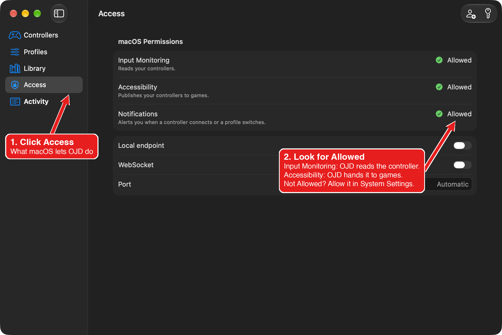
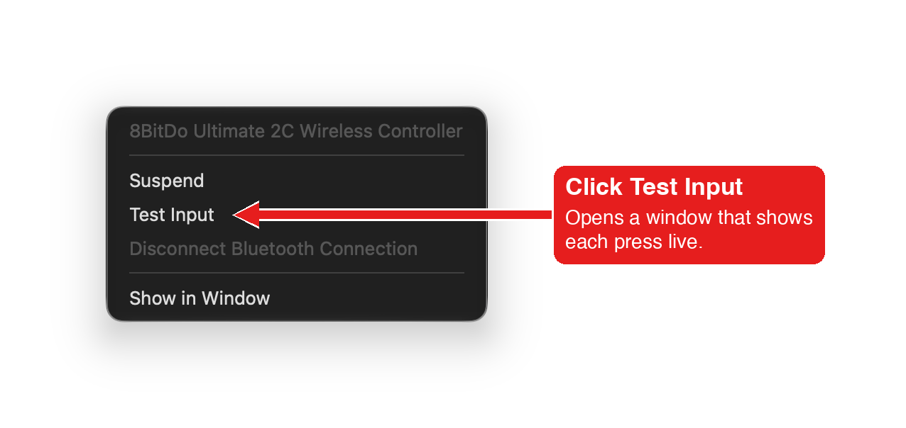

# Frequently Asked Questions

Short answers to common questions about OpenJoystickDriver (OJD).

Each answer is a sentence or two and links to the page with the full story. Find your question under its topic below.

## Contents

- [About OpenJoystickDriver](#about-openjoystickdriver)
- [Setting Up](#setting-up)
- [Controllers](#controllers)
- [Games and Apps](#games-and-apps)
- [Your Data and Updates](#your-data-and-updates)
- [Getting Help](#getting-help)
- [Further Reading](#further-reading)

## About OpenJoystickDriver

### What Does OpenJoystickDriver Do?

It makes controllers that your Mac doesn't support work with Mac games, as a [virtual gamepad](Glossary.md#terms). It can also turn buttons into keys, clicks, and pointer movement. See [Getting Started](Getting-Started.md).

### Is It Free?

Yes. OJD is open source under the Mozilla Public License 2.0. The code is on [GitHub](https://github.com/xsyetopz/OpenJoystickDriver).

### Which Macs Does It Run On?

Any Apple silicon or Intel Mac with macOS 12 (Monterey) or later.

### Is It Finished?

No. OJD is alpha software. Some controllers are untested on real hardware, and some games don't read the virtual gamepad. See [Known Issues](Known-Issues.md).

## Setting Up

### Where Is the App After I Open It?

In the menu bar. Click the controller icon and choose **Open OpenJoystickDriver**. To add a Dock icon, turn on **Show in Dock** in **Settings**. See [Find the Menu-Bar Icon](Getting-Started.md#find-the-menu-bar-icon).

### Why Does OJD Ask for Input Monitoring and Accessibility?

**Input Monitoring** lets OJD read your controller. **Accessibility** lets it run the virtual gamepad and send keys and pointer movements. See [Permissions](Permissions-and-Security.md#permissions).

### How Do I Allow the Permissions?

Choose Apple menu > **System Settings** > **Privacy & Security**. Click **Input Monitoring** and turn on **OpenJoystickDriver**. Go back, click **Accessibility**, and turn it on there too. On macOS 27, Accessibility is called **Device Control and Data Access**. See the [pictures for each step](Permissions-and-Security.md#grant-input-monitoring-and-accessibility).

### OpenJoystickDriver Isn't in the List. What Do I Do?

Click **+** under the list, choose **OpenJoystickDriver** in **Applications**, and turn on its switch. See [If OpenJoystickDriver Isn't in the List](Permissions-and-Security.md#if-openjoystickdriver-isnt-in-the-list).

### How Do I Know the Permissions Are On?

Open OJD and click **Access** in the sidebar. Each permission says **Allowed**.

### Do I Need to Turn Off SIP or AMFI?

No. SIP (System Integrity Protection) and AMFI (Apple Mobile File Integrity) are safety locks built into macOS. OJD installs no kernel extension, so you keep both turned on.

### Does OJD Start When I Log In?

On macOS 13 or later, yes. Turn off **Start at login** in **Settings** to stop it. See [Allow the Login Item](Getting-Started.md#allow-the-login-item).

### Do I Need the Xbox USB Driver?

Only for an Xbox One or Xbox Series controller on a USB cable. You approve the [Xbox USB driver](Glossary.md#terms) once in **System Settings**. See [Xbox USB Driver](Connecting-Controllers.md#xbox-usb-driver).

### How Do I Turn On the Driver Extension?

Choose Apple menu > **System Settings** > **General** > **Login Items & Extensions**. Scroll to **Extensions**, click **By Category**, then the **(i)** beside **Driver Extensions**. Turn on **OpenJoystickDriver** and click **Done**. See the [pictures for each step](Connecting-Controllers.md#approve-the-driver).

### Do I Need Xcode?

Only to build OJD from source with the Xbox USB driver and Shortcuts actions. With only the Command Line Tools and the swift.org toolchain, the build leaves both out. See [Building From Source](Building-from-Source.md).

## Controllers

### Will My Controller Work?

Check [Supported Controllers](Supported-Controllers.md), or connect it and look for its name in the menu-bar menu.

### How Do I Connect a Controller over Bluetooth?

Put it in pairing mode. Choose Apple menu > **System Settings** > **Bluetooth**, point at it under **Nearby Devices**, and click **Connect**. See the [picture](Connecting-Controllers.md#connect-over-bluetooth).

### How Do I Check That My Controller Works?

Select it in **Controllers** and click **Open Input Test**. See [Testing a Controller](Testing-a-Controller.md).

### What Does Working Mean?

**Working** under a controller's name means OJD reads it and games can use it. Any other word comes with a line that says what to do next.

### Can I Use Several Controllers at Once?

Yes. Each gets its own virtual gamepad. See [How Games See Your Controller](Playing-Games.md#how-games-see-your-controller).

### Why Does My Controller Say Handled by macOS?

macOS already supports it, so OJD shows no virtual gamepad and games read it through macOS. For some controllers, the **Handled by** menu changes this. See [Controllers Area](Using-the-App.md#controllers-area).

### Why Does My Clone Controller Act Differently?

A clone can look like the original but send different data inside. So OJD may work with it fully, partly, or not at all. See [Clone and Fake Controllers](Supported-Controllers.md#clone-and-fake-controllers).

### Can I Add a Controller That Isn't Supported?

Yes, with a mod: a folder that adds or changes a [controller record](Controller-Records.md). You can't edit records inside the app. See [Add Support for a Controller](Start-Add-Support-for-a-Controller.md), [Writing Controller Mods](Writing-Controller-Mods.md), or [report a bug](Reporting-a-Bug.md) to ask.

## Games and Apps

### Why Does My Controller Work in One App but Not Another?

Apps listen for different kinds of gamepad. Steam and many games read the default Xbox-style virtual gamepad. Safari and some Mac games only read a different kind. See [Game Does Not See the Controller](Troubleshooting.md#game-does-not-see-the-controller).

### What Is the Virtual Gamepad Kind?

The [virtual gamepad kind](Glossary.md#terms) is the kind of controller games think you have. Keep **Automatic** unless a game shows no input. Pick **For Steam and SDL games** for Steam, emulators, and games built with SDL (a common toolkit for reading controllers). Pick **For Apple Game Controller games** for Safari and Mac games that use Apple's controller support. See [Virtual Gamepad Kind](Using-the-App.md#virtual-gamepad-kind).

### Does OJD Work with Steam?

Yes, with the default [virtual gamepad kind](Glossary.md#terms). The maintainer saw every control and rumble work on macOS 27, and one tester saw an extra controller with no input. See [Game and App Compatibility](Playing-Games.md#game-and-app-compatibility).

### Does Rumble Work in Games?

It should, if the controller has motors and uses the default virtual gamepad. Rumble in games is untested on real hardware, and game lighting doesn't reach the controller. See [Rumble and Lighting](Playing-Games.md#rumble-and-lighting).

### Can I Use My Controller as a Mouse or Keyboard?

Yes, with a [profile](Glossary.md#terms). See [Control the Mac with a Controller](Start-Control-the-Mac.md) and [Profiles](Remapping-Profiles.md).

## Your Data and Updates

### Does OJD Connect to the Internet?

Only to check GitHub for updates, when you click **Check Now** or turn on **Check for updates automatically** (off by default). It sends no controller data and installs nothing. See [How Update Checks Work](Updating-and-Uninstalling.md#how-update-checks-work).

### How Do I Update OJD?

Download the later disk image from [GitHub Releases](https://github.com/xsyetopz/OpenJoystickDriver/releases) and replace the app. Profiles and settings stay. See [Install an Update](Updating-and-Uninstalling.md#install-an-update).

### Where Does OJD Keep My Data?

Profiles and records are in `~/Library/Application Support/OpenJoystickDriver/`, logs in `~/Library/Logs/OpenJoystickDriver/`, and settings in the `com.openjoystickdriver` preferences domain. See [Data on Your Mac](Permissions-and-Security.md#data-on-your-mac).

### How Do I Remove OJD?

Quit OJD and move it to the Trash. Your data stays until you remove it. See [Uninstall](Updating-and-Uninstalling.md#uninstall).

## Getting Help

### What Do I Do When Something Doesn't Work?

Try [Troubleshooting](Troubleshooting.md), then [Known Issues](Known-Issues.md), then [report a bug](Reporting-a-Bug.md).

### How Do I Report a Bug?

Choose **Help** > **Copy Support Report** and paste it into a GitHub issue with what happened. Read it before you share it. See [Reporting a Bug](Reporting-a-Bug.md).

### When Do I Get a Fix?

In the next tester build or release, which the maintainer links from the issue. See [Get a Fix](Updating-and-Uninstalling.md#get-a-fix).

## Further Reading

- [Getting Started](Getting-Started.md)
- [Troubleshooting](Troubleshooting.md)
- [Known Issues](Known-Issues.md)
- [Glossary](Glossary.md)
