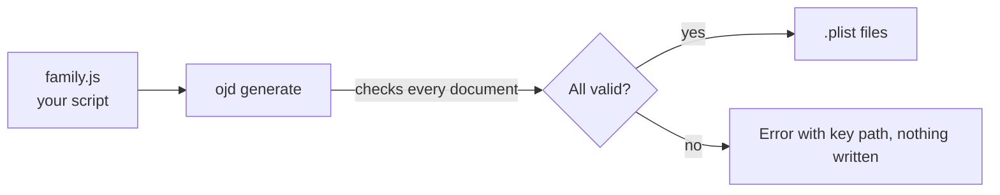

# Generating Documents with Scripts

Use a script to make many similar documents, such as one record for each product in a controller family. Write a JavaScript file that returns controller records, patches, [profiles](Glossary.md#terms), or [virtual gamepads](Glossary.md#terms). `ojd generate` checks the result and writes property list files. For one controller, a [record or a patch](Support-Ladder.md) is simpler.

`ojd generate` is the only part of OpenJoystickDriver (OJD) that runs a script. OJD never runs a script in a [mod package](Writing-Controller-Mods.md).

- **Who:** people who write many similar records or profiles.
- **What:** a JavaScript file that `ojd generate` turns into checked `.plist` files.
- **When:** several models differ by only a few details.
- **Why:** one script replaces many hand-copied files.
- **How:** write the script, run `ojd generate`, then install the files it writes.



## The Generate Function

Define a function `generate` with no argument. It returns one document or a list. A document is an object with the keys of its property list. Its `kind` is one of `Controller`, `ControllerPatch`, `Profile`, or `VirtualDevice`.

`ojd generate` refuses:

- `null`, no value, or a value that is not an object
- an empty list, or a list with a non-object item
- a document that holds `null` anywhere (leave the key out)
- a document its reader refuses. The error names the document, key path, and rule.

If one document fails, the command writes none.

The script runs in a sealed box. It can't read files, use the network, start programs, or set timers. It can only build documents and hand them back. A call to `fetch` fails with a reference error. A type annotation is a syntax error. The command reports a syntax error or exception with its message and line number.

A whole number becomes an `<integer>`. A fractional number becomes a `<real>`. A hexadecimal literal such as `0x1209` is a whole number.

## The Example Script

This script returns three controllers with one input layout. Save it as `pads.js`.

```javascript
function generate() {
  var buttons = ["South", "East", "West", "North", "LeftShoulder", "RightShoulder", "Back", "Start"];
  var sticks = ["LeftStickX", "LeftStickY", "RightStickX", "RightStickY"];
  return [1, 2, 3].map(function (productID) {
    return {
      apiVersion: "openjoystickdriver/v1alpha3",
      kind: "Controller",
      vendorID: 0x1209,
      productID: productID,
      modes: [{ id: "default", protocol: { family: "HIDReportLayout" } }],
      input: {
        layouts: [{
          report: { length: { atLeast: 8 } },
          buttons: buttons.map(function (control, bit) {
            return { control: control, bitOffset: bit, bitSize: 1 };
          }),
          hat: [{ bitOffset: 8, bitSize: 4, encoding: "EightWay" }],
          axes: sticks.map(function (control, index) {
            return { control: control, bitOffset: 16 + 8 * index, bitSize: 8 };
          }),
          leftTrigger: { bitOffset: 48, bitSize: 8 },
          rightTrigger: { bitOffset: 56, bitSize: 8 }
        }]
      }
    };
  });
}
```

`1209` is a pid.codes test vendor ID. Use it only for testing. In a file you share, use the real vendor and product numbers (VID and PID).

## Run the Script

1. Print the documents without a file:

   ```text
   ojd generate pads.js
   ```

2. Write them into a folder:

   ```text
   ojd generate pads.js --output Controllers
   ```

The command writes one file per document, named the way OJD names that kind of file, such as `1209-0001.plist`. It creates the folder if it is missing.

An existing file with the same content is reported as unchanged. A file with different content stops the command, which names the file and writes nothing. Pass `--replace` to overwrite it.

If two documents need the same file name, the command reports an error and writes none.

## Set the Time Limit

The script runs in a helper process with a 5 second limit. Use `--timeout SECONDS` to change it. A script past the limit gives error `E2010` and writes no file.

## Further Reading

- [Command Reference](Command-Reference.md#generate)
- [Controller Records](Controller-Records.md)
- [Writing Controller Mods](Writing-Controller-Mods.md)
