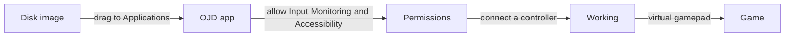

# Getting Started

Install OpenJoystickDriver, allow what it needs, connect a controller, and see it work.

- **Who:** anyone using OpenJoystickDriver for the first time.
- **What:** install the app, allow two permissions, connect a controller.
- **When:** once, on each Mac.
- **Where:** your Applications folder, then System Settings, then the menu bar.
- **Why:** games see the controller only after OJD can read it and pass it on.
- **How:** follow the numbered steps below; it takes about five minutes.

## Contents

- [About OpenJoystickDriver](#about-openjoystickdriver)
- [Installing OpenJoystickDriver](#installing-openjoystickdriver)
- [Quickstart](#quickstart)
- [Further Reading](#further-reading)

## About OpenJoystickDriver

OpenJoystickDriver (OJD) is a menu-bar app that makes game controllers work with Mac games. Think of it as a translator. Your controller speaks one language, and many games only understand another. OJD reads the controller over USB, Bluetooth, or a 2.4 GHz wireless dongle and shows it to games as a [virtual gamepad](Glossary.md#terms) they understand.

A [profile](Glossary.md#terms) can also make controller buttons press keys, click the mouse, move the pointer, or scroll. See [Remapping Profiles](Remapping-Profiles.md).

You don't turn off any Mac security to use OJD. It needs no kernel extension and no change to System Integrity Protection or Apple Mobile File Integrity. Xbox One and Xbox Series controllers on a USB cable can use the [Xbox USB driver](Glossary.md#terms). See [Connecting Controllers](Connecting-Controllers.md#xbox-usb-driver).

> [!NOTE]
> OJD is alpha software. Some controllers are untested on real hardware, and some games don't read the virtual gamepad. See [Supported Controllers](Supported-Controllers.md) and [Game and App Compatibility](Playing-Games.md#game-and-app-compatibility).

## Installing OpenJoystickDriver

You need a Mac with macOS 12 (Monterey) or later and a controller from [Supported Controllers](Supported-Controllers.md).

1. Open the OpenJoystickDriver disk image.
2. Drag **OpenJoystickDriver.app** onto **Applications**.
3. Eject the disk image.
4. Open **OpenJoystickDriver** from the Applications folder.

> [!IMPORTANT]
> Keep the app in `/Applications`. The login item and Xbox USB driver commands refuse to run from another folder.

### Find the Menu-Bar Icon

OJD has no Dock icon and opens no window at first. Click the controller icon in the menu bar, then choose **Open OpenJoystickDriver**. The icon turns into a warning triangle when something needs attention.

To add a Dock icon, turn on **Show in Dock** in **Settings** > **General**. See [Settings Window](Using-the-App.md#settings-window).

### Allow the Login Item

On macOS 13 or later, OJD starts when you log in, so your controllers work without opening it. If macOS asks, open Apple menu > **System Settings** > **General** > **Login Items & Extensions** and turn on **OpenJoystickDriver**. On macOS 12, open the app yourself after you log in.

To stop this, turn off **Start at login** in **Settings**, or run `ojd setting set launchAtLogin false`.

## Quickstart

### Allow the Permissions OJD Needs

OJD needs two macOS permissions. **Input Monitoring** lets it read your controller, and **Accessibility** lets it pass the controller on to games. On macOS 27, Accessibility is called **Device Control and Data Access**.

1. Click the menu-bar icon and choose **Open OpenJoystickDriver**.
2. On **Finish Setting Up**, click **Request...** next to each permission.
3. When macOS asks, allow OpenJoystickDriver. If it doesn't ask, turn it on in **System Settings** > **Privacy & Security**. [Step-by-step pictures](Permissions-and-Security.md#grant-input-monitoring-and-accessibility).
4. Click **Done**.

If the window shows **Permission needed** instead, click **Grant Access**. If the menu shows **Permission Missing**, click that row. After you allow a permission, click **Restart OpenJoystickDriver** in the **Access** area if it appears.

**Check:** click **Access**. Both permissions say **Allowed**.

### Connect a Controller

Connect your controller by USB cable, Bluetooth, or dongle. Its name appears in the menu-bar menu. A genuine Xbox One or Xbox Series controller on USB also needs the Xbox USB driver turned on. See [Approve the Driver](Connecting-Controllers.md#approve-the-driver).

### See the Controller Work

1. In the app window, click **Controllers** and select your controller.
2. Click **Open Input Test**.
3. Press buttons and move the sticks.

**Working** under the controller's name means OJD reads it and games can use it. Any other word comes with a line that says what to do next. In the Input Test window, the status reads **Input active** while OJD receives input. See [Testing a Controller](Testing-a-Controller.md).

### Play a Game

Start the game. It reads the virtual gamepad as if it were your controller. If the Input Test shows nothing, see [Controller Is Not Detected](Troubleshooting.md#if-a-controller-isnt-detected). If the game shows no input, see [Game Does Not See the Controller](Troubleshooting.md#game-does-not-see-the-controller).

## Further Reading

- [Using the App](Using-the-App.md)
- [Security Model](Permissions-and-Security.md#security-model)
- [Permissions](Permissions-and-Security.md#permissions)
- [Testing a Controller](Testing-a-Controller.md)
- [Supported Controllers](Supported-Controllers.md)
- [Connecting Controllers](Connecting-Controllers.md)
- [Updating OpenJoystickDriver](Updating-and-Uninstalling.md)
