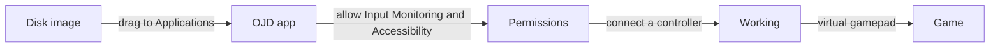
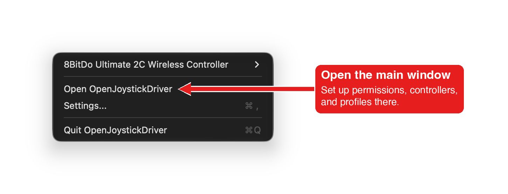
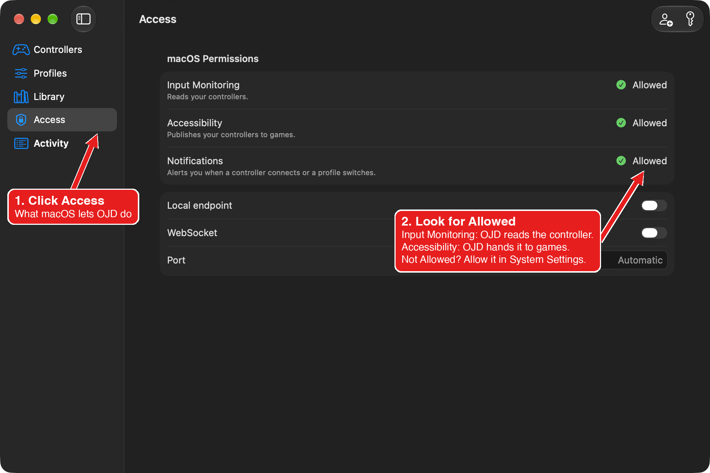

# Getting Started

Install OpenJoystickDriver, allow what it needs, connect a controller, and see it work. It takes about five minutes, once per Mac.

## Contents

- [About OpenJoystickDriver](#about-openjoystickdriver)
- [Installing OpenJoystickDriver](#installing-openjoystickdriver)
  - [Find the Menu-Bar Icon](#find-the-menu-bar-icon)
  - [Allow the Login Item](#allow-the-login-item)
- [Quickstart](#quickstart)
  - [Allow the Permissions OJD Needs](#allow-the-permissions-ojd-needs)
  - [Connect a Controller](#connect-a-controller)
  - [See the Controller Work](#see-the-controller-work)
  - [Play a Game](#play-a-game)
- [Further Reading](#further-reading)

## About OpenJoystickDriver

OpenJoystickDriver (OJD) is a menu-bar app, like a translator. Your controller speaks one language and many Mac games speak another. OJD reads the controller over USB, Bluetooth, or a 2.4 GHz dongle and shows games a [virtual gamepad](Glossary.md#terms).

OJD needs no kernel extension, and you don't turn off any Mac security. For the [Xbox USB driver](Glossary.md#terms), see [Connecting Controllers](Connecting-Controllers.md#xbox-usb-driver).

> [!NOTE]
> OJD is alpha software. Some controllers are untested, and some games ignore the virtual gamepad. See [Supported Controllers](Supported-Controllers.md) and [Game Compatibility](Playing-Games.md#game-and-app-compatibility).

## Installing OpenJoystickDriver

You need macOS 12 (Monterey) or later and a [supported controller](Supported-Controllers.md).

1. Open the OpenJoystickDriver disk image.
2. Drag **OpenJoystickDriver.app** onto **Applications**.
3. Eject the disk image.
4. Open **OpenJoystickDriver** from Applications.

> [!IMPORTANT]
> Keep the app in `/Applications`. The login item and Xbox USB driver commands refuse to run elsewhere.

### Find the Menu-Bar Icon

OJD has no Dock icon. Click its menu-bar icon, then choose **Open OpenJoystickDriver**. A warning triangle means something needs attention.

For a Dock icon, turn on **Show in Dock** in **Settings** > **General**. See [Settings Window](Using-the-App.md#settings-window).

### Allow the Login Item

On macOS 13 or later, OJD starts at login. If macOS asks, turn on **OpenJoystickDriver** in Apple menu > **System Settings** > **General** > **Login Items & Extensions**. On macOS 12, open the app yourself.

To stop it, turn off **Start at login** in **Settings**, or run `ojd setting set launchAtLogin false`.

## Quickstart

### Allow the Permissions OJD Needs

**Input Monitoring** reads your controller. **Accessibility** (**Device Control and Data Access** on macOS 27) passes it to games.

1. Open the app from the menu-bar icon.
2. On **Finish Setting Up**, click **Request...** next to each permission.
3. Allow OpenJoystickDriver when macOS asks. No prompt? Turn it on in **System Settings** > **Privacy & Security**. See the [pictures](Permissions-and-Security.md#grant-input-monitoring-and-accessibility).
4. Click **Done**.

Click **Grant Access**, **Permission Missing**, or **Restart OpenJoystickDriver** if you see one.

**Check:** **Access** says **Allowed** twice.

### Connect a Controller

Plug in a USB cable, or pair by Bluetooth or dongle. Its name appears in the menu-bar menu. Genuine Xbox One or Series controllers on USB also need the driver: see [Approve the Driver](Connecting-Controllers.md#approve-the-driver).

### See the Controller Work

1. In the app window, click **Controllers** and select your controller.
2. Click **Open Input Test**.
3. Press buttons and move the sticks.

**Working** means games can use it. Any other status says what to do next. See [Testing a Controller](Testing-a-Controller.md).

### Play a Game

Start the game.

| Problem | Go to |
| --- | --- |
| Input Test shows nothing | [Controller Is Not Detected](Troubleshooting.md#if-a-controller-isnt-detected) |
| Game shows no input | [Game Does Not See the Controller](Troubleshooting.md#game-does-not-see-the-controller) |

## Further Reading

[Using the App](Using-the-App.md) and [Updating OpenJoystickDriver](Updating-and-Uninstalling.md).
