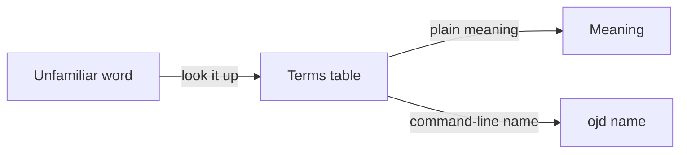
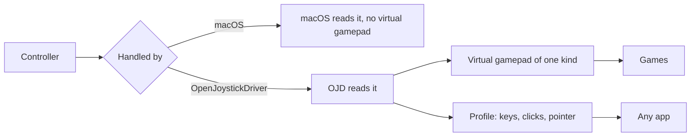
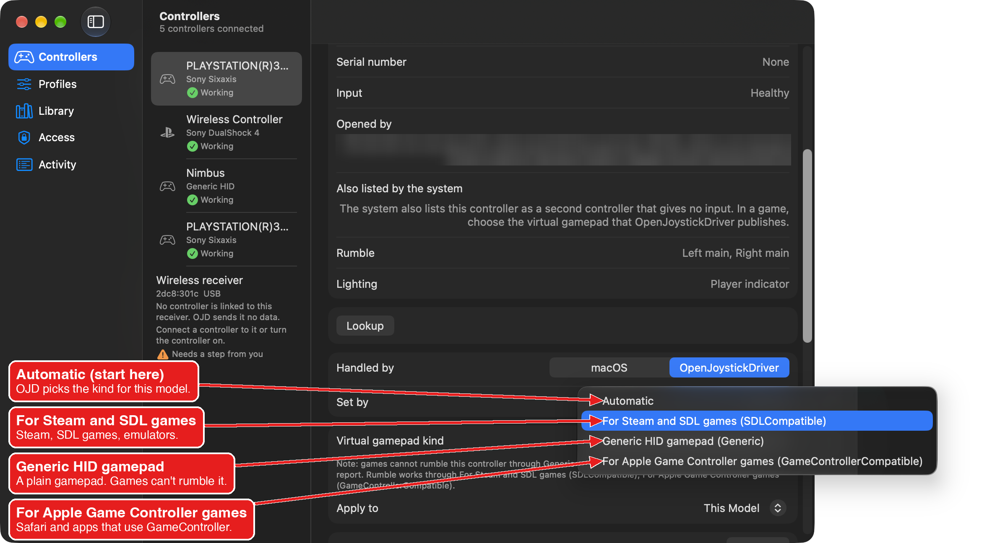

# Glossary

Look up the words OpenJoystickDriver uses. Each word means the same in the app, its menus, the command-line help, and this guide. **Replaces** lists older or casual words for the same thing. **Command line** shows the name the `ojd` tool uses.

Other pages link each word to the **Terms** table below, so the app and the guide never disagree.

## Terms

| Term | Definition | Replaces | Command line |
| --- | --- | --- | --- |
| profile | A list of rules that changes what each button, stick, or trigger does. For example, a profile can make the A button press the Space bar. | "remapping profile" | `ojd profile` |
| virtual gamepad | A pretend gamepad that OpenJoystickDriver makes in software. Games see it instead of your real controller, like a stand-in actor that copies every move. | "virtual device", "virtual controller", "Virtual HID profile", "persona" | `ojd virtual`, the `persona` key of a virtual gamepad file |
| virtual gamepad kind | Which kind of gamepad the stand-in pretends to be. Pick the one your game reads best: "For Steam and SDL games", "For Apple Game Controller games", or "Generic HID gamepad". | "persona", "profile" for this choice, the raw identifiers in Simple | `SDLCompatible`, `GameControllerCompatible`, `Generic` |
| Handled by macOS | macOS reads the controller by itself. OpenJoystickDriver stays out of the way and makes no virtual gamepad for it. | "Served by", "Left to macOS", "macOS (native)" | `server` `system` (`System` in JSON), `ojd controller release` |
| Handled by OpenJoystickDriver | OpenJoystickDriver reads the controller and passes its input to games through a virtual gamepad. | "Served by", "OpenJoystickDriver (virtual)" | `server` `ojd` (`OJD` in JSON), `ojd controller claim` |
| Xbox USB driver | A small add-on that OpenJoystickDriver installs in macOS so it can read Xbox controllers plugged in by USB cable. | "driver extension", "system extension", "transport extension", "USB extension", "DriverKit", "dext" | `ojd transport-extension` |
| connection | How the controller reaches the Mac: a cable, a wireless receiver, or Bluetooth. | "transport", "Wireless Link" | `connection` |
| mode | A setting you pick on the controller itself, with a switch or a button combination, such as XInput or DInput. Some controllers act like a different controller in each mode. | "protocol" where it names this setting | `modes` in a controller record |
| endpoint | A private door on your Mac where your own programs can connect to OpenJoystickDriver to hear controller events or drive a virtual gamepad. It's off until you turn it on in Access. | | `ojd access enable` |
| socket | The door's address inside your Mac: a file path that only programs on this Mac can open. It exists only while the endpoint is on. | | `socketPath` in `ojd --json access status` |
| token | A named password you make in Access and give to one program or web page. OpenJoystickDriver shows it once, so copy it right away. Revoke it to lock that program out again. | | `ojd access grant --token NAME` |
| scope | What a token lets a program do: **Read** hears controller events, **Control** drives a virtual gamepad. A token for a web page can't have Control. | | `--scope read`, `--scope control` |

How the main terms fit together:

Where you pick the virtual gamepad kind in the app:

## Rules

- The command line keeps every command, flag, schema value, and error code as it is, so scripts get the same output. Each term's row names the value it stands for.
- In All Controls, the app shows the command-line value next to the term. In Simple, it shows only the term. See [Using the app](Using-the-App.md).
- An error message about a file writes the file's key exactly as the file spells it, such as `persona`.
- A place in System Settings keeps the name macOS shows, such as "Driver Extensions".
- "Protocol" means the language a controller and the Mac speak to each other, as in `ojd protocol`.
- Each language translates a term one way only. See [LOCALIZATION.md](../LOCALIZATION.md).

## Further Reading

- [Using the App](Using-the-App.md)
- [Command Reference](Command-Reference.md)
- [Playing Games](Playing-Games.md)
