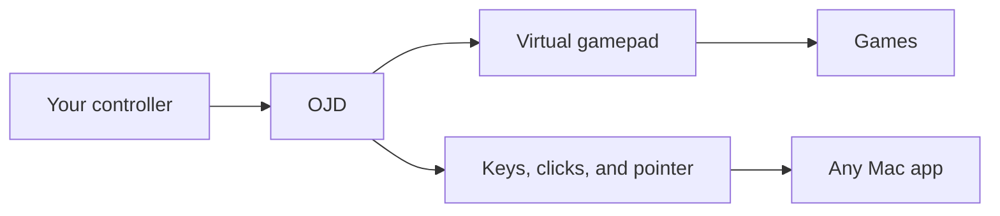
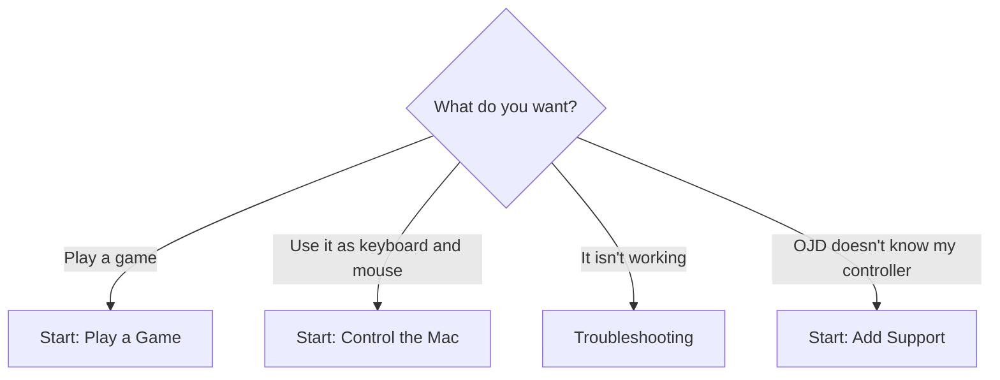

# OpenJoystickDriver Documentation

OpenJoystickDriver (OJD) makes game controllers that your Mac doesn't support work. For quick answers, read the [FAQ](FAQ.md).

Think of OJD as an interpreter. Your controller speaks its own language. OJD listens and repeats each press through a [virtual gamepad](Glossary.md#terms), a pretend controller that every game understands. It can also turn presses into keys and clicks.

- **Who:** anyone with a controller their Mac doesn't support.
- **What:** a menu-bar app that makes the controller work in games and apps.
- **Where:** start with [Start: Play a Game with a Controller](Start-Play-a-Game.md).
- **How:** install OJD, allow two permissions, connect the controller.

The main window shows each controller and what it's doing:

## Which Page Do I Need?

## Start Here

- [Play a Game with a Controller](Start-Play-a-Game.md): Install, connect, and play.
- [Control the Mac with a Controller](Start-Control-the-Mac.md): Press keys, click, and move the pointer.
- [Set Up OJD on Several Macs](Start-Set-Up-Several-Macs.md): Repeat the setup and copy profiles.
- [Add Support for a Controller](Start-Add-Support-for-a-Controller.md): Teach OJD a controller it does not know.

## Learn the Basics

- [Getting Started](Getting-Started.md): Install OJD and use your first controller.
- [Using the App](Using-the-App.md): Tour the menu, window, and Settings.
- [Testing a Controller](Testing-a-Controller.md): Check buttons, sticks, rumble, and lights.

## Controllers

- [Supported Controllers](Supported-Controllers.md): See which controllers work.
- [Connecting Controllers](Connecting-Controllers.md): Connect by USB, Bluetooth, or dongle, and use the [Xbox USB driver](Glossary.md#terms).
- [Wii Remote](Wii-Remote.md): Pair a Wii Remote.

## Games

- [Playing Games](Playing-Games.md): See how games see your controller.

## Remapping

- [Profiles](Remapping-Profiles.md): Create and share profiles.
- [Bindings and Actions](Bindings-and-Actions.md): Assign keys and actions to buttons.
- [Sticks, Triggers, Touchpad, and Motion](Sticks-Triggers-Touchpad-and-Motion.md): Adjust sticks, triggers, touchpads, and motion.
- [Profile File Reference](Profile-File-Reference.md): Look up profile files and limits.

## Your Mac

- [Permissions and Security](Permissions-and-Security.md): See what OJD needs and keeps.
- [Updating and Uninstalling](Updating-and-Uninstalling.md): Update or remove OJD.

## Help

- [FAQ](FAQ.md): Read short answers.
- [Troubleshooting](Troubleshooting.md): Fix common problems.
- [Known Issues](Known-Issues.md): See current problems and workarounds.
- [Error Codes](Error-Codes.md): Look up an error code.
- [Glossary](Glossary.md): Look up the words OJD uses.
- [Reporting a Bug](Reporting-a-Bug.md): Learn what to include.

## For Advanced Users

- [Using the Command Line](Command-Line.md): Control OJD from Terminal.
- [Command Reference](Command-Reference.md): Look up every `ojd` command.
- [Automating OpenJoystickDriver](Automating-OpenJoystickDriver.md): Script `ojd` and drive a virtual gamepad.
- [WebRTC Bridge](WebRTC-Bridge.md): Use a controller connected to another Mac.
- [Support Ladder](Support-Ladder.md): Find the smallest step that makes a controller work.
- [Controller Records](Controller-Records.md): Add or change how OJD drives a controller.
- [Controller Record Modes](Controller-Record-Modes.md): Offer alternative modes and describe a mode's session.
- [Writing Controller Mods](Writing-Controller-Mods.md): Bundle records, profiles, and patches.
- [Generating Documents with Scripts](Generating-Documents-with-Scripts.md): Make many records with a script.
- [Building From Source](Building-from-Source.md): Build OJD for a fix before the next tester build.

## Contributor Documentation

See the [contributor documentation](../docs/README.md).
