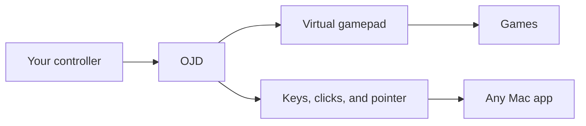
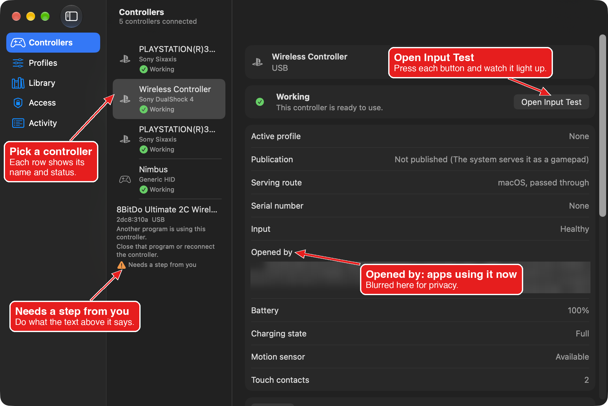
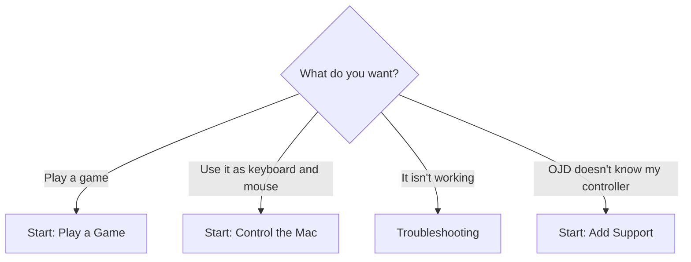

# OpenJoystickDriver Documentation

OpenJoystickDriver (OJD) makes game controllers that your Mac doesn't support work. Quick answers are in the [FAQ](FAQ.md).

Think of OJD as an interpreter. Your controller speaks its own language. OJD repeats each press through a [virtual gamepad](Glossary.md#terms), a pretend controller that every game understands. It can also turn presses into keys and clicks.

The main window shows each controller and what it's doing:

## Which Page Do I Need?

## Start Here

- [Play a Game with a Controller](Start-Play-a-Game.md)
- [Control the Mac with a Controller](Start-Control-the-Mac.md)
- [Set Up OJD on Several Macs](Start-Set-Up-Several-Macs.md)
- [Add Support for a Controller](Start-Add-Support-for-a-Controller.md)

## Learn the Basics

- [Getting Started](Getting-Started.md)
- [Using the App](Using-the-App.md)
- [Testing a Controller](Testing-a-Controller.md)

## Controllers

- [Supported Controllers](Supported-Controllers.md)
- [Connecting Controllers](Connecting-Controllers.md) (USB, Bluetooth, dongle, [Xbox USB driver](Glossary.md#terms))
- [Wii Remote](Wii-Remote.md)
- [Playing Games](Playing-Games.md)

## Remapping

- [Profiles](Remapping-Profiles.md)
- [Bindings and Actions](Bindings-and-Actions.md)
- [Sticks, Triggers, Touchpad, and Motion](Sticks-Triggers-Touchpad-and-Motion.md)
- [Profile File Reference](Profile-File-Reference.md)

## Your Mac

- [Permissions and Security](Permissions-and-Security.md)
- [Updating and Uninstalling](Updating-and-Uninstalling.md)

## Help

- [FAQ](FAQ.md)
- [Troubleshooting](Troubleshooting.md)
- [Known Issues](Known-Issues.md)
- [Error Codes](Error-Codes.md)
- [Glossary](Glossary.md)
- [Reporting a Bug](Reporting-a-Bug.md)

## For Advanced Users

- [Using the Command Line](Command-Line.md)
- [Command Reference](Command-Reference.md) (every `ojd` command)
- [Automating OpenJoystickDriver](Automating-OpenJoystickDriver.md)
- [WebRTC Bridge](WebRTC-Bridge.md)
- [Support Ladder](Support-Ladder.md) (smallest step that works)
- [Controller Records](Controller-Records.md)
- [Controller Record Modes](Controller-Record-Modes.md)
- [Writing Controller Mods](Writing-Controller-Mods.md)
- [Generating Documents with Scripts](Generating-Documents-with-Scripts.md)
- [Using Agent Skills](Using-Agent-Skills.md)
- [Building From Source](Building-from-Source.md)

## Contributor Documentation

See the [contributor documentation](../docs/README.md).
