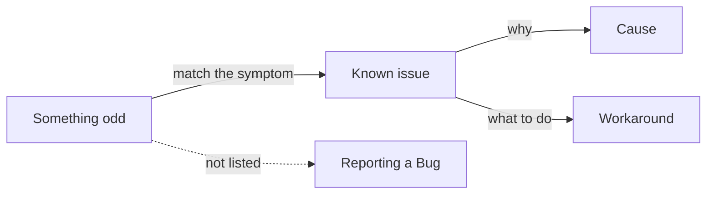
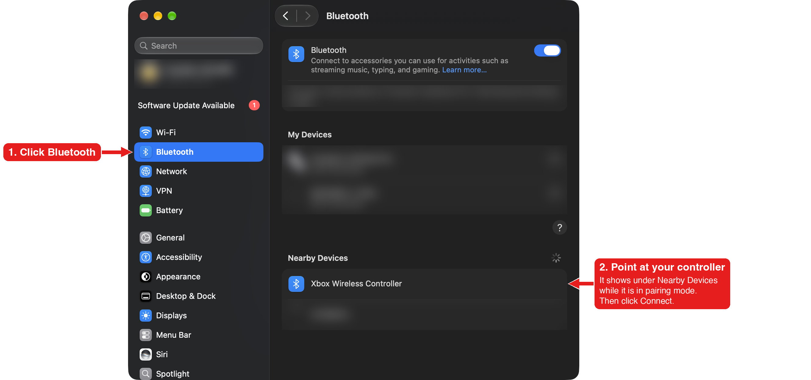
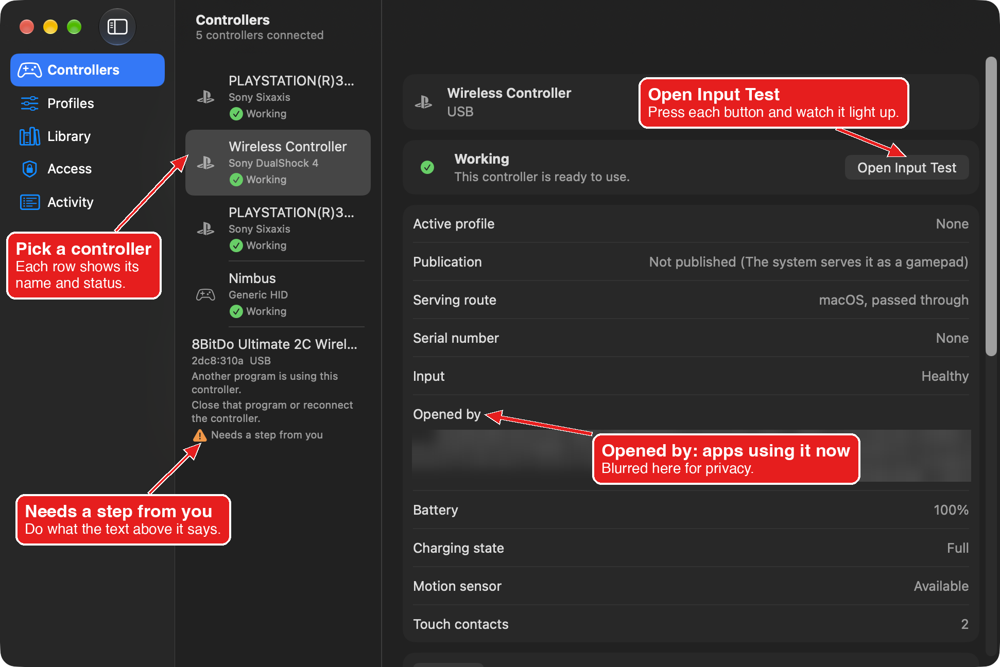

# Known Issues

Open bugs and limits in OpenJoystickDriver (OJD). Each one says what you'll notice, why it happens, and what to do.

- **Who:** anyone who hits a bug that isn't fixed yet.
- **What:** each issue with what you notice, why it happens, and what to do.
- **When:** before you report a bug.
- **How:** find the symptom below, then try its workaround.

## Two Controllers With One USB Serial Number

**What you notice:** two identical pads seem to swap places, or one looks like a different controller when you use another USB port.

**Why:** a serial number is meant to be unique, like a name tag. Some pads all wear the same tag, such as ID `057E:2009` with serial `000000000001`. OJD still gives each pad its own [virtual gamepad](Glossary.md#terms). The first pad to connect keeps the plain name tag. The second pad's tag adds its USB port.

**What to do:** keep each pad in the same USB port. After you unplug and replug, the pads may swap.

## A Pad Shows the Identity of a Switch Pro Controller

**What you notice:** a third-party pad in Switch mode shows up as a Switch Pro Controller.

**Why:** some pads borrow the Switch Pro Controller's ID `057E:2009` and serial `000000000001`. OJD treats every `057E:2009` pad as a Pro Controller, because the serial alone can't tell the models apart. These pads also send updates at their own speed, which OJD leaves alone.

**What to do:** run `ojd diagnose`. Its `switch-placeholder-serial` check names each such pad. The check only reports; it changes nothing.

## A Wii Remote May Not Pair With macOS

**What you notice:** the Wii Remote never shows up in OJD.

**Why:** macOS does the pairing, not OJD. If the remote isn't in **System Settings** > **Bluetooth**, OJD can't see it. Nobody has tested which macOS versions pair it with the 1 and 2 buttons or with the SYNC button.

**What to do:** see [Pair the Remote](Wii-Remote.md#pair-the-remote).

## Virtual Gamepads Carry No Pointer

**What you notice:** pointing the Wii Remote at the screen does nothing in a game.

**Why:** the pointer reaches your profile, not the game. The default and Generic [virtual gamepad kinds](Glossary.md#terms) carry only gamepad controls: buttons, sticks, and triggers.

**What to do:** bind the pointer to the mouse in a profile. Nobody has tested this on a real remote yet. See [IR Pointer](Wii-Remote.md#ir-pointer).

## Unplugging a USB Controller Can Crash the App

**What you notice:** OJD quits when you unplug a USB controller or dongle.

**Why:** reports come from macOS 27.0, when every controller on one USB hub disconnected at once. The suspected cause is a macOS plug-in being unloaded too early. OJD keeps that plug-in loaded for each controller. Nobody has confirmed that this stops the crash.

**What to do:** open OJD again. If old virtual gamepads stay listed in **System Settings**, restart OJD. See [Crash When You Unplug a Controller](Troubleshooting.md#crash-when-you-unplug-a-controller).

## The Xbox USB Driver Reads Only Seven Xbox Controllers

**What you notice:** a wired Xbox controller works differently from the ones on the list.

**Why:** Apple lets the [Xbox USB driver](Glossary.md#terms) match only seven USB IDs. They are listed in [Building from Source](Building-from-Source.md).

**What to do:** nothing. OJD reads other wired Xbox controllers through plain USB access, or macOS handles them itself.

## Another App Reads a USB Controller Directly

**What you notice:** the controller shows **Used by** and an app name, or "another program is using this controller". `ojd controller list` leaves it out.

**Why:** Steam, GOG Galaxy, Chrome, and other apps can grab a USB controller so nobody else can use it. While they hold it, OJD can't. That isn't an error.

**Where you see it:**

- `ojd status`, under unserved devices
- the **Controllers** list and the controller's details in the app
- `ojd controller show VVVV:PPPP`

**What to do:** quit that app. OJD takes the controller back as soon as the app lets go.

## Some Apps Don't Read the Virtual Gamepad

**What you notice:** the game ignores the controller even though OJD shows it working.

**Why:** CrossOver and some older games (built with SDL2 or IOHIDManager) may not read OJD's virtual gamepad. Steam does read it; that was tested with a GameSir G7 SE.

**What to do:** see [Game and App Compatibility](Playing-Games.md#game-and-app-compatibility).

## macOS Still Lists Its Own Pad for a DualShock 3

**What you notice:** Steam shows two DualShock 3 pads. One is OJD's virtual gamepad. The other is called "PLAYSTATION(R)3 Controller" and does nothing.

**Why:** OJD holds a USB DualShock 3 for itself, but macOS keeps its own copy in the list anyway. macOS won't hand a controller its own driver uses over to an app.

**What to do:** in the game, pick OJD's virtual gamepad and ignore the other one. In OJD, the controller's details say **Also listed by the system**.

If another app holds the pad, the details say "Owned by another app", and OJD gets no input until that app lets go. `ojd diagnose` has a `hid-input-drops` check. A warning there means macOS threw away some of the controller's input.

## The OJD Menu Closes While Steam Is Open

**What you notice:** the OJD menu-bar menu closes by itself.

**Why:** Steam jumps to the front whenever a controller sends input, and that closes the menu.

**What to do:** click the OJD icon again, or switch to another app first.

## Further Reading

- [Game Does Not See the Controller](Troubleshooting.md#game-does-not-see-the-controller)
- [Reporting a Bug](Reporting-a-Bug.md)
