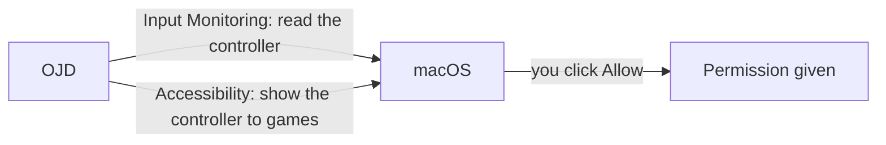
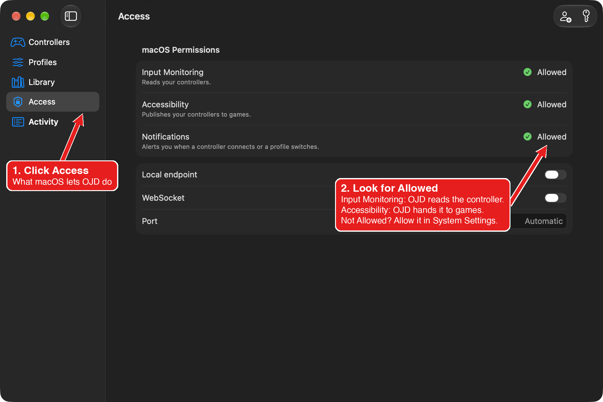
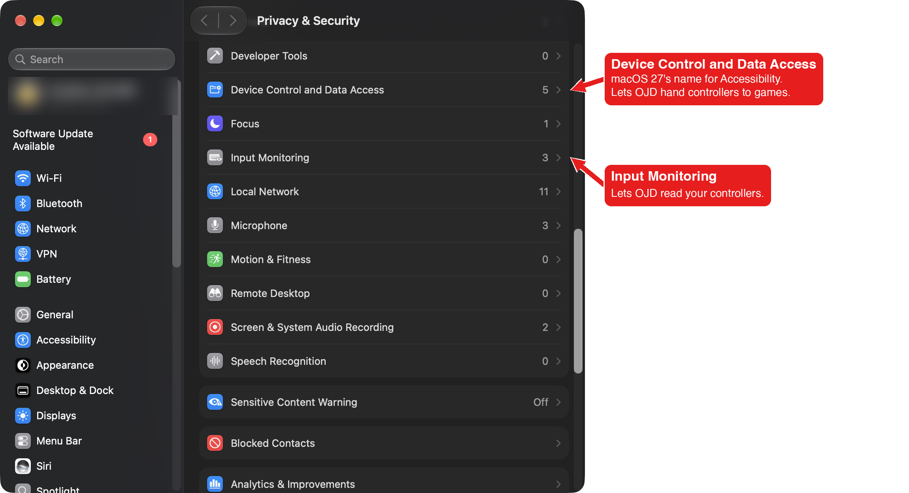
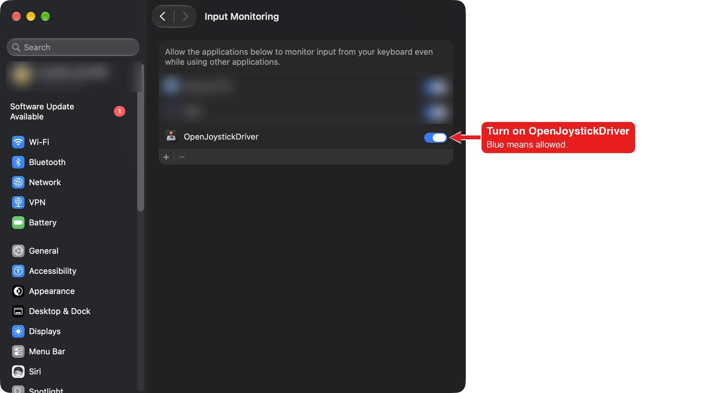

# Permissions and Security

Which macOS permissions OpenJoystickDriver (OJD) asks for, why, and how it stays safe.



## Contents

- [Security Model](#security-model)
- [Permissions](#permissions)
- [Further Reading](#further-reading)

## Security Model

macOS locks (System Integrity Protection, SIP, and Apple Mobile File Integrity, AMFI) stop apps from changing the system. OJD works with both on.

> [!WARNING]
> Never turn off SIP or AMFI for OJD. No feature needs it. A guide that says to is wrong.

### Signing

A signature is a sealed envelope: it proves who made the app and that nobody changed it. The maintainer signs release and tester builds with a Developer ID, and Apple checks them for malware ("notarizes" them).

### Xbox USB Driver

The [Xbox USB driver](Glossary.md#terms) runs outside the kernel (the core of macOS), and macOS asks your approval first. Only Xbox One and Series controllers on USB use it. See [Approve the Driver](Connecting-Controllers.md#approve-the-driver).

### Data on Your Mac

- [Profiles](Glossary.md#terms): `~/Library/Application Support/OpenJoystickDriver/` (only your user can read it)
- Logs: `~/Library/Logs/OpenJoystickDriver/`
- Settings: `com.openjoystickdriver` preferences domain

OJD uses the internet only to check GitHub for updates, when you click **Check Now** or, if **Check for updates automatically** is on (off by default), at launch. It sends no controller data.

### Endpoint Access

The endpoint is a private door for other programs on your Mac, such as a stream overlay. Nothing outside your Mac can reach it.

- It's closed until you click **Turn On** in **Access** or run `ojd access enable`.
- Each program needs a grant: `read` to watch, or `control` to press buttons on a virtual gamepad.
- A grant is tied to the program's signature, so another program can't pretend to be it. Ad-hoc or unsigned programs are refused. `ojd access list` shows programs refused in the last 24 hours.
- Web pages use `ojd access web enable`, a WebSocket on `127.0.0.1` (your Mac only). A page needs a token from `ojd access grant --token` and can only read. See [access](Command-Reference.md#access).

### Support Report

**Help** > **Copy Support Report** copies a report to the clipboard and saves nothing. It holds service status, virtual gamepad details, permission state, build version, and device product names, but no serial numbers, file paths, packet data, or location IDs. Read it before sharing.

## Permissions

OJD asks only when you click **Request...**, **Open System Settings**, or **Grant Access**, or run `ojd permission request`. It asks for nothing at launch.

### Permissions the App Uses

| Permission | What it's for | When you need it |
| --- | --- | --- |
| Input Monitoring | Reads input from a controller | Always |
| Accessibility (Device Control and Data Access on macOS 27) | Shows your controllers to games | Always |
| Keyboard & pointer | Sends keys, mouse, scroll, system keys, and typed text | When a profile does this |
| Notifications | Shows alerts | Optional |

OJD uses no camera, microphone, or Full Disk Access. It uses Bluetooth only to disconnect a wireless controller and to connect a Switch 2 controller.

### Grant Input Monitoring and Accessibility

Without both, games see nothing. Only you can turn them on.

**Check first.** Click **Access**. **Allowed** beside both means you're done.



**Turn them on:**

1. In OJD, click **Grant Access** in the **Permission needed** banner. Or choose Apple menu > **System Settings**, then **Privacy & Security**.
2. Find the two rows.

   

3. Click **Input Monitoring**. Turn on **OpenJoystickDriver** (blue means on).

   

4. Go back. Click **Accessibility** (**Device Control and Data Access** on macOS 27). Turn on **OpenJoystickDriver**.

   

5. In OJD, click **Restart OpenJoystickDriver** in **Access** if it appears.

### If OpenJoystickDriver Isn't in the List

macOS remembers its answer per build. An old answer can make it say no silently, with no prompt and no list entry.

**Add it by hand:** click **+** under the list, choose **OpenJoystickDriver** in **Applications**, click **Open**, then turn on its switch.

**Or clear the answers** in Terminal, then click **Grant Access** again:

```sh
tccutil reset ListenEvent com.openjoystickdriver
tccutil reset PostEvent com.openjoystickdriver
tccutil reset Accessibility com.openjoystickdriver
```

### Turn On Notifications

1. Choose OpenJoystickDriver > **Settings...**, then turn on a notification switch or click **Send Test Notification**.
2. Click **Allow** in the macOS prompt. Denied before? Click **Open Notification Settings** and turn on **Allow notifications**.


### Approve the Xbox USB Driver

Approve it in **General**: see [Approve the Driver](Connecting-Controllers.md#approve-the-driver).

### Details for Advanced Users

The app holds these permissions. The `ojd` command never sends keyboard or mouse events.

- Post Event access (the macOS name for **Keyboard & pointer**) covers keyboard, mouse, scroll, system keys (media, volume, brightness, keyboard illumination), and typed text, all through `CGEvent.post`. Without it, the action fails. Typed text also fails while secure input is on (`IsSecureEventInputEnabled`).
- These need no permission of their own: open application, open URL, Mission Control (`NSWorkspace`), Run Shortcut (`/usr/bin/shortcuts run NAME`), MIDI output (virtual CoreMIDI source), Speak (`AVSpeechSynthesizer`).
- `ojd permission list` reads the service's permissions when it runs, and its own when it doesn't.

Untested: whether macOS attributes a `shortcuts` process's permission to the app, and whether **Keyboard & pointer** and **Accessibility** share one switch.

## Further Reading

- [Access Area](Using-the-App.md#access-area)
- [Game Does Not See the Controller](Troubleshooting.md#game-does-not-see-the-controller)
- [Reporting a Bug](Reporting-a-Bug.md)
