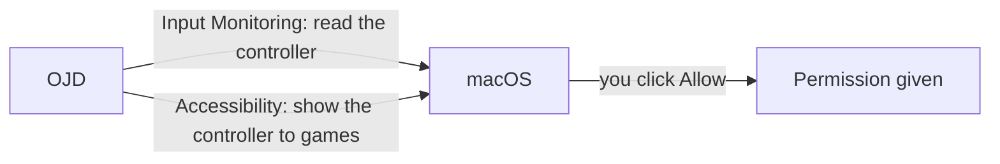

# Permissions and Security

Which macOS permissions OpenJoystickDriver (OJD) asks for, why it needs each one, and how it keeps your Mac safe.

- **Who:** anyone deciding whether to trust OJD with their Mac.
- **What:** each permission OJD asks for, and why.
- **When:** the first time you open OJD, and whenever macOS asks again.
- **Where:** System Settings > Privacy & Security, or the **Access** area of the app.
- **Why:** macOS blocks apps from reading controllers or showing them to games until you allow it.
- **How:** click **Request...** next to each permission in the **Access** area.



## Contents

- [Security Model](#security-model)
- [Permissions](#permissions)
- [Further Reading](#further-reading)

## Security Model

macOS has built-in locks that stop apps from changing the system: System Integrity Protection (SIP) and Apple Mobile File Integrity (AMFI). OJD works with both locks on.

> [!WARNING]
> Never turn off SIP or AMFI for OJD. No feature needs it. A guide that tells you to is wrong.

### Signing

A signature works like a sealed envelope: it proves who made the app and that nobody changed it. The maintainer signs the release app, and Apple checks it for malware ("notarizes" it). Tester builds are signed with a Developer ID and notarized too.

### Xbox USB Driver

The [Xbox USB driver](Glossary.md#terms) reads Xbox One and Xbox Series controllers that you connect with a USB cable. It runs outside the core of macOS (the kernel), so a driver problem stays out of the core. macOS asks for your approval before it runs. No other controller uses it. The driver only reads the controller, and the app hands the [virtual gamepad](Glossary.md#terms) to games. See [Approve the Driver](Connecting-Controllers.md#approve-the-driver).

### Data on Your Mac

- [Profiles](Glossary.md#terms) are in `~/Library/Application Support/OpenJoystickDriver/`. Only your user can read the folder.
- Logs are in `~/Library/Logs/OpenJoystickDriver/`.
- Settings are in the `com.openjoystickdriver` preferences domain.

OJD talks to the internet for one thing only: the update check. It contacts GitHub when you click **Check Now**, and at launch if **Check for updates automatically** is on (off by default). The app sends no controller data and doesn't update itself.

### Endpoint Access

The endpoint is a private door that lets other programs on your Mac, such as a stream overlay, read your controllers. Nothing outside your Mac can reach it. It's closed until you click **Turn On** in the **Access** area or run `ojd access enable`. Each program also needs its own pass (a grant) for each kind of access: `read` to watch the controller, or `control` to press buttons on a virtual gamepad, which games treat as your own presses.

A grant is tied to the program's signature (its developer's team ID, or Apple), so another program can't pretend to be it. Programs with a homemade (ad-hoc) signature or none at all are refused. `ojd access list` shows programs refused in the last 24 hours.

Web pages, such as a browser overlay, use a second door: `ojd access web enable` opens a WebSocket on `127.0.0.1` (your own Mac only). A page needs a token, a password from `ojd access grant --token`, and can only read, never `control`. See [access](Command-Reference.md#access).

### Support Report

**Help** > **Copy Support Report** copies a report about your setup to the clipboard, ready to paste into a bug report. The app doesn't save it anywhere. It holds service status, virtual gamepad details, permission state, the build version, and your devices' product names. It leaves out serial numbers, file paths, packet data, and location IDs. Read it before you share it.

## Permissions

OJD asks for nothing at launch. It asks only when you do one of these:

- Click **Request...** or **Open System Settings** in the **Access** area.
- Click **Grant Access** in the **Permission needed** banner.
- Run `ojd permission request`.

### Permissions the App Uses

| Permission | What it's for | When you need it |
| --- | --- | --- |
| Input Monitoring | Reads input from a controller | Always |
| Accessibility (Device Control and Data Access on macOS 27) | Shows your controllers to games | Always |
| Keyboard & pointer | Sends keyboard, mouse, and scroll events, including system keys and typed text | When a profile does this |
| Notifications | Shows alerts | Optional |

Open application, open URL, Mission Control, and Run Shortcut need no permission of their own. Which prompts they raise is untested.

The app doesn't use the camera, the microphone, or Full Disk Access. The app uses Bluetooth only to disconnect a wireless controller and to connect a Switch 2 controller. You see no Bluetooth prompt at launch.

### Grant Input Monitoring and Accessibility

- **What:** two switches in macOS System Settings.
- **Why:** with **Input Monitoring**, OJD can read your controller. With **Accessibility**, OJD can hand the controller to games. Without both, games see nothing.
- **When:** once, after you install OJD. Again if a later build asks.
- **Who:** you. macOS lets only you turn these on.

**Check first.** Open OJD and click **Access** in the sidebar. **Allowed** beside both means you're done.


**Turn them on:**

1. In OJD, click **Grant Access** in the **Permission needed** banner. Or choose Apple menu > **System Settings**, then click **Privacy & Security**.
2. Find the two rows. On macOS 27, **Accessibility** is called **Device Control and Data Access**.

   

3. Click **Input Monitoring**. Turn on **OpenJoystickDriver**. A blue switch means it's on.

   

4. Click the back arrow. Click **Device Control and Data Access** (**Accessibility** on older macOS). Turn on **OpenJoystickDriver**.

   

5. Go back to OJD. If **Restart OpenJoystickDriver** appears in **Access**, click it.

**Check:** **Access** shows **Allowed** twice.

### If OpenJoystickDriver Isn't in the List

macOS remembers its answer for each OJD build. An old answer for an earlier build can make macOS say no silently: no prompt, and no entry in the list.

**Add it by hand:** click **+** under the list, choose **OpenJoystickDriver** in **Applications**, and click **Open**. Then turn on its switch.

**Or clear the stored answers,** then click **Grant Access** again. In Terminal, run:

```sh
tccutil reset ListenEvent com.openjoystickdriver
tccutil reset PostEvent com.openjoystickdriver
tccutil reset Accessibility com.openjoystickdriver
```

### Turn On Notifications

Notifications are optional. They tell you when a controller connects or a profile switches.

1. Choose OpenJoystickDriver > **Settings...**, then turn on a notification switch. Or click **Send Test Notification**.
2. Click **Allow** in the macOS prompt.

If you denied them before, click **Open Notification Settings**. Then turn on **Allow notifications**.


### Approve the Xbox USB Driver

Only genuine Xbox One and Xbox Series controllers on a USB cable need it. The approval is in **General**, not in **Privacy & Security**. See [Approve the Driver](Connecting-Controllers.md#approve-the-driver).

### Details for Advanced Users

This part gives the technical names. The app holds every permission below. The `ojd` command never sends keyboard or mouse events.

| Action | Permission it needs | Process that calls the API |
| --- | --- | --- |
| Keyboard, mouse, and scroll events | Post Event access | The app, through `CGEvent.post` |
| System keys (media, volume, brightness, keyboard illumination) | Post Event access | The app, through `CGEvent.post` |
| Type text | Post Event access | The app, through `CGEvent.post`. The action fails with a named error while secure input is on (`IsSecureEventInputEnabled`) |
| Open application, open URL, Mission Control | None of its own | The app, through `NSWorkspace` |
| Run Shortcut | None of its own | The app starts `/usr/bin/shortcuts run NAME` as a child process. The Shortcuts tool does the work |
| MIDI output | None of its own | The app creates one virtual CoreMIDI source |
| Speak | None of its own | The app, through `AVSpeechSynthesizer` |

Post Event access is the macOS name for **Keyboard & pointer**. Without it, the action fails and posts nothing. `ojd permission list` reads the service's permissions when it runs, and its own when it doesn't.

Untested on hardware: whether macOS attributes a `shortcuts` process's permission to the app, and whether **Keyboard & pointer** and **Accessibility** share one switch.

## Further Reading

- [Access Area](Using-the-App.md#access-area)
- [Game Does Not See the controller](Troubleshooting.md#game-does-not-see-the-controller)
- [Reporting a Bug](Reporting-a-Bug.md)
- [Updating and Uninstalling](Updating-and-Uninstalling.md)
