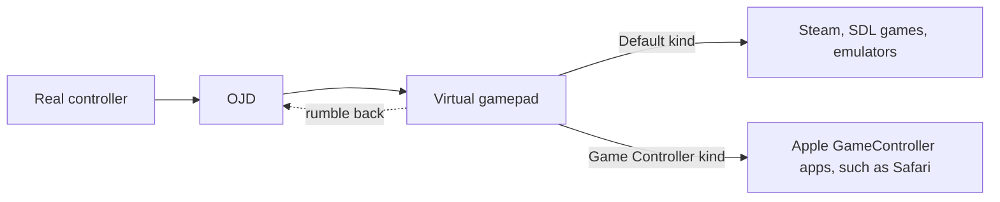
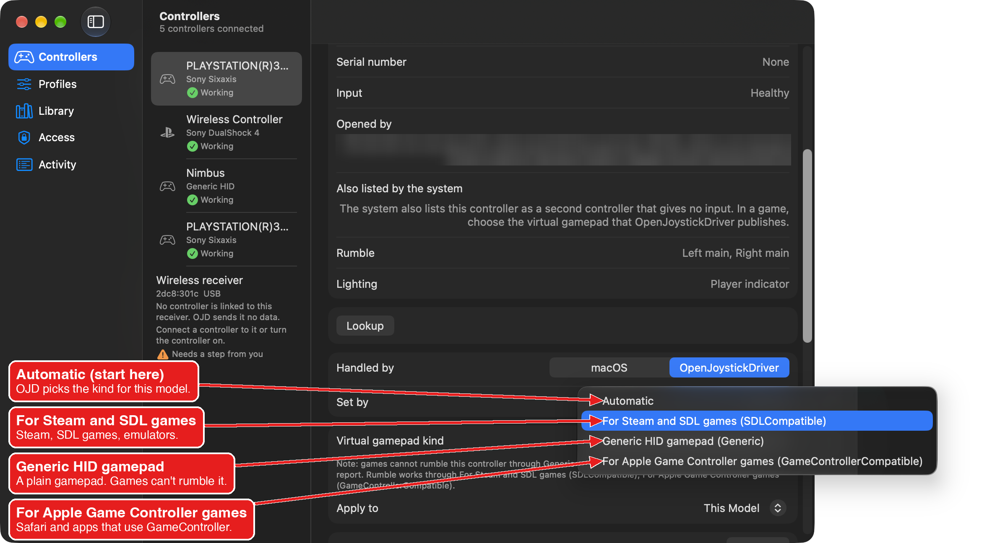
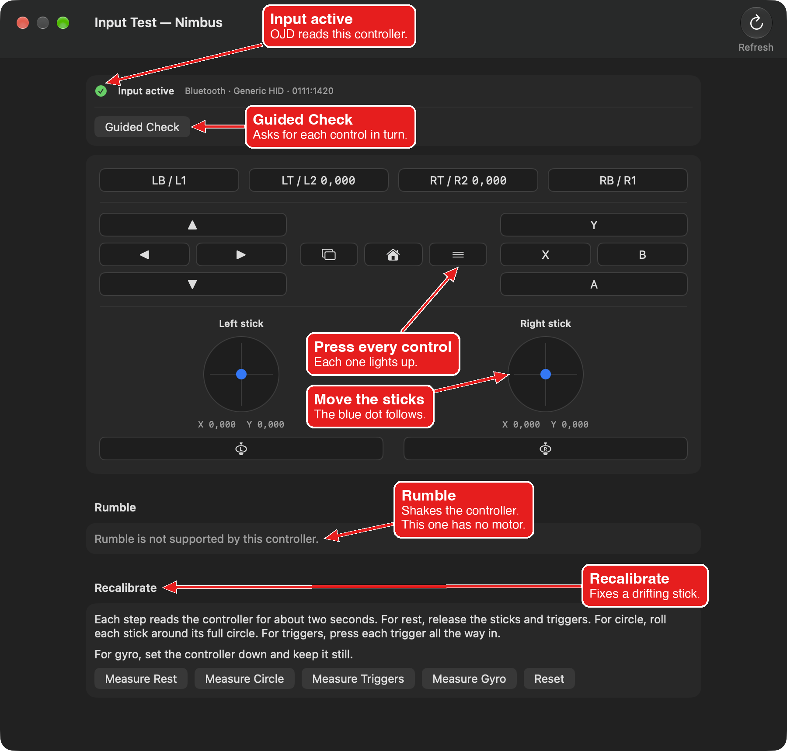

# Playing Games

See how games see your controller through OpenJoystickDriver (OJD), and what works.

OJD shows games a [virtual gamepad](Glossary.md#terms) they know. Connect the controller, then start a game.

## Contents

- [How Games See Your Controller](#how-games-see-your-controller)
- [Game and App Compatibility](#game-and-app-compatibility)
- [Launch Settings per App](#launch-settings-per-app)
- [Rumble and Lighting](#rumble-and-lighting)
- [Further Reading](#further-reading)

## How Games See Your Controller

Games read a stand-in, not your real controller. OJD makes one [virtual gamepad](Glossary.md#terms) per controller and copies each move to it.



### Virtual Gamepad Kinds

Each virtual gamepad has one of three [kinds](Glossary.md#terms).

| Kind | Shown to games as | ID | Rumble |
| --- | --- | --- | --- |
| Default | Xbox Wireless Controller, USB | `045E:0B13` | Yes |
| Game Controller | Xbox Wireless Controller, Bluetooth | `045E:0B13` | Yes |
| Generic | Generic HID Gamepad | `1209:4A4F` | No |
| Older Unity games | DualShock 4 Wireless Controller, USB | `054C:09CC` | Yes |

- Default: SDL 2 and SDL 3 games, Wine, and Apple's GameController framework see an Xbox pad. It has no Share button, and the left stick loses a little precision (full tilt reads about 99.6%). Home may open the macOS Game Overlay instead of reaching the game.
- Game Controller: for GameController apps that need Share or the full left stick precision. OJD never picks it. Run `ojd virtual set game-controller-compatible CONTROLLER`. SDL 2.30.12, as in CrossOver 26.3, reads every control from it; SDL 3 games and Steam read no input from it. For another SDL game, run `ojd virtual launch --sdl-gamecontroller-backend PROGRAM`.
- Generic: 16 buttons, no hat switch, so the D-pad uses four buttons.
- Older Unity games: for games built on InControl, such as Hollow Knight, Hollow Knight: Silksong, and Katana ZERO, which rumble on macOS only a DualShock 4 over USB. OJD never picks it. Run `ojd virtual set in-control-compatible CONTROLLER`. Apple's GameController framework sees a DualShock 4, and SDL's PS4 driver matches its ID. Games show PlayStation button names. It carries no touchpad, touch, or motion.



### Automatic Selection

OJD picks a kind per model, in this order:

1. Your override, if it fits the controller.
2. The default kind, if it fits the main controls.
3. The Generic kind.

Most controllers get the default kind. PCSX2 and DuckStation map all of it, rumble included, but none of the Generic kind.

A controller [Handled by macOS](Glossary.md#terms) gets no virtual gamepad.

### Change the Virtual Gamepad Kind for a Model

Change the kind only to test a problem, then [report the result](Reporting-a-Bug.md).

1. Click **Controllers**, then select your controller.
2. Expand **Advanced**.
3. Choose a kind from the **Virtual gamepad kind** pop-up menu.

Choose **Automatic** to undo. See [Controllers Area](Using-the-App.md#controllers-area).

## Game and App Compatibility

Sources: the maintainer (macOS 27) and one tester (macOS 26.7.1, ZD Ultimate Legend). No guarantees. "Not verified" means no hardware result.

### Results by Interface

| Interface | App | Result with the default kind |
| --- | --- | --- |
| OJD | Input Test | Works |
| macOS | **System Settings** Game Controllers | Not verified |
| Browser | Gamepad API | Not verified. With the Game Controller kind, Safari reads every button and rumbles. |
| Apple GameController | Probe (`just diagnose-gamecontroller`) | Reads every control but Home. |
| Apple GameController | Silksong (GOG) | Not verified. With the Game Controller kind, turn on the game's native gamepad option. |
| Native macOS games | Non-Steam native games | Works |
| SDL | Steam | Not verified |
| SDL3 | Probe (`just diagnose-sdl3`) | Reads every control, Guide included, with rumble. |
| Wine | CrossOver | CrossOver 26.3: XInput and DirectInput read every control, and XInput rumbles. Cave Story reads it. Wine ignores the pad for its first few seconds after it appears. |
| SDL | RPCS3 | Not verified |
| SDL2 | Games that bundle SDL 2 | SDL 2.30.12 reads every control. Not verified in a native game. |
| IOHIDManager | Super Meat Boy, Cuphead, LEGO Marvel's Avengers, older Unity or Feral ports | Does not work |

Two apps work better with the Generic kind:

| App | Result with the Generic kind |
| --- | --- |
| OpenEmu | Works. The default kind is not verified. |
| Steam | Needs **Begin Setup**. Skip the Guide step, because it opens Big Picture mode. One tester saw it erratic. |

### Start an App with the SDL Mapping

`ojd virtual launch PROGRAM` gives a program the SDL mapping of each virtual gamepad. Unverified on hardware. See [Command Reference](Command-Reference.md). To keep options per app, see [Launch Settings per App](#launch-settings-per-app).

### Launch Settings per App

Launch settings are the environment variables and arguments OJD adds when it starts one app through `ojd virtual launch`. They save you from typing the same launch options for each SDL game. The maintainer checked the stored variables, the hints and the arguments with a test app started the way Steam starts a game; a game started from Steam is untested.

**Key.** A setting belongs to one app. The key is the bundle identifier of the nearest enclosing `.app`. A program outside an `.app` is keyed by its absolute path. Choosing the `.app` and launching the program inside it, as Steam's `%command%` does, reach the same setting.

**Fields.**

- `sdlGameControllerBackend`: turns on the SDL GameController backend hints, as `--sdl-gamecontroller-backend` does.
- `environment`: variables added to the app's environment. A name starts with a letter or an underscore and holds only letters, digits, and underscores. Any other name is refused.
- `arguments`: arguments added after the ones you give on the command line.

**Merge order.**

1. The environment `ojd` runs with.
2. The stored `environment` over it.
3. The SDL mapping of each virtual gamepad, added after a stored `SDL_GAMECONTROLLERCONFIG`.
4. The backend hints, when the setting or the command line asks for them.

The `--sdl-gamecontroller-backend` option turns the hints on whatever the stored value is, and replaces a stored value of a hint. `--no-launch-settings` ignores the stored setting for one run.

**Set up in the app.**

1. Open **Controllers** and choose a controller that has a virtual gamepad.
2. In **Launch settings for apps**, choose **Add App...** and pick the `.app`.
3. Set the backend, the environment (one `NAME=VALUE` per line), and the arguments (one per line). Choose **Save**.
4. Choose **Copy Steam Launch Option**.
5. In Steam, open the game's **Properties** > **General** > **Launch Options** and paste the option.

The option reads `"PATH-OF-OJD" virtual launch -- %command%`, with the full path of the `ojd` link that runs the app: `/usr/local/bin/ojd`, or a link in `/opt/homebrew/bin` or `~/.local/bin`. Steam starts a game with a short `PATH`, so the option names the link in full. **Edit...** changes a setting. **Remove** deletes it. The **Launch** button of the app applies the stored settings too.

**Set up on the command line.**

```text
ojd virtual launch-setting set /Applications/Game.app --sdl-gamecontroller-backend --env SDL_VIDEODRIVER=cocoa --argument -windowed
ojd virtual launch-setting show /Applications/Game.app
ojd virtual launch-setting list
ojd virtual launch-setting remove /Applications/Game.app
```

Then set the Steam launch option once, as above. See [Command Reference](Command-Reference.md#virtual).

**Limits.**

- Settings apply only through `ojd virtual launch`.
- Each game needs the Steam launch option set once.
- Settings are environment variables and arguments only.
- An app opened from Finder, the Dock or Steam without the launch option gets no setting.
- A changed setting applies at the next launch.

**Steam and the pad.** Steam and OJD can't both read a USB pad: whichever starts first holds it. Start OJD first and it keeps the pad while Steam runs. Start Steam first and `ojd status` lists the pad under unsupported devices as `device-in-use`, **Used by** `steam_osx`; OJD serves it again as soon as Steam quits. The maintainer saw both orders with a Razer Wolverine Tournament Edition and an 8BitDo Ultimate 2C on macOS 27. Whether turning off Steam Input stops Steam from taking the pad is untested. See [Known Issues](Known-Issues.md#another-app-reads-a-usb-controller-directly) and [Does OJD Work with Steam?](FAQ.md#does-ojd-work-with-steam).

### Use Switch Pro Mode on One Controller

Switch Pro mode on the ZD Ultimate Legend made RPCS3, the browser, and System Settings work. macOS handles it, so OJD makes no virtual gamepad. HD Rumble drives only the linear haptics. Untested on other controllers.

## Rumble and Lighting

Rumble from a game reaches your controller. Lighting doesn't. Game rumble is untested on hardware.

The default and Game Controller kinds accept rumble. OJD sends a short command, then a stop.

The Generic kind has no rumble. When a controller with motors uses it, the picker, `ojd virtual show`, `ojd virtual set`, and `ojd controller show` name the kinds that can rumble. Their `--json` output has `gameRumbleUnavailable`.

Controllers without a motor ignore rumble. OJD sends no lightbar commands.

Input Test's **Rumble** and **Lighting** groups talk to the controller directly. Without rumble, the **Rumble** group says so. Without lighting, the **Lighting** group is missing. See [Testing a Controller](Testing-a-Controller.md).



## Further Reading

- [Game does not see the controller](Troubleshooting.md#game-does-not-see-the-controller)
- [Known issues](Known-Issues.md)
