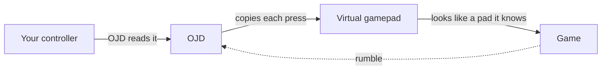
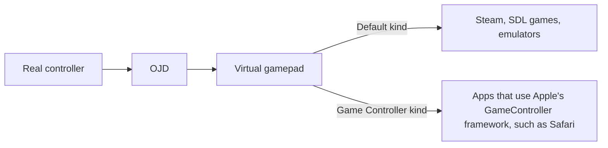

# Playing Games

See how games and apps see your controller through OpenJoystickDriver (OJD), which ones work, and what to expect from rumble.

- **Who:** anyone who wants to play with a controller on a Mac.
- **What:** how games see the controller, which games work, and what rumble does.
- **Where:** any game or app that reads gamepads, such as Steam.
- **Why:** many games only understand a few controller types, so OJD shows them one they know.
- **How:** connect the controller, then start the game; it sees a [virtual gamepad](Glossary.md#terms).

## Contents

- [How Games See Your Controller](#how-games-see-your-controller)
- [Game and App Compatibility](#game-and-app-compatibility)
- [Rumble and Lighting](#rumble-and-lighting)
- [Further Reading](#further-reading)

## How Games See Your Controller

Games don't read your real controller. OJD reads it and makes one [virtual gamepad](Glossary.md#terms) for each controller, and games read that. It works like a stand-in: you move the controller, and the stand-in copies each move for the game.

### Virtual Gamepad Kinds

Each virtual gamepad has one of three [kinds](Glossary.md#terms).

| Kind | Shown to games as | ID | Rumble |
| --- | --- | --- | --- |
| Default (Xbox-style) | Xbox Adaptive Controller, USB | `045E:0B0C` | Yes |
| Game Controller | Xbox Wireless Controller, Bluetooth | `045E:0B13` | Yes |
| Generic | OpenJoystickDriver Generic HID Gamepad, USB | `1209:4A4F` | No |

The default kind acts like an Xbox controller. SDL games, Steam, and emulators read it as an Xbox pad. Apple's GameController framework is the part of macOS that Safari and some Mac games use to read controllers. It doesn't see the default kind.

The Game Controller kind suits apps that use Apple's GameController framework. OJD never picks it for you. To choose it, run `ojd virtual set game-controller-compatible CONTROLLER`. SDL games and Steam read no input from it. To make another SDL game read it, start the game with `ojd virtual launch --sdl-gamecontroller-backend PROGRAM`.

The Generic kind is a plain HID gamepad with 16 buttons. HID is the standard way keyboards, mice, and gamepads talk to a computer. It has no hat switch, the control that reports the D-pad as one direction, so the D-pad uses four of the buttons.

You can see and change the kind in the **Controllers** area:

### Automatic Selection

OJD picks a kind for each controller model in this order:

1. Your override for the model, if the kind fits the controller.
2. The default kind, if it fits the main controls.
3. The Generic kind.

Most controllers get the default kind. In PCSX2 and DuckStation, it maps every control, including both rumble motors. The Generic kind gets no bindings there. The maintainer tested both on macOS 27.

OJD publishes no virtual gamepad for a controller that is [Handled by macOS](Glossary.md#terms). The controller's details say **Handled by macOS**.

### Change the Virtual Gamepad Kind for a Model

Change the kind only to test a problem, and report the result. See [Reporting a Bug](Reporting-a-Bug.md).

1. Click **Controllers** in the sidebar.
2. Select your controller.
3. Expand **Advanced**.
4. Choose a kind from the **Virtual gamepad kind** pop-up menu.

To remove the override, choose **Automatic**. It applies to every connected controller of the same model. See [Controllers Area](Using-the-App.md#controllers-area).

## Game and App Compatibility

Results come from the maintainer (macOS 27) and one tester (macOS 26.7.1, ZD Ultimate Legend). None is a guarantee. "Not verified" means no hardware result.

Each game reads controllers in one way, called an interface, and the interface decides whether the game sees the OJD virtual gamepad. OJD can't change how another app reads controllers.

### Results by Interface

| Interface | App | Result with the default kind |
| --- | --- | --- |
| OJD | Input Test | Works |
| macOS | Game Controllers in **System Settings** | Lists the Game Controller kind only |
| Browser | Gamepad API | Does not fully work. Chrome and Firefox misread some controls and give no rumble. Safari needs the Game Controller kind, which reads every button and moves the rumble motors. |
| Apple GameController | Silksong (GOG) | Use the Game Controller kind and turn on the game's native gamepad option |
| Native macOS games | Non-Steam native games | Works |
| SDL | Steam | Works. Steam lists it as "Xbox Adaptive Controller" and rumbles the motors. |
| Wine | CrossOver | Not verified. One tester saw no controller. |
| SDL | RPCS3 | Not verified |
| IOHIDManager or SDL2 | Super Meat Boy, Cuphead, LEGO Marvel's Avengers, older Unity or Feral ports | Does not work |

### Generic HID Results

| App | Result with the Generic kind |
| --- | --- |
| OpenEmu | Works. The default kind maps buttons wrongly. |
| Steam | Needs **Begin Setup**. Skip the Guide step, because it opens Big Picture mode. One tester saw it erratic. |

No setting fixes the failures above. See [How Games See Your Controller](#how-games-see-your-controller).

### Start an App with the SDL Mapping

`ojd virtual launch PROGRAM` runs a program with the SDL mapping of each virtual gamepad, so SDL in that program lists them. PCSX2 and DuckStation map the default kind without it, but not the Generic kind. This is not verified on hardware. See [Command Reference](Command-Reference.md).

### Use Switch Pro Mode on One Controller

The tester switched the ZD Ultimate Legend to Switch Pro mode. macOS then handles the controller, and OJD publishes no virtual gamepad. RPCS3, the browser, and System Settings work. HD Rumble drives only the linear haptics. This workaround is untested on other controllers.

## Rumble and Lighting

Rumble from a game reaches your controller. Lighting doesn't. Rumble in games is untested on real hardware.

### Rumble from Games

The default and Game Controller kinds accept rumble. OJD turns a game's rumble into a short command for the controller. When the rumble ends, OJD sends a stop.

The Generic kind has no rumble. When a controller with motors uses it, OJD tells you so. The virtual gamepad picker, `ojd virtual show`, `ojd virtual set`, and `ojd controller show` say games can't rumble it and name the kinds that can. The `--json` output of `ojd virtual show` and `ojd controller show` has `gameRumbleUnavailable`.

A controller without a motor ignores rumble, and so do generic gamepads. OJD passes no lightbar commands.

### Rumble from Input Test

Input Test has its own **Rumble** and **Lighting** groups. They talk to the controller directly. See [Testing a Controller](Testing-a-Controller.md).

### Identical Controllers

Two controllers with the same ID each get their own virtual gamepad. Each virtual gamepad has its own serial number and LocationID (the address macOS uses to tell devices apart). So a game's rumble reaches only the controller it was sent to.

## Further Reading

- [Game does not see the controller](Troubleshooting.md#game-does-not-see-the-controller)
- [Known issues](Known-Issues.md)
