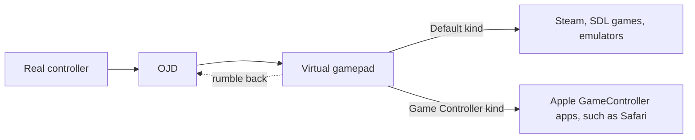

# Playing Games

See how games see your controller through OpenJoystickDriver (OJD), and what works.

OJD shows games a [virtual gamepad](Glossary.md#terms) they know. Connect the controller, then start a game.

## Contents

- [How Games See Your Controller](#how-games-see-your-controller)
- [Game and App Compatibility](#game-and-app-compatibility)
- [Rumble and Lighting](#rumble-and-lighting)
- [Further Reading](#further-reading)

## How Games See Your Controller

Games read a stand-in, not your real controller. OJD makes one [virtual gamepad](Glossary.md#terms) per controller and copies each move to it.

### Virtual Gamepad Kinds

Each virtual gamepad has one of three [kinds](Glossary.md#terms).

| Kind | Shown to games as | ID | Rumble |
| --- | --- | --- | --- |
| Default | Xbox Adaptive Controller, USB | `045E:0B0C` | Yes |
| Game Controller | Xbox Wireless Controller | `045E:0B13` | Yes |
| Generic | Generic HID Gamepad | `1209:4A4F` | No |

- Default: SDL games, Steam, and emulators see an Xbox pad. Apple's GameController framework (Safari, some Mac games) doesn't see it.
- Game Controller: for apps that use that framework. OJD never picks it. Run `ojd virtual set game-controller-compatible CONTROLLER`. SDL games and Steam read no input from it. For another SDL game, run `ojd virtual launch --sdl-gamecontroller-backend PROGRAM`.
- Generic: 16 buttons, no hat switch, so the D-pad uses four buttons.

### Automatic Selection

OJD picks a kind per model, in this order:

1. Your override, if it fits the controller.
2. The default kind, if it fits the main controls.
3. The Generic kind.

Most controllers get the default kind. PCSX2 and DuckStation map all of it, rumble included, but none of the Generic kind.

A controller [Handled by macOS](Glossary.md#terms) gets no virtual gamepad.

### Change the Virtual Gamepad Kind for a Model

Change the kind only to test a problem, then [report the result](Reporting-a-Bug.md).

1. Click **Controllers**, then select your controller.
2. Expand **Advanced**.
3. Choose a kind from the **Virtual gamepad kind** pop-up menu.

Choose **Automatic** to undo. See [Controllers Area](Using-the-App.md#controllers-area).

## Game and App Compatibility

Sources: the maintainer (macOS 27) and one tester (macOS 26.7.1, ZD Ultimate Legend). No guarantees. "Not verified" means no hardware result.

### Results by Interface

| Interface | App | Result with the default kind |
| --- | --- | --- |
| OJD | Input Test | Works |
| macOS | **System Settings** Game Controllers | Lists the Game Controller kind only |
| Browser | Gamepad API | Chrome and Firefox misread some controls, no rumble. Safari needs the Game Controller kind, which reads every button and rumbles. |
| Apple GameController | Silksong (GOG) | Use the Game Controller kind. Turn on the game's native gamepad option. |
| Native macOS games | Non-Steam native games | Works |
| SDL | Steam | Works, with rumble. Listed as "Xbox Adaptive Controller". |
| Wine | CrossOver | Not verified. One tester saw no controller. |
| SDL | RPCS3 | Not verified |
| IOHIDManager or SDL2 | Super Meat Boy, Cuphead, LEGO Marvel's Avengers, older Unity or Feral ports | Does not work |

With the Generic kind, OpenEmu works (the default kind maps its buttons wrongly). Steam needs **Begin Setup**: skip the Guide step, because it opens Big Picture mode. One tester saw it erratic.

### Start an App with the SDL Mapping

`ojd virtual launch PROGRAM` gives a program the SDL mapping of each virtual gamepad. Unverified on hardware. See [Command Reference](Command-Reference.md).

### Use Switch Pro Mode on One Controller

Switch Pro mode on the ZD Ultimate Legend made RPCS3, the browser, and System Settings work. macOS handles it, so OJD makes no virtual gamepad. HD Rumble drives only the linear haptics. Untested on other controllers.

## Rumble and Lighting

Rumble from a game reaches your controller. Lighting doesn't. Game rumble is untested on hardware.

The default and Game Controller kinds accept rumble. OJD sends a short command, then a stop.

The Generic kind has no rumble. When a controller with motors uses it, the picker, `ojd virtual show`, `ojd virtual set`, and `ojd controller show` name the kinds that can rumble. Their `--json` output has `gameRumbleUnavailable`.

Controllers without a motor ignore rumble. OJD sends no lightbar commands.

Input Test's **Rumble** and **Lighting** groups talk to the controller directly. See [Testing a Controller](Testing-a-Controller.md).

## Further Reading

- [Game does not see the controller](Troubleshooting.md#game-does-not-see-the-controller)
- [Known issues](Known-Issues.md)
