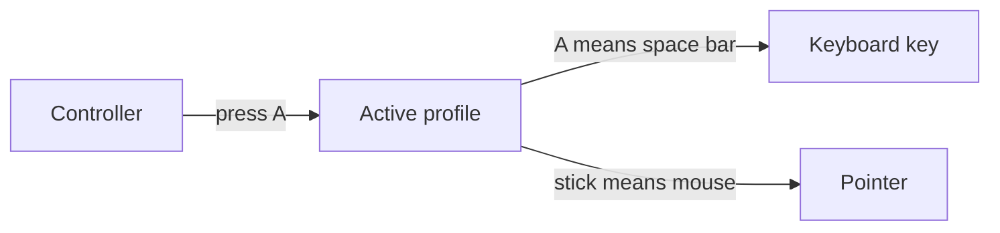
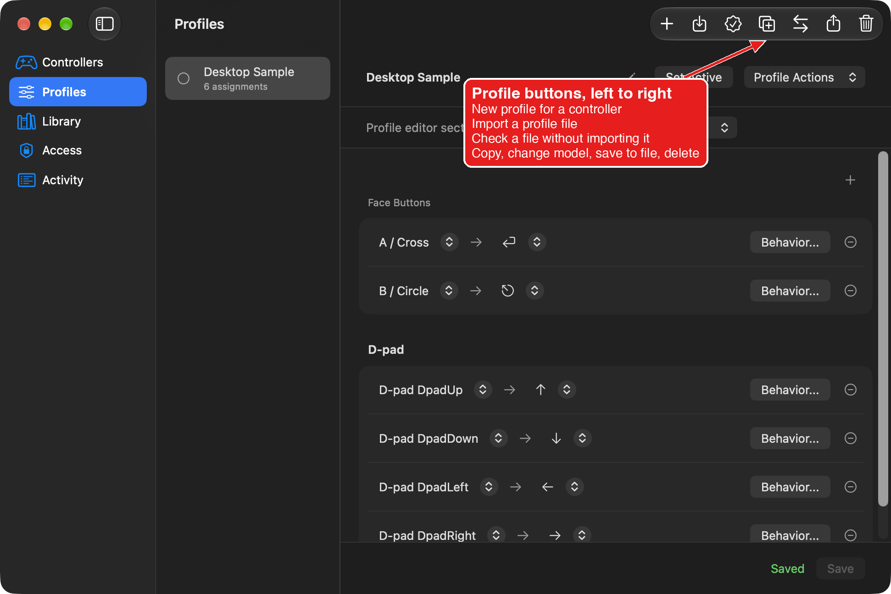

# Profiles

A [profile](Glossary.md#terms) is your own button layout. It changes what buttons, sticks, triggers, touchpad, and motion do. Example: A presses the space bar.



## Contents

- [About Profiles](#about-profiles)
- [Creating a Profile](#creating-a-profile)
- [Importing and Exporting Profiles](#importing-and-exporting-profiles)
- [Further Reading](#further-reading)

## About Profiles

A profile is a cheat sheet for OpenJoystickDriver (OJD): "press this, do that". It fits one controller model.

### What a Profile Contains

A name, a controller model (find the [ID](Connecting-Controllers.md#finding-your-controller-id)), and a scope: **All Applications** works everywhere, **One Application** only while your app is in front. It can also hold rules, chords, sequences, layers, stick, trigger, touch, and motion settings, an output policy, and a light color.

### The Active Profile

A profile does nothing until you activate it. One model gets one active profile per scope. OJD picks:

1. The latest activated profile matching the front app.
2. The latest activated global profile.
3. The latest activated profile for the model, even if its app is not in front.

With none active, the controller goes straight to the [virtual gamepad](Glossary.md#terms).

A button can switch profiles: see [Switch profiles, set layers, and pause](Bindings-and-Actions.md#switch-profiles-set-layers-and-pause).

See it under **Controllers** > your controller > **Active profile**. **Selected by app** means rule 1 chose it. OJD reads the front app on connect and profile change. App switches are untested.

### Output Policy

Shown only in the **All Controls** interface.

| Virtual gamepad setting | Meaning |
| --- | --- |
| **Disabled** | Keyboard and mouse only. |
| **Mapped Controls Only** | Only controls with rules. |
| **Include Unmapped Controls** | Every control (the start value). |

**Hide controller from other apps** keeps the real controller to OJD. Virtual gamepad output needs it. Keyboard and pointer output needs Accessibility access ([Permissions](Permissions-and-Security.md)).

## Creating a Profile

Connect the controller, then click **Profiles**.



### Create a Profile in the App

1. Click **New Profile** in the toolbar.

   

2. Type a **Profile name** and choose the **Controller**.
3. Choose a **Target**: **All Applications** or **One Application** (then choose the app). See [About profiles](#about-profiles).
4. Optionally choose a **Template**.
5. Click **Create**.

Templates: **Empty** (no assignments, **Not active**), **Keyboard Navigation** (D-pad, South, East press navigation keys), **Mouse Clicks** (South, East, North press mouse buttons), **Gyro to Stick** (see [Create a Gyro to Stick Profile](Sticks-Triggers-Touchpad-and-Motion.md#create-a-gyro-to-stick-profile)).

To load a file, see [Importing and exporting profiles](#importing-and-exporting-profiles).

### Create a Profile With the Command Line

```shell
ojd profile create "My controller" --controller 045E:02FD
```

It needs the running app and starts inactive. For `--app`, `--template`, and more, see [Command reference](Command-Reference.md).

### Activate a Profile

Click **Set Active**.

With no output, the app asks **Activate profile with no controller input?**. To restore default input first, choose **Restore Default Input** in **Profile Actions**.

**Deactivate** turns it off. **Deactivate All** in **Profile Actions** turns off every profile for the controller.

```shell
ojd profile activate "My controller"
ojd profile deactivate "My controller"
```

- `activate` refuses a profile with no output unless you add `--allow-empty`.
- Profiles that open apps or URLs, run shortcuts, or type text need `--confirm-actions`. **Set Active** asks first.
- Paired Joy-Con profiles have no **Set Active** button. See [Sticks, triggers, touchpad, and motion](Sticks-Triggers-Touchpad-and-Motion.md).

### Save, Rename, Copy, Delete

| Task | App | Command line |
| --- | --- | --- |
| Save | Click **Save**. If another process changed the profile, click **Reload** or **Keep Editing**. | |
| Rename, or change controller or scope | Click **Profile Details** (the pencil), change **Profile name**, **Vendor ID**, **Product ID**, or **Target**. For **One Application**, use **Add App**, **Other...**, or **Remove**. Click **Apply**, then **Save**. | `ojd profile rename PROFILE NEW-NAME` or `ojd profile edit PROFILE`. See [Profile file reference](Profile-File-Reference.md). |
| Duplicate | Click **Duplicate** (copy: `NAME Copy`). | `ojd profile duplicate PROFILE NEW-NAME` |
| Delete | Click **Delete**, then confirm. | `ojd profile delete PROFILE` |

### Clear All Assignments

1. Open **Profile Actions**.
2. Choose **Remove All Assignments...** (removes assignments, chords, sequences, and layers; stick, trigger, touch, and motion settings stay) or **Clear All Inputs...** (clears those too).
3. Confirm the alert.

**Restore Default Input** returns to pass-through. Command line: `ojd binding clear PROFILE --all` matches **Remove All Assignments...**, and `ojd profile set PROFILE outputPolicy.virtualGamepad Passthrough` restores pass-through.

## Importing and Exporting Profiles

Export saves a file to keep, share, or move to another Mac.

### Export a Profile

1. Select the profile, then click **Export Profile** (or File > **Export Profile...**).
2. Choose a folder and file name, then click **Save**.

```shell
ojd profile export PROFILE --output FILE.plist
```

### Import a Profile

1. Click **Import Profile** (or File > **Import Profile...**).
2. Select a file and click **Open**.

```shell
ojd profile import FILE.plist
```

OJD refuses unknown settings, out-of-range numbers, or a file above 4 MiB.

### What Happens on Import

- Same ID: replaced.
- Unknown ID: added.
- Same name, different profile: rejected.
- Replaced profile was active and the import has another model: OJD deactivates it.

Imported profiles start inactive. [Activate](#activate-a-profile) one.

### Recover Damaged Profile Files

Unreadable files show in Settings and `ojd profile list`. See [Profile file reference](Profile-File-Reference.md#damaged-files).

1. Run `ojd profile list` to see each damaged file.
2. Run `ojd profile recover --dry-run` to preview (changes nothing).
3. Run `ojd profile recover`, and confirm if asked.

It backs up, then removes each damaged file and resets a damaged active profile list. Without a terminal, add `--force`.

## Further Reading

- [Profile file reference](Profile-File-Reference.md)
- [Troubleshooting](Troubleshooting.md)
