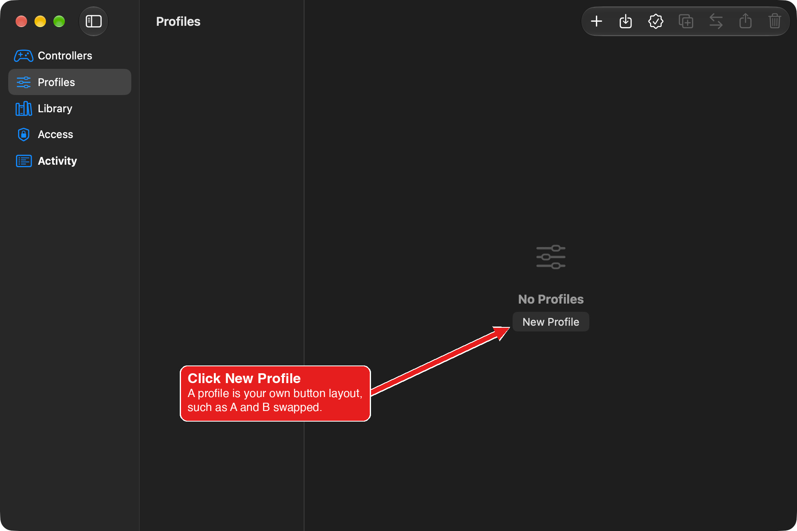

# Profiles

Use [profiles](Glossary.md#terms) to change what the buttons, sticks, triggers, touchpad, and motion sensors of your controller do.

## Contents

- [About Profiles](#about-profiles)
- [Creating a Profile](#creating-a-profile)
- [Importing and Exporting Profiles](#importing-and-exporting-profiles)
- [Further Reading](#further-reading)

## About Profiles

A profile is a saved set of rules for one controller model. A rule can make a button press a key, move the pointer, or scroll.

### What a Profile Contains

Each profile has a name, a controller model, and an application scope. For the controller ID, see [Finding your controller ID](Connecting-Controllers.md). A profile can also hold assignments, chords, sequences, layers, stick, trigger, touch, and motion settings, an output policy, and a lighting color. It applies to every connected controller of its model.

### Scope

**All Applications** works in every app. **One Application** works only while an app you list is in front.

### The Active Profile

A profile does nothing until you activate it. One model can have one active profile for each scope. OpenJoystickDriver (OJD) picks the profile for a controller in this order:

1. The most recently activated profile whose scope matches the front app.
2. The most recently activated global profile.
3. The most recently activated profile for the model, even if its app is not in front.

If none is active, OJD passes the controller through to the [virtual gamepad](Glossary.md#terms).

A button can change the active profile. See [Switch profiles, set layers, and pause](Bindings-and-Actions.md#switch-profiles-set-layers-and-pause).

To see the active profile, select the controller in **Controllers** and read **Active profile**. **Selected by app** names the front app when rule 1 chose it. OJD reads the front app when a controller connects and when you change a profile. Whether it re-checks when you switch apps is untested.

> [!WARNING]
> Do not activate a second global profile for a model that already has one. Two active global profiles for one model crash the app at every launch. See [Known issues](Known-Issues.md).

### Output Policy

The output policy decides how a profile sends its results. Its pickers show only in the **All Controls** interface.

| Setting | Values | Meaning |
| --- | --- | --- |
| Virtual gamepad | **Disabled**, **Mapped Controls Only**, **Include Unmapped Controls** | Whether OJD publishes a virtual gamepad |
| **Require exclusive physical input** | Off, On | Whether OJD takes exclusive ownership of the physical input |

**Disabled** sends keyboard and pointer events only. **Mapped Controls Only** sends only the destinations you assigned. **Include Unmapped Controls** also forwards the rest. Virtual gamepad output needs exclusive physical input. A profile you create starts with **Include Unmapped Controls** and no assignments, unless you pick a template.

Keyboard and pointer output needs Accessibility access. See [Permissions](Permissions-and-Security.md).

## Creating a Profile

### Before You Begin

Connect the controller the profile is for, then click **Profiles** in the sidebar.

### Create a Profile In the App

1. In the toolbar, click **New Profile**. With no profiles yet, the button also appears in the middle of the window.

   

2. Type a **Profile name**.
3. Choose the controller from the **Controller** list.
4. Choose a **Target**: **All Applications** or **One Application**. For **One Application**, choose the app. See [About profiles](#about-profiles).
5. Optionally choose a **Template**: **Empty**, **Gyro to Stick**, **Keyboard Navigation**, or **Mouse Clicks**.
6. Click **Create**.

A profile from **Empty** has no assignments and shows **Not active**. **Keyboard Navigation** binds the D-pad, South, and East to navigation keys. **Mouse Clicks** binds South, East, and North to the mouse buttons. For **Gyro to Stick**, see [Create a Gyro to Stick Profile](Sticks-Triggers-Touchpad-and-Motion.md#create-a-gyro-to-stick-profile).

The **Sort by** menu orders profiles by **Name**, **Controller**, or **Last Used**. To import a profile instead, see [Importing and exporting profiles](#importing-and-exporting-profiles).

### Create a Profile With the Command Line

```shell
ojd profile create "My controller" --controller 045E:02FD
```

The command needs the running app, and the profile starts inactive. For options such as `--app` and `--template`, see [Command reference](Command-Reference.md).

### Activate a Profile

Select the profile and click **Set Active**.

If the profile produces no output, the app asks **Activate profile with no controller input?**. To restore default input first, choose **Restore Default Input** from the **Profile Actions** menu.

To deactivate the profile, click **Deactivate**. **Deactivate All** in the **Profile Actions** menu deactivates every profile for the controller.

The command line equivalents are:

```shell
ojd profile activate "My controller"
ojd profile deactivate "My controller"
```

`activate` refuses a profile that produces no output unless you add `--allow-empty`. A profile that opens apps or URLs, runs shortcuts, or types text needs `--confirm-actions`. **Set Active** asks first. Paired Joy-Con profiles have no **Set Active** button. See [Sticks, triggers, touchpad, and motion](Sticks-Triggers-Touchpad-and-Motion.md).

### Save Changes

Click **Save** to store your edits. The editor shows **Unsaved changes**, **Saving...**, **Saved**, or **Save failed**. If another process changes the profile, click **Reload** or **Keep Editing**.

### Rename a Profile or Change Its Controller or Scope

1. Select the profile.
2. Click **Profile Details** (the pencil button).
3. Change **Profile name**, **Vendor ID**, **Product ID**, or **Target**.
4. For **One Application**, open **Add App** and choose an app, or **Other...**. Click **Remove** beside an app to drop it.
5. Click **Apply**, then **Save**.

On the command line, run `ojd profile rename PROFILE NEW-NAME`, or `ojd profile edit PROFILE` to change the controller or app. See [Profile file reference](Profile-File-Reference.md).

### Duplicate a Profile

Select the profile and click **Duplicate**.

The copy is named `NAME Copy`. On the command line, run `ojd profile duplicate PROFILE NEW-NAME`.

### Delete a Profile

Select the profile, click **Delete**, and confirm.

On the command line, run `ojd profile delete PROFILE`.

### Clear All Assignments

1. Open the **Profile Actions** menu.
2. Choose **Remove All Assignments...** to remove every assignment, chord, sequence, and layer. Stick, trigger, touch, and motion settings stay. **Clear All Inputs...** clears those too.
3. Confirm the alert.

To return to pass-through, choose **Restore Default Input**. On the command line, `ojd binding clear PROFILE --all` matches **Remove All Assignments...**, and `ojd profile set PROFILE outputPolicy.virtualGamepad Passthrough` restores pass-through.

## Importing and Exporting Profiles

Export a profile to keep, share, or move it. Import loads one from a file.

### Export a Profile

1. Select the profile in **Profiles**.
2. Click **Export Profile**, or choose File > **Export Profile...**.
3. Choose a folder and file name, then click **Save**.

On the command line (see [Using the command line](Command-Line.md)):

```shell
ojd profile export PROFILE --output FILE.plist
```

### Import a Profile

1. In **Profiles**, click **Import Profile**, or choose File > **Import Profile...**.
2. Select a profile file and click **Open**.

On the command line:

```shell
ojd profile import FILE.plist
```

OJD checks the file first and rejects one with unknown keys, out-of-range values, or a size above 4 MiB.

### What Happens On Import

- A profile with the same ID is replaced.
- A profile with an unknown ID is added.
- If a different profile has the same name, OJD rejects the import.
- If the replaced profile was active and the import has another controller model, OJD deactivates it.

An imported profile is not active until you [activate it](#activate-a-profile).

### Recover Damaged Profile Files

OJD skips a profile file it cannot read and reports it in Settings and in `ojd profile list`. See [Profile file reference](Profile-File-Reference.md#damaged-files).

1. Run `ojd profile list` to see each damaged file.
2. Run `ojd profile recover --dry-run` to preview. This changes nothing.
3. Run `ojd profile recover`, and confirm if asked.

The command removes each damaged file and resets a damaged active profile list, after saving a backup beside each. Without a terminal, add `--force`.

## Further Reading

- [Profile file reference](Profile-File-Reference.md)
- [Bindings and actions](Bindings-and-Actions.md)
- [Sticks, triggers, touchpad, and motion](Sticks-Triggers-Touchpad-and-Motion.md)
- [How games see your controller](Playing-Games.md)
- [Known issues](Known-Issues.md)
- [Troubleshooting](Troubleshooting.md)
