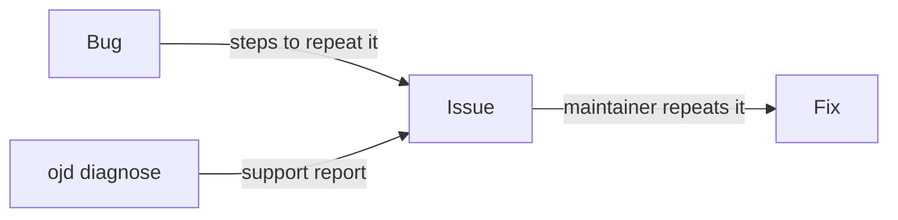

# Reporting a Bug

Found a bug? Tell the maintainer on the [issue tracker](https://github.com/xsyetopz/OpenJoystickDriver/issues). First check [Known Issues](Known-Issues.md) and [Troubleshooting](Troubleshooting.md).



## What To Include

1. Controller model, connection (USB, Bluetooth, dongle), and ID such as `045E:02D1`. See [Finding Your Controller ID](Connecting-Controllers.md#finding-your-controller-id).
2. macOS and OJD versions. Choose OpenJoystickDriver > **About OpenJoystickDriver**.
3. What you did, expected, and saw.
4. A support report.
5. Logs, if the app quit or showed an error.

With a tester build, attach `OpenJoystickDriver-TESTER-BUILD.txt` from the DMG and name the build you tested.

## Create a Support Report

In Terminal, with the [`ojd` command](Command-Line.md#run-a-command):

```shell
ojd diagnose --output support-report.json
```

Or choose **Help** > **Copy Support Report**.


It leaves out serial numbers, file paths, and packet contents, but includes product names. Read it first.

Lag? Run it right after, so the report holds the timings.

## Run a Guided Check

A control dead or acting as another? Run **Guided Check** in the Input Test window, or `ojd controller check <controller> --json > check.json`.

At the end, click **Open Issue**. OJD saves the result and opens the support form filled in. Attach the file. See [Testing a Controller](Testing-a-Controller.md#guided-check).

## Get the Logs

The log is OJD's diary. Open **Activity** and choose **Log**, or choose **Help** > **Activity Log**.


Or run `ojd log show --lines 200`. Logs may contain device names and paths. Read them first.

## Capture Packets

Packets are the small messages a controller sends. A capture is a voice memo of them. If a controller fails, press each control while this runs, and write down the order:

```shell
ojd controller capture <controller> --duration 10 --json > capture.jsonl
```

## Gather Data From Other Systems

The maintainer owns few controllers, so your files are all they have. Windows and Linux show what macOS hides: descriptors (the controller's built-in button list), first packets, and the driver. Attach what you can, and name the controller's mode.

On macOS:

- HID report descriptor: `ioreg -r -c IOHIDDevice -l -w0 > ioreg-hid.txt`. Your controller's `ReportDescriptor` line is the descriptor.
- USB tree: `ioreg -p IOUSB -l -w0 > ioreg-usb.txt`.
- Draft record, pressing each control: `ojd record draft <controller> > draft.plist`.
- Bluetooth packets: PacketLogger from Apple's Additional Tools for Xcode.

On Linux:

- Descriptors: `sudo lsusb -v -d VVVV:PPPP > lsusb.txt`.
- HID descriptor and reports: `sudo hid-recorder` from [hid-tools](https://gitlab.freedesktop.org/libevdev/hid-tools). Pick your device, press each control.
- USB packets: `sudo modprobe usbmon`, then capture the controller's `usbmonX` interface in Wireshark before you plug it in. Save as `.pcapng`.
- Plug-in log: `sudo dmesg | tail -50`, plus the driver that bound (`xpad`, `hid-generic`).

On Windows:

- Hardware IDs: **Device Manager** > the controller > **Properties** > **Details** > **Hardware Ids**.
- Descriptors: USB Device Tree Viewer dump.
- USB packets: [USBPcap](https://desowin.org/usbpcap/) with Wireshark. Start on the controller's root hub, then plug it in.

Link what others found: entries in Linux drivers (`xpad.c`, `hid-*.c`), SDL (`controller_list.h`, SDL_GameControllerDB), Steam Input, or other drivers; threads naming the firmware version and mode; the maker's mode manual.

GPL driver links are welcome. OJD takes IDs and byte values from them and writes its own code.
