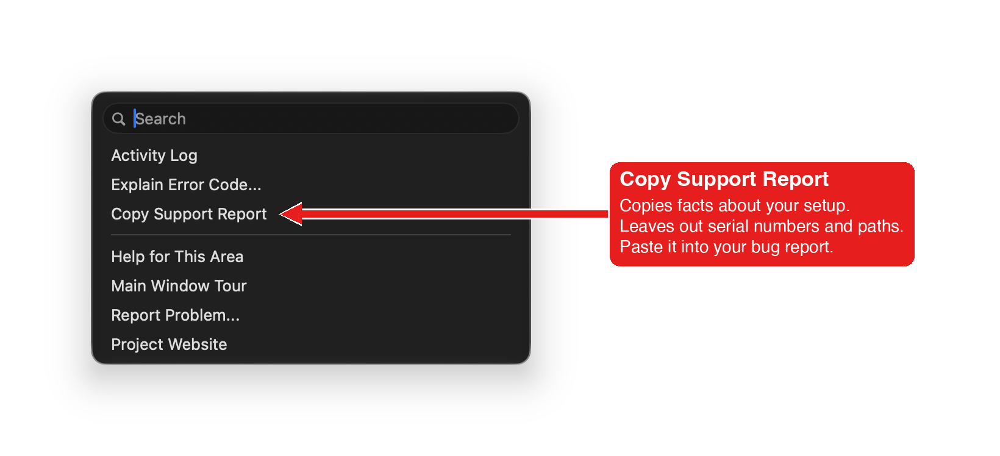

# Reporting a Bug

Send reports to the [issue tracker](https://github.com/xsyetopz/OpenJoystickDriver/issues) so the maintainer can reproduce the problem.

## What To Include

1. The controller model, the connection (USB, Bluetooth, or dongle), and the controller's ID, such as `045E:02D1`. See [Finding Your Controller ID](Connecting-Controllers.md#finding-your-controller-id).
2. The macOS version and the OJD version. Choose OpenJoystickDriver > **About OpenJoystickDriver**.
3. What you did, what you expected, and what happened.
4. A support report.
5. Logs, if the app quit or showed an error.

With a tester build, attach `OpenJoystickDriver-TESTER-BUILD.txt` from the DMG. Name the build you tested and any later build that fixed the problem.

## Create a Support Report

Run this in Terminal. It needs the [`ojd` command](Command-Line.md#run-a-command).

```shell
ojd diagnose --output support-report.json
```

Or choose **Help** > **Copy Support Report**.



The report leaves out serial numbers, file paths, and packet contents. It includes your controllers' product names. Read it before you share it.

For a stutter or latency report, run the command right after the stutter. The report then holds frame timings.

## Run a Guided Check

If a control doesn't respond, or acts as another control, run **Guided Check** in the Input Test window. Or run `ojd controller check <controller> --json > check.json`. The check asks you to move each control in turn.

When it ends, click **Open Issue**. OJD saves the result and opens the support form with your details filled in. Attach the saved file. See [Testing a Controller](Testing-a-Controller.md#guided-check).

If every control responded, **Validate** offers the result as a community validation.

## Get the Logs

Open **Activity** and choose **Log**, or choose **Help** > **Activity Log**. Or run:

```shell
ojd log show --lines 200
```

Logs may contain device names and paths. Read them before you share them.

## Capture Packets

For a controller that works wrongly or not at all, attach a packet capture. Run this while you press each control, and say in what order:

```shell
ojd controller capture <controller> --duration 10 --json > capture.jsonl
```

Attach the file. Check it before you share it.

## Gather Data From Other Systems

The maintainer has a few controllers. For the rest, your data is the only data. A controller that works on Windows or Linux shows there what macOS hides: its descriptors, its startup packets, and the driver that serves it. Attach each file you can make, and say which mode or switch setting the controller was in.

On macOS:

- The HID report descriptor: `ioreg -r -c IOHIDDevice -l -w0 > ioreg-hid.txt`. The `ReportDescriptor` line of your controller is the descriptor.
- The USB tree: `ioreg -p IOUSB -l -w0 > ioreg-usb.txt`.
- A draft record: `ojd record draft <controller> > draft.plist`, while you press each control.
- Bluetooth packets: PacketLogger from Apple's Additional Tools for Xcode.

On Linux:

- The descriptors: `sudo lsusb -v -d VVVV:PPPP > lsusb.txt`.
- The HID report descriptor and reports: `sudo hid-recorder` from [hid-tools](https://gitlab.freedesktop.org/libevdev/hid-tools). Run it without arguments to list the devices, then pick yours and press each control.
- USB packets: `sudo modprobe usbmon`, then capture the `usbmonX` interface of the controller's bus in Wireshark, from before you plug the controller in. Save it as `.pcapng`.
- The kernel log of the plug-in: `sudo dmesg | tail -50`, and the name of the driver that bound, such as `xpad` or `hid-generic`.

On Windows:

- The hardware IDs: **Device Manager** > the controller > **Properties** > **Details** > **Hardware Ids**.
- The descriptors: a dump from USB Device Tree Viewer.
- USB packets: [USBPcap](https://desowin.org/usbpcap/) with Wireshark. Start the capture on the controller's root hub, then plug the controller in, so the file holds the descriptors and the startup packets.

Also collect what others have found about the controller, with links:

- Its entry in Linux drivers (`xpad.c`, `hid-*.c`), SDL (`controller_list.h`, SDL_GameControllerDB), Steam Input, or other driver projects.
- Issues, forum threads, and reviews about it, with the firmware version and mode they name.
- The maker's manual page on modes and button combinations.
- The firmware version, and the app that updates it.

Links to GPL drivers are welcome. OJD takes facts from them, such as IDs and byte values, and writes its own code.

## Further Reading

- [Known issues](Known-Issues.md)
- [Command reference](Command-Reference.md)
- [Supported controllers](Supported-Controllers.md)
